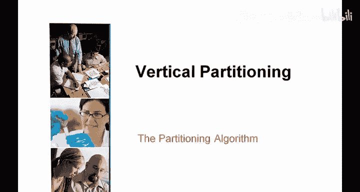
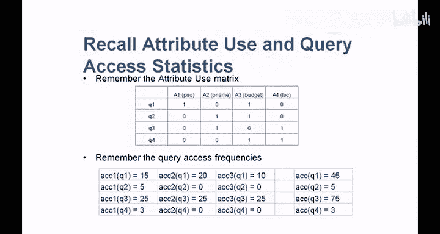
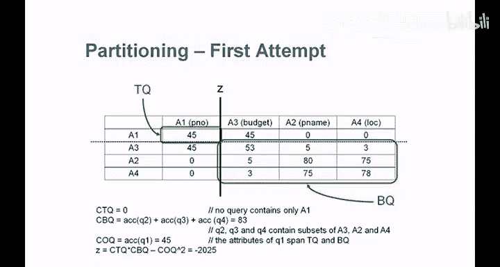
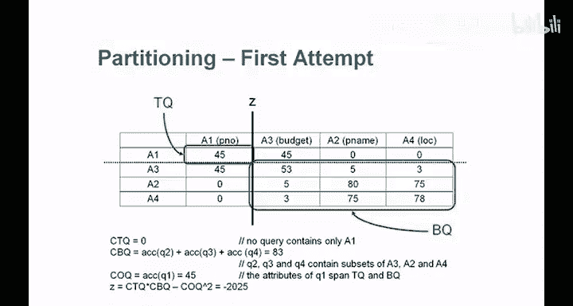
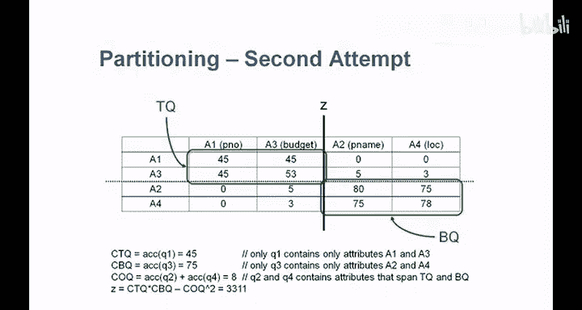
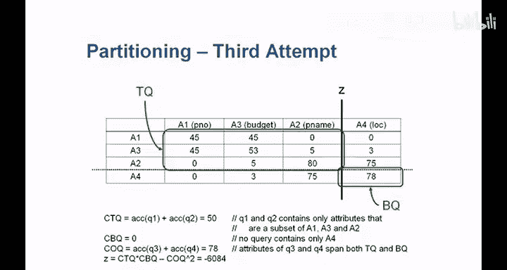
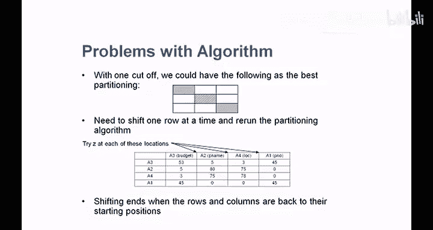

# 017：垂直分区算法 🧩

在本节课中，我们将学习如何通过算法自动确定垂直分区的最佳方案。当属性数量众多时，仅凭观察亲和度矩阵来划分列变得非常困难。因此，我们需要一个系统化的方法来找到最优分区点。

上一节我们介绍了集群亲和度矩阵的概念，本节中我们来看看如何利用查询访问频率等数据，通过算法找到最佳分区点。

## 算法概述

垂直分区算法的目标是找到一种列的分组方式，使得经常在查询中共同使用的属性被分到同一个片段（表）中。其核心思想是评估在亲和度矩阵的每一列之间进行“切割”的收益。

我们通过一个称为 **Z值** 的度量来评估每个潜在切割点的优劣。Z值的计算公式如下：

**Z = CTQ × CBQ - COQ²**

其中：
*   **CTQ**：只访问“顶部”片段（切割点左侧列）中属性的所有查询的总访问频率。
*   **CBQ**：只访问“底部”片段（切割点右侧列）中属性的所有查询的总访问频率。
*   **COQ**：必须同时访问顶部和底部片段中属性的所有查询的总访问频率。

我们的目标是**最大化Z值**。Z值越高，意味着该切割点能更好地将高频共同访问的属性聚集在一起，同时减少需要跨片段访问的查询。

## 算法步骤演示

我们通过一个具体的例子来演示算法的计算过程。假设我们有属性A1, A2, A3, A4，以及四个查询及其每小时的总访问频率：

*   Q1 使用属性 {A1, A3}， 访问频率 = 45
*   Q2 使用属性 {A2, A3}， 访问频率 = 5
*   Q3 使用属性 {A2, A4}， 访问频率 = 75
*   Q4 使用属性 {A3, A4}， 访问频率 = 3

我们已获得其集群亲和度矩阵，列顺序为 A1, A3, A2, A4。现在，我们尝试在不同的列之间进行切割。

### 尝试1：在A1和A3之间切割（Z1）

假设切割点在A1列之后。这意味着：
*   **顶部片段（T）** 包含列：A1
*   **底部片段（B）** 包含列：A3, A2, A4

以下是计算过程：
*   **CTQ**：查找只访问A1（即仅属于顶部片段）的查询。没有这样的查询。因此 CTQ = 0。
*   **CBQ**：查找只访问{A3, A2, A4}中任意子集（即仅属于底部片段）的查询。符合的查询有Q2、Q3、Q4。CBQ = 5 + 75 + 3 = 83。
*   **COQ**：查找必须同时访问A1和{A3, A2, A4}中属性的查询。符合的查询是Q1（使用了A1和A3）。COQ = 45。

计算Z值：
**Z1 = 0 × 83 - 45² = -2025**

这个负值很大，表明在A1和A3之间切割是一个糟糕的选择。

### 尝试2：在A3和A2之间切割（Z2）

现在，将切割点移动到A3列之后。这意味着：
*   **顶部片段（T）** 包含列：A1, A3
*   **底部片段（B）** 包含列：A2, A4

以下是计算过程：
*   **CTQ**：只访问{A1, A3}的查询。符合的查询是Q1。CTQ = 45。
*   **CBQ**：只访问{A2, A4}的查询。符合的查询是Q3。CBQ = 75。
*   **COQ**：必须同时访问{A1, A3}和{A2, A4}的查询。符合的查询是Q2（使用A2,A3）和Q4（使用A3,A4）。COQ = 5 + 3 = 8。

计算Z值：
**Z2 = 45 × 75 - 8² = 3375 - 64 = 3311**

这个Z值非常高，是一个非常好的候选切割点。

### 尝试3：在A2和A4之间切割（Z3）

最后，将切割点移动到A2列之后。这意味着：
*   **顶部片段（T）** 包含列：A1, A3, A2
*   **底部片段（B）** 包含列：A4

以下是计算过程：
*   **CTQ**：只访问{A1, A3, A2}的查询。符合的查询是Q1和Q2。CTQ = 45 + 5 = 50。
*   **CBQ**：只访问{A4}的查询。没有这样的查询。CBQ = 0。
*   **COQ**：必须跨片段访问的查询。符合的查询是Q3（使用A2,A4）和Q4（使用A3,A4）。COQ = 75 + 3 = 78。

计算Z值：
**Z3 = 50 × 0 - 78² = -6084**

这个值也非常差。

## 算法优化与挑战

通过比较三次尝试，Z2（在A3和A2之间切割）的值3311远高于其他选项。因此，最佳垂直分区方案是创建两个片段：{A1, A3} 和 {A2, A4}。

然而，基本算法存在两个主要问题：

1.  **初始列排序的影响**：算法的结果严重依赖于集群亲和度矩阵中列的初始顺序。一个不佳的初始排序可能隐藏了更好的分区方案。
    *   **解决方案**：需要通过“行/列移位”来系统地尝试不同的列排列。即，将每一行及其对应的列依次移动到矩阵的末尾，对每一种新的排列重新计算所有可能的Z值，直到回到原始排列。这确保了所有可能的分组顺序都被考虑到。

2.  **多个切割点**：上述算法只寻找一个最佳切割点，将表分成两个片段。但实际上，一个表可能被最优地分割成两个以上的片段。
    *   **解决方案**：这需要递归地应用该算法。即在第一次切割得到的每个片段上，再次运行分区算法，看是否值得进一步分割。但挑战在于确定何时停止递归。可能的切割方案数量是属性数n的指数级（O(2ⁿ)），这使得寻找全局最优解成为一个计算复杂的问题，也是当前的研究课题。

## 总结

本节课中我们一起学习了垂直分区算法。该算法通过计算不同切割点的Z值（`Z = CTQ × CBQ - COQ²`），来量化分区方案的优劣，目标是最大化Z值。我们通过实例演示了计算过程，并找到了最佳分区点。最后，我们讨论了算法的局限性：依赖于初始列排序（可通过行/列移位优化）以及如何处理多个分区（需递归应用并面临组合爆炸的挑战）。理解这个算法是设计高效垂直分区的关键一步。