# 018：实施语义完整性 🛡️

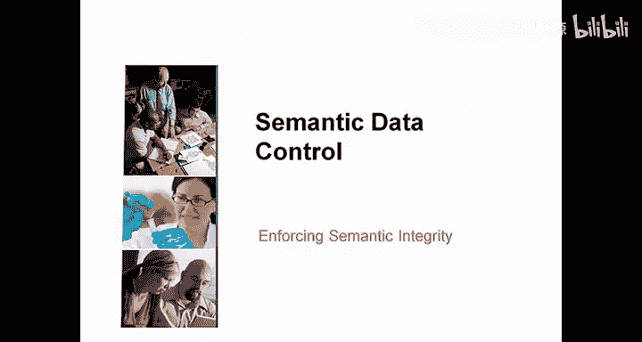

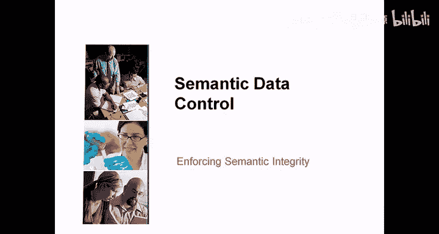

在本节课中，我们将学习如何实施语义完整性控制，以确保数据库在执行更新操作后仍能保持数据的一致性和正确性。我们将探讨两种主要方法：后置测试和前置测试，并重点介绍如何使用差分关系来高效地实施约束。

---

## 欢迎来到语义数据控制

语义完整性控制是数据库管理中的一个核心概念，它确保所有数据操作都符合预定义的业务规则和约束。

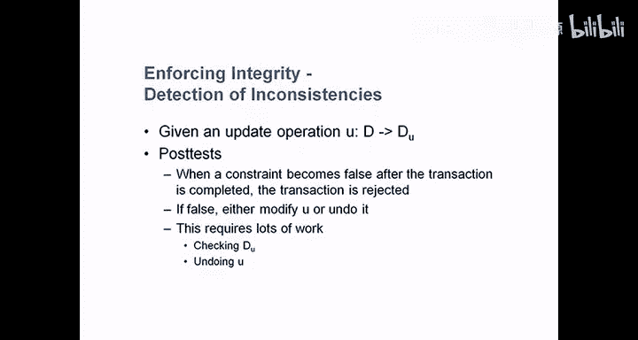

## 实施语义完整性的挑战

实施语义完整性可能非常困难。给定一个更新数据库的操作，例如函数 **U**，它基本上将数据库从原始状态 **D** 转移到更新后的状态 **D<sub>U</sub>**。这意味着数据库可能增加新行、更改记录值或删除行。总之，在更新操作完成后，数据库的状态与操作开始前不同。

## 后置测试方法

一种处理方法是**后置测试**。具体流程是：先执行操作，将数据库状态从 **D** 更改为 **D<sub>U</sub>**。然后，在事务完成后测试约束条件。如果某个约束变为假，则拒绝该事务。

此时，我们需要修改更新操作，改变其更新的内容，或者撤销其操作效果。这通常需要大量工作，因为一旦数据库状态改变，就必须检查 **D<sub>U</sub>** 以确保其符合所有断言。此外，撤销操作本身也可能非常耗时。

## 前置测试方法

因此，我们倾向于选择另一种更高效的选项：**前置测试**。这种方法确保只有在操作执行后数据库能保持一致性状态时，才允许执行该操作。

前置测试更高效，因为它无需撤销任何操作。其原理是：在执行更新操作前，先检查如果执行此操作，数据库将进入的状态。如果该状态会违反某些断言，则根本不执行该更新操作。

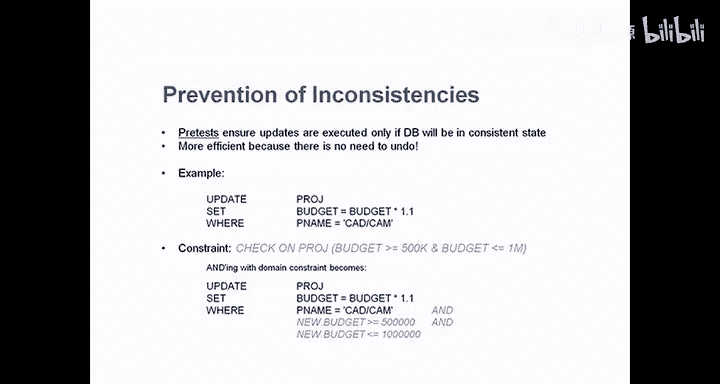

以下是一个示例。假设我们有一个简单的查询，想要将某个项目的预算增加10%：

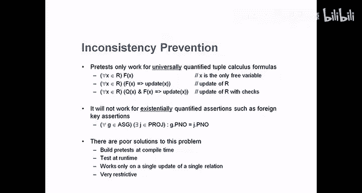

```sql
UPDATE project SET budget = budget * 1.1 WHERE project_name = 'CADCAM';
```

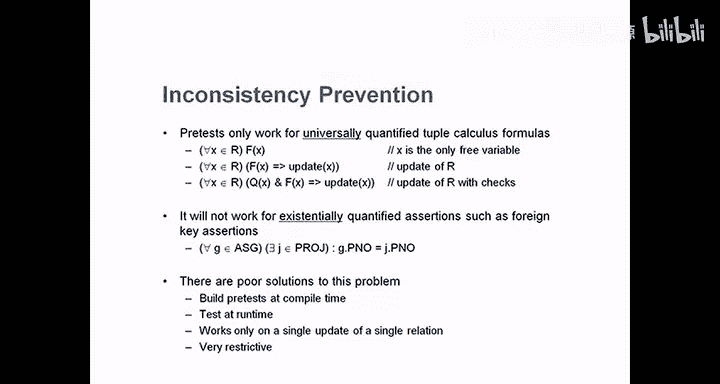

如果数据库的约束是预算必须在50万到100万之间，我们需要确保更新后的预算不会超过上限。

一种解决方法是，在执行查询前，将约束条件附加到更新语句中：

```sql
UPDATE project
SET budget = budget * 1.1
WHERE project_name = 'CADCAM'
  AND NEW.budget BETWEEN 500000 AND 1000000;
```

这里使用了 **NEW.budget** 运算符，它代表预算操作生效后的新值。数据库可以提前检查此条件。如果预算确实会超过100万美元，它将拒绝该操作，并且不会更改数据库中的任何值。这样，数据库将保持其原有的一致状态。

## 一致性预防的局限性

然而，一致性预防方法仅适用于**全称量化的元组演算公式**。

这类公式的形式通常是：对于所有 **x**，**F(x)** 生效。这意味着当 **F(x)** 对数据库中的所有或部分数据生效时，它会更新关系的特定部分，并且该更新将仅应用于设计要更新的那些行。

我们可以将约束条件（例如之前的 **Q(x)**）附加到查询的 WHERE 子句中，在数据进入数据库之前很久就检查其值。如果检查通过，则允许更新；否则拒绝操作，数据库保持不变。

但是，这种方法不适用于**存在量化的断言**，例如键约束。

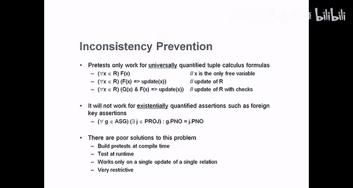

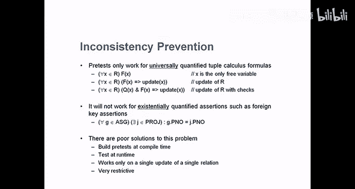

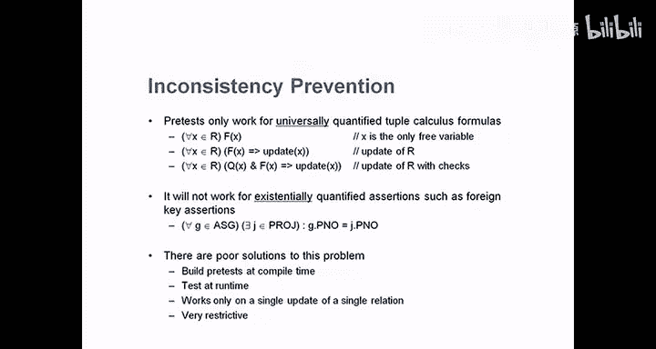

请看页面中间的公式：

> ∀ a ∈ Assignment, ∃ p ∈ Project (a.project_number = p.project_number)

这个断言确保不会添加没有对应项目的任务行。也就是说，每次你想添加一个任务行时，必须确保该行中指定的项目编号等于项目表中的某个项目编号。

注意，这里有一个 **∃ p ∈ Project** 子句。它并不适用于项目表中的所有行，因此不能像之前那样轻松地将此断言附加到更新操作中。

对于这个问题，有一些不太理想的解决方案：可以在编译时构建前置测试（但并非总是容易实现），也可以在运行时进行测试（但这需要在更新操作中构建一些复杂的逻辑）。这些方法通常只适用于对单个关系的单次更新，限制性较强。

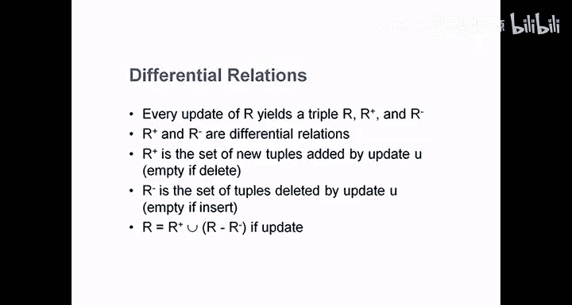

## 差分关系方法

因此，我们引入了另一种方法：**差分关系**。这种方法非常有效，因为对某个关系 **R** 的每次更新都会产生一个三元组：**(R, R<sup>+</sup>, R<sup>-</sup>)**。

*   **R** 是原始关系。
*   **R<sup>+</sup>** 是**差分关系**，代表更新操作要添加到 **R** 的新元组集合。例如，如果是纯插入操作，则 **R<sup>-</sup>** 为空。
*   **R<sup>-</sup>** 也是**差分关系**，代表更新操作要从 **R** 中移除的元组集合。例如，如果是纯删除操作，则 **R<sup>+</sup>** 为空。

对于更新操作，某些内容会被添加到关系中，某些内容会被移除。操作流程是：首先移除计划要删除的元素（**R<sup>-</sup>**），然后将新行（**R<sup>+</sup>**）添加到关系中。因此，关系的新版本如幻灯片最后一行所述：

> R' = (R - R<sup>-</sup>) ∪ R<sup>+</sup>

## 编译断言的示例

编译后的断言以三元组形式表达：**(R, T, C)**。

*   **R** 是目标关系。
*   **T** 是更新操作的类型（插入、删除、修改）。
*   **C** 是断言条件，仅在 **R** 和 **T** 匹配时才进行测试。

这意味着，只有当类型为 **T** 的更新作用于表 **R** 时，我们才测试该特定断言，并且它仅适用于 **R<sup>+</sup>** 和 **R<sup>-</sup>**。

操作流程如下：我们启动操作，确定如果操作继续执行，将添加到数据库的内容（**R<sup>+</sup>**）和将从数据库减去的内容（**R<sup>-</sup>**）。此时 **R** 保持不变。我们测试 **R<sup>+</sup>** 和 **R<sup>-</sup>** 中的值。如果它们通过断言测试，我们就更新数据库。如果断言测试失败，我们只需丢弃 **R<sup>+</sup>** 和 **R<sup>-</sup>**，**R** 从未改变，数据库保持原状。

以下是任务表（Assignment）的一些断言示例：

1.  **插入断言 (C1)**：
    *   **作用**：确保所有新插入的任务行都有一个对应的项目存在于项目表中。
    *   **逻辑**：∀ new_a ∈ Assignment<sup>+</sup>, ∃ p ∈ Project (new_a.project_number = p.project_number)
    *   **目的**：防止添加没有对应项目的“孤儿”任务。

2.  **删除断言 (C2)**：
    *   **作用**：当从项目表中删除一行时，确保没有任务行仍然关联到要删除的这个项目。
    *   **逻辑**：∀ a ∈ Assignment, ∀ old_p ∈ Project<sup>-</sup> (a.project_number ≠ old_p.project_number)
    *   **目的**：防止在删除项目后留下“孤儿”任务。

3.  **修改断言 (C3)**：
    *   **作用**：当更新项目表中的一行时进行处理。更新操作会产生旧行版本（old_p）和新行版本（new_p）。
    *   **逻辑**：检查所有任务行，确保要么旧项目编号在任务表中没有对应项（即该项目没有任务），要么新行的项目编号与旧行相同（即项目编号未改变）。
    *   **目的**：防止通过更改项目编号来破坏任务与项目之间的引用完整性，确保关联的任务行仍然有效。

---

## 总结

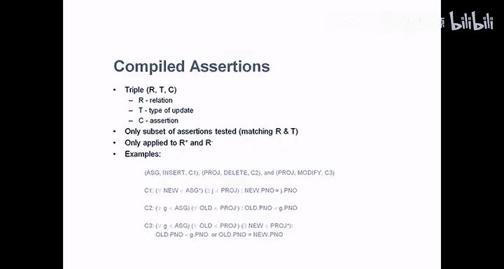

在本节课中，我们一起学习了实施语义完整性的核心方法。我们了解到，后置测试虽然直接但效率较低，而前置测试通过提前检查避免了撤销操作的开销。对于存在量化的复杂约束，我们引入了强大的差分关系方法，它通过检查更新操作产生的增量集合（**R<sup>+</sup>** 和 **R<sup>-</sup>**）来高效地实施断言，从而在保持数据库一致性的同时，提升了操作的效率。