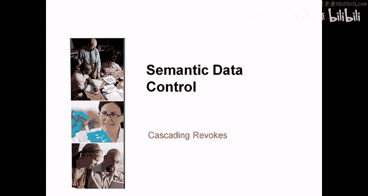
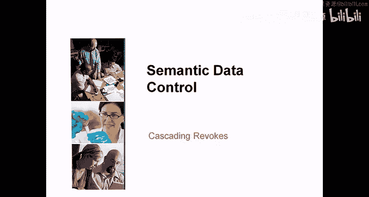
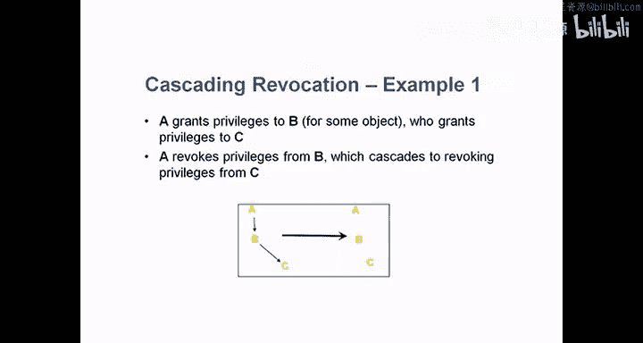
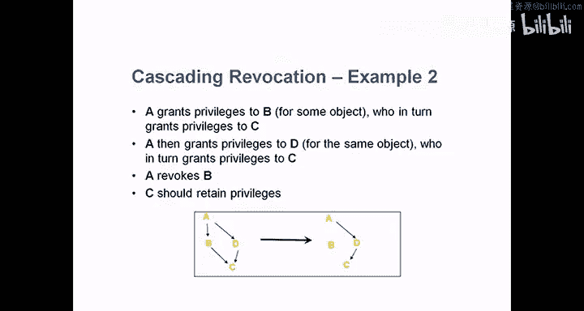
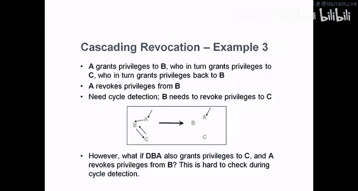
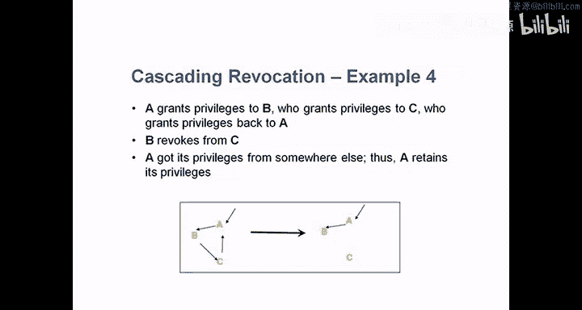

# 020：级联撤销 🔄

## 概述

在本节课中，我们将要学习数据库权限管理中的一个重要概念：**级联撤销**。我们将通过几个逐步深入的例子，来理解当数据库管理员或用户撤销（REVOKE）某个用户的权限时，这个操作如何像多米诺骨牌一样，影响其他通过该用户间接获得权限的用户。

---

## 级联撤销的基本概念

级联撤销的核心思想是：当一个用户（授权者）撤销授予另一个用户（被授权者）的权限时，系统必须确保，不仅被授权者直接失去该权限，而且所有**仅通过**该被授权者获得此权限的用户也将失去该权限。

上一节我们介绍了语义数据控制，本节中我们来看看级联撤销的具体运作机制。

---

## 例一：简单的线性授权链

第一个例子非常简单。假设有三个用户：**A**、**B** 和 **C**。

*   **A** 将某个数据库对象（如表或视图）的权限授予 **B**。
*   **B** 随后将同一对象的权限授予 **C**。

此时，权限的流向形成一个简单的链：`A -> B -> C`。

当 **A** 决定撤销 **B** 的权限时，情况会如何发展？

**A** 撤销 **B** 的权限，意味着 **A** 不再信任 **B** 拥有该权限。由于 **C** 的权限完全来源于 **B**（且仅来源于 **B**），因此 **B** 也必须撤销授予 **C** 的权限。

最终结果是：**B** 和 **C** 都失去了对该对象的访问权限。

以下是这个过程的图示说明：

---

## 例二：用户从多路径获得权限

第二个例子稍复杂一些。假设有四个用户：**A**、**B**、**C**、**D**。

*   **A** 将权限授予 **B**。
*   **B** 将权限授予 **C**。
*   **A** 也将权限授予 **D**。
*   **D** 也将权限授予 **C**。

此时，用户 **C** 通过两条独立的路径获得了权限：`A -> B -> C` 和 `A -> D -> C`。

现在，当 **A** 撤销授予 **B** 的权限时，会发生什么？

1.  **A** 与 **B** 之间的授权关系被切断。
2.  **B** 必须级联撤销其授予 **C** 的权限。
3.  然而，**C** 仍然保留着从 **D** 那里获得的权限，因为 **A** 并未撤销 **D** 的权限。

最终，**C** 的权限得以保留，因为它仍有另一条有效的权限来源路径（`A -> D -> C`）。只有 **B** 完全失去了权限。

以下是权限变化的对比：

---

## 例三：循环授权与检测

第三个例子引入了循环授权，情况变得更有趣。假设有三个用户：**A**、**B**、**C**。

*   **A** 将权限授予 **B**。
*   **B** 将权限授予 **C**。
*   **C** 又将权限授予 **B**。

这就形成了一个循环：`A -> B -> C -> B`。

当 **A** 撤销 **B** 的权限时，问题出现了：**B** 似乎还拥有从 **C** 那里获得的权限，那么 **B** 的权限是否应该保留？

答案是否定的。**A** 的意图是彻底撤销 **B** 的权限。系统需要通过**循环检测**算法来识别出 **B** 和 **C** 之间存在的权限循环依赖。这个循环本质上是由最初的授权者 **A** 所启动的。

因此，级联撤销的结果是打破这个循环。最终，**B** 和 **C** 的权限都会被撤销，因为他们的权限根源（**A**）已经收回了授权。

以下是循环授权被检测并解除的示意图：

**一个重要的补充**：如果用户 **C** 除了从 **B** 获得权限外，还从其他独立来源（例如数据库管理员）直接获得了权限，那么当 **A** 撤销 **B** 的权限时，**C** 的权限将得以保留，因为它有另一个有效的权限来源。

---

## 例四：授权者自身在循环中

最后一个例子最为复杂。假设有三个用户：**A**、**B**、**C**。

*   **A** 将权限授予 **B**。
*   **B** 将权限授予 **C**。
*   **C** 又将权限授予 **A**。

这就形成了一个包含初始授权者 **A** 的循环：`A -> B -> C -> A`。

现在，如果 **B** 撤销授予 **C** 的权限，会发生什么？

你可能会认为，通过循环检测，整个循环（`A->B`, `B->C`, `C->A`）都应该被移除。但这里有一个关键点：**A** 是**初始的权限拥有者**（例如，可能是对象的创建者）。**A** 的权限并非完全依赖于这个循环。

因此，在这种情况下，级联撤销算法必须足够智能，以确保初始授权者 **A** 不会因为撤销操作而意外地失去自己的权限。通常，**A** 的权限会得以保留，而 **B** 和 **C** 之间的授权关系被切断。

以下是此场景的说明：

---

## 总结

本节课中我们一起学习了**级联撤销**机制。我们通过四个由浅入深的例子，理解了数据库系统如何处理权限撤销的连锁反应：

1.  **线性链的完全撤销**：权限沿单一链条传递时，撤销源头会导致后续所有用户权限丢失。
2.  **多路径授权的保留**：只要用户仍有其他有效的权限来源路径，其权限就可以保留。
3.  **循环授权的检测与解除**：系统需要检测并打破因循环授权产生的虚假权限依赖，确保撤销意图被彻底执行。
4.  **保护初始授权者**：算法需确保初始权限拥有者不会因级联撤销而失去自身权限。

级联撤销是数据库安全模型中确保权限一致性和意图正确执行的关键机制。理解它有助于我们更好地设计和管理数据库的访问控制策略。