# 021：查询处理示例 📊


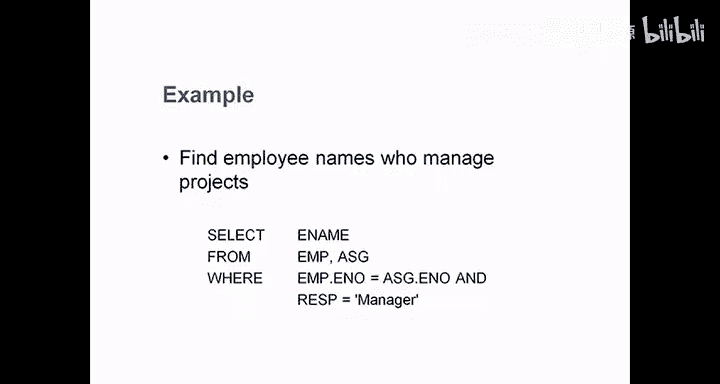

在本节课中，我们将通过一个具体的例子来学习查询处理。我们将分析一个简单的查询，并探讨如何通过不同的关系代数表达式来优化查询计划，以及如何在分布式数据库系统中评估不同策略的成本。

---

## 概述

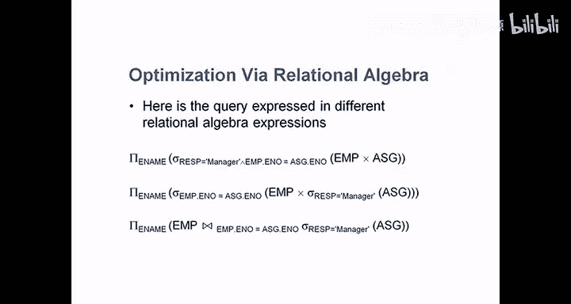

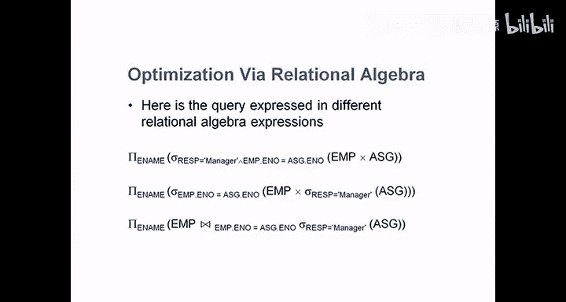

查询处理是数据库系统的核心功能之一。它涉及将用户的高级查询（如SQL语句）转换为一系列可以在数据库上执行的低级操作。优化查询处理可以显著提高数据库的性能。本节课我们将通过一个简单的连接查询示例，来理解查询优化的基本概念和方法。

## 查询示例

我们首先来看一个简单的查询。这个查询涉及两个表：`employee`（员工表）和`assignment`（任务分配表）。我们的目标是找出所有职责为“经理”的员工姓名。

以下是查询的SQL表示：
```sql
SELECT employee.name
FROM employee, assignment
WHERE employee.emp_no = assignment.emp_no
AND assignment.responsibility = 'manager';
```

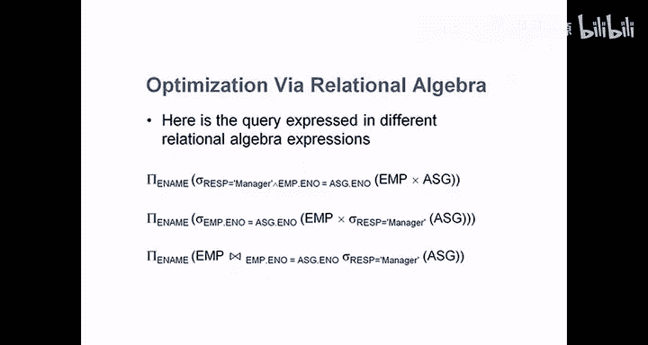

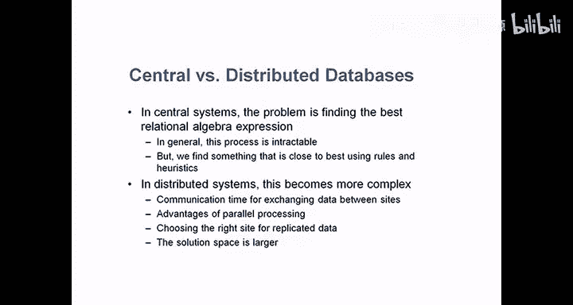

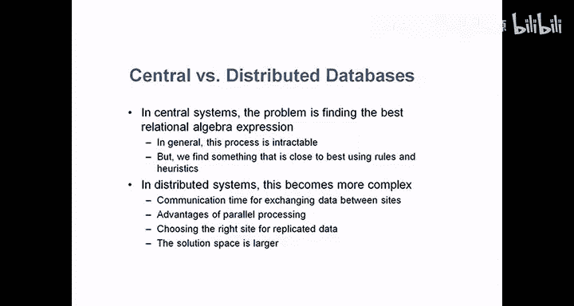

## 关系代数表达式

将SQL查询转换为关系代数表达式是查询处理的第一步。对于同一个查询，我们可以有多种等价的关系代数表达式，但它们的执行效率可能大不相同。

上一节我们介绍了查询示例，本节中我们来看看几种不同的关系代数表达式。

以下是三种等价但执行策略不同的关系代数表达式：

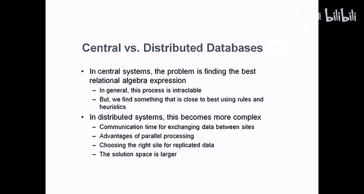

1.  **基础表达式**：首先计算`employee`和`assignment`表的笛卡尔积，然后应用选择条件（员工号相等且职责为经理），最后投影出员工姓名。
    *   **公式**：`π_name(σ_responsibility='manager' ∧ employee.emp_no=assignment.emp_no(employee × assignment))`

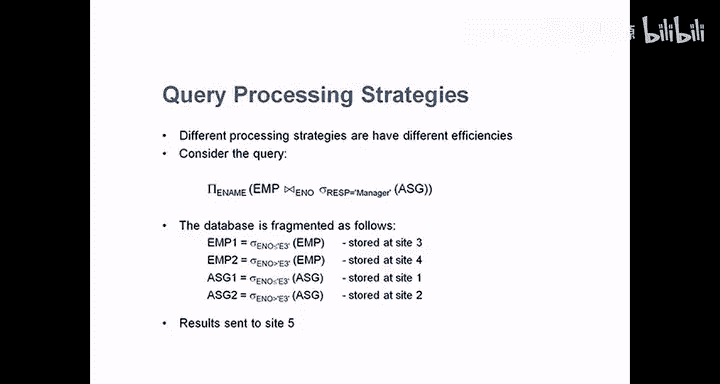

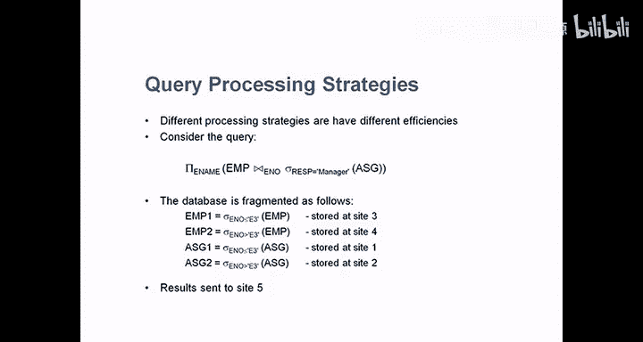

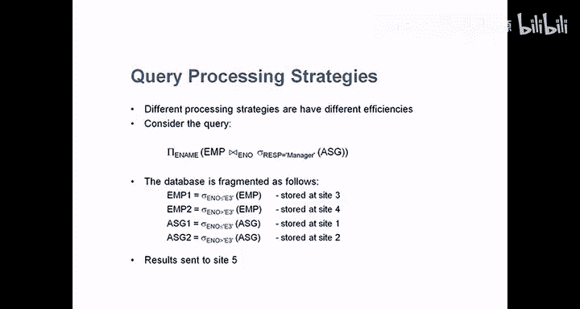

2.  **优化表达式A**：将选择条件`σ_responsibility='manager'`下推到`assignment`表上，先过滤出经理任务，再进行连接和投影。这减少了连接操作的数据量。
    *   **公式**：`π_name(σ_employee.emp_no=assignment.emp_no(employee × σ_responsibility='manager'(assignment)))`

3.  **优化表达式B**：进一步优化，使用自然连接代替笛卡尔积加选择条件。先过滤`assignment`表，然后与`employee`表进行自然连接，最后投影。
    *   **公式**：`π_name(employee ⋈ σ_responsibility='manager'(assignment))`

直观上，表达式3的效率高于表达式2，表达式2的效率高于表达式1。这是因为我们尽可能早地减少了参与运算的数据量，并使用了更高效的自然连接操作。

## 集中式与分布式系统的挑战

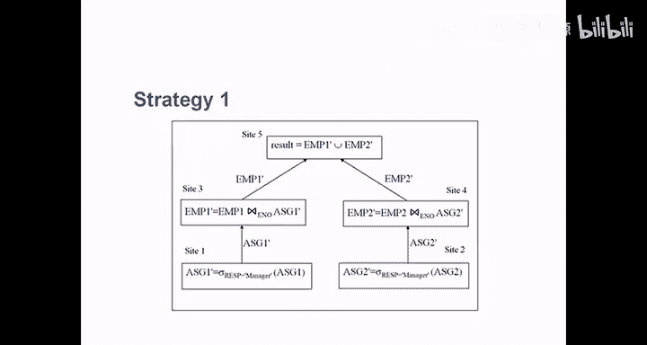

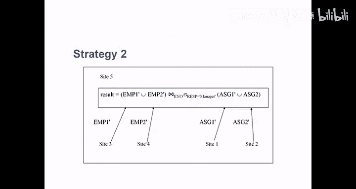

在集中式数据库系统中，从众多可能的查询计划中找到最优解本身就是一个非常复杂（NP难）的问题。随着查询涉及的表和条件增多，可能的查询计划数量会呈指数级增长。

在分布式数据库系统中，问题变得更加复杂。我们不仅需要考虑本地操作的代价，还必须考虑数据在不同站点间传输的通信代价。此外，还需要处理数据分片、副本选择以及利用并行处理潜力等问题。虽然解空间更大，但通过合理的启发式方法和成本估算，我们仍然可以找到高效的查询计划。

## 分布式查询计划成本估算示例

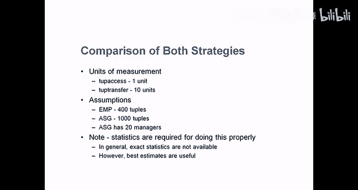

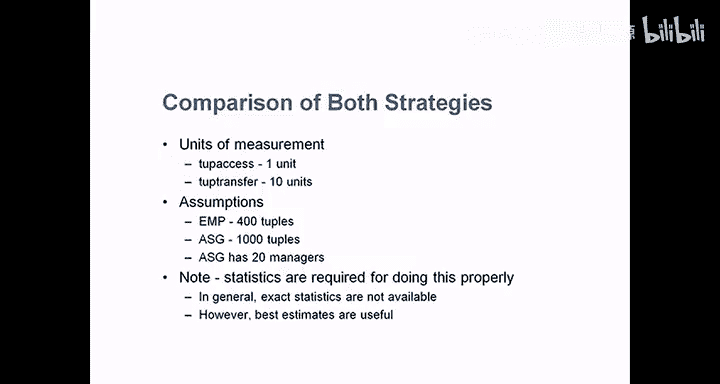


为了量化不同查询计划的优劣，我们需要进行成本估算。成本通常包括**I/O代价**（读写元组）和**通信代价**（传输数据）。

假设我们有一个分布式数据库，数据分片存储在不同站点：
*   `employee`表（共400条记录）被水平分片为`employee1`（站点3）和`employee2`（站点4）。
*   `assignment`表（共1000条记录）被水平分片为`assignment1`（站点1）和`assignment2`（站点2）。
*   已知`assignment`表中只有20条记录的`responsibility`为`'manager'`，且均匀分布在两个分片中。
*   最终结果需要传送到站点5。
*   代价单位：一次本地元组访问为 **1** 单位，一次元组传输为 **10** 单位。

### 策略一：先过滤后连接（优化策略）

这个策略对应之前的“优化表达式B”，并在分布式环境下执行：
1.  在站点1和2分别从`assignment`分片中筛选出`manager`记录（各约10条）。
2.  将这些过滤后的记录（各约10条）分别发送到对应的`employee`分片所在站点（站点3和4）。
3.  在站点3和4分别执行本地自然连接（`employee1` ⋈ `assignment1_filtered`, `employee2` ⋈ `assignment2_filtered`）。
4.  将连接结果（各约10条）发送到站点5。
5.  在站点5合并结果。

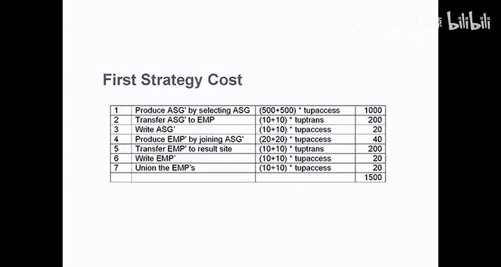

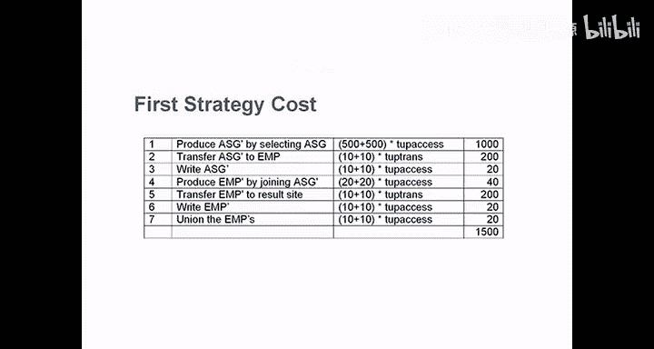

以下是详细的成本计算：

**总资源代价计算：**
*   读取`assignment`分片：`500 + 500 = 1000`
*   传输`manager`记录到员工站点：`(10 + 10) * 10 = 200`
*   在员工站点写入接收到的记录：`10 + 10 = 20`
*   执行本地连接（假设有索引，每次连接需2次读）：`20 * 2 = 40`
*   传输连接结果到站点5：`(10 + 10) * 10 = 200`
*   在站点5写入结果：`10 + 10 = 20`
*   在站点5合并结果：`10 + 10 = 20`
*   **总资源代价**：`1000 + 200 + 20 + 40 + 200 + 20 + 20 = 1500`

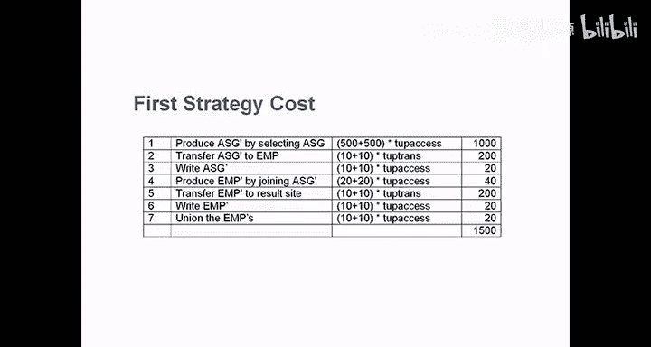

**响应时间估算（考虑并行操作）：**
*   并行读取`assignment`分片：`max(500, 500) * 1 = 500`
*   并行传输`manager`记录：`max(10, 10) * 10 = 100`
*   并行在员工站点写入：`max(10, 10) * 1 = 10`
*   并行执行本地连接：`max(20, 20) * 1 = 20` (以较慢的站点为准)
*   并行传输连接结果：`max(10, 10) * 10 = 100`
*   在站点5写入结果：`(10 + 10) * 1 = 20`
*   合并结果：`(10 + 10) * 1 = 20`
*   **总响应时间**：`500 + 100 + 10 + 20 + 100 + 20 + 20 = 770` (与视频中760略有出入，为计算细节差异)

### 策略二：全部集中后处理（朴素策略）

这个策略将所有数据都发送到站点5进行集中处理：
1.  将`employee1`、`employee2`、`assignment1`、`assignment2`所有数据发送到站点5。
2.  在站点5重组完整的`employee`表和`assignment`表。
3.  在站点5执行完整的查询：先过滤`assignment`，再与`employee`连接，最后投影。

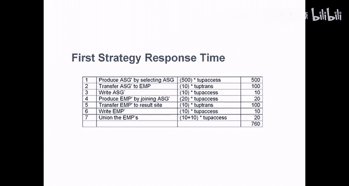

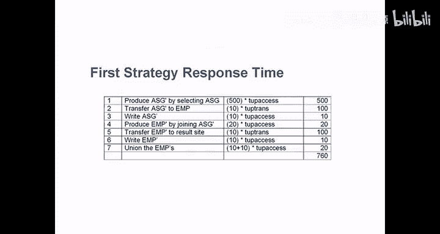


以下是详细的成本计算：

**总资源代价计算：**
*   读取所有分片：`200 + 200 + 500 + 500 = 1400`
*   传输所有数据到站点5：`(400 + 1000) * 10 = 14000`
*   在站点5写入所有数据：`1400 * 1 = 1400`
*   在站点5执行查询（无索引，需嵌套循环连接）：
    *   读取全部`assignment`进行过滤：`1000`
    *   连接操作：对20条`manager`记录，每条需扫描400条`employee`记录：`20 * 400 = 8000`
*   **总资源代价**：`1400 + 14000 + 1400 + 1000 + 8000 = 25800`

**响应时间估算（考虑并行传输）：**
*   并行读取分片：`max(200, 200, 500, 500) * 1 = 500`
*   并行传输数据（以最大分片计）：`500 * 10 = 5000`
*   在站点5写入数据：`max(200, 500) * 1 = 500` (以较大分片计)
*   执行查询（无法并行）：
    *   过滤`assignment`：`1000`
    *   连接操作：`8000`
*   **总响应时间**：`500 + 5000 + 500 + 1000 + 8000 = 15000`


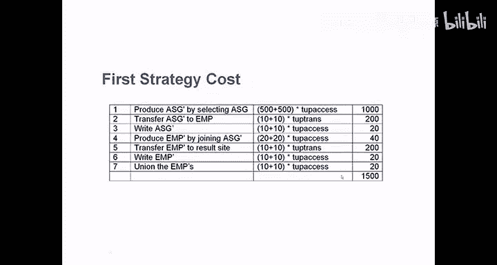

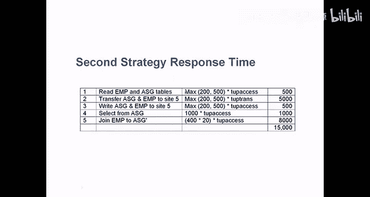


## 对比与总结

通过对比两种策略，我们可以清晰地看到：

| 评估指标 | 策略一（先过滤后连接） | 策略二（全部集中处理） | 结论 |
| :--- | :--- | :--- | :--- |
| **总资源代价** | **1500** 单位 | 25800 单位 | 策略一节省约94%的资源 |
| **响应时间** | **~770** 单位 | 15000 单位 | 策略一快约95% |

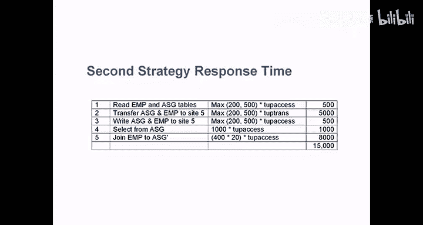

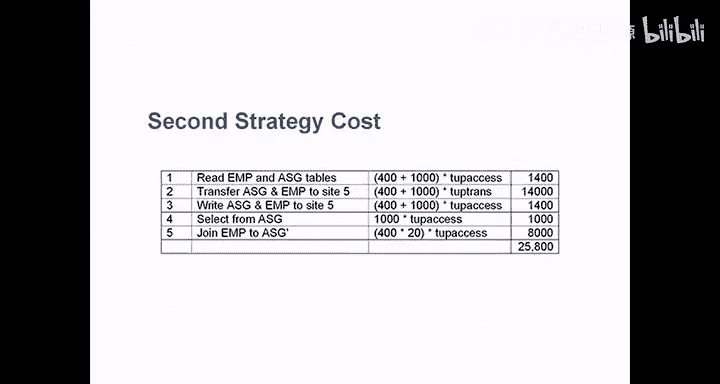

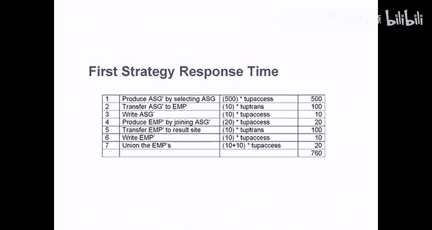

**本节课中我们一起学习了：**
1.  一个查询可以对应多个等价的关系代数表达式，形成不同的查询执行计划。
2.  通过将选择操作下推、使用连接代替笛卡尔积等代数变换，可以优化查询计划。
3.  在分布式数据库系统中，评估查询计划成本时，必须同时考虑**本地处理代价（I/O）**和**网络通信代价**。
4.  利用统计数据（如表大小、选择率）进行成本估算是查询优化的基础。准确的估算有助于系统选择高效的查询计划，避免低效计划。
5.  本例证明，通过在数据源附近提前过滤减少数据传输量，通常能极大提升分布式查询的性能。

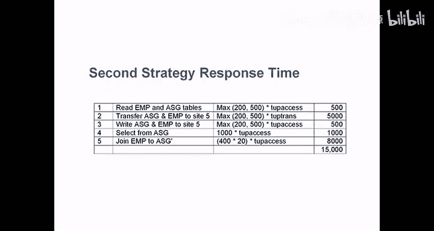


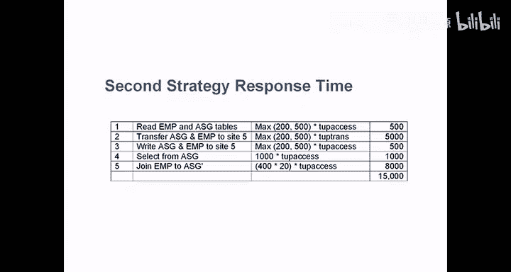

这个示例虽然简单，但揭示了查询优化，尤其是分布式查询优化的核心思想。在接下来的课程中，我们将深入探讨更复杂的代价模型和优化算法。