# 022：查询转换规则 📚


在本节课中，我们将学习查询处理中的一个核心环节：查询转换规则。我们将了解如何通过应用一系列规则，将一个查询的执行计划（通常表示为关系代数表达式树）转换为一个语义等价但执行效率更高的计划。这对于优化大规模数据库系统的查询性能至关重要。

---

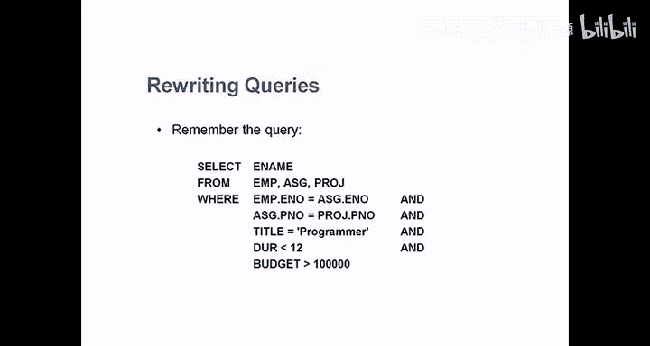

## 从示例查询开始

首先，我们来看一个示例查询。这个查询涉及三个表：`employee`、`assignment` 和 `project`。它的目标是选择那些头衔为“程序员”、项目预算超过100,000且项目持续时间少于12个月的员工姓名。

对应的SQL语句如下：
```sql
SELECT e.name
FROM employee e, assignment a, project p
WHERE e.emp_no = a.emp_no
  AND a.proj_no = p.proj_no
  AND e.title = ‘programmer’
  AND p.budget > 100000
  AND p.duration < 12;
```

## 构建查询树 🌲

查询处理的第一步是将关系代数表达式转换为一个查询树。我们按照投影（Projection）、选择（Selection）和连接（Join）的顺序来构建这棵树。

构建出的查询树结构如下：
*   根节点是投影操作 `π(e.name)`。
*   其子节点是一个复合的选择操作 `σ(title=‘programmer’ ∧ duration<12 ∧ budget>100000)`。
*   这个选择操作作用于一个连接操作 `⋈` 的结果。
*   该连接操作将 `project` 表与另一个连接结果（`assignment` 表与 `employee` 表的连接）进行连接。

这个树形结构本身就是发送给查询执行模块的指令集。执行模块会自底向上地处理这棵树：
1.  首先连接 `assignment` 和 `employee` 表。
2.  将结果与 `project` 表连接。
3.  依次应用关于预算、持续时间和头衔的选择条件。
4.  最后投影出员工姓名。

这个初始的执行计划可能需要较长的执行时间。因此，我们的目标是通过应用转换规则，生成一个语义相同但执行更快的查询树。

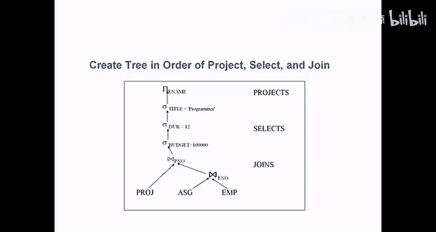

---

## 查询树转换规则 🔧

为了优化查询树，我们可以应用一系列转换规则。以下是一些核心规则，我们假设有两个表 `R(A1, A2, ..., An)` 和 `S(B1, B2, ..., Bn)`。

### 1. 交换律 (Commutative Law)

连接和笛卡尔积操作满足交换律：
*   **公式**：`R × S ≡ S × R`
*   **公式**：`R ⋈ S ≡ S ⋈ R`

虽然这两个表达式在数学上等价，但对查询处理器而言意义不同。执行顺序决定了哪个是外表（驱动表），哪个是内表。如果内表 `S` 上有索引，那么 `R ⋈ S`（以 `R` 为外表）的效率是 `O(n log n)`。而如果顺序反过来 `S ⋈ R`（以 `S` 为外表），但 `R` 没有索引，效率就会降为 `O(n²)`。一个好的查询优化器会根据索引情况选择更优的连接顺序。

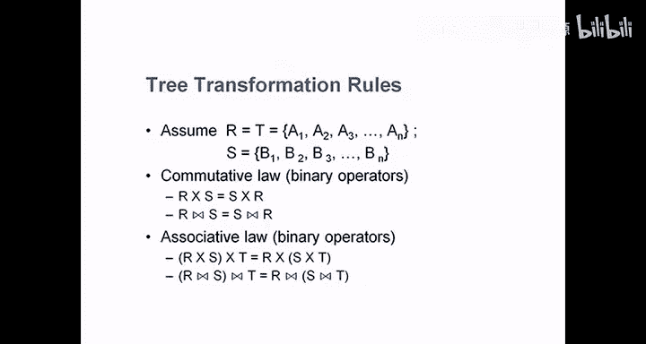

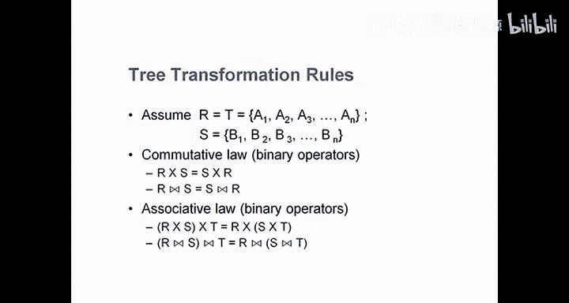

### 2. 结合律 (Associative Law)

连接和笛卡尔积操作也满足结合律：
*   **公式**：`(R × S) × T ≡ R × (S × T)`
*   **公式**：`(R ⋈ S) ⋈ T ≡ R ⋈ (S ⋈ T)`

与交换律类似，不同的结合顺序也可能因为索引等因素而产生不同的执行效率。

上一节我们介绍了二元操作的交换律和结合律，本节中我们来看看针对一元操作（选择和投影）的转换规则。

### 3. 投影的级联消除

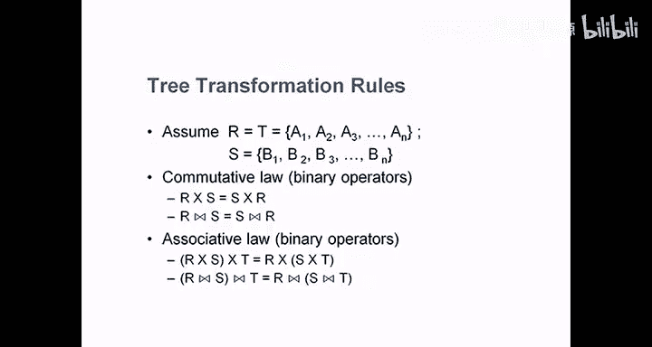

如果连续进行多次投影，且每次投影的属性集是前一次的子集，则可以合并或消除中间的投影层。
*   **公式**：`π_A‘ (π_A‘‘ (R)) ≡ π_A‘ (R)`，其中 `A‘ ⊆ A‘‘`

### 4. 选择的级联合并

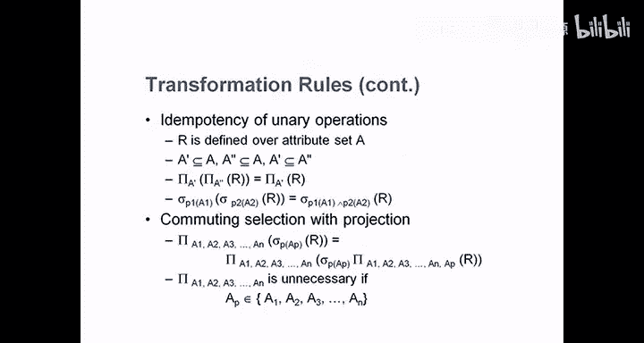

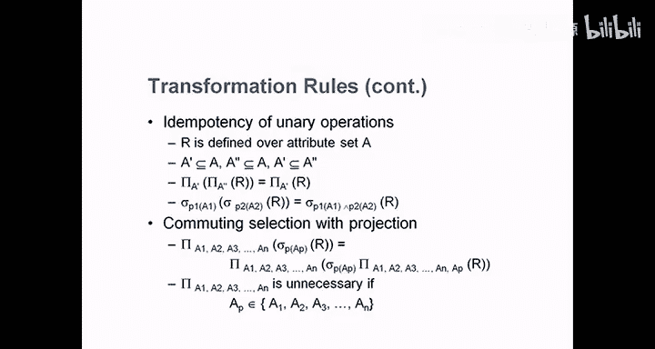

如果对同一个关系应用多个选择条件，可以将它们合并为一个包含所有条件的“与”操作。
*   **公式**：`σ_c1 (σ_c2 (R)) ≡ σ_(c1 ∧ c2) (R)`

### 5. 选择与投影的交换/下推

如果在一个选择操作之后进行投影，并且选择条件 `c` 中涉及的属性 `Ap` 包含在投影属性集 `{A1, ..., An}` 中，则可以将投影下推到选择之前，仅保留选择所需的列，从而减少处理的数据量。
*   **公式**：`π_{A1,...,An} (σ_c (R)) ≡ π_{A1,...,An} (σ_c (π_{A1,...,An, Ap} (R)))`

### 6. 选择对二元操作的下推

如果选择条件只涉及连接或笛卡尔积中某一个表的属性，可以提前将该选择操作应用到对应的表上，生成一个更小的中间结果，再进行连接，这能显著提升效率。
*   **公式**：`σ_c (R × S) ≡ σ_c (R) × S`，当条件 `c` 只涉及 `R` 的属性时。
*   **公式**：`σ_c (R ⋈ S) ≡ σ_c (R) ⋈ S`，当条件 `c` 只涉及 `R` 的属性时。

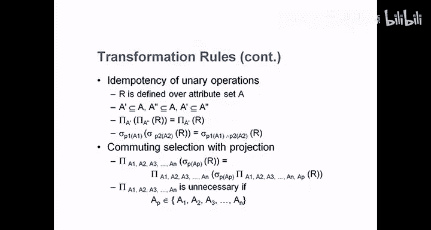

这个规则同样适用于并集操作。
*   **公式**：`σ_c (R ∪ S) ≡ σ_c (R) ∪ σ_c (S)`

### 7. 投影对二元操作的下推

对于连接或笛卡尔积后的投影，如果投影的属性集 `C` 可以明确地划分为来自 `R` 的属性子集 `A‘` 和来自 `S` 的属性子集 `B‘`，那么可以将投影分别下推到两个操作数上，先减少列数再进行连接。
*   **公式**：`π_C (R × S) ≡ π_A‘ (R) × π_B‘ (S)`，其中 `C = A‘ ∪ B‘`，且 `A‘` 属于 `R`，`B‘` 属于 `S`。
*   该规则对自然连接 `⋈` 同样适用。

---

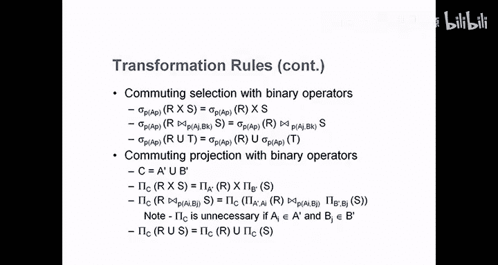

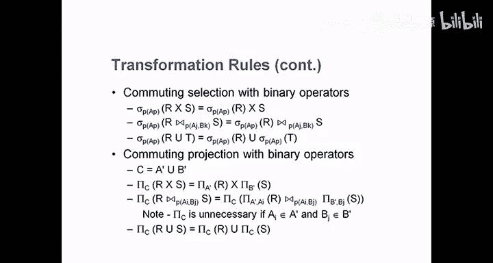

## 应用规则优化示例查询 🚀

现在，让我们将上述规则（特别是规则4、5、6、7）应用到最初的示例查询树上。核心思想是：**尽可能地将选择和投影操作沿着查询树下推**。

以下是优化步骤：
1.  **下推选择**：
    *   `budget > 100000` 和 `duration < 12` 只涉及 `project` 表，可以下推到该表。
    *   `title = ‘programmer’` 只涉及 `employee` 表，可以下推到该表。
2.  **下推投影**：
    *   最终只需要 `e.name`。分析连接条件（`e.emp_no = a.emp_no` 和 `a.proj_no = p.proj_no`），我们发现还需要 `project` 表的 `proj_no`、`assignment` 表的 `emp_no` 和 `proj_no` 以及 `employee` 表的 `emp_no` 和 `name`。
    *   因此，我们可以将投影下推到每个基表，只读取这些必需的列。

优化后的查询树变为：
*   从 `project` 表中选择 `budget>100000 ∧ duration<12` 的行，并只投影 `proj_no`。
*   从 `assignment` 表投影 `emp_no, proj_no`。
*   从 `employee` 表中选择 `title=‘programmer’` 的行，并投影 `emp_no, name`。
*   先将优化后的 `assignment` 与 `employee` 片段连接，再与优化后的 `project` 片段连接。
*   最后从结果中投影 `name`。

这个新计划在处理早期就过滤了大量无关的数据行和列，从而大大提升了执行效率。

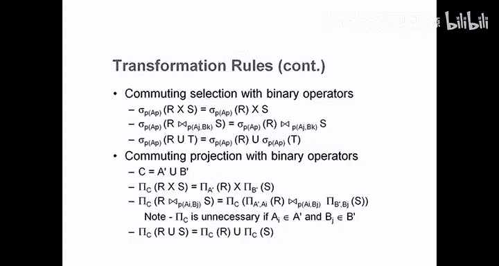

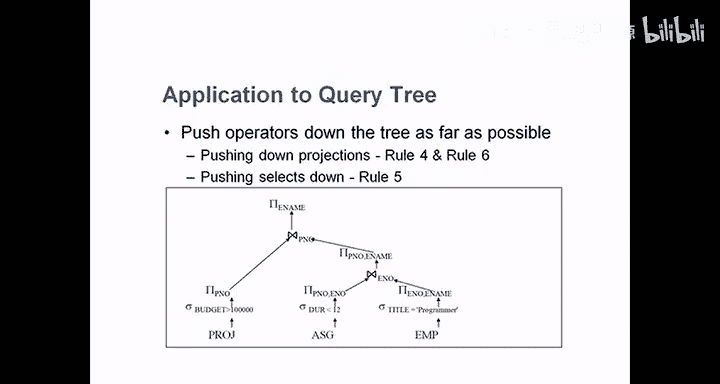

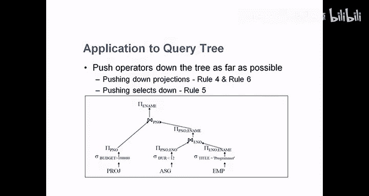

---

## 应用于分片数据库 🌐

在分布式或分片数据库中，这些转换规则能发挥更大作用，帮助我们消除对无关数据分片的访问。

### 水平分片削减

如果表被水平分片（按行分割），且分片定义带有谓词（例如，`employee1: emp_no < 100`, `employee2: 100 <= emp_no < 200`, `employee3: emp_no >= 200`）。

当查询自身带有谓词（例如，`emp_no < 150`）时：
*   我们可以分析查询谓词与分片定义谓词。
*   如果某个分片的定义与查询谓词矛盾（如 `employee3` 的 `emp_no >= 200` 与 `emp_no < 150` 矛盾），则该分片不可能包含任何结果，可以从查询计划中**完全消除**。
*   原本需要合并所有分片再选择，现在只需访问相关的分片（`employee1` 和 `employee2`）。

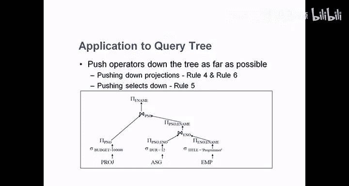

### 连接削减

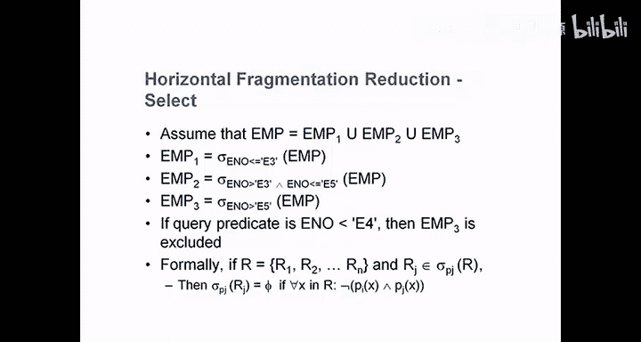

当两个水平分片的表进行连接时，我们可以只连接那些定义谓词可能产生交集的分片对，避免不必要的笛卡尔积。
*   例如，`employee` 的分片1、2只与 `assignment` 的分片1连接；`employee` 的分片3只与 `assignment` 的分片2连接。
*   最后将各个连接结果进行合并。

### 垂直分片削减

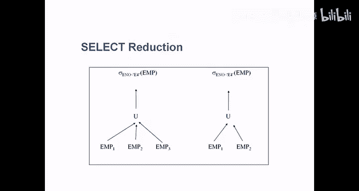

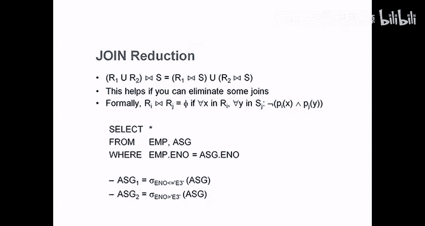

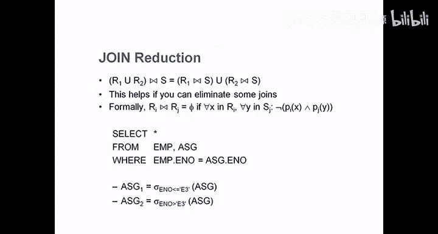

如果表被垂直分片（按列分割），例如 `employee1` 包含 `(emp_no, name)`，`employee2` 包含 `(emp_no, title, salary)`。

当查询只请求某些列时（例如，只请求 `name`）：
*   我们可以识别出只有 `employee1` 分片包含所需列。
*   因此，查询计划可以**忽略** `employee2` 分片，直接对 `employee1` 分片进行操作，避免了不必要的列重组开销。

---

## 总结 📝

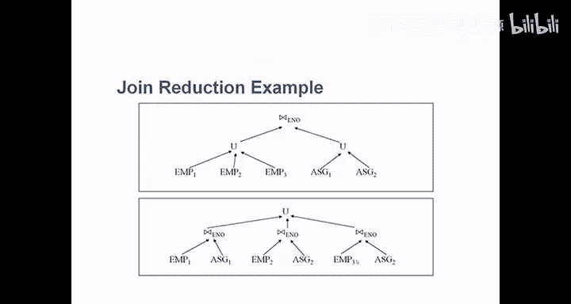

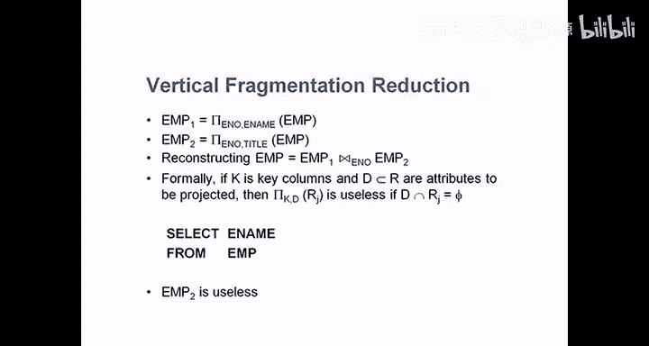

本节课中我们一起学习了查询转换规则，这是数据库查询优化的核心基础。我们了解到：
1.  通过将关系代数表达式转换为查询树，可以形成具体的执行指令。
2.  应用**交换律**、**结合律**、**选择/投影下推**等转换规则，可以生成语义等价但更高效的执行计划。
3.  优化的核心原则是**尽早过滤**：尽早减少需要处理的行数（通过下推选择）和列数（通过下推投影）。
4.  在分片数据库环境中，这些规则可以进一步用于**分片削减**，直接消除对不包含相关数据分片的访问，极大地提升了分布式查询的性能。

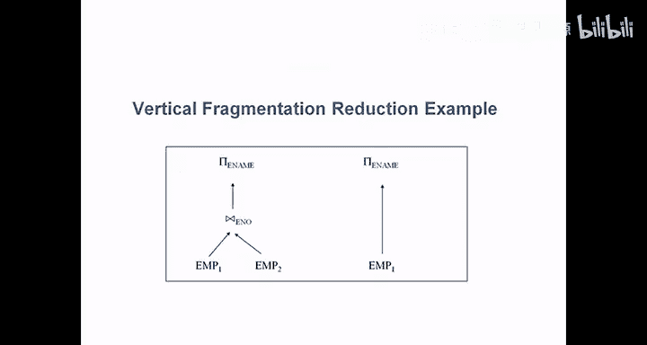

掌握这些规则，有助于我们理解数据库优化器的工作原理，并能更好地编写出本身就更易于优化的查询语句。