# 023：查询操作成本 🧮

在本节课中，我们将学习关系数据库中各种查询操作的计算成本。我们将探讨不同操作（如选择、投影、连接）在没有索引、有索引或已排序情况下的性能差异，并使用大O符号来描述其时间复杂度。

## 无索引表的选择操作

上一节我们介绍了课程概述，本节中我们来看看从没有索引的单个表中选择行的情况。

如果查看右侧的图表，它代表一个有N行的表。为了找到匹配的行，我们必须检查表中的每一行。在最坏的情况下，我们需要读取所有N行。即使我们知道表中只有一个匹配项，平均也需要读取大约一半的行（N/2）。

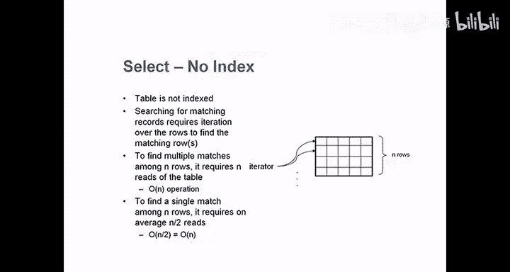

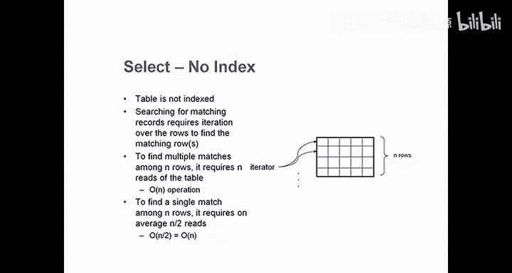

在计算复杂度理论中，我们使用大O符号来描述操作成本的数量级。对于这种情况，读取表行的成本是 **O(N)**。这意味着成本与表中的行数成线性关系。虽然平均读取次数是N/2，但在大O表示法中，我们忽略常数因子，因此它仍然是线性时间复杂度操作。

## 带索引的选择操作

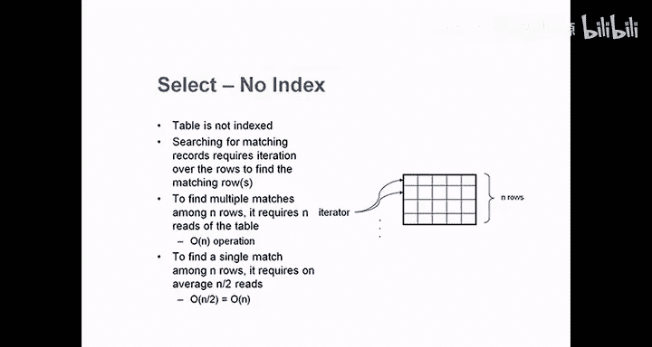

上一节我们讨论了无索引的线性搜索，本节中我们来看看使用索引进行选择的情况。

大多数关系数据库使用B+树进行索引。B+树是一种平衡树，它根据某个键（如ID或姓氏）来组织表中的所有行。当插入一行时，系统会根据索引键值将其放置在树中的适当位置。

图中展示了一个二叉树（每个节点有两个分支），但实际的B+树每个节点可以有多个分支。B+树的关键优势在于它能保持平衡，这意味着树的最底层深度始终是 **log N**。因此，要查找一行，我们只需要进行大约 **log N** 次读取，而不是N次。这比直接扫描整个表要快得多。

使用B+树索引搜索一行的时间复杂度是 **O(log N)**。此外，B+树叶节点本身是排序的，并且通过指针相互连接。这意味着一旦找到第一个匹配项（例如“Harry”），我们就可以快速遍历相邻的叶节点来找到所有匹配项，后续每次读取的成本接近 **O(1)**。

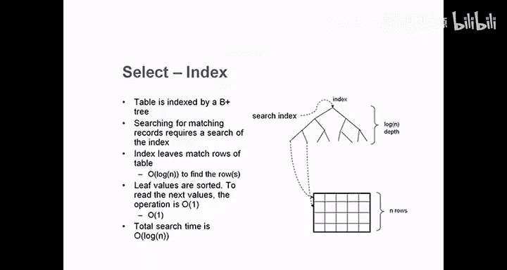

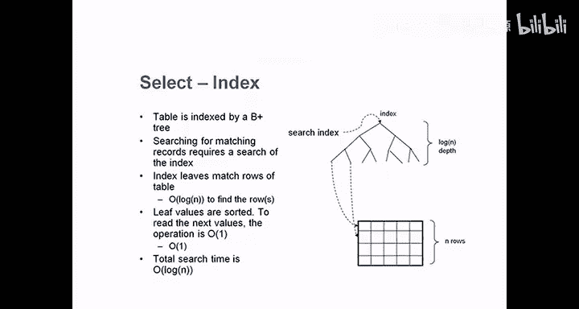

因此，使用索引搜索的总时间是 **O(log N)**，这比无索引的 **O(N)** 要高效得多。

## 哈希索引

上一节我们了解了B+树索引，本节中我们来看看另一种快速索引：哈希索引。

哈希索引速度非常快。其原理是：对搜索条件（键值）应用哈希函数，生成一个代表该键值的数字（哈希值）。当插入一行时（例如“Harry”），系统计算其哈希值，并在哈希索引中创建一个条目，该条目指向表中相应的行。

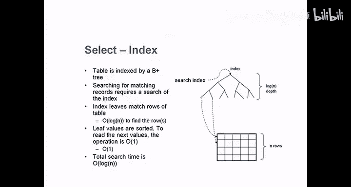

查找时，只需对键值（如“Harry”）应用相同的哈希函数，在哈希索引中找到对应的条目，然后跟随指针找到表中的行。这是一个 **O(1)** 的操作，理论上非常快。

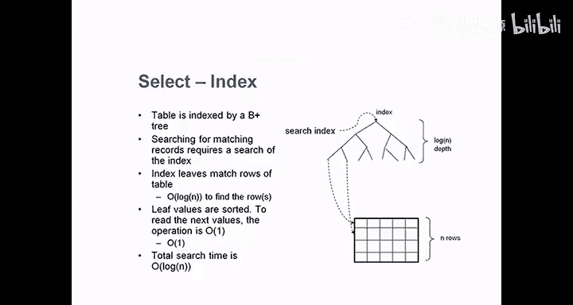

那么，为什么我们不总是使用哈希索引呢？问题在于，当表中的行数非常多时，哈希索引会变得复杂。不同的键值可能会哈希到同一个值（哈希冲突）。为了解决冲突，哈希索引条目可能指向一个“桶链”，其中包含所有哈希到同一值的行。当数据量很大而哈希表相对较小时，会导致很长的桶链，搜索性能可能退化到接近 **O(N)**。

在本课程中，当我们讨论哈希索引时，将假设哈希索引有充足的空间，其操作的时间复杂度为 **O(1)**。

## 带去重的投影操作

上一节我们讨论了索引选择，本节中我们来看看投影操作及其去重成本。

投影操作是从结果集中获取特定的列。但获取这些列后，结果中可能存在重复行，因此需要去重。

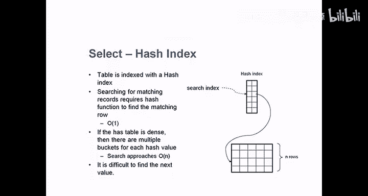

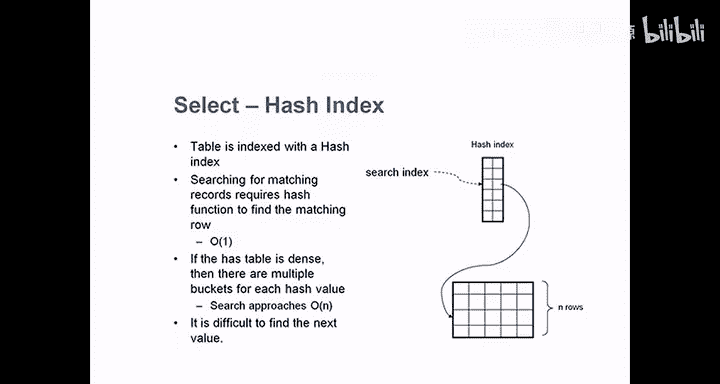

以下是检索和排序这些记录的成本：
*   搜索这些记录的成本可能是 **O(N)**。
*   然而，排序本质上是一个 **N log N** 的过程。对于N个元素，目前已知最好的排序算法时间复杂度是 **O(N log N)**。

因此，总时间是 **O(N log N + N)**。根据大O表示法的规则，我们取增长最快的项，所以带去重的投影操作的时间复杂度是 **O(N log N)**。

类似地，如果要将记录分组，本质上也需要排序，因此分组操作的时间复杂度也是 **O(N log N)**。如果初始表已经排序，则排序步骤可以省略，此时搜索成本仅为 **O(N)**。

## 笛卡尔积与连接操作

上一节我们分析了投影和分组，本节中我们来看看更复杂的连接操作，特别是成本高昂的笛卡尔积。

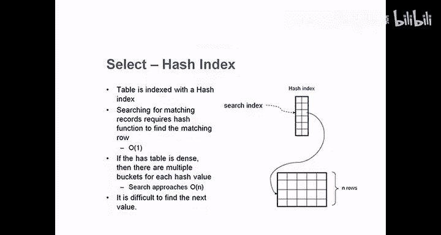

笛卡尔积的计算复杂度非常高，是 **O(N²)** 的操作。我们假设有两个没有索引的表A和表B，每个表都有N行。

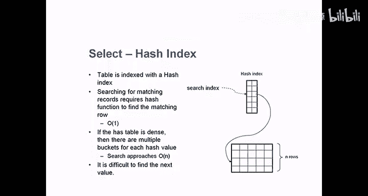

执行连接的算法是：遍历表A的每一行。对于表A中的每一行，我们都必须遍历表B的所有行以寻找潜在的匹配。因此，这本质上是 **N * N** 或 **N²** 次操作，非常昂贵。我们应尽可能避免笛卡尔积。

### 带索引的连接

带索引的连接则快得多。假设表A有N行，表B有N行且已建立索引。

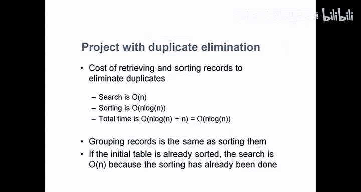

当我们遍历表A的每一行时，可以通过表B的索引（一个 **log N** 深度的搜索）快速找到表B中对应的匹配行。因此，总搜索成本是 **N * log N**，即 **O(N log N)**，这比笛卡尔积的 **O(N²)** 要快得多。

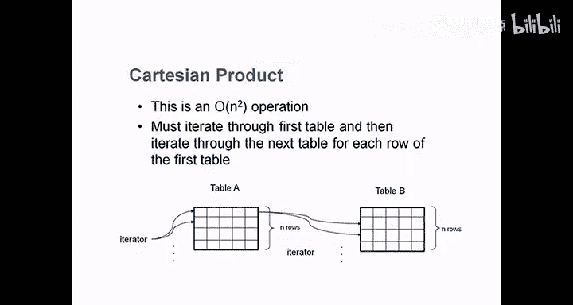

### 在已排序表上的连接

在已排序的表上进行连接可能是最好的连接方式。我们假设两个表都已根据连接键排序。

算法维护两个指针，分别指向表A和表B的当前位置。我们从顶部开始，比较两个指针指向的键值。根据比较结果，我们相应地移动其中一个或两个指针。由于表是排序的，我们永远不需要回溯指针，每个表的指针都只向下移动一次。

因此，这本质上是一个 **2N** 次读取的操作。根据大O表示法，我们忽略常数因子，所以其时间复杂度是 **O(N)**。

## 总结 🎯

本节课中我们一起学习了关系数据库中各种查询操作的时间复杂度：

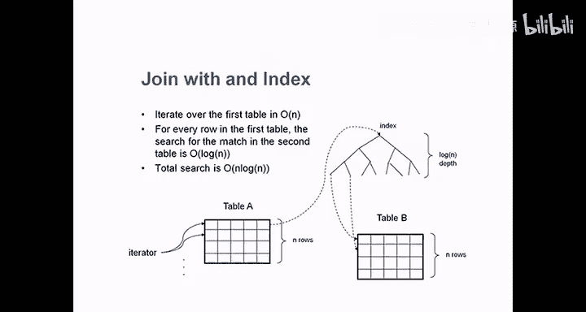

*   **无索引选择**：成本为 **O(N)**，需要线性扫描整个表。
*   **带B+树索引选择**：成本为 **O(log N)**，利用平衡树结构快速定位。
*   **带哈希索引选择**：理想情况下成本为 **O(1)**，但可能因哈希冲突退化。
*   **带去重的投影/分组**：成本为 **O(N log N)**，主要由排序步骤决定。
*   **笛卡尔积**：成本为 **O(N²)**，应尽量避免。
*   **带索引的连接**：成本为 **O(N log N)**，比笛卡尔积高效。
*   **在已排序表上的连接**：成本为 **O(N)**，是最优的连接方式之一。

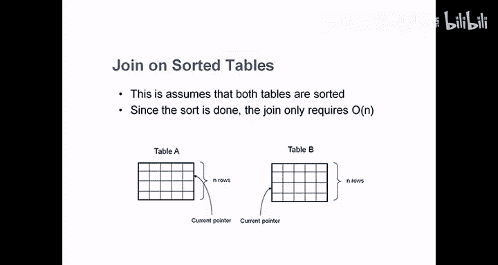

理解这些操作的成本有助于我们设计更高效的数据库查询和索引策略。