# 025：查询优化统计信息 📊

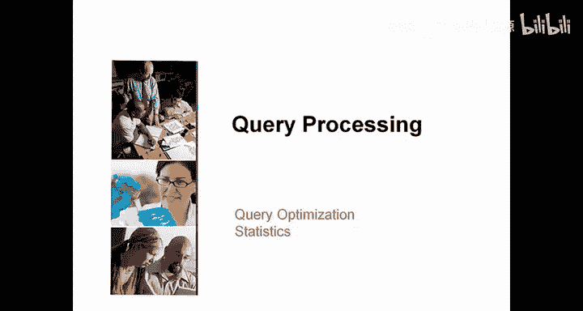

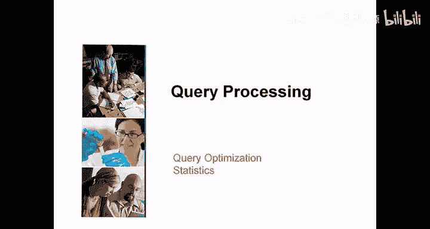

在本节课中，我们将学习查询优化中至关重要的统计信息。我们将了解数据库系统收集哪些统计信息，以及如何利用这些信息来估算查询中间结果的规模，从而选择最优的查询执行计划。

---

## 统计信息的重要性

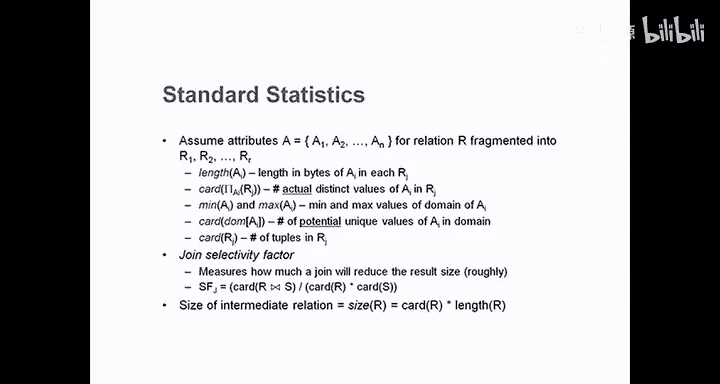

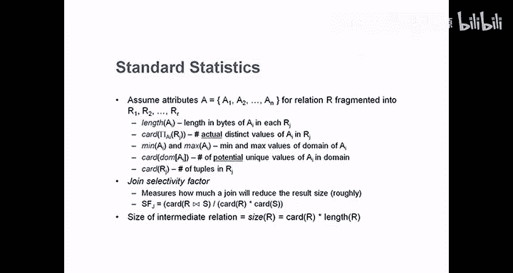

上一节我们介绍了查询处理的基本概念。本节中，我们来看看优化器做出明智决策所依赖的统计信息。没有关于数据库的统计信息，我们就无法计算最佳的执行计划。

以下是数据库系统通常会收集和维护的关键统计信息：

*   **属性长度**：对于关系R的每个属性a_i，其长度`length(a_i)`表示该列在每个数据片段中占用的字节数。
*   **投影值基数**：对于某个数据片段中的属性a_i，其投影值基数`card(∏_ai (Rj))`表示该片段中a_i的实际不同值的数量。例如，一个存储美国各州的表可能有大量行，但不同值只有50个。
*   **最小值和最大值**：了解属性a_i的最小值`min(ai)`和最大值`max(ai)`对于预测满足范围约束（如 `age > 50`）的行数至关重要。
*   **域基数**：属性a_i的域基数`card(dom(ai))`表示该属性在理论上可能拥有的不同值的数量，而不仅仅是数据库中当前存在的值。
*   **片段基数**：数据片段Rj的基数`card(Rj)`就是该片段中包含的元组（行）数量。

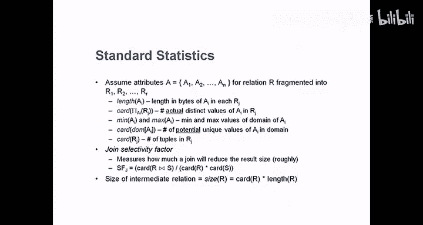

此外，**连接选择因子**也是一个重要概念。它衡量连接操作能多大程度地减少结果集的大小。其通用公式为：
`SF_join = card(R ⋈ S) / (card(R) * card(S))`

最后，我们可以估算**中间关系的大小**，其公式为：
`size(Relation) = card(Relation) * length(tuple)`
这可以理解为行数乘以每行的字节数。

---

## 估算中间结果基数的假设

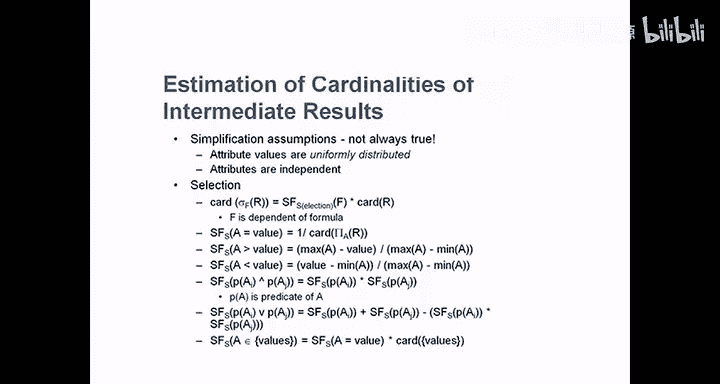

为了简化估算过程，我们通常基于两个核心假设进行推导。请注意，这些假设在现实中并非总是成立，但它们是行之有效的经验法则。

1.  **属性值均匀分布**：假设属性值在其取值范围内是均匀分布的。例如，如果年龄范围是20到60岁，那么每个年龄段（如20-30，30-40等）的行数大致相同。
2.  **属性间相互独立**：假设不同属性的值之间没有关联。例如，年龄和邮政编码是独立的。这简化了涉及多个属性的谓词估算。

基于这些假设，我们可以推导出各种操作结果基数的估算公式。

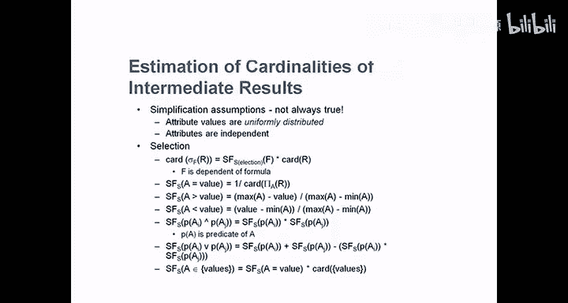

---

## 选择操作的基数估算

给定一个关系R和一个选择公式F，应用选择后结果集的基数估算公式为：
`card(σ_F (R)) = SF_F * card(R)`
其中，`SF_F`是选择公式F的选择因子。

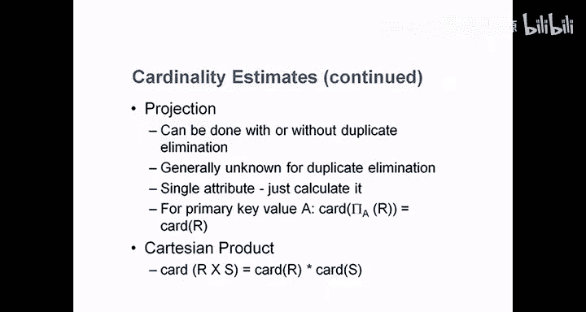

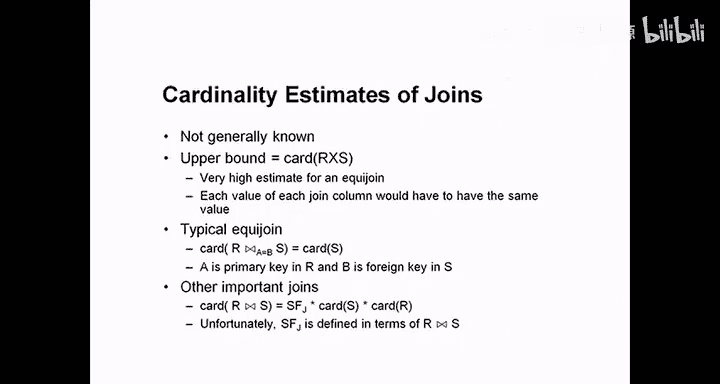

以下是针对不同选择条件的估算公式：

*   **等值选择**：`SF_(A=value) = 1 / card(dom(A))`
*   **范围选择（大于）**：`SF_(A>value) = (max(A) - value) / (max(A) - min(A))`
*   **范围选择（小于）**：`SF_(A<value) = (value - min(A)) / (max(A) - min(A))`
*   **合取选择**：`SF_(F1 AND F2) = SF_(F1) * SF_(F2)` （基于属性独立性假设）
*   **析取选择**：`SF_(F1 OR F2) = SF_(F1) + SF_(F2) - SF_(F1) * SF_(F2)`
*   **集合成员选择**：`SF_(A IN {v1, ..., vn}) = n * SF_(A=value)`

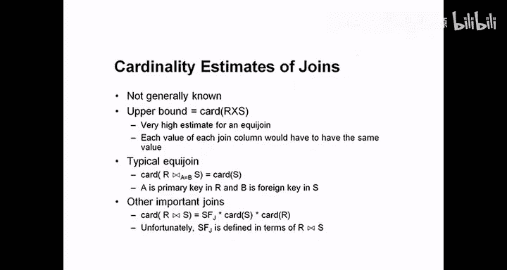

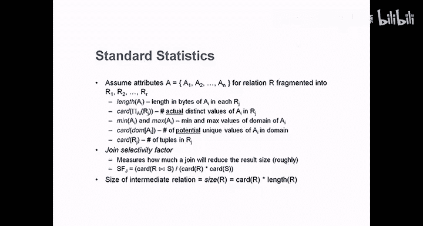

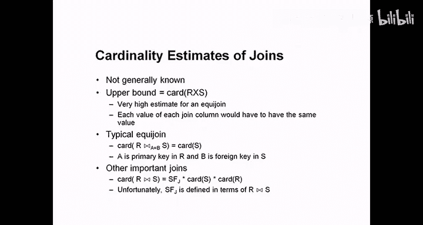

---

## 其他操作的基数估算

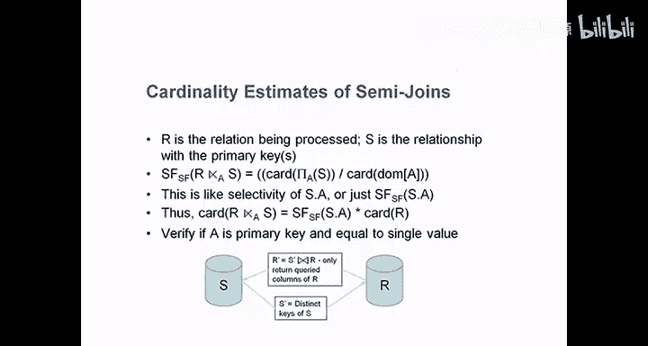

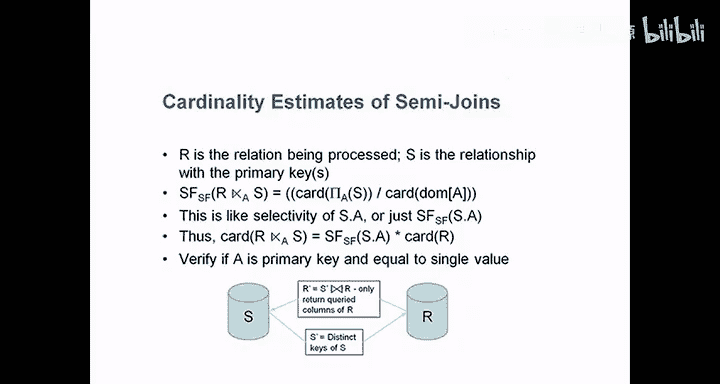

了解选择操作的估算后，我们来看看投影、连接等操作的基数估算。

*   **投影**：
    *   若不消除重复值：`card(∏_A (R)) = card(R)`
    *   若消除重复值：`card(∏_A (R))` 近似等于属性A的不同值数量，但难以精确预知。对于主键投影，其基数等于`card(R)`。
*   **笛卡尔积**：`card(R × S) = card(R) * card(S)`
*   **连接**：
    *   一般连接的上限是笛卡尔积的大小。
    *   对于等值连接，若关系R和S在连接属性上是一对多关系，则 `card(R ⋈_A S) ≈ card(S)`。
    *   对于非等值连接：`card(R ⋈_F S) = SF_join * card(R) * card(S)`。但`SF_join`本身依赖于连接结果，因此难以精确估算。
*   **半连接**：半连接是一种优化技术，用于减少分布式连接中的网络传输量。其选择因子可估算为：`SF_semijoin = card(∏_A (S)) / card(dom(A))`。
*   **并集**：
    *   上限：`card(R ∪ S) ≤ card(R) + card(S)`
    *   下限：`card(R ∪ S) ≥ max(card(R), card(S))`
*   **差集**：
    *   上限：`card(R - S) ≤ card(R)`
    *   下限：`card(R - S) ≥ 0`

---

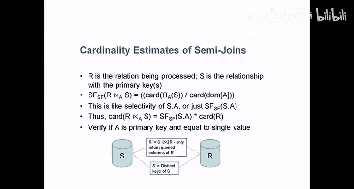

## 总结

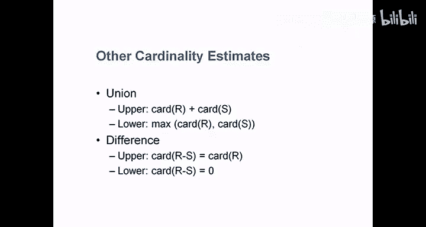

本节课中，我们一起学习了查询优化中使用的核心统计信息，包括属性长度、基数、最值等。我们引入了两个关键的简化假设（均匀分布和属性独立）来估算中间结果的基数，并推导了选择、投影、连接、并集、差集等多种关系代数操作的基数估算公式。这些估算是查询优化器评估不同执行计划成本、并最终选择最优计划的基础。理解这些统计信息和估算原理，对于深入理解数据库系统的性能调优至关重要。