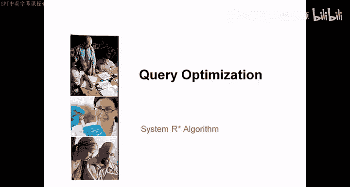
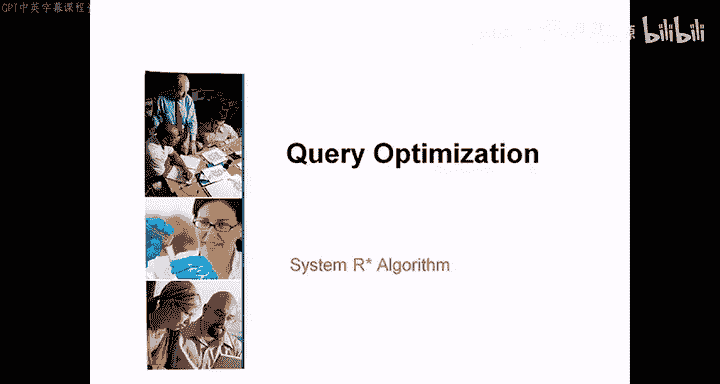
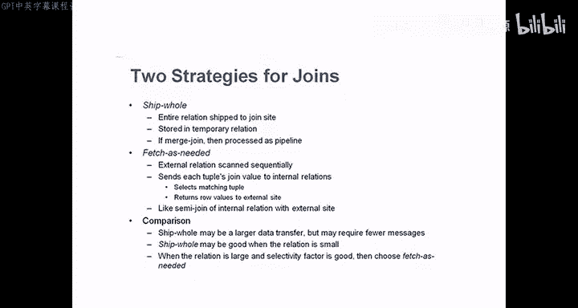
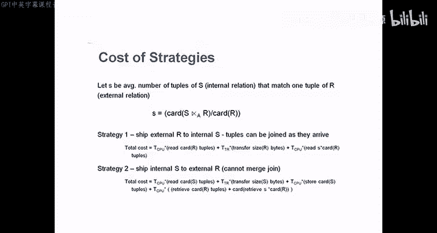
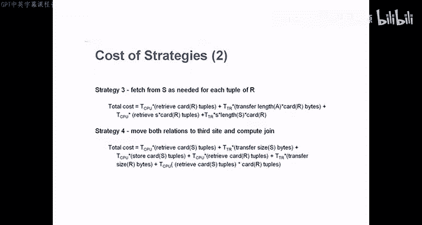

# 029：System R*算法 🧠

在本节课中，我们将学习分布式数据库系统System R*中用于执行表连接操作的优化算法。我们将重点探讨两种基本的数据传输策略，并学习如何通过成本模型计算和比较不同策略的开销，以选择最优的执行计划。

---

## 分布式System R*概述

上一节我们介绍了查询优化的基本概念，本节中我们来看看System R*在分布式环境下的具体实现。System R*主要采用两种策略来在不同站点间传输表数据以执行连接操作。

以下是两种核心的数据传输策略：

1.  **整体表传输**：将一个完整的表从一个站点传输到另一个站点。
2.  **按需行获取**：根据需要获取单行数据，并将该行传输到另一站点进行处理。

---

## 策略一：整体表传输

在整体表传输策略中，整个关系（表）被传输到执行连接的站点，并存储为一个临时关系。

如果参与连接的两个表都已排序，系统可以执行高效的**归并连接**。当被传输表的行数据到达时，可以与目标站点上已有的表进行流水线式的匹配处理，算法效率很高。

其成本计算公式如下：
`总成本 = (读取R表所有行的CPU成本) + (传输整个R表到S站点的网络成本) + (在S站点读取匹配行的CPU成本)`

具体公式为：
`Cost₁ = (card(R) * T_cpu) + (size(R) * T_net) + (card(R) * s * T_cpu)`
其中，`card(R)` 是表R的行数，`size(R)` 是表R的数据大小，`T_cpu` 是单次CPU读操作的成本，`T_net` 是单位数据的网络传输成本，`s` 是一个选择因子。

---

## 策略二：内部表回传

此策略将内部表S传输回外部表R所在的站点。在这种情况下，通常无法进行归并连接，因为表S需要在R的站点上完全存储后再进行处理。

其成本计算公式如下：
`总成本 = (读取S表所有行的CPU成本) + (传输整个S表到R站点的网络成本) + (在R站点读取并连接匹配行的CPU成本)`

具体公式为：
`Cost₂ = (card(S) * T_cpu) + (size(S) * T_net) + (card(R) * s * T_cpu)`

---

## 策略比较与选择因子

整体表传输可能涉及更大量的数据传输，但所需的消息数量可能更少（只需传输一次表）。而按需获取策略虽然每次传输的数据量小，但可能需要发送大量消息。

当关系表较小时，整体传输可能是好选择；当表很大且连接的选择性很好（即匹配的行很少）时，按需获取策略可能更优。系统依赖统计信息来帮助我们确定哪种策略更佳。

这里引入一个关键的选择因子 **s**，其定义为：
`s = (通过半连接从R选出的行数) / card(R)`
这个因子在计算最低成本策略时非常有用。

---

## 策略三：按需获取

现在，让我们看看“按需获取”策略的成本计算。该策略为表R的每一行，去表S所在的站点获取匹配的行。

以下是该策略的成本构成步骤：

1.  读取表R的每一行。
2.  将每行中用于连接的列值传输到表S所在的站点。
3.  在S站点检索匹配的元组。
4.  将结果行值传回初始的R站点。

其总成本计算公式为：
`Cost₃ = (card(R) * T_cpu) + (card(R) * length(a) * T_net) + (card(R) * s * T_cpu) + (card(R) * s * length(S) * T_net)`
其中，`length(a)` 是连接列a的长度，`length(S)` 是表S中一行的长度。

---

## 策略四：传输至第三方站点

第四种策略是将两个关系都传输到第三个站点，并在那里计算连接。

以下是该策略的成本计算：

1.  检索并传输整个表S到第三站点。
2.  检索并传输整个表R到第三站点。
3.  在第三站点执行连接操作。

其总成本计算公式为：
`Cost₄ = (读取和传输S表的成本) + (读取和传输R表的成本) + (在第三站点执行连接的成本)`
具体为：
`Cost₄ = [(card(S) * T_cpu) + (size(S) * T_net)] + [(card(R) * T_cpu) + (size(R) * T_net)] + (card(R) * s * T_cpu)`

---

## 总结

本节课中我们一起学习了System R*算法的核心。System R*在执行连接时，会综合考虑上述四种策略。它利用数据库的统计信息（如表大小、行数、选择因子s）和既定的成本模型，为每一种策略计算出一个预估的总成本。最终，系统会选择**成本最低的策略**作为该连接操作的执行计划。这种基于成本的优化方法，是System R*能够在分布式环境下高效处理大规模数据连接的关键。