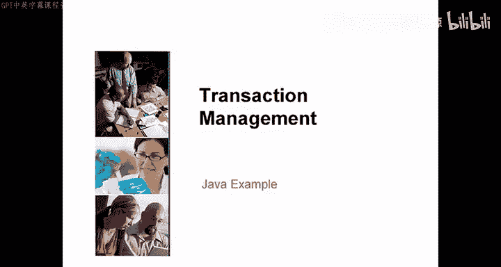
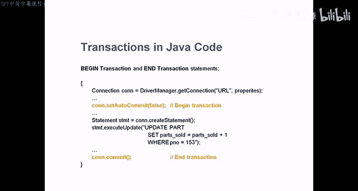
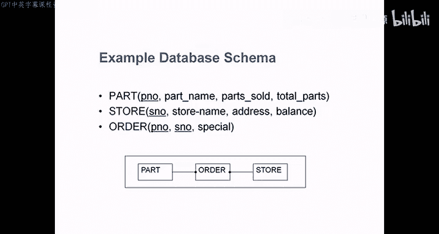
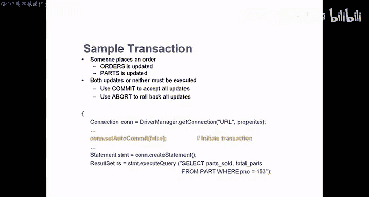
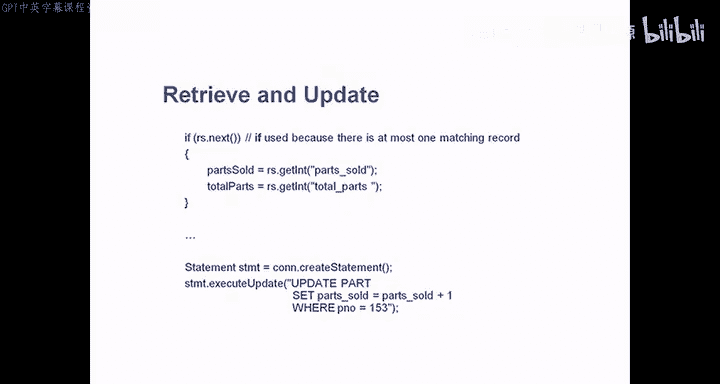
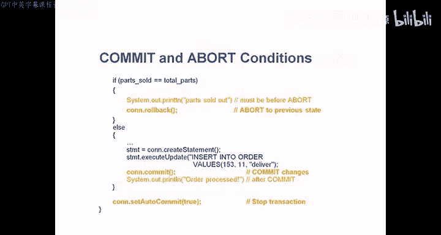

# 030：Java事务管理示例 🧑‍💻



在本节课中，我们将学习如何在Java程序中使用JDBC进行事务管理。我们将通过一个具体的订单处理示例，理解如何将多个数据库操作捆绑成一个原子性的事务，确保数据的一致性。

## 概述

事务管理的核心目标是确保一系列数据库操作要么全部成功，要么全部失败，从而维护数据的完整性。Java通过JDBC API提供了实现这一目标的方法。默认情况下，JDBC会自动提交每个独立的SQL操作。为了实现事务，我们需要显式地控制提交和回滚。

## Java事务管理基础

上一节我们介绍了事务管理的概念，本节中我们来看看Java是如何具体实现它的。

在Java中，通过JDBC操作数据库时，默认行为是“自动提交”。这意味着每执行一条`UPDATE`、`INSERT`或`DELETE`语句，其结果会立即永久保存到数据库中。

为了实现事务，我们需要将多个操作捆绑在一起。以下是实现步骤：

1.  获取数据库连接。
2.  关闭自动提交模式。
3.  执行一系列SQL语句。
4.  根据所有操作的成功与否，选择提交或回滚事务。
5.  恢复自动提交模式。

以下是核心的Java代码框架：

```java
Connection conn = DriverManager.getConnection(databaseURL);
conn.setAutoCommit(false); // 开始事务



try {
    // 执行多个SQL操作，例如：
    // statement.executeUpdate("UPDATE ...");
    // statement.executeUpdate("INSERT ...");
    
    conn.commit(); // 所有操作成功，提交事务
    System.out.println("事务提交成功。");
} catch (SQLException e) {
    conn.rollback(); // 任何操作失败，回滚事务
    System.out.println("事务失败，已回滚。");
} finally {
    conn.setAutoCommit(true); // 恢复自动提交
}
```

## 示例场景：库存与订单系统

为了更具体地说明，我们引入一个包含三个表的订单系统。

*   **`part` 表**：存储零件信息，包含`part_sold`（已售数量）和`total_parts`（总库存）等字段。
*   **`store` 表**：存储商店信息。
*   **`order` 表**：作为连接表，记录商店与零件之间的销售关系（多对多）。

其关系如下图所示：




业务逻辑是：当处理一笔订单时，需要同时更新`part`表中对应零件的已售数量，并在`order`表中插入一条新的销售记录。这两个操作必须作为一个原子单元。

## 分步Java代码解析

上一节我们了解了系统结构，本节中我们来看看实现这个事务的详细Java代码逻辑。



**第一步：建立连接并开启事务**
首先，获取数据库连接并关闭自动提交，以开启一个新事务。

```java
Connection conn = DriverManager.getConnection("jdbc:mysql://localhost/mydb", "user", "password");
conn.setAutoCommit(false);
```

**第二步：检查库存**
执行查询，获取目标零件的当前库存状态。



```java
Statement stmt = conn.createStatement();
ResultSet rs = stmt.executeQuery("SELECT part_sold, total_parts FROM part WHERE part_id = 153");
if (rs.next()) {
    int partSold = rs.getInt("part_sold");
    int totalParts = rs.getInt("total_parts");
```
**第三步：判断并执行更新**
根据库存情况决定是继续处理还是回滚。

以下是处理逻辑的关键判断：

```java
    if (partSold == totalParts) {
        // 库存已售罄
        System.out.println("零件已售罄。");
        conn.rollback(); // 回滚事务，之前对part_sold的增量更新将被撤销
    } else {
        // 库存充足，执行更新
        stmt.executeUpdate("UPDATE part SET part_sold = part_sold + 1 WHERE part_id = 153");
        // 插入订单记录
        stmt.executeUpdate("INSERT INTO order (part_id, store_id) VALUES (153, 11)");
        conn.commit(); // 提交事务，使两个更新永久生效
        System.out.println("订单处理成功。");
    }
}
```

**第四步：清理与恢复**
无论事务提交还是回滚，最后都应恢复连接状态。

```java
conn.setAutoCommit(true); // 恢复自动提交模式
stmt.close();
conn.close();
```

## 重要注意事项

在事务处理中，信息提示的时机至关重要，它关系到用户对系统状态的正确理解。

*   **回滚前的提示**：在调用`rollback()`**之前**输出错误信息（如“零件售罄”）。这是因为如果回滚操作本身失败，用户至少已收到明确的状态反馈。
*   **提交后的提示**：在调用`commit()`**之后**输出成功信息（如“订单处理成功”）。这是因为只有在提交成功后，操作才算真正完成。如果在提交前提示，系统可能在提示后崩溃，导致用户收到成功信息但数据并未保存。

## 总结



本节课中我们一起学习了Java中使用JDBC进行事务管理的完整流程。我们掌握了如何通过`setAutoCommit(false)`开启事务，将多个数据库操作捆绑；如何使用`commit()`使所有更改生效，或使用`rollback()`在出错时撤销所有更改。通过一个具体的库存订单示例，我们理解了事务对于保证数据一致性的重要性，以及信息提示与事务操作顺序的关键细节。