# 031：事务管理 - 事务的形式化定义 📚

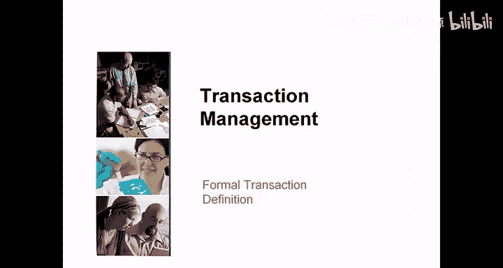

在本节课中，我们将学习事务的形式化定义。我们将介绍用于描述事务的符号和概念，包括部分排序、操作以及终止条件。理解这些形式化定义是后续深入学习事务管理的基础。

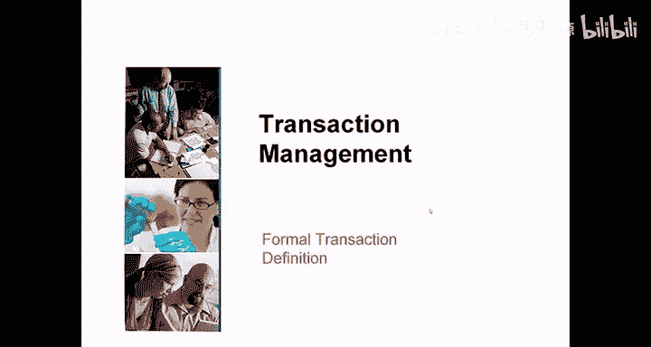

---

## 欢迎来到事务管理

本单元将涵盖事务的形式化定义。请耐心理解，这里有一些特殊的符号，但我会解释这些符号的含义，因为在讨论事务管理的过程中，我们将持续使用它们。

首先，我们定义一个事务 **Tᵢ**，它代表某个事务。例如，可能存在三个事务：**T₁**、**T₂**、**T₃**。

---

## 事务的定义

事务 **Tᵢ** 被定义为其所有操作及其终止条件的**部分排序**。

我们只关心特定的操作。请记住，在任何事务中，软件内部会发生许多操作。我们真正关心的操作只有**读**和**写**。

因此，当我说“所有操作”时，我实际上指的是该事务的**读**和**写**操作，以及终止条件。终止条件要么是**提交**，要么是**中止**。

---

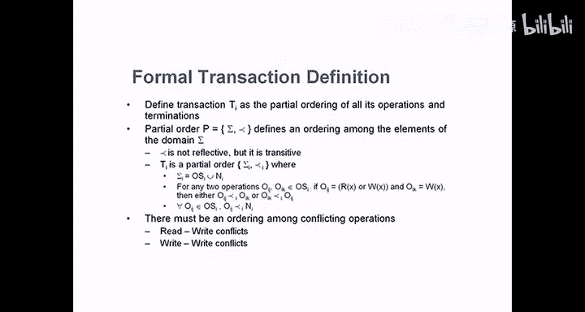

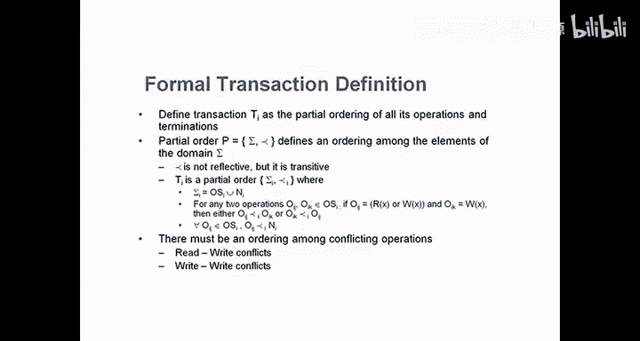

## 什么是部分排序？

部分排序由操作集合 **Σ** 定义。这个弯曲的小于符号 **≺** 表示存在某种排序关系。“小于”意味着存在排序，而“弯曲的小于”符号则表示这是一种**部分排序**。

我们可以通过一个直观的例子来理解部分排序：穿袜子和鞋子。你可以先穿右袜，然后左袜，再穿右鞋，最后左鞋；或者先穿右袜、右鞋，再穿左袜、左鞋；也可以先穿左袜、左鞋，再穿右袜、右鞋。穿袜子和鞋子的顺序有很多种。

然而，袜子的穿戴顺序并不总是严格的。你可以先穿右袜或先穿左袜，也可以先穿右鞋或先穿左鞋。但右袜必须在右鞋之前穿上，左袜也必须在左鞋之前穿上。它不一定需要紧挨在左鞋之前穿上，但必须在某个时间点先于左鞋穿上。

因此，部分排序定义了所有必须保持的顺序，同时允许那些不一定需要保持的顺序保持开放。穿袜子和鞋子的部分排序是：左袜必须在左鞋之前穿上，右袜必须在右鞋之前穿上。没有其他顺序是隐含的。这是一种部分排序，而不是严格排序。

这个弯曲的小于符号 **≺** 不具有自反性，但具有传递性。所以，**A ≺ B** 并不意味着 **B ≺ A**，但 **A ≺ B** 且 **B ≺ C** 则肯定意味着 **A ≺ C**。

---

## 事务的形式化表示

因此，事务 **Tᵢ** 是其操作（读或写，或两者）的部分排序 **σᵢ**，加上其终止条件 **τᵢ**。

**Σ** 是调度中所有操作的并集，以及其终止条件的并集。注意，对于任何两个我们考虑的操作 **Oⱼ** 和 **Oₖ**（在此事务 **Tᵢ** 内），**Oⱼ** 必须是读或写，**Oₖ** 必须是写。请记住，读与读之间没有冲突，只有读与写以及写与写之间存在冲突。

对于所有操作，存在某种部分排序，使得操作必须在其终止条件之前发生。同样，冲突操作之间必须存在某种排序，即对相同数据值的读和写以及写和写必须有某种顺序。

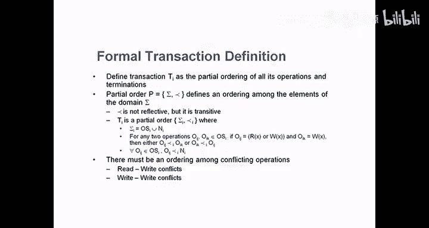

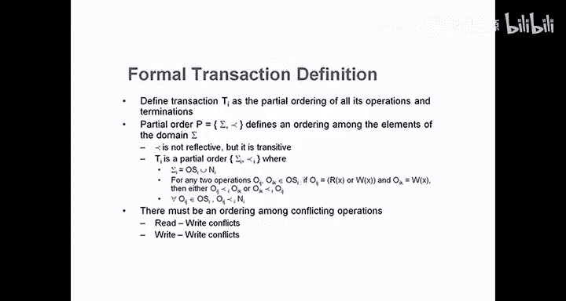

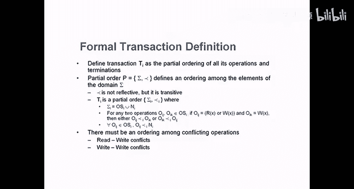

---

## 一个简单的例子

这里有一个简单的例子。假设有一个简单的事务：我们读取 **X**，将 **X** 和 **Y** 相加得到新的 **X**，我们希望将 **X** 的新值写入内存并提交。

我们用一个称为**有向无环图**的图来表示这个事务，它代表了我们关心的操作。请注意，我们只关心操作 1、2、4 和 5，因为它们是读、写或提交。我们不关心加法操作，只关心读、写和提交。

因此，你可以用一个非常简单的部分排序来表示这个事务：你可以读取 **X**，也可以读取 **Y**。你不在乎读操作的顺序，只要它们都被读取即可。两个读操作都必须在写操作之前完成。你不能在写操作之前读一个，然后在写操作之后读另一个，这没有任何意义。

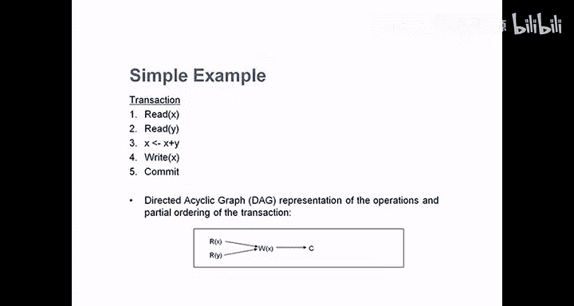

在读操作和写操作之间存在严格的排序，但在读操作彼此之间存在部分排序。最后，在写操作和提交操作之间存在严格的排序。这是一个用有向无环图表示的部分排序图。

---

## 部分排序符号详解

现在，让我们更详细地看看这个部分排序符号。在前面的简单例子中，**Σ**（操作集合）包括：读 **X**、读 **Y**、写 **X** 和提交。

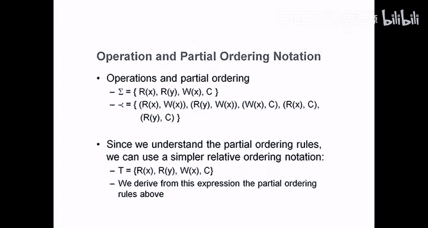

如果你查看部分排序，你会注意到在**读 X** 和**写 X** 之间、**写 X** 和**提交**之间、**读 X** 和**提交**之间以及**读 Y** 和**提交**之间都存在部分排序关系。

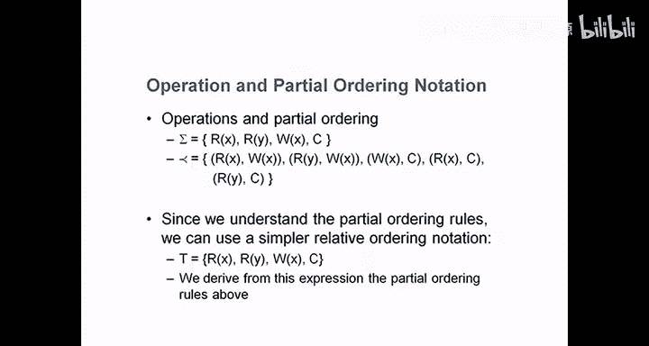

但既然我们理解了部分排序规则，我们实际上可以用更简单的排序符号来表示这一点。如果你注意到本幻灯片第三行列出的所有部分排序关系，你当然可以推导出**读 X** 必须在**提交**之前发生，这来自于我们已经指定的另外两个部分排序关系：即**读 X** 必须在**写 X** 之前发生，而**写 X** 必须在**提交**之前发生。

同样，通过查看**读 Y** 在**写 X** 之前、**写 X** 在**提交**之前的部分排序关系，你也可以推断出**读 Y** 在**提交**之前发生。

了解了这些信息，你实际上可以用更简单的术语来表示一个事务。你可以这样表示这个事务：**读 X** 和**读 Y** 以某种顺序在**写 X** 之前发生，而**写 X** 在**提交**之前发生。

因为我们知道读操作彼此之间没有冲突，它们可以以任何顺序发生。但这些读操作与写操作存在冲突，它们与提交操作也存在冲突，写操作与提交操作也存在冲突。因此，在写操作和提交操作之间必须有严格的排序，在读操作和写操作之间也必须有严格的排序。然而，读操作之间不一定有严格的排序。

在这种符号表示下，基于我们对冲突的了解，我们实际上可以通过交换读操作的顺序来创建一个对数据库产生相同效果的事务。这完全不会改变事务的含义，它只是另一种类型的事务，但会对数据库产生相同的效果。

---

## 总结

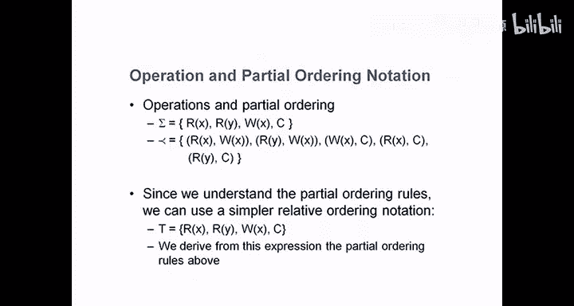

在本节课中，我们一起学习了事务的形式化定义。我们介绍了事务 **Tᵢ** 作为其读、写操作及终止条件（提交或中止）的部分排序 **σᵢ**。我们解释了部分排序的概念，并通过穿袜子鞋子的例子进行了说明。我们还学习了如何使用有向无环图来表示事务，以及如何利用对操作冲突的理解，用更简洁的符号来有效地表示事务。掌握这些形式化概念是理解后续事务调度、并发控制和恢复机制的基础。