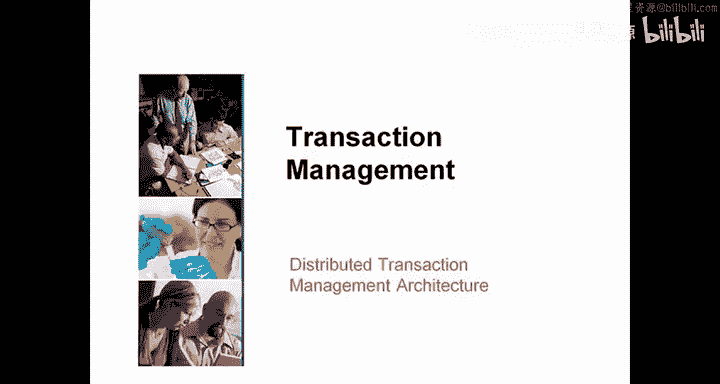
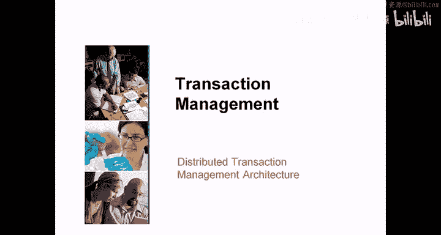
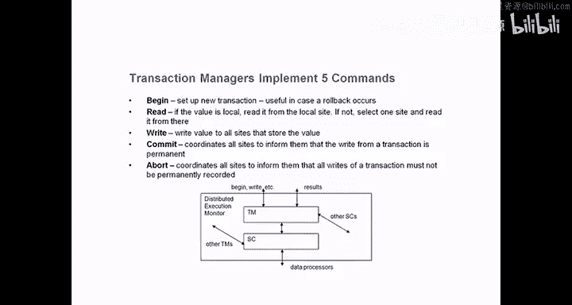

# 033：分布式事务管理架构 🏗️

在本节课中，我们将要学习分布式事务管理架构的基本组成和工作原理。我们将通过一个核心架构图，了解分布式执行监控器、事务管理器与调度器如何协同工作，以管理跨多个数据库的事务操作。

---

上一节我们介绍了分布式事务管理的背景，本节中我们来看看其核心架构组件。

想象在分布式数据库系统中，每个数据库都关联着一个这样的“盒子”，即**分布式执行监控器**。

在分布式执行监控器内部，定义了一个**事务管理器**和一个**调度器**。

---

接下来，我们详细看看这个架构如何处理操作。

分布式执行监控器会接收到诸如 `BEGIN`、`READ`、`WRITE`、`COMMIT` 或 `ABORT` 等操作指令。

操作首先会生效，并开始在其关联的数据处理器上调度这些操作。

由于存在与其他数据库关联的并行调度器，它还需要将自己必须执行的调度活动通知给其他调度器。

因此，它将与许多其他调度器保持联系，可能是所有分布式数据库的所有调度器。

---

以下是操作在架构中的流转过程：

当有一个 `BEGIN`、`READ`、`WRITE`、`COMMIT` 或 `ABORT` 指令时，该信息被发送给事务管理器。

事务管理器与其需要通信的调度器进行沟通。

调度器根据指令排队操作，然后将这些操作发送给数据处理器，并将结果返回给事务管理器。

---

调度器的指令来源有两个，理解这一点很重要。

调度器既可以接收来自其自身事务管理器的命令，也可以接收来自与其他分布式执行监控器关联的分布式事务管理器的命令。

然后，它会将返回值发送给其他分布式执行监控器，具体是发送给其中的事务管理器。

最终，结果会被传回给发起调用的应用程序。

---

当我们谈论事务管理器架构时，我们讨论的就是一个分布式执行监控器，并且通常是每个分布式数据库系统都关联一个这样的监控器。

我们将在后续讨论分布式数据库系统的事务管理时进一步探讨这一点。

分布式数据库系统的事务管理与集中式系统类似，但分布式执行监控器现在必须考虑控制多个事务和多个调度器。

我们将在下一个模块中更详细地了解这一点。

---

本节课中我们一起学习了分布式事务管理架构。我们了解了**分布式执行监控器**作为核心组件，其内部的**事务管理器**和**调度器**如何协作，以处理跨数据库的事务操作，并与系统中的其他监控器进行通信。这是理解大规模分布式数据库如何保证事务一致性与可靠性的基础。