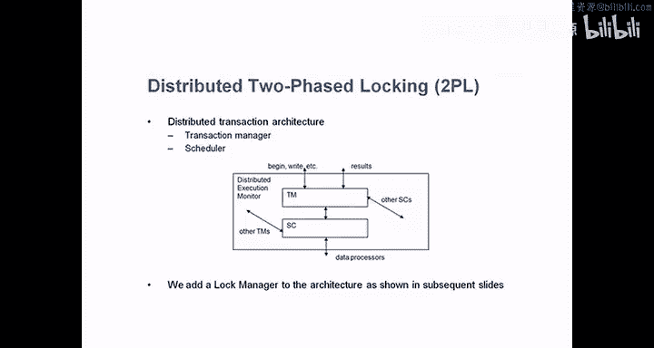
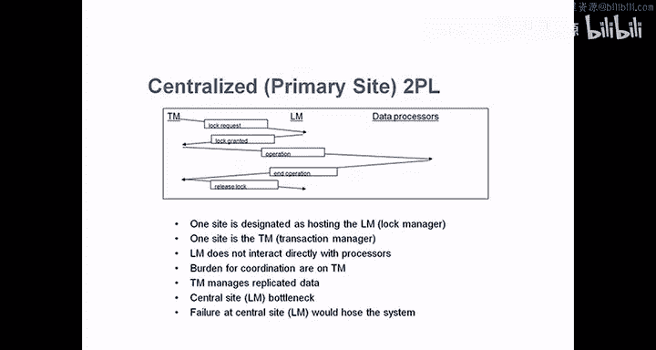
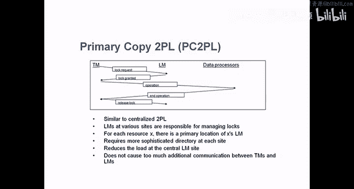
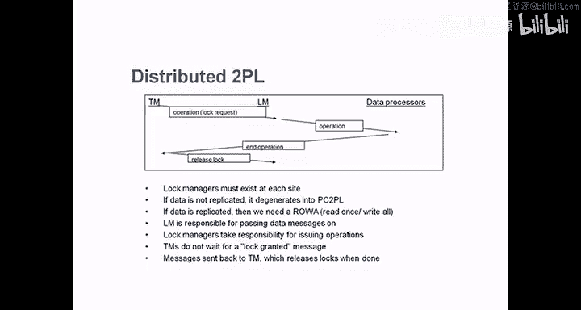
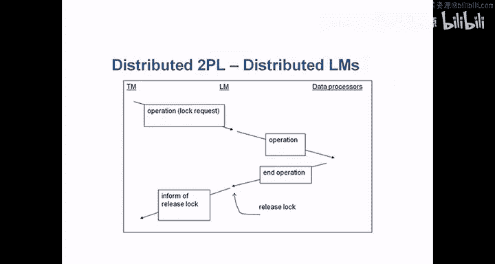

# 035：分布式两阶段锁协议 🔒

在本节课中，我们将学习分布式数据库系统中的并发控制，重点介绍分布式两阶段锁协议。我们将探讨几种不同的实现方案，分析它们的架构、工作流程以及各自的优缺点。

---

## 分布式事务架构回顾

上一节我们介绍了分布式事务的基本架构。本节中，我们来看看在这个架构下如何实现并发控制。

分布式事务架构包含分布在企业各处的分布式执行监视器。该架构中包含了事务管理器和调度器。

*   操作被发送给事务管理器。
*   事务管理器会识别正确的调度器，并将操作发送给它们。
*   调度器启动数据库处理器执行操作。
*   结果被发送回相应的调度器和事务管理器。
*   最后，结果被返回给应用程序。

---

## 集中式（主站点）两阶段锁

对于分布式两阶段锁，我们需要一个锁管理器。首先介绍的是集中式两阶段锁算法，也称为主站点两阶段锁。

以下是其工作原理示意图：

请注意示意图中的流程：

1.  事务管理器收到某个操作请求。
2.  事务管理器向锁管理器请求锁。
3.  锁管理器回复“锁已授予”的消息。
4.  事务管理器随后将操作发送给数据处理器。
5.  数据处理器处理该操作。
6.  操作结束后，数据处理器发送消息回事务管理器。
7.  事务管理器再发送消息给锁管理器以释放锁。

在此方案中，一个站点被指定为托管锁管理器，另一个站点被指定为托管事务管理器。锁管理器不直接与处理器交互。因此，事务管理器承担了整个系统中所有消息协调的负担。

同时要认识到，集中式锁管理器会成为系统的瓶颈。如果锁管理器宕机，数据库系统中的任何操作都无法进行。锁管理器站点的故障会导致系统瘫痪。同样，如果只有一个事务管理器，它的故障也会导致系统瘫痪。但目前我们讨论的是只有一个锁管理器的集中式方案。

---

## 主副本两阶段锁

主副本两阶段锁算法与之前描述的集中式两阶段锁算法几乎相同。

其操作顺序是相同的，区别在于我们将锁管理器分布在整个企业中。

以下是其关键特点：

*   每个锁管理器负责管理不同的资源 `X`。
*   存在一个锁管理器负责资源 `X` 的主位置。这意味着系统中可能存在该资源的副本，但锁管理器管理的是该资源的主位置。

工作流程如下：

1.  当事务管理器需要更新或修改某个值时，它会向相应的锁管理器发送锁请求。
2.  锁管理器授予锁。
3.  然后，操作被发送到存有资源 `X` 的多个数据处理器。
4.  处理器将“操作结束”的响应发送回事务管理器。
5.  事务管理器随后释放锁。

这种方案确实减轻了中心锁管理器站点的负载，并且没有在事务管理器和锁管理器之间引起过多的额外通信。

---

## 分布式两阶段锁管理

我们意识到上述方案仍然存在某种集中化的负担或锁管理器的负担。因此，我们继续探讨分布式两阶段锁管理。

在这种情况下，我们将锁管理器分布到每个站点。

如果数据没有复制，这实际上就退化成了之前的主副本两阶段锁算法。但在当前方案中，每个站点都有一个锁管理器。

如果数据被复制了，那么我们需要实现一种 **“读一次，写全部”** 的方法。

*   **读操作**：可以从任何复制了该数据的站点读取。
*   **写操作**：必须写入每一个站点。

锁管理器负责传递数据消息。具体流程如下（参考顶部示意图）：

1.  当事务管理器请求锁时，锁管理器会授予锁，但不会立即通知事务管理器。
2.  锁管理器会继续向数据处理器发送消息以执行操作。
3.  数据处理器完成后，发送消息回事务管理器。
4.  事务管理器转而向锁管理器释放锁。

---

## 进一步优化：事务管理器信任锁管理器

我们可以更进一步。让事务管理器将所有操作委托给锁管理器。

工作流程如下：

1.  当事务管理器通过锁请求发起一个操作时，它会发送消息给锁管理器。
2.  锁管理器转而让数据处理器执行操作。
3.  当操作结束时，数据处理器会通知锁管理器释放锁，并通知事务管理器锁已释放。

---

## 总结

本节课中，我们一起学习了分布式两阶段锁协议。

我们介绍了集中式（主站点）、主副本和完全分布式等几种不同的两阶段锁方案。这些方案各有不同的优缺点，从控制度的高低到瓶颈的多少各不相同。

选择正确的方案，很大程度上取决于你的分布式数据库系统的具体特性和使用场景。所有方案都是有效的，但具体使用哪一种，需要根据实际情况来决定。

