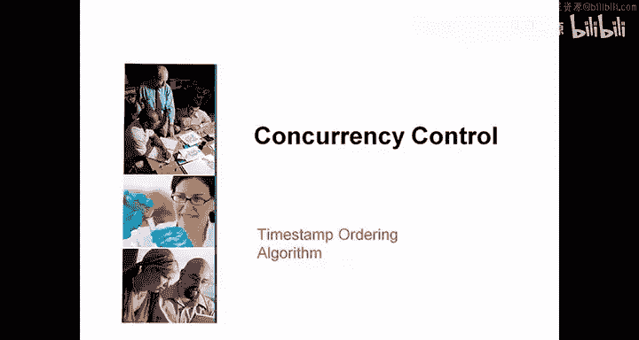
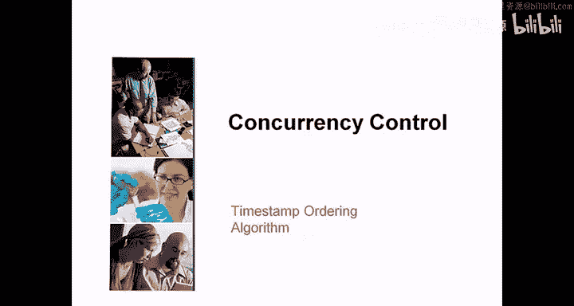
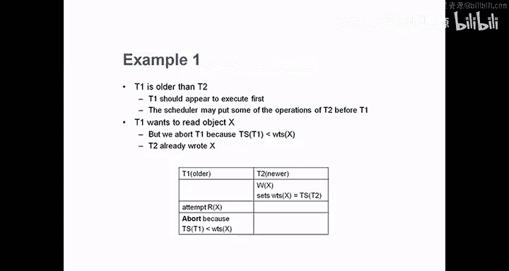
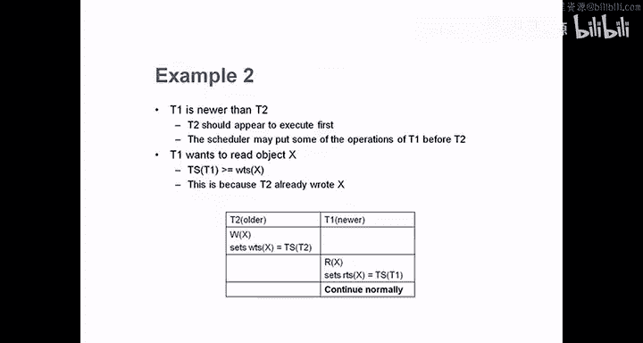
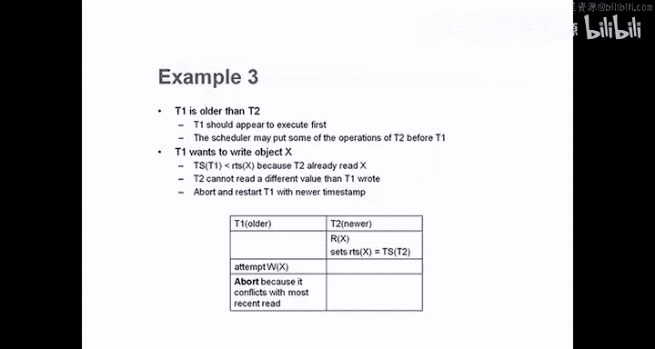
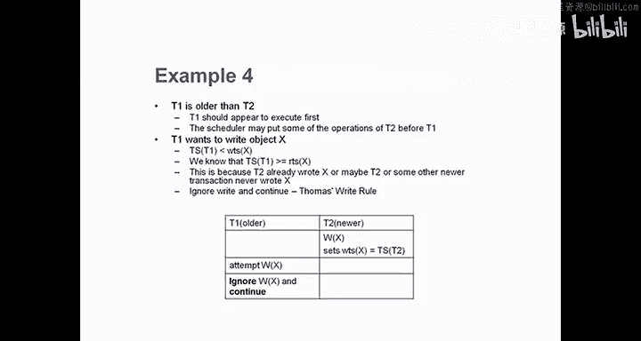
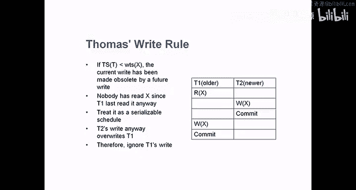
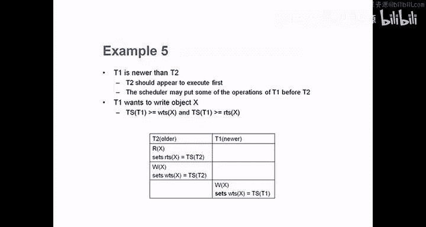

# 036：时间戳排序算法 ⏱️

在本节课中，我们将学习并发控制中的时间戳排序算法。这是一种基于时间戳而非锁的机制，用于确保多个事务并发执行时的正确性。我们将详细解析算法的每一步决策，并通过具体例子说明其工作原理。

## 概述

时间戳排序算法是一种非锁定的并发控制方法。它通过为每个事务分配一个唯一的时间戳，并依据时间戳的先后顺序来调度读写操作，从而解决冲突。如果调度器安排的执行顺序违反了时间戳顺序，算法将中止并重启相应的事务。

## 算法原理详解

上一节我们概述了算法的基本思想，本节中我们来看看算法处理读写操作的具体规则。

### 读操作的处理

以下是处理读请求的两种情况。

**情况一：较旧事务尝试读取已被较新事务写入的对象**

假设事务 T1 的时间戳比事务 T2 更早（即 T1 更旧）。理论上，T1 的操作应发生在 T2 之前。然而，调度器可能将 T2 的写操作安排在 T1 的读操作之前执行。

*   **问题**：T1（旧事务）试图读取对象 X 的值。但 T2（新事务）已经写入了 X。这意味着 T1 读取了一个本应由更晚事务写入的值，这与时间戳顺序矛盾。
*   **处理**：由于 T1 的读操作时间戳小于 X 的写时间戳（即 `T1.timestamp < X.write_timestamp`），算法将中止并重启 T1 事务，并为其分配一个更新的时间戳。

**情况二：较新事务读取已被较旧事务写入的对象**

假设事务 T1 的时间戳比事务 T2 更新（即 T1 更新）。调度器可能将 T1 的读操作安排在 T2 的写操作之前。

*   **处理**：T1（新事务）读取对象 X。T2（旧事务）已经写入了 X。这符合逻辑顺序，因为新事务读取旧事务写入的值是允许的。因此，读操作可以正常进行。

### 写操作的处理

处理完读操作，我们接下来分析写操作的几种情形。

**情况一：较旧事务尝试写入已被较新事务读取的对象**

事务 T1（旧）尝试写入对象 X，但事务 T2（新）已经读取了 X 的旧值。

*   **问题**：T2 本应读取 T1 写入后的值，但它“抢先”读取了更早的值。如果此时 T1 再写入，会破坏 T2 已读取数据的一致性。
*   **处理**：由于存在冲突（较新事务已读取），T1 的写操作将被中止。

**情况二：较旧事务尝试写入已被较新事务写入的对象（托马斯写规则）**

事务 T1（旧）尝试写入对象 X，但事务 T2（新）已经写入了一个值，且 T2 从未读取过 X。

*   **分析**：T2 的写操作是“盲写”，不依赖于 X 的先前值。即使 T1 先执行并写入，其值最终也会被 T2 覆盖。
*   **处理**：应用**托马斯写规则**。T1 的写操作可以被安全地忽略，事务可以继续执行，因为其写入效果最终无效。规则可表示为：若 `T1.timestamp < X.write_timestamp` 且 `X.read_timestamp < T1.timestamp` 不成立（即无新事务读过），则忽略 T1 的写。

**情况三：较新事务写入对象**

事务 T1（新）尝试写入对象 X，而事务 T2（旧）已经读取或写入过 X。

*   **处理**：这是最直接的情况。较新事务的写入总是被允许，因为它发生在逻辑时间线的后面。

## 总结

本节课我们一起学习了时间戳排序算法的核心机制。该算法利用时间戳决定操作顺序，通过比较事务时间戳与数据项的读写时间戳来处理冲突。关键点包括：当旧事务读取到新事务写入的值时需中止；当新事务读取旧事务写入的值时允许；写操作需特别考虑是否被较新事务读取过（决定中止）或是否会被较新事务覆盖（应用托马斯写规则忽略）。这种方法避免了锁的使用，但可能导致更多的事务重启。