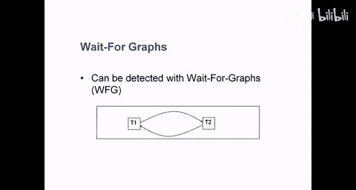
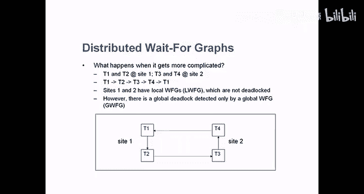
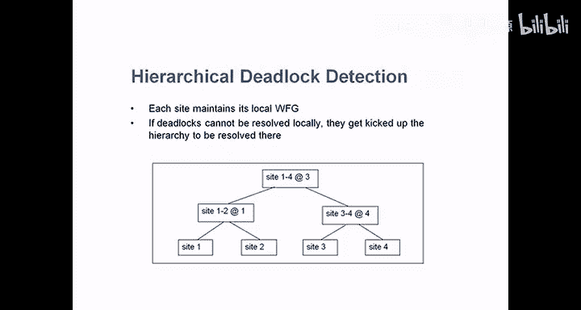

# 039：等待图检测 🔄

在本节课中，我们将要学习并发控制中的一个重要概念：等待图。等待图是一种用于检测和处理数据库系统中死锁问题的有效方法。

## 什么是等待图？ 🤔

上一节我们介绍了并发控制的基本概念，本节中我们来看看等待图的具体作用。等待图是一种处理死锁条件的绝佳方法。

请注意，在我们的示意图中有两个事务。事务1正在等待事务2已锁定的资源，同时，事务2正在等待事务1已锁定的资源。除非我们处理这个死锁，否则这些事务将无限期地等待下去。

处理死锁的一种方法是创建等待图。如果你的分布式数据库系统，甚至是一个中心化数据库系统，能够跟踪各个事务正在等待什么，你就可以检测到图中存在一个循环：事务1在等待事务2，事务2在等待事务1。在图中检测循环是一件非常容易的事情。这是一个有两个节点的图，并且这两个节点之间存在一个循环。

因此，系统可以立即介入并处理死锁。它可以中止其中一个事务或两个事务，它有这些选项。但等待图向它提示了存在一个需要处理的死锁。

## 多站点环境下的挑战 🌐

当你处理多个站点时，情况会变得稍微复杂一些。你可能在一个站点有事务1和事务2，而在另一个不同的站点管理着事务3和事务4，并且你在每个站点创建了本地等待图。

以下是各站点已知的信息：
*   在站点1，我们知道T1在等待T2。
*   在站点2，我们知道T3在等待T4。

然而，跨站点来看，T4在等待T1，并且T2在等待T3。因此，实际上，在我们的整个企业或全局系统中，存在一个循环，但在本地并不存在任何循环。

所以，我们必须创建一个全局等待图来确定是否存在循环，并判断是否存在全局死锁。

## 如何管理全局死锁检测？ 🛠️

我们如何管理这个问题呢？实际上，有多种方法可以在多个层级进行死锁检测和处理死锁。

在下面的示意图中，你注意到站点1、站点2、站点3和站点4各自都有自己的本地等待图，以及一个用于检测任何循环并在确实检测到循环时处理死锁的算法。

然后，在站点1，你可以有一个全局等待图，仅代表站点1和站点2的图。你甚至可以将这个全局图存放在站点1。这样做的好处是，如果站点1和站点2没有检测到任何循环，你可以将它们的等待图合并，形成一个处理站点1和站点2的全局等待图，并在站点1处理它。这样，你就可以看到两个站点之间是否存在死锁，并在那里处理它。

类似地，在站点4，你可以开始构建一个代表站点3和站点4的全局等待图，并在站点4处理站点3和站点4之间的任何死锁。

最终，你仍然需要担心企业范围内的死锁循环。因此，在站点3，你可能会存放一个真正全局的等待图，其中汇集了所有本地的等待图，并在站点3进行处理。这是在分布式系统中处理分层死锁检测的一种方法。

## 总结 📝

本节课中我们一起学习了等待图检测。我们了解到等待图是检测死锁的有效工具，它通过识别事务间的等待循环来工作。在单站点系统中，这相对简单。然而，在分布式多站点环境中，挑战在于本地可能没有循环，但跨站点却可能形成全局死锁。为了解决这个问题，我们介绍了分层死锁检测的方法，即通过构建不同层级的全局等待图（如站点间、企业级）来汇总信息，从而在更高的层级上识别和处理那些在本地不可见的死锁循环。