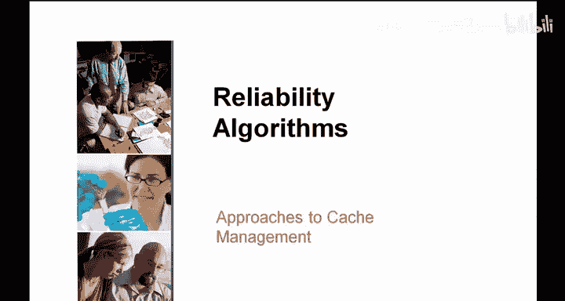
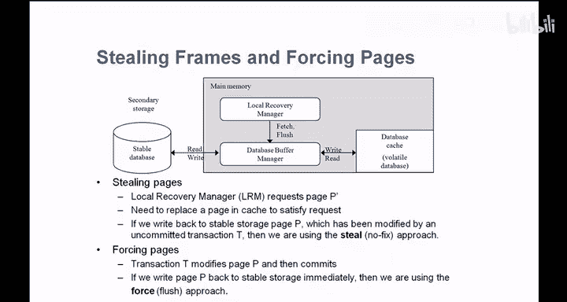

# 041：缓存管理方法 🗄️

在本节课中，我们将要学习数据库系统中的缓存管理方法。缓存是提升数据库性能的关键组件，它通过在快速的主内存中暂存数据，减少对慢速磁盘的访问。我们将探讨两种核心的缓存管理策略：“窃取”与“强制”，并理解它们如何影响数据库的可靠性与性能。

## 缓存管理方案概述

上一节我们介绍了缓存的基本概念，本节中我们来看看一个典型的缓存管理方案。

下图展示了一个典型的缓存管理方案。

在主内存中，同时存在本地恢复管理器和一个数据库缓冲区管理器。数据库缓冲区管理器负责管理左侧的二级存储（如磁盘）与右侧的数据库缓存之间的数据移动。

由于数据库缓存位于主内存中，它是易失性的。主内存可能崩溃，系统本身也可能崩溃。因此，我们预期数据库缓存会因系统问题而偶尔被清空。这是一个易失性数据库。

在左侧，我们有二级存储，它是一个稳定的数据库。这是一个磁盘系统，虽然它偶尔也会崩溃，但比主内存稳定得多。

缓存的核心思想是将页面从稳定的存储中调入数据库缓存，以便应用程序能快速访问数据，并在主内存中更快地修改数据。通过将数据移入数据库缓存，应用程序的性能可以得到显著提升。

## 缓存管理的两个核心方面

缓存管理主要涉及两个不同的方面。

第一个方面是“窃取”页面。当本地恢复管理器请求一个页面（例如页面 P‘）时，我们从稳定数据库中提取 P’。当我们将它移动到数据库缓存时，数据库缓存可能已满。因此，我们需要将数据库缓存中的一个页面替换回稳定存储，以便为新页面 P‘ 腾出空间。

这看起来没问题，但问题在于，如果我们写回稳定存储的页面包含尚未提交的数据，我们就是在将一些未提交的数据写入稳定存储。这可能是有问题的。因为如果系统崩溃，我们将在稳定存储中留下未提交的事务数据，而这些数据本不应该存在于稳定存储中。

如果我们确实将未提交的数据从易失性内存（数据库缓存）移动到稳定存储，我们使用的就是“窃取”方法，有时也称为“非固定”方法。

理想情况下，我们希望只在二级存储中保留已提交的事务，而在数据库缓存中保留未提交的事务。

第二个方面是“强制”页面。当我们把一个页面调入易失性内存（数据库缓存）后，我们可能执行一个事务并修改数据。当该事务完成后，我们希望将数据强制写回二级存储，因为我们不再需要它了。这被称为“强制”方法或“刷新”方法。

## 无窃取与强制方法

显然，“无窃取”和“强制”是最容易实现的组合。“无窃取”意味着我们不将任何未提交的事务移动到稳定存储。同时，它意味着当一个事务提交后，我们确实会将其移动或刷新回稳定存储。

这种方法实际上非常有用，因为我们总是可以确定：在缓存内存中，我们只有未提交的数据；而在稳定存储中，我们只有已提交的数据。这意味着如果系统宕机，我们在主内存中丢失的只是未提交的数据，而在稳定存储中保留的数据都是已提交的。能够将两者分开是非常有用的。

但不幸的是，这种方法在实际中并不总是运行良好。因为通常我们希望调入的页面数量会超过缓存的容量，而且缓存中可能充满了未提交的事务。然而，为了确保数据库事务的良好性能，我们仍然需要将页面调入缓存。因此，我们常常不得不实际“窃取”数据，即将未提交的事务数据放回稳定存储，这并不是我们想要做的。但我们能做什么呢？我们通常以性能为首要目标，有时这就意味着需要将未提交的数据移回稳定存储。

另一个问题是，总是将已提交的事务页面强制写回稳定存储，对于I/O操作来说并不理想，因为这需要过多的磁盘I/O。如果你总是在提交事务后立即将数据推回磁盘，你会占用大量系统资源，最终导致应用程序响应时间变慢，因为每次提交事务时都会发生大量的磁盘I/O。

## 现实中的恢复算法

因此，现实中使用的恢复算法类型是“窃取/非强制”算法。在这种算法下，我们允许已提交的事务数据保留在易失性内存中，也允许未提交的事务页面存在于稳定内存中。

当然，这里的问题是当系统崩溃时我们该怎么办。

以下是正常执行期间的恢复步骤：

1.  我们记录所有已完成的事务和所有已完成的修改。我们将这些日志保存在稳定存储中，并保证其是永久性的。我们拥有一个永久性的日志，记录了所有对数据库进行的修改或更新，包括所有事务的更新、删除等。
2.  这些日志条目必须在实际更改发生之前写入。因为你不会希望出现这样的情况：实际进行了更改，然后系统崩溃了，但由于没有写入日志条目，导致没有恢复依据。因此，我们真正想做的是先写入日志条目。

日志使得本地恢复管理器能够执行以下操作：

*   对于稳定存储中存在的未提交数据，我们希望**撤销**那些已中止和未完成事务的操作。这意味着我们希望访问稳定存储并撤销那些操作，以便我们实际上可以用最后一次已提交的事务数据来替换稳定存储中的信息。
*   最后，对于那些已提交但在被写出到稳定存储之前一直保留在易失性内存中的数据，我们希望**重做**那些操作。这样我们就可以在缓存中的稳定存储区域重建数据，以便将其移出到稳定存储。

因此，我们希望撤销那些已中止或未完成的事务，以便从稳定存储中移除未提交的数据；同时，我们希望重做已提交事务的操作，以便重建存在于易失性内存中的已提交数据。这将成为我们本地恢复管理操作的基础，随着课程的深入，我们将看到如何具体实现。

## 总结

本节课中我们一起学习了数据库缓存管理的核心方法。我们首先了解了典型的缓存管理架构，然后深入探讨了“窃取”与“强制”这两个关键概念及其对数据一致性和性能的影响。我们认识到，理想的“无窃取+强制”方法虽然简单且能保证数据一致性，但在实际高性能场景中往往不可行。因此，现实系统多采用“窃取+非强制”策略，并依赖预写日志机制来实现崩溃恢复，通过**撤销**未完成事务和**重做**已提交事务来保证数据的最终一致性。