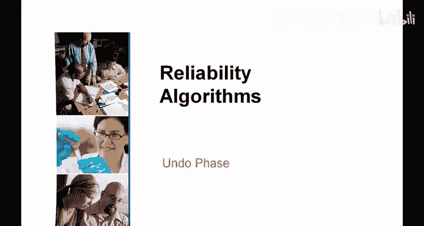
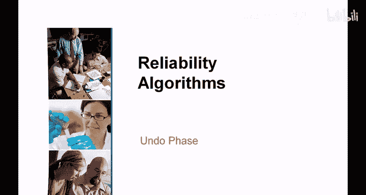
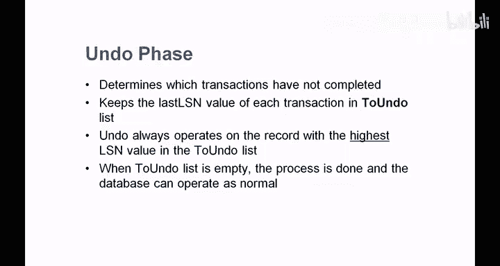
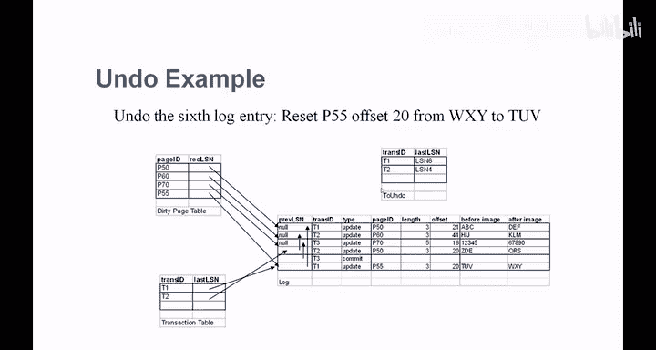
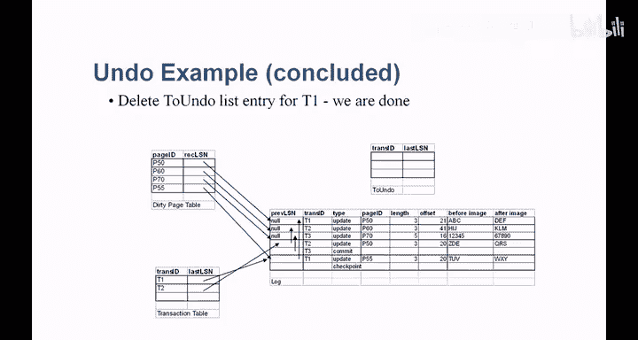

# 044：Aries 算法之撤销阶段 🗂️

在本节课中，我们将学习 Aries 恢复算法的最后一个关键步骤——**撤销阶段**。我们将了解如何识别并回滚那些在系统崩溃时尚未提交的事务，以确保数据库最终只包含已提交事务的结果，从而维持数据的一致性与持久性。

---

## 撤销阶段概述

上一节我们介绍了重做阶段，它负责将数据库恢复到崩溃前的物理状态。然而，此时数据库中可能还包含一些未提交事务（即“脏事务”）所做的修改。本节中我们来看看**撤销阶段**，它的核心目标就是**回滚所有未提交事务**，消除它们对数据库的影响。

撤销阶段是 Aries 算法的最后一步。我们已经通过重做阶段将数据库重建到了崩溃发生前的检查点状态。现在，我们需要移除数据库中所有未提交事务所对应的数据条目。

---

## 撤销阶段的工作原理

在撤销阶段，我们首先查找所有未完成的事务，并将它们放入一个待撤销列表中。然后，算法会**反向遍历**这些事务的日志记录，逐一撤销它们对数据库所做的修改。

算法总是从**日志序列号最大**的记录开始处理，即最后发生的操作最先被撤销。以下将用一个具体例子来说明这个过程。

---

## 撤销阶段示例分析

假设在崩溃后，我们已通过分析阶段和重做阶段，重建了如下状态：
*   **脏页表** 和 **事务表** 已恢复到崩溃前的状态。
*   数据库中的数据也通过重做，恢复到了崩溃前的样子。

但此时，事务 T1 和 T2 尚未提交，我们需要撤销它们的影响。

首先，我们根据事务表创建 **待撤销列表**。该列表包含了所有需要被回滚的事务及其对应的最后一条日志记录位置。

以下是初始状态：
*   事务 T1（未提交）指向日志的第 6 条记录。因此，我们将 `(T1, LSN=6)` 加入待撤销列表。
*   事务 T2（未提交）指向日志的第 4 条记录。因此，我们将 `(T2, LSN=4)` 加入待撤销列表。

---

### 撤销执行过程

撤销过程是一个循环，每次处理待撤销列表中**日志序列号最大**的记录。

**第一步：撤销 T1 的最后操作 (LSN=6)**
1.  当前待撤销列表中，LSN 最大的是 6（属于 T1）。
2.  查看日志第 6 条记录：这是一次更新操作，将页面 P55 偏移量 20 处的值从 `TUV` 改为了 `WXY`。
3.  执行撤销：将页面 P55 对应位置的值从 `WXY` **恢复**为 `TUV`。
4.  操作完成后，根据该日志记录的“前一LSN”指针（值为1），更新待撤销列表中 T1 的指针。现在 T1 对应的条目变为 `(T1, LSN=1)`。

**第二步：撤销 T2 的最后操作 (LSN=4)**
1.  此时待撤销列表中，LSN 最大的是 4（属于 T2）。
2.  查看日志第 4 条记录：这是一次更新操作，将值 `ZDE` 改为了 `QRS`。
3.  执行撤销：将 `QRS` **恢复**为 `ZDE`。
4.  根据该记录的“前一LSN”指针（值为2），更新待撤销列表中 T2 的指针。现在 T2 对应的条目变为 `(T2, LSN=2)`。

**第三步：撤销 T2 的上一操作 (LSN=2)**
1.  此时待撤销列表中，LSN 最大的是 2（属于 T2）。
2.  查看日志第 2 条记录：这是一次更新操作，将值 `HJ` 改为了 `KLM`。
3.  执行撤销：将 `KLM` **恢复**为 `HJ`。
4.  根据该记录的“前一LSN”指针，发现其值为 `NULL`。这表明 T2 的所有操作都已回滚完毕。因此，**将 T2 从待撤销列表中移除**。

**第四步：撤销 T1 的上一操作 (LSN=1)**
1.  此时待撤销列表中只剩下 T1，对应 LSN=1。
2.  查看日志第 1 条记录：这是一次更新操作，将值 `ABC` 改为了 `DF`。
3.  执行撤销：将 `DF` **恢复**为 `ABC`。
4.  根据该记录的“前一LSN”指针，发现其值为 `NULL`。这表明 T1 的所有操作也已回滚完毕。因此，**将 T1 从待撤销列表中移除**。

---

## 撤销完成后的状态

至此，待撤销列表已空，撤销阶段结束。此时数据库的状态是：
*   已提交事务 T3 的所有修改均被保留（在重做阶段已恢复）。
*   未提交事务 T1 和 T2 的所有修改均被彻底回滚，如同从未发生过。

数据库现在处于一个**稳定且一致**的状态，只包含已提交事务的结果。系统可以安全地接受新的事务，继续正常运行。

---

## 本节总结

本节课中我们一起学习了 Aries 恢复算法的撤销阶段。我们了解到：
1.  **目标**：回滚所有在崩溃时未提交的事务，确保数据库一致性。
2.  **关键机制**：使用**待撤销列表**来跟踪需要回滚的事务，并**反向遍历日志**（从最新的未提交操作开始）来执行撤销。
3.  **核心操作**：对于每一条更新日志记录，执行其**逆操作**，将数据项恢复到此事务修改之前的值。
4.  **最终结果**：数据库仅保留已提交事务的修改，为后续操作提供了一个干净、一致的起点。

撤销阶段与之前介绍的分析阶段、重做阶段共同构成了完整的 Aries 恢复算法，确保了数据库系统在发生故障后能够可靠地恢复到正确状态。