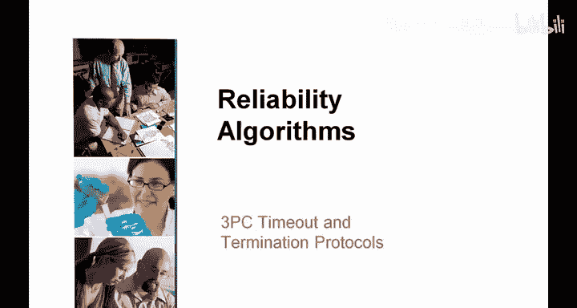
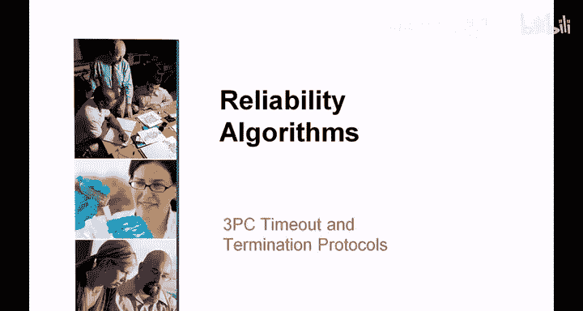
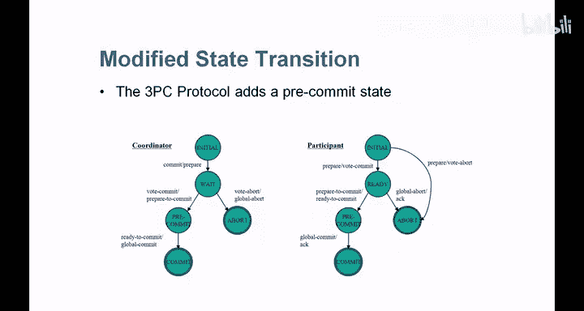
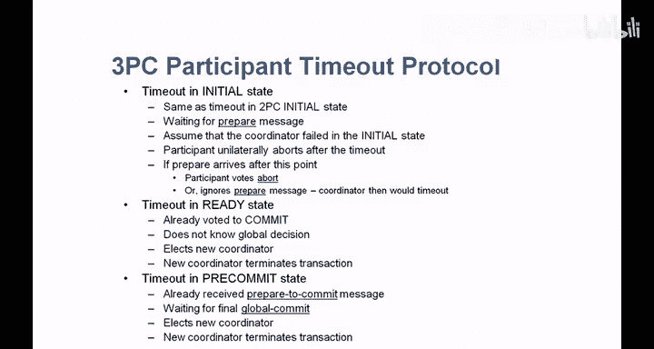
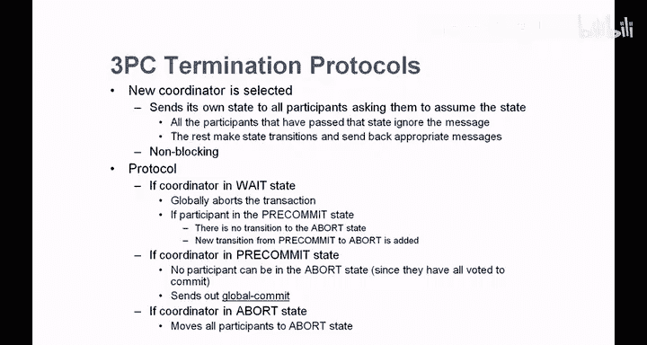

# 046：三阶段提交协议的超时与终止协议 🕒

在本节课中，我们将学习三阶段提交协议（3PC）的超时处理与终止协议。我们将了解3PC如何通过引入一个额外的“预提交”阶段来解决两阶段提交协议（2PC）中的阻塞问题，并详细探讨在超时发生时，协调者和参与者如何采取行动以确保系统能够继续运行。

## 概述

三阶段提交协议是对两阶段提交协议的改进，旨在解决参与者可能被阻塞的问题。它通过引入一个“预提交”阶段，使得即使在协调者或其他参与者发生故障时，参与者也能独立地决定事务的最终状态，从而避免无限期等待。

## 三阶段提交协议的状态转换

上一节我们介绍了2PC的阻塞问题，本节中我们来看看3PC如何通过修改状态转换来解决它。

3PC在协调者和参与者的状态机中增加了一个“预提交”状态。这个状态的关键作用是，它使得协调者的“等待”状态或参与者的“就绪”状态不再直接与“提交”或“中止”状态相邻。在2PC中，正是这种相邻关系导致了阻塞。

在预提交阶段，协调者和参与者已经投票决定“是，我们打算提交”，但尚未最终提交。这给了它们最后一次机会来确认是否真的要提交。这个过程可以概括为：“是的，我会提交。我真的要提交吗？是的，真的要提交。好的，那就提交。” 这使得参与者可以在“你真的要提交吗？”这个阶段选择中止，从而允许参与者在协调者或其他参与者宕机时能够独立地继续推进，而不会被阻塞。

以下是协调者和参与者的状态转换流程：

### 协调者视角

1.  **初始状态**：协调者发起事务，向所有参与者发送“准备”消息，询问它们是否准备提交。
2.  **等待状态**：协调者等待所有参与者的投票。
    *   如果**任何**参与者投票“否”，协调者将**全局中止**事务，并向所有参与者发送“中止”消息。
    *   如果**所有**参与者都投票“是”，协调者则进入**预提交**状态。
3.  **预提交状态**：协调者向所有参与者发送“准备提交”消息，并等待它们确认。
4.  **提交状态**：当收到所有参与者的确认后，协调者发送“全局提交”消息，并进入提交状态。

### 参与者视角

1.  **初始状态**：参与者等待协调者的指令。
2.  **收到“准备”消息**：参与者决定是中止还是提交。
    *   如果决定**中止**，则进入中止状态，并通知协调者。
    *   如果决定**提交**，则进入**就绪**状态，并通知协调者，然后等待协调者的进一步指令。
3.  **预提交状态**：当参与者收到协调者的“准备提交”消息时，它知道所有参与者都已投票同意提交。参与者进入预提交状态，等待最终的“提交”指令。
4.  **提交状态**：收到协调者的“全局提交”消息后，参与者执行提交。

接下来，我们将具体分析在这种设计下，超时发生时系统如何应对。

## 超时处理

当协调者或参与者在某个状态等待超时，它们需要有一套规则来决定下一步行动，以避免阻塞。

### 协调者超时

*   **在等待状态超时**：协调者已发送“准备”消息，但未能在超时前收到所有参与者的回复。此时，协调者可以**单方面中止**事务，因为它尚未收到任何“同意提交”的承诺。它会发送全局中止消息。
*   **在预提交状态超时**：协调者已收到所有参与者的“同意提交”投票，并进入了预提交状态。此时，它知道所有参与者至少处于“就绪”状态。因此，协调者可以安全地决定**全局提交**事务，并向所有参与者发送“全局提交”消息。
*   **在提交或中止状态超时**：协调者已发出最终指令，但可能不知道参与者是否已执行。此时，它需要依靠接下来要介绍的**终止协议**来恢复。

### 参与者超时

*   **在初始状态超时**：参与者等待“准备”消息超时。它假设协调者在初始状态就失败了，因此可以**单方面中止**事务。
*   **在就绪状态超时**：这是2PC中的阻塞状态。在3PC中，参与者已经投票同意提交，但尚未收到全局决定。此时，参与者可以**选举一个新的协调者**，由新协调者来终止事务。因为参与者尚未进入“预提交”状态，它仍有第二次机会（在预提交阶段）改变决定，因此它不会被阻塞。
*   **在预提交状态超时**：参与者已两次确认要提交（一次在投票时，一次在进入预提交时），并且知道所有其他参与者也同意提交。此时，它只需等待最终的“提交”指令。如果超时，它可以选举新协调者，而新协调者将确保事务被正确终止（提交或中止）。**关键点在于，参与者在任何状态下超时，都不会进入一个永久阻塞的状态。**

## 终止协议

当参与者因协调者超时而选举出新协调者后，终止协议将被启动，以确保所有节点就事务的最终状态达成一致。

以下是终止协议的步骤：

1.  新选举出的协调者将自己的状态发送给所有参与者。
2.  参与者收到消息后：
    *   如果参与者的状态**领先于或等于**协调者发送的状态，则忽略此消息。
    *   否则，参与者将自己的状态更新为协调者发送的状态，并回复相应的消息。
3.  新协调者根据收集到的参与者状态做出最终决定：
    *   如果**任何**参与者处于“中止”状态，或者协调者自己处于“等待”状态，则**全局中止**事务。
    *   如果**所有**参与者都处于“预提交”或“提交”状态，并且协调者处于“预提交”状态，则**全局提交**事务。
    *   需要特别处理的一种情况是：如果一个参与者处于“预提交”状态，但新协调者发现事务需要中止（例如因为另一个参与者在更早阶段失败了），那么**必须创建一条从“预提交”到“中止”的状态转换路径**。这在标准状态图中原本不存在，但在终止协议中是必要的。

这个协议确保了所有参与者和协调者都不会被阻塞。事务最终将要么全部提交，要么全部中止，从而实现了我们所需的**原子性**，同时又避免了阻塞。

## 总结

本节课中我们一起学习了三阶段提交协议的超时与终止机制。3PC通过引入“预提交”阶段，有效解决了2PC中参与者可能被阻塞的核心问题。我们详细分析了协调者和参与者在各种状态下的超时处理逻辑，并介绍了在新协调者被选举出来时，系统如何通过终止协议来恢复并达成一致状态。这使得3PC成为一个**非阻塞**的原子提交协议，提高了分布式数据库系统在部分节点故障时的可用性。