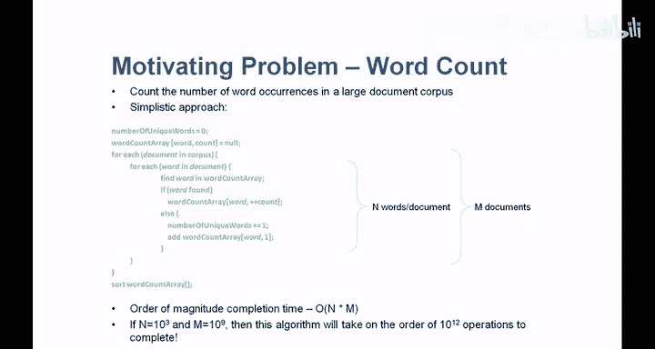
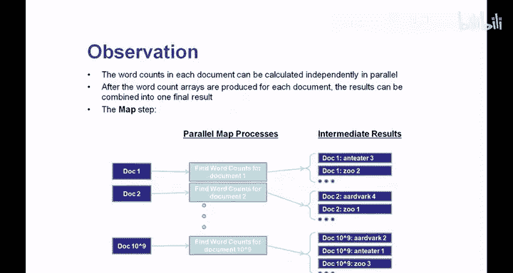
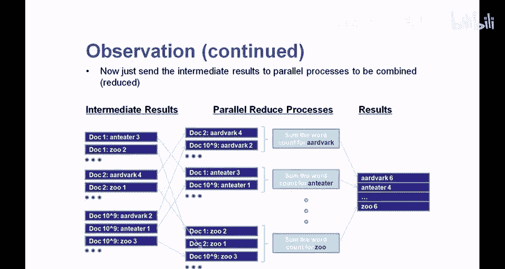
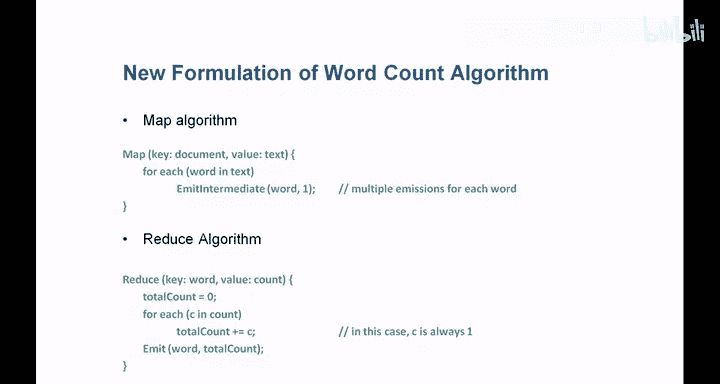
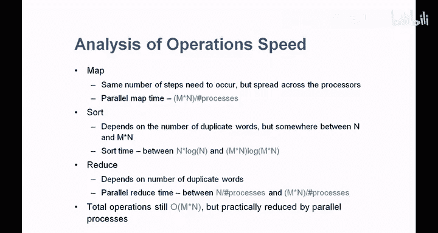
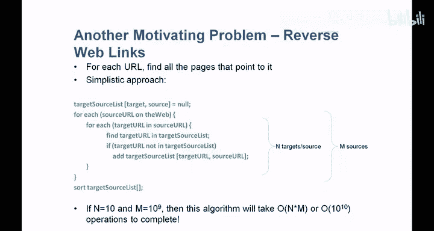
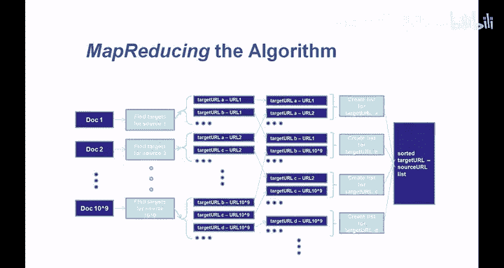
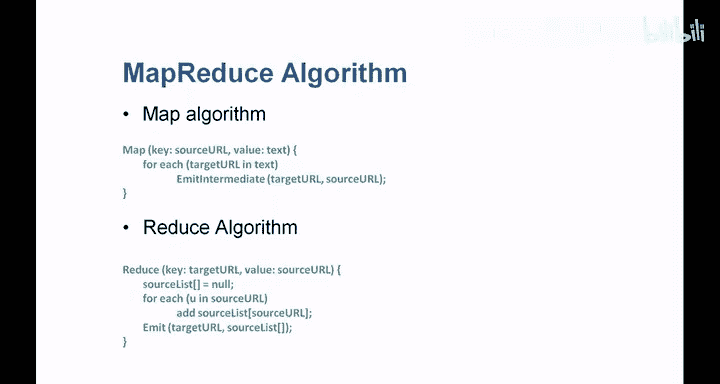

# 047：MapReduce的驱动性问题 🚀

## 概述

在本节课中，我们将学习MapReduce编程模型，并探讨其背后的核心驱动性问题。我们将通过两个具体实例——文档词频统计和网页反向链接分析——来理解MapReduce如何将大规模计算问题分解为可并行处理的步骤，从而显著提升处理效率。

---

## 1. 驱动性问题一：文档词频统计


上一节我们介绍了MapReduce的基本概念，本节中我们来看看第一个驱动性问题：如何统计海量文档中每个单词的出现次数。


我们拥有一个庞大的文档语料库。目标是构建一个数组，记录每个唯一单词及其在所有文档中出现的总次数。

### 原始算法分析

原始算法是一个嵌套循环结构。

算法开始时，我们有一个用于记录单词和计数的数组。对于语料库中的每个文档，我们执行以下操作：检查文档中的每个单词，在计数数组中查找该单词。如果找到，则将该单词的计数加一。如果未找到，则将数组大小增加一，插入新单词并将其计数设为一。

因此，对于每个文档，我们统计其中出现的单词及其频率。对于整个语料库，我们最终得到每个单词在所有文档中出现的总次数。



如果平均每个文档有 `n` 个单词，内层循环将迭代 `n` 次。如果语料库包含 `M` 个文档，外层循环将迭代 `M` 次。因此，总迭代次数为 `n * M`，算法的时间复杂度为 **O(n * M)**。

假设 `n` 为1000，`M` 为10⁹，那么算法将需要大约10¹²次操作，这将耗费很长时间。我们需要一种方法来加速这个过程。

### MapReduce解决方案

我们注意到，内层循环（统计单个文档的词频）可以独立地为每个文档并行执行。唯一需要的是，在最后阶段，我们必须合并所有独立的单词计数结果。

从MapReduce的视角来看，每个文档的词频统计可以独立并行计算。为每个文档生成词频数组后，结果可以在最后阶段合并为一个最终结果。

以下是MapReduce步骤：



**Map阶段**：为每个文档分配一个Map进程。每个Map进程统计其对应文档中的单词，并输出中间结果（单词， 出现次数）。

**Shuffle/Sort阶段**：将所有Map输出的中间结果按键（单词）进行排序和分组。

**Reduce阶段**：为每个单词分配一个Reduce进程。Reduce进程接收该单词对应的所有计数列表，并求和，最终输出该单词在整个语料库中的总次数。

以下是Map和Reduce函数的伪代码描述：



**Map函数**：输入是文档内容。对于文档中的每个单词，输出一个中间键值对。
```python
# 输入： (document_id, document_text)
# 输出：中间键值对列表 [(word, 1), ...]
def map_function(document_text):
    for word in document_text.split():
        emit(word, 1)
```

**Reduce函数**：输入是同一个单词对应的所有计数值列表。
```python
# 输入： (word, [count1, count2, ...])
# 输出：最终键值对 (word, total_count)
def reduce_function(word, counts):
    total = sum(counts)
    emit(word, total)
```

### 性能分析

*   **Map时间**：操作总数仍为 `M * n`，但被分摊到多个并行进程中执行，因此实际时间大大缩短。
*   **排序时间**：取决于需要排序的中间键值对数量，复杂度在 **O(N log N)** 到 **O(M*n log(M*n))** 之间，但排序可以在多台机器上高效进行。
*   **Reduce时间**：同样，求和操作可以在多个Reduce进程中并行执行。

总操作数虽然仍是 `M * n`，但通过并行化，实际执行时间得到了显著降低。这正是MapReduce的关键：通过大量并行进程执行计算，经过中间排序，最后归约结果。



---

## 2. 驱动性问题二：网页反向链接分析

在理解了词频统计的MapReduce实现后，我们来看另一个驱动性问题，这对许多网络搜索引擎至关重要：如何计算互联网上每个网页被其他网页链接的次数（反向链接数）。

对于互联网上的每个页面，我们想知道有多少其他页面指向它。任何单个页面本身并不知道谁链接了它，因此必须检查互联网上的所有其他页面。

### 原始算法分析

我们希望得到一个（目标页面， 来源页面列表）的列表。对于网络上的每个来源页面，检查该来源页面中包含的所有目标链接。对于每个目标链接，在目标-来源列表中查找该目标URL。如果找到，则将当前来源页面添加到该目标的来源列表中；如果未找到，则将该目标URL添加到列表中，并初始化其来源列表。



因此，内层循环处理每个来源页面的 `n` 个链接，外层循环遍历 `M` 个来源页面。算法时间复杂度为 **O(n * M)**。假设每个页面平均有10个链接 (`n=10`)，要分析10⁹个页面 (`M=10⁹`)，则需要大约10¹⁰次操作，计算量巨大。

### MapReduce解决方案

MapReduce算法则简单高效：
1.  **Map阶段**：每个Map进程处理一个网页（来源URL）。它提取该页面中的所有出站链接（目标URL），并为每个链接输出一个中间键值对：`(target_url, source_url)`。
2.  **Shuffle/Sort阶段**：将所有中间结果按键（目标URL）进行排序和分组。
3.  **Reduce阶段**：每个Reduce进程接收一个目标URL及其对应的所有来源URL列表。它只需整理这个列表，并输出 `(target_url, [source_url1, source_url2, ...])`。通过统计来源列表的长度，即可得到该目标页面的反向链接数。

以下是该问题的Map和Reduce函数描述：

**Map函数**：输入是网页内容。
```python
# 输入： (source_url, page_html)
# 输出：中间键值对列表 [(target_url, source_url), ...]
def map_function(source_url, page_html):
    for target_url in extract_links(page_html):
        emit(target_url, source_url)
```

**Reduce函数**：输入是同一个目标URL对应的所有来源URL列表。
```python
# 输入： (target_url, [source1, source2, ...])
# 输出：最终键值对 (target_url, source_list)
def reduce_function(target_url, source_list):
    # 可以直接输出列表，也可以计算列表长度作为入度
    emit(target_url, source_list)
```

这个过程非常直观。我们并行化了Map和Reduce过程，最终得到一个按目标URL排序的列表，其中包含了指向它的所有来源URL。通过统计来源列表的大小，可以快速高效地确定每个网页的流行度（被链接数），这远比线性的嵌套循环算法要快。



---

## 总结

本节课中我们一起学习了MapReduce模型解决大规模计算问题的两个经典案例。

首先，我们探讨了**文档词频统计**问题，看到了如何将串行的嵌套循环转化为并行的Map和Reduce阶段，从而高效处理海量文本数据。



接着，我们分析了**网页反向链接分析**问题，理解了MapReduce如何通过“目标-来源”的映射与归约，快速计算出互联网页面的入度，这是网页排名等算法的基石。



这两个实例共同揭示了MapReduce的核心优势：**将计算任务分解为独立的`map`和`reduce`阶段，通过数据排序和分组实现高效的并行处理与结果聚合**，从而能够应对传统串行算法难以处理的大规模数据集。