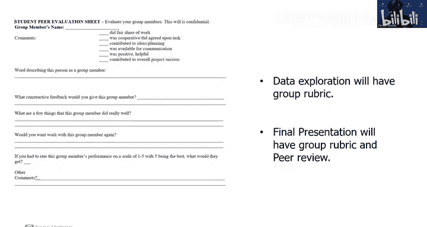

#  001：神经网络基础导论与背景知识 🧠

在本节课中，我们将介绍《神经网络基础》课程的整体框架、学习目标、评分方式以及课程要求。我们将一起了解这门课程的核心内容、你需要具备的基础知识，以及如何通过课程的学习和项目实践来掌握神经网络的原理与应用。

---

## 课程概述

本课程将介绍神经网络，并重点推导其背后的数学理论。课程目标是获得经验，能够用公式构建模型，并使用Python在算法中实现它们。

我们将重点关注数学理论，同时也会在Python中进行大量实践操作。

课程非常强调研究，因为该领域发展迅速，如果不结合最新研究，将无法提供全面的知识。

---

## 先修知识与技能要求

上一节我们介绍了课程的整体目标，本节中我们来看看成功学习本课程需要具备哪些基础。

我期望每位学员都能熟练使用Python进行编程，这是在本课程中取得成功所必需的。本课程的所有代码都将使用Python编写。这并非苛刻要求，而是因为该领域的主流模型和工具大多基于Python，因此课程也以此为基础。

在数学方面，我期望学员熟悉以下几项内容：
*   多元微积分
*   线性代数
*   概率与统计
*   数学证明的书写

如果你对其中任何一项感到困难，请随时联系我，我很乐意提供帮助。这些是本课程的先决条件。

以下是来自可汗学院的相关学习链接，可供复习：
*   多元微积分
*   线性代数
*   概率与统计

---

## 课程目标与评分构成

了解了先修要求后，我们来看看课程结束时你能达到什么水平，以及如何获得成绩。

课程结束时，学生将能够实现、应用并从数学角度分析各种神经网络，并将其应用于现实世界。我不希望这仅仅是教科书式的学习，而是希望你能在遇到数据集时，能够思考并知道可以用它做什么。这是本课程的目标。

本课程与其他机器学习课程的不同之处在于，主要重点在于基础，即数学和底层算法。我不希望学生只是应用算法，而是希望你们理解它，然后基于对数学的理解来应用算法。

以下是本课程的评分构成：

**1. 作业 (18%)**
在课程的前六周，将布置六次作业。大部分问题是基于数学推导的，每次作业都会有一个编程问题，用于练习使用Python操作实现算法。因此，你每周都需要回答数学推导问题和至少一个编程问题。

**2. 研究论文讨论 (12%)**
每周，我将选择一篇研究论文供课堂讨论。我会介绍当周主题的相关研究，然后分配一篇论文。每位学生都需要阅读，并在讨论板上讨论论文的主要观点和发现。每位学生需要发布一个讨论帖，并评论自己的想法或回应同学的想法和评论。我希望这是一个互动过程。

**3. 研究论文报告 (40%)**
这是一项个人作业。你需要按以下步骤完成：
*   在网上搜索一篇你感兴趣的、经过同行评审的神经网络领域研究论文。
*   通过电子邮件将论文标题和作者姓名发送给讲师以获得批准。
*   就研究论文的发现和主题进行录屏演示，并将视频发布到讨论板上。
*   你还需要负责至少向一位同学的视频提出一个问题。
*   如果有人对你的视频提问，你应尽力回答。请注意，完美的回答不是重点，重点是获得阅读研究的经验。

**4. 数据探索项目 (20%)**
在课程的第一天，学生将被随机分组。这个项目是最终项目的前期提案。你需要：
*   寻找一个你感兴趣的数据集（例如来自Kaggle或你的工作，前提是数据可以公开）。
*   将其视为申请研究资金的提案来处理：说明为什么关心它、我们要做什么、我们认为可以利用神经网络的哪些结构等。此时你尚未实际应用神经网络。
*   在课程中期，你的小组将进行演示，向同学展示这个数据集和研究想法。演示需要录屏并发布到讨论板，时长约20分钟。
*   同学将根据评分标准进行评判。**评论部分最为重要**。所有评论将被匿名化后反馈给小组，以供下次演示改进。

**5. 最终项目 (40%)**
你将使用在数据探索项目中选择的同一个数据集。此时，你将应用在课程中或其他地方学到的神经网络技术，尝试从该数据集中提取信息。**重点不在于获得完美的性能，而在于处理一个具有挑战性的数据集、探索它并从中学习。** 项目包括：
*   提交代码。
*   进行最终的口头报告演示并发布到讨论板。
*   接受同学的同行评审。
*   **在小组内部进行同行评审**：你需要评价你的队友在这次项目中的贡献。这模拟了现实工作中同事评价的场景。

---

## 课程教材与理念

我们已经了解了课程的具体安排，现在来看看我们将使用什么材料，以及贯穿课程的核心教学理念。

主要教材是Ian Goodfellow等人所著的《Deep Learning》。作者在线免费提供了该书的PDF版本，我非常欣赏这本书。

课程前半部分将主要使用这本教材，后半部分我们将开始更多地探索公开的研究文献。

我希望每个人专注于学习本身，成绩自然会随之而来。但我理解作为学生的关切，因此解释了每部分的评分方式。

---

## 总结与展望 🚀

本节课中，我们一起学习了《神经网络基础》课程的导论与背景知识。

我们明确了课程的核心目标是理解神经网络的数学基础并用Python实现。我们了解了需要具备的Python编程和数学先修知识。我们详细拆解了课程的评分构成，包括作业、研究讨论、个人报告、小组数据探索项目以及最终的团队项目，这些设计旨在平衡理论理解、实践应用、研究能力与团队协作。

最后，我想强调的是，我们将共同面对学习材料，而不是你与我对抗。我热爱这个领域，也热爱讨论它。期待本学期与大家一同踏上这段学习冒险之旅。请记住，在组建小组时，请为你们的团队起一个“X战警”风格的名字！

我期待本学期与大家见面，如有任何问题，请通过电子邮件或办公时间联系。很快再见！