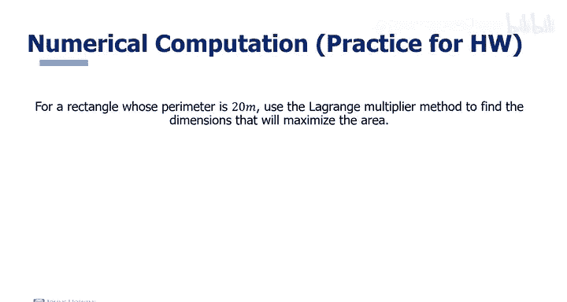
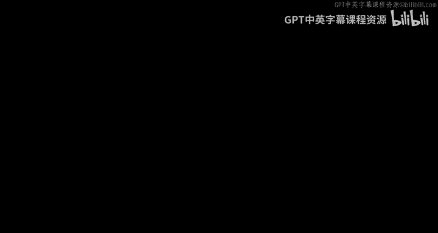

#  003：深度学习数学基础 🧮

在本节课中，我们将学习深度学习的核心数学基础。这些概念是理解后续复杂模型和算法的基石。我们将涵盖线性代数、概率论与信息论以及数值计算中的关键知识点，并通过具体的证明和例题来加深理解。

## 线性代数基础

上一节我们介绍了课程的整体框架，本节中我们来看看线性代数中的核心概念。线性代数为我们提供了描述和处理数据的语言，尤其是在处理高维数据时。

以下是线性代数中需要掌握的核心概念列表：
*   **标量、向量、矩阵和张量**：数据的基本表示形式。
*   **矩阵和向量的乘法**：线性变换的基础操作。
*   **单位矩阵和逆矩阵**：矩阵运算中的特殊元素。
*   **线性相关与张成空间**：理解向量空间结构的关键。
*   **范数**：衡量向量大小的方式，例如 L2 范数公式为 `||x||₂ = √(Σxᵢ²)`。
*   **特征分解**：将矩阵分解为特征向量和特征值。
*   **奇异值分解**：矩阵的另一种重要分解形式。
*   **伪逆**：处理非方阵或奇异矩阵的广义逆。
*   **迹**：矩阵对角元素之和。

为了具体说明如何运用这些知识，我们来看一个线性代数中的例题。

**例题：点到直线的投影**
已知表达式 `αu`（其中 `α ∈ ℝ`，`u` 是 `ℝⁿ` 中的单位向量）定义了一条直线。试推导出该直线上与任意点 `x ∈ ℝⁿ` 距离最近的点 `y` 的表达式。这种用集合中最近点替换原点的操作称为**投影**。

**证明过程如下：**
我们的目标是找到直线上的点 `y`，使其与点 `x` 的距离最小。我们定义距离度量为平方范数，因为最小化平方距离等价于最小化距离本身。

我们知道 `y` 位于直线上，因此 `y = αu`。所以，我们需要求解以下优化问题：
`min_α ||x - αu||²`

将其展开：
`||x - αu||² = (x - αu)ᵀ(x - αu) = xᵀx - 2αxᵀu + α²uᵀu`

由于 `u` 是单位向量，`uᵀu = ||u||² = 1`。因此，问题简化为：
`min_α (xᵀx - 2αxᵀu + α²)`

为了找到最小值，我们对 `α` 求导并令其为零：
`d/dα [xᵀx - 2αxᵀu + α²] = -2xᵀu + 2α = 0`

解得：
`α = xᵀu`

将 `α` 代回 `y = αu`，得到投影点 `y` 的表达式：
`y = (xᵀu) u`

证明完毕。

## 概率与信息论

理解了线性代数中的投影概念后，我们转向概率与信息论。这部分知识对于理解机器学习中的不确定性、模型评估和决策至关重要。

以下是概率与信息论的核心概念列表：
*   **随机变量**：描述随机现象结果的变量。
*   **概率分布**：随机变量取值的概率规律。
*   **边缘分布与条件概率**：多元分布中的重要概念。
*   **条件概率的链式法则**：分解联合概率的工具。
*   **独立性与条件独立性**：简化模型的关键假设。
*   **期望、方差和协方差**：描述随机变量特征的核心量。
*   **贝叶斯规则**：根据新证据更新概率的法则。
*   **连续变量**：处理连续取值的随机变量。
*   **信息论**：量化信息的基本理论。
*   **结构化概率模型**：用图模型表示复杂的概率关系。

现在，我们通过一个例题来理解信息论中的一个基本性质——可加性。

**例题：信息量的可加性**
证明信息度量具有可加性。即，观察一系列概率分别为 `p_i`（`i=1` 到 `n`）的独立事件的组合所获得的信息量，等于按任意顺序单独观察每个事件所获信息量之和。

**证明过程如下：**
信息度量通常定义为事件发生概率的负对数（以2为底），单位是比特。对于一个概率为 `p` 的事件，其信息量为 `I = -log₂(p)`。

对于 `n` 个独立事件，其联合概率是各自概率的乘积：
`P(联合事件) = ∏_{i=1}^{n} p_i`

那么，观察这个联合事件所获得的信息量为：
`I_联合 = -log₂(∏_{i=1}^{n} p_i)`

根据对数的性质，乘积的对数等于对数的和：
`I_联合 = -Σ_{i=1}^{n} log₂(p_i) = Σ_{i=1}^{n} [-log₂(p_i)] = Σ_{i=1}^{n} I_i`

其中 `I_i` 是观察第 `i` 个单独事件所获得的信息量。这正好证明了信息量的可加性。

证明完毕。

## 数值计算

最后，我们探讨数值计算中的关键问题。在实际的深度学习模型训练中，数值稳定性直接关系到算法能否成功运行。

以下是数值计算中的核心议题列表：
*   **上溢出与下溢出**：计算机表示数字时的精度限制问题。
*   **病态条件**：输入微小变化导致输出巨大变化的不稳定系统。
*   **基于梯度的优化**：深度学习模型训练的核心方法。
*   **约束优化**：在特定限制条件下寻找最优解。

我们通过一个经典的约束优化问题来应用拉格朗日乘数法。

**例题：最大化矩形面积**
已知一个矩形的周长为20米。使用拉格朗日乘数法求使其面积最大的矩形尺寸。

**求解过程如下：**
设矩形的长为 `x`，宽为 `y`。目标是最大化面积 `f(x, y) = xy`。约束条件是周长固定：`g(x, y) = 2x + 2y = 20`。

构造拉格朗日函数 `L`：
`L(x, y, λ) = f(x, y) - λ(g(x, y) - 20) = xy - λ(2x + 2y - 20)`

分别对 `x`, `y`, `λ` 求偏导数并令其为零：
1.  `∂L/∂x = y - 2λ = 0`  => `y = 2λ`
2.  `∂L/∂y = x - 2λ = 0`  => `x = 2λ`
3.  `∂L/∂λ = -(2x + 2y - 20) = 0` => `2x + 2y = 20`

由方程1和2可知 `x = y`。代入方程3：
`2x + 2x = 20` => `4x = 20` => `x = 5`
因此 `y = 5`。

所以，在周长为20米的约束下，面积最大的矩形是边长为5米的正方形。这是一个最大值点，因为当矩形退化为一条线时面积为0（最小值），而5 > 0。

求解完毕。

## 总结

本节课中我们一起学习了深度学习的三大数学支柱：**线性代数**、**概率与信息论**以及**数值计算**。我们不仅列出了核心概念，还通过**点到直线的投影**、**信息量的可加性证明**和**拉格朗日乘数法求矩形最大面积**三个具体例子，演示了如何运用这些数学工具解决实际问题。掌握这些基础是理解和构建更复杂神经网络模型的关键第一步。