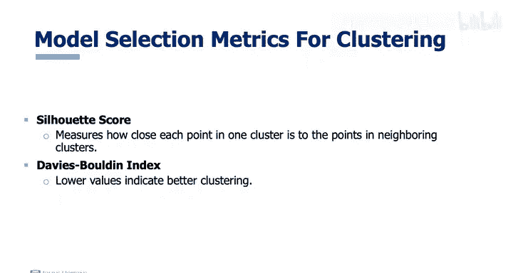

#  004：机器学习基础概述 📚

在本节课中，我们将学习机器学习的基本概念，为后续深入学习神经网络和深度学习奠定基础。我们将从宏观视角理解机器学习，并探讨其核心组成部分，包括学习算法、模型评估、优化方法等。

---

## 什么是机器学习？ 🤖

机器学习是人工智能的一个子领域，它涉及使用计算算法从数据中学习并做出预测或决策，而无需为特定任务进行显式编程。深度学习是机器学习的一个分支，专注于使用深层神经网络来建模复杂函数。

---

## 学习算法与任务 🎯

学习算法是帮助模型从数据中学习并做出预测的算法。其目标是最小化预测输出与实际输出之间的成本函数或误差。

一个计算机程序通过经验 **E** 学习，针对某类任务 **T**，并以性能度量 **P** 进行评估。如果算法在任务 **T** 上的性能 **P** 随着经验 **E** 的增加而提高，那么它就是在学习。

### 任务类型

任务是希望机器学习算法学习的具体能力。学习是实现任务的手段，而非任务本身。以下是一些常见的任务示例：

*   **分类**：将输入数据分配到预定义的类别中。
*   **回归**：预测连续数值输出。
*   **异常检测**：识别与大多数数据显著不同的数据点。

---

## 性能度量与经验 📊

性能度量是用于评估机器学习算法能力的定量指标，它因任务而异。

### 性能度量示例

以下是不同任务常用的性能度量：

*   **分类任务**：准确率、精确率、召回率、F1分数、ROC曲线。
*   **回归任务**：平均绝对误差 (MAE)、均方误差 (MSE)、R²分数。

### 经验（数据）

在机器学习和深度学习中，经验通常指模型从中学习的数据，常被称为训练集。数据使模型能够调整其参数并优化预测。

*   **监督学习**：经验涉及为模型提供输入-输出对（即带有标签的数据）。模型调整参数以使输出尽可能接近提供的标签。
*   **无监督学习**：模型仅获得输入数据，没有明确的输出或标签。其目标是理解数据的底层结构或分布。

---

## 模型容量、过拟合与欠拟合 ⚖️

上一节我们介绍了学习的基本框架，本节中我们来看看模型训练中常见的挑战：容量、过拟合和欠拟合。

### 模型容量

模型容量指模型拟合各种函数的能力，与模型复杂度密切相关。例如，具有更多神经元和层的神经网络比线性模型拥有更高的容量。高容量模型可以非常紧密地拟合训练数据，但可能在未见数据上泛化能力差。

### 过拟合

过拟合发生在高容量模型过于紧密地拟合训练数据时，它甚至开始捕捉数据中的噪声和异常值。这导致模型在训练数据上误差很低，但在未见数据上性能很差。在图表中，过拟合表现为训练集和验证集性能曲线之间存在巨大差距。

### 欠拟合

欠拟合是相反的情况，发生在模型容量过低，无法捕捉数据的潜在趋势或结构时。这导致训练误差和验证误差都很高，表明模型不够复杂。在图表中，欠拟合表现为训练和验证性能曲线都处于不理想的平台期。

---

## 超参数调优 🛠️

为了找到最佳的模型性能，我们需要调整超参数。超参数是指导训练过程的配置变量，它们影响模型架构和算法行为，例如学习率、神经网络中隐藏层的数量、正则化参数等。超参数本身不直接从数据中学习。

以下是几种常见的超参数调优方法：

*   **网格搜索**：暴力遍历预定义的超参数子集的所有组合，评估每种配置下的模型性能。这种方法全面但计算成本高、耗时。
*   **随机搜索**：从预定义的分布中随机测试超参数值。研究表明，随机搜索通常能以比网格搜索更少的试验次数找到合适的超参数集。
*   **贝叶斯优化**：一种基于概率模型的方法，它构建目标函数的概率模型来建议更好的超参数，通常比随机搜索更高效。
*   **基于梯度的优化**：如果超参数相对于目标函数是可微的，则可以计算梯度并使用梯度下降法进行优化，常用于神经架构搜索。
*   **早停**：在训练期间监控模型在验证集上的性能，如果性能停止改善或开始下降，则停止训练。这可以防止过拟合并节省计算资源。
*   **交叉验证**：通常与超参数调优结合使用，以获得更稳健的模型性能估计。它将训练数据划分为多个子集，模型在部分子集上训练，在其余子集上验证，并循环此过程，最后取平均性能。
*   **正则化技术**：如L1和L2正则化，它们包含控制正则化强度的超参数，调整这些参数也有助于防止过拟合。

**实用建议**：通常从粗略搜索（如随机搜索）开始，然后使用更精细的方法（如贝叶斯优化）进行优化。务必考虑计算成本，并确保拥有可靠的验证集来评估超参数。

---

## 偏差与方差 🎭

理解了如何调整模型后，我们需要深入模型误差的来源：偏差和方差。

### 偏差

偏差是由于模型过于简化所做的假设而导致的误差。高偏差模型可能错过特征与目标输出之间的相关关系，导致预测 consistently 不正确，从而造成欠拟合。例如，用线性回归去拟合非线性数据就会产生高偏差。

### 方差

方差是由于学习算法过于复杂而导致的误差。高方差模型会捕捉数据中的噪声，并对训练集中的微小波动高度敏感。这导致模型在训练数据上表现良好，但在未见数据上泛化能力差。例如，使用非常高次数的多项式回归拟合数据，会导致曲线剧烈摆动以拟合噪声。

### 偏差-方差权衡

理想情况下，我们希望模型同时具有低偏差和低方差。但在实践中，减少一个往往会增加另一个。增加模型复杂度会降低偏差但增加方差；降低模型复杂度会增加偏差但减少方差。偏差-方差权衡代表了追求良好模型时的这种张力。

绘制模型误差随模型复杂度的变化图，通常可以看到偏差下降而方差上升。最佳点位于中间某处，它提供了偏差和方差之间的平衡。

**缓解策略**：使用正则化（如L1、L2）可以防止系数变得过大，从而惩罚复杂度。交叉验证通过以多种方式分割数据来确保模型在不同数据子集上表现良好。

---

## 数据集划分与正则化 📈

为了有效管理偏差和方差，我们需要合理使用数据并采用正则化技术。

### 数据集的作用

*   **训练集**：用于训练模型，模型通过它来学习并随时间改进。
*   **验证集**：用于模型选择和超参数调优。
*   **测试集**：用于评估模型的最终性能。

增加训练数据量有助于缓解过拟合，因为更多的数据使得模型更难记住噪声和异常值。但需注意，简单地添加更多数据并不总是可行或有效，特别是当数据本身有噪声或不具代表性时。

### 正则化

正则化是一种用于防止过拟合的技术。它向损失函数添加惩罚项，以阻止模型过度拟合训练数据，从而降低方差。常见的正则化方法包括L1/L2正则化、Dropout和早停等。我们将在深度学习的上下文中进一步讨论这些方法。

---

## 损失函数 📉

现在，让我们看看驱动模型学习的核心：损失函数。

损失函数（有时称为成本函数）在机器学习中扮演着核心角色。它们衡量预测值与实际值之间的差异，并提供一个优化算法试图最小化的度量。损失函数的选择会显著影响模型性能，应根据问题性质（如回归、分类）进行选择。

以下是一些常见的损失函数示例：

*   **均方误差 (MSE)**：主要用于回归问题，计算实际值与预测值之间平方距离的平均值。公式为：`MSE = (1/n) * Σ(y_i - ŷ_i)^2`
*   **平均绝对误差 (MAE)**：也用于回归问题，计算实际值与预测值之间绝对差异的平均值。公式为：`MAE = (1/n) * Σ|y_i - ŷ_i|`
*   **Huber损失**：MSE和MAE的组合，对小误差值为二次型，对大误差值为线性型，使其对异常值不如MSE敏感。
*   **交叉熵损失**：用于分类问题，量化实际类别分布与预测类别分布之间的差异。
*   **分类交叉熵损失**：交叉熵损失向多类分类的扩展。
*   **合页损失**：常用于支持向量机，有时也用于神经网络，用于目标值为-1和1的二元分类。
*   **KL散度**：衡量两个概率分布之间的差异，常用于无监督学习或模型间知识迁移。
*   **余弦相似度损失**：衡量两个向量（真实值与预测值）之间夹角的余弦值，对方向性而非幅度重要时有用。
*   **对比损失和三元组损失**：用于孪生网络或三元组网络，以学习嵌入表示，处理相似或不相似的数据对或三元组。
*   **自定义损失函数**：根据特定问题和需求，从业者可以设计自己的损失函数，以实现定制化的优化目标。

---

## 优化方法 🚀

有了损失函数，下一个问题是如何优化它。优化是训练机器学习模型的核心环节，涉及寻找使损失函数最小化的最佳模型参数。优化方法的选择取决于问题性质、数据集大小和模型 specifics。

### 随机优化

我们有一个依赖于参数θ的函数F，它是一个可微的随机函数。我们感兴趣的是最小化该函数关于其参数的期望值。随机性通常源于对数据点的随机子采样或函数本身固有的噪声。

在随机梯度下降中，由于使用小批量数据和噪声，损失函数表面不规则，我们需要较小的步长以避免发散。理想情况下，我们希望在垂直方向（梯度变化大的方向）减慢学习，在水平方向（梯度变化平缓的方向）加快学习。

以下是几种改进的优化算法：

*   **带动量的SGD**：通过计算梯度的指数移动平均来平滑更新步骤，允许使用更大的步长，加速收敛。
*   **RMSProp**：通过按梯度平方的指数移动平均来调整步长，进一步减少垂直方向的更新幅度，增大水平方向的更新幅度，从而更有效地平滑噪声。
*   **Adam**：结合了动量（一阶矩估计）和RMSProp（二阶矩估计）的思想。它计算梯度及其平方的指数移动平均值，并进行偏差校正，使得优化过程更加高效和稳定。Adam在实践中通常表现优异。

实验表明，Adam在多种任务（如分类任务CIFAR-10）上通常优于其他优化器。

---

## 模型评估与选择 ✅

最后，在训练好模型后，我们需要评估和选择最佳模型。模型评估与选择是机器学习工作流中的关键步骤，确保所选模型在未见数据上表现良好并具有良好的泛化能力。

### 评估方法

*   **留出法**：将数据分为训练集和测试集（或训练集、验证集、测试集三部分）。模型在训练集上训练，在验证集上评估和调优超参数，最后在测试集上评估最终性能。方法简单，但数据集较小时可能不稳定。
*   **K折交叉验证**：将数据集分成K个子集（折）。模型依次在K-1折上训练，在剩余的1折上测试，重复K次，每次使用不同的折作为测试集，最后取K次评估的平均性能。这有助于减少留出法的方差，在数据量不足时是首选。
*   **留一法交叉验证**：K折交叉验证的特例，其中K等于数据点数。每个数据点依次作为测试集一次。计算成本高昂。
*   **自助法**：从数据集中有放回地随机抽取样本，模型在这些样本上训练和测试。这有助于了解模型的偏差和方差。

### 评估指标

根据任务类型选择合适的评估指标：

*   **回归任务**：均方误差 (MSE)、平均绝对误差 (MAE)、R²分数。也可以直接使用损失函数作为指标。
*   **分类任务**：准确率、精确率、召回率、F1分数、AUC。交叉熵损失也常作为指标。
*   **聚类任务（无监督）**：轮廓系数（衡量一个点与自身簇和其他簇的接近程度）、戴维森堡丁指数 (DBI，值越低表示聚类越好）。

### 模型选择技术

之前讨论过的超参数调优方法，如网格搜索、随机搜索、贝叶斯优化和正则化，同时也是重要的模型选择技术。

---

## 总结 🎓

本节课中，我们一起学习了机器学习的基础知识。我们从机器学习的定义和其与深度学习的关系开始，探讨了学习算法、任务类型和性能度量。我们深入研究了模型容量、过拟合和欠拟合的概念，以及如何通过超参数调优来优化模型。我们分析了模型误差的来源——偏差和方差，并讨论了如何通过数据集划分和正则化来管理它们。接着，我们介绍了驱动模型训练的损失函数和各种优化方法，特别是像Adam这样高效的优化器。最后，我们涵盖了模型评估与选择的关键步骤和方法。这些概念为理解更复杂的深度学习模型奠定了坚实的基础。