#  005：深度前馈网络 🧠

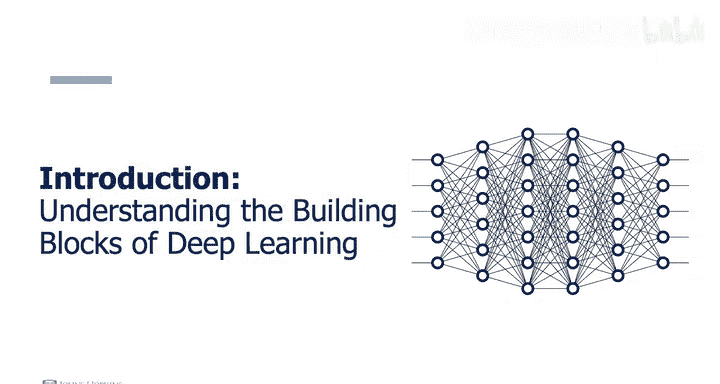

在本节课中，我们将学习深度前馈网络（Deep Feedforward Neural Networks）的基础知识。我们将探讨其数学原理、核心组件（如激活函数和隐藏层）、训练方法（如梯度下降和反向传播），以及如何设计有效的网络架构。通过理解这些基础概念，我们可以为学习更复杂的深度学习模型打下坚实的基础。

---

## 深度前馈网络概述

深度前馈网络，通常被称为多层感知机（MLPs）。它们的作用是近似一个目标函数 `F*`。网络接收输入，并通过一系列没有反馈连接的层进行前向传播。

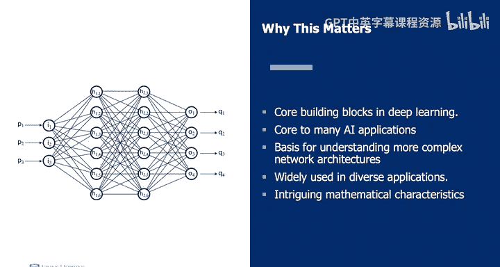

深度前馈网络是深度学习的核心构建模块，广泛应用于许多人工智能应用中。它们是理解更复杂网络架构的基础。从数学角度看，它们是非常强大的非线性函数逼近器。

---

## 通用逼近定理

一个著名的**通用逼近定理**指出，在合理的约束条件下，神经网络可以以任意精度逼近任何函数。

具体来说，一个具有单隐藏层的神经网络，可以逼近几乎处处连续的任何函数。这是机器学习中的一个重要定理。

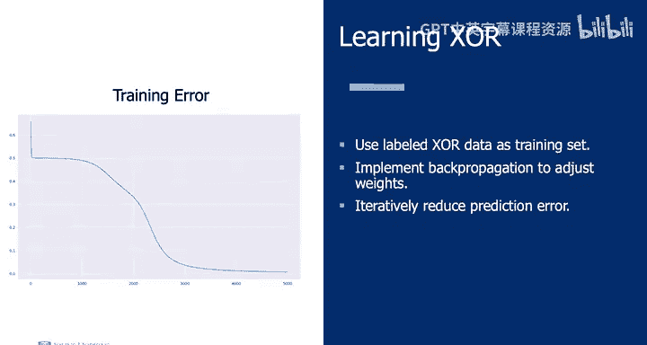

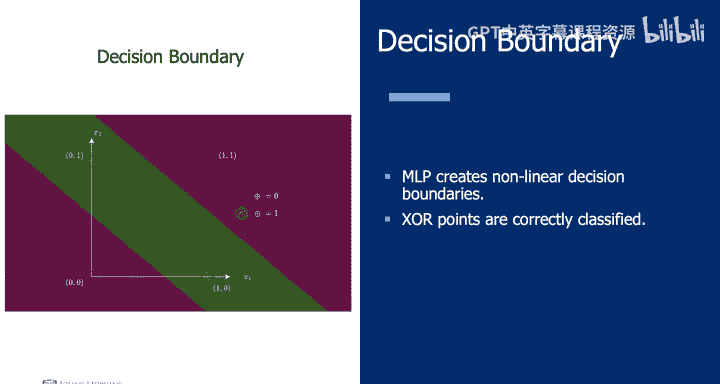

需要谨慎理解的是，该定理阐述了网络的理论能力，但并未说明逼近函数的可学习性或训练效率。在实践中，人们发现具有许多层的**深度网络**，比浅层网络能更高效地逼近复杂函数。

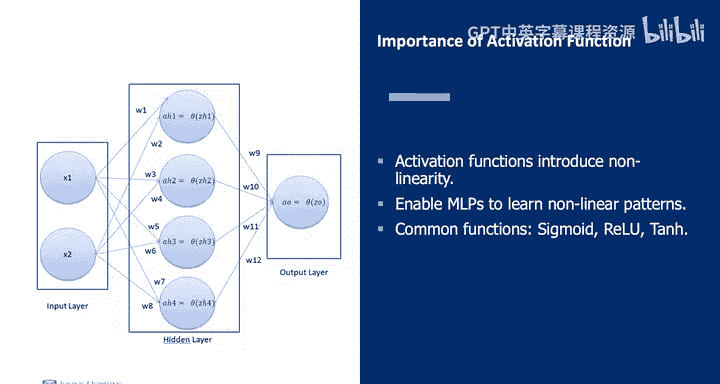

该定理并未规定如何找到权重和偏置，也未说明对于给定的逼近需要多少隐藏单元。从更广泛的角度看，定理确保了神经网络在理论上可以逼近一个函数，而实践中的挑战在于如何有效地进行训练。

---

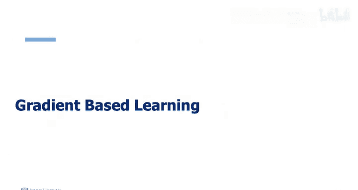

## 一个简单示例：异或（XOR）问题

让我们通过一个例子来理解。逻辑异或（XOR）是一个二元运算，当输入中为1的数量是奇数时，输出为1。观察其真值表可以发现，这是一个非线性可分问题。

感知机（Perceptron）会尝试绘制一个线性决策边界，但异或问题不是线性可分的，因此感知机无法解决这个问题。

多层感知机（MLPs）可以捕获非线性关系。它们由输入层、隐藏层和输出层组成，并使用非线性激活函数，例如Sigmoid函数。

一个典型的MLP结构可能包含两个输入神经元、两个隐藏神经元和一个输出神经元。输入是0和1，输出判断是否为异或真。

我们使用异或数据作为训练集，并实现反向传播算法来调整权重，从而迭代地减少预测误差。

最终，MLP创建了一个非线性的决策边界，成功地对异或点进行了正确分类。

---

## 激活函数

激活函数为神经网络引入了非线性，使MLPs能够学习非线性模式。常见的激活函数包括Sigmoid、ReLU和Tanh。

*   **Sigmoid和Tanh**：将输出压缩到特定范围（Sigmoid为[0,1]，Tanh为[-1,1]）。但它们容易导致梯度消失问题，因为在输出接近饱和区时，其梯度接近于零，会显著减慢学习速度。
*   **整流线性单元（ReLU）**：输出非负值，有助于缓解梯度消失问题，因为其正区间的导数为1。其变体包括Leaky ReLU、参数化ReLU（PReLU）和指数线性单元（ELU）等，但也存在“神经元死亡”等问题。

激活函数的研究非常活跃，还有Swish、Maxout、Softplus等多种选择。选择哪种激活函数通常取决于具体任务和网络深度。ReLU及其变体在深度网络中非常流行，而Sigmoid和Tanh则适用于特定场景，如二分类问题的输出层。

---

## 架构设计

架构设计涉及构建神经元的布局，决定网络的深度（层数）和宽度（每层的神经元数）。这直接影响模型的学习能力和计算成本。

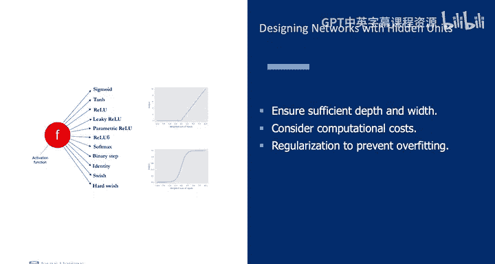

*   **深度 vs. 宽度**：增加深度可以提升模型的表示能力，但也会带来训练挑战（如梯度消失/爆炸、过拟合）。增加宽度有助于网络学习更多特征，但会增加计算量。
*   **挑战与技巧**：
    *   **深度带来的挑战**：梯度消失/爆炸、过拟合风险增加、前向/反向传播计算密集。
    *   **应对技巧**：使用正则化（如L2正则化、Dropout）来惩罚大权重、避免过拟合；使用**跳跃连接**（如ResNet中的残差连接）来促进更深模型的训练。
*   **输出层设计**：取决于任务类型。
    *   **回归问题**：通常使用线性激活函数，损失函数常用均方误差（MSE）。
    *   **分类问题**：通常使用Softmax激活函数，损失函数常用交叉熵（Cross-Entropy）。
*   **现实约束**：设计时需考虑计算资源、数据可用性（数据少时复杂模型易过拟合）以及是否使用**迁移学习**（使用预训练架构）。

从简单的MLP到ResNet、Transformer等先进架构的演进，是由任务需求、数据集和硬件进步驱动的。因此，关注当前研究动态非常重要。

设计有效的模型既是理论也是实验，是一门艺术与科学的结合。关键在于平衡模型容量与可用数据及计算资源。

---

## 反向传播与微分

训练神经网络需要计算损失函数相对于权重的梯度。对于拥有成千上万甚至更多参数的网络，解析计算梯度是不切实际的，因此需要高效的计算方法。

反向传播依赖于链式法则，它将复杂的求导过程分解为更简单的部分。

*   **前向传播**：计算网络输出和损失。
*   **反向传播**：将梯度从输出层向输入层传播，利用链式法则计算各层参数的梯度。

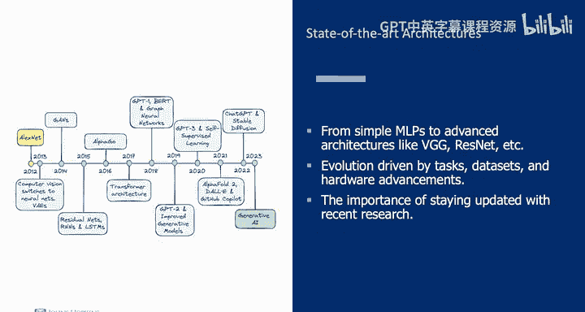

我们可以用计算图来可视化这个过程，节点代表运算，边代表数据流，这有助于结构化反向传播过程。

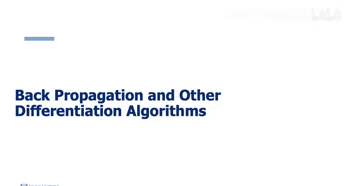

反向传播算法步骤如下：
1.  用随机值初始化网络权重。
2.  对每个训练样本，执行前向传播和反向传播。
3.  根据计算出的梯度调整权重。

反向传播也面临梯度下降法共同的挑战（如鞍点、局部最优），以及自身特有的一些问题（如梯度爆炸/消失、学习率选择、计算效率）。为此，发展出了如Rprop、共轭梯度等优化算法，它们超越了标准的反向传播，在某些场景下能提供更快的速度或更好的稳定性。

为了充分发挥反向传播的效能，可以采取以下策略：
*   **明智地初始化权重**：例如使用Xavier初始化方法。
*   **考虑自适应优化方法**：如Adam、RMSprop。
*   **使用正则化**：防止过拟合。

反向传播是深度学习的基石之一，它严谨且计算高效。该领域的研究每天都在持续改进。

---

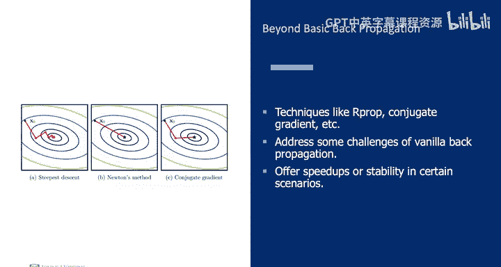

## 总结

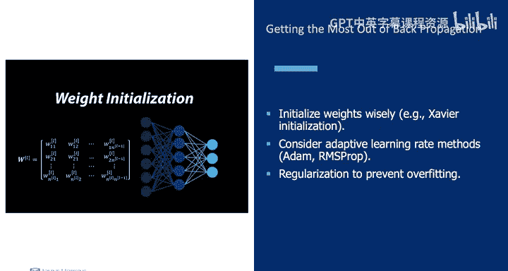

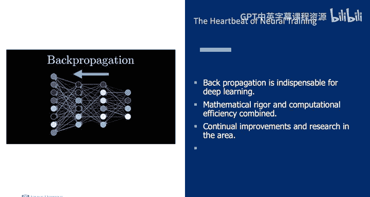

本节课我们一起学习了深度前馈网络的核心概念。我们从其作为通用函数逼近器的数学意义出发，通过异或问题理解了非线性激活函数和隐藏层的必要性。我们探讨了网络架构设计中的深度与宽度权衡，以及输出层的设计原则。最后，我们深入了解了模型训练的核心——基于梯度下降的反向传播算法及其面临的挑战与优化技巧。掌握这些基础知识，是迈向更高级深度学习领域的坚实第一步。