#  006：深度学习正则化 🛡️

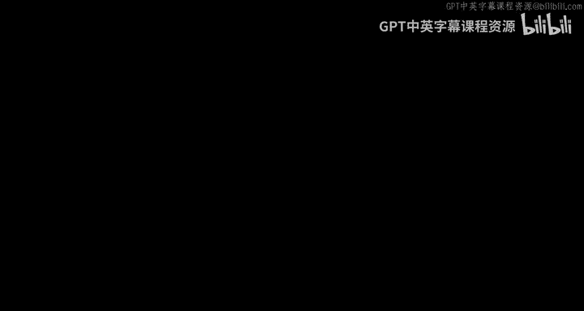

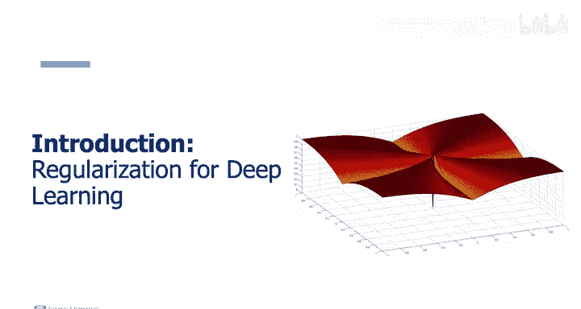

在本节课中，我们将学习深度学习中的正则化技术。正则化是防止模型过拟合、提升其泛化能力的关键手段。我们将探讨多种正则化方法，包括参数范数惩罚、约束优化、数据增强、噪声注入、半监督学习以及多任务学习。

---

## 为什么需要正则化？🤔

上一节我们介绍了正则化的概念，本节中我们来看看为什么需要它。

深度神经网络是能力强大的模型，有时会过于灵活，存在很高的过拟合风险。过拟合是指模型学习了数据中的噪声，而非底层规律。我们训练模型的最终目标是使其在未见过的数据上也能表现良好，即具有良好的泛化能力。正则化对于实现这一目标至关重要。

正则化不仅仅是减少过拟合，它还需要在模型复杂度和拟合能力之间取得平衡。我们希望模型足够复杂以捕捉数据中的模式，但又不能过于激进以至于学习到不期望的噪声。这需要在两者之间找到一个平衡点。

正则化也融入了我们的先验信念。例如，我们通常认为更平滑的函数更可能是合理的。

以下是正则化在损失函数中的常见形式：
*   **L1 正则化**：在损失函数中添加权重的 L1 范数作为惩罚项。
*   **L2 正则化**：在损失函数中添加权重的 L2 范数（平方和）作为惩罚项。

这些方法有直观的解释，并且与贝叶斯统计中的先验分布（L1对应拉普拉斯先验，L2对应高斯先验）和最大后验概率估计有关。

关键要点是，正则化对于构建鲁棒且有效的模型至关重要。其理论基础植根于优化和统计学。虽然正则化方法多种多样，本节课我们只探讨其中几种。

---

## 参数范数惩罚 📏

现在，让我们深入了解第一种正则化方法：参数范数惩罚。

其核心思想是在损失函数中，根据权重的大小添加一个惩罚项。最常见的两种是 L1 和 L2 正则化。

总损失函数 `J` 可以表示为：
`J(θ; X, y) = J_original(θ; X, y) + α * Ω(θ)`
其中，`Ω(θ)` 是惩罚项，`α` 是超参数，用于控制惩罚的强度。

L1 正则化的一个重要特性是会导致**稀疏性**，即部分权重会变为精确的零。L2 正则化则会**收缩**权重值，但很少会使权重精确为零。在贝叶斯解释中，L1 正则化对应于拉普拉斯先验，L2 正则化对应于高斯先验。

在权重更新过程中，这些惩罚项会抑制权重的过度增长，有助于模型收敛和泛化。它们能防止权重变得异常大或异常小，促使模型学习更有用的特征。

超参数 `α` 的作用是平衡模型拟合程度和权重惩罚强度。如果 `α` 太大，会导致欠拟合；如果 `α` 太小，则正则化效果不足，可能导致过拟合。因此，需要通过调参来找到合适的 `α` 值。

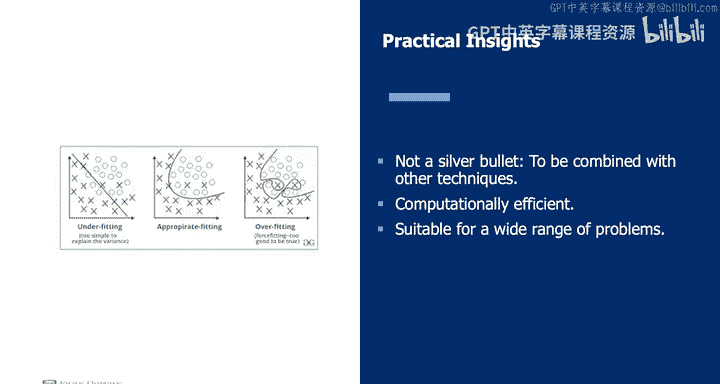

参数范数惩罚并非万能药，通常需要与其他技术结合使用。但其计算效率高，适用于广泛的问题，且易于实现，因此常作为首选的基线正则化方法。

---

## 约束优化视角 🔒

上一节我们将正则化视为损失函数中的惩罚项，本节我们从约束优化的角度重新审视它。

直接添加惩罚项会改变目标函数，而约束则直接限制了解空间的范围。另一种正则化的视角是将模型参数约束在一定范围内。

例如，对于 L2 正则化，可以将其视为要求权重的 L2 范数不大于某个常数 `K`。这就将一个带惩罚的优化问题转化为了一个带约束的优化问题。约束限定了权重的取值范围，在参数空间中，L2 约束通常表示为一个球体，L1 约束则表示为一个菱形。

带惩罚的目标函数可以重新表述为带约束的形式。L2 惩罚对应一种“软”约束，而硬约束则在参数空间中划定了一个精确的边界。

另一种处理约束优化问题的方法是使用**拉格朗日乘子法**。它将带约束的问题转化为无约束问题，从而在计算上更易处理，其核心思想是将约束条件整合进目标函数。

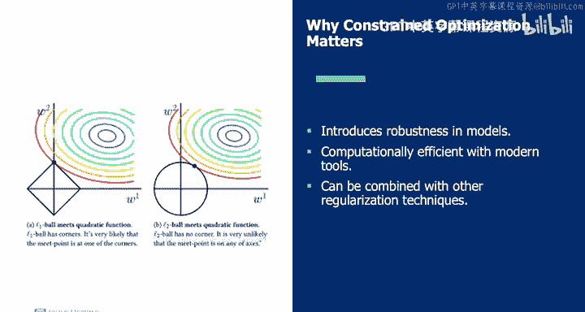

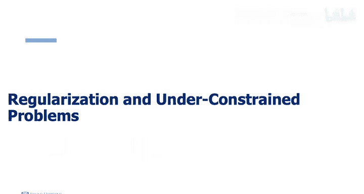

在优化时，梯度下降法仍然适用。对于硬约束，需要在梯度下降后增加一个投影步骤，确保更新后的参数仍满足约束条件。

我们喜欢约束优化方法，是因为它为模型引入了稳定性，并且借助现代优化工具可以高效计算。它也能与其他正则化技术结合使用。

---

## 欠定问题与正则化 ⚖️

现在，我们讨论正则化在欠定问题中的作用。

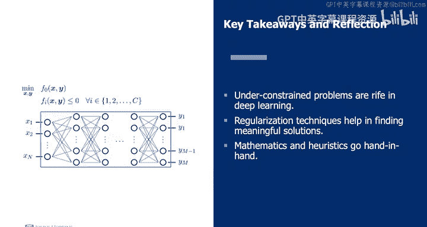

欠定问题是指模型参数数量远多于训练样本数量的情况，这在深度学习中很常见。在这种情况下，存在无限多个解，但关键问题是：哪一个解是最好的？

欠定问题中过拟合的风险极高。正则化的作用是在偏差和方差之间引入权衡。它基于特定准则（如偏好小权重），从众多可能解中选择一个。通过引入偏差来降低方差，从而提升模型的泛化能力。

深度学习中的欠定问题非常普遍。我们构建的大型神经网络，其参数空间可能远超我们拥有的数据量。正则化技术帮助我们在这种情况下找到一个有意义且泛化能力强的解。在应用这些技术时，数学严谨性和启发式方法常常相辅相成。

---

## 数据增强 📈

除了在损失函数中添加惩罚项，还有另一种强大的正则化技术：数据增强。

深度模型通常非常“数据饥渴”，有限的数据容易导致过拟合。原始数据集本身可能不足以训练出泛化能力强的模型。

通过变换现有数据来创建新的训练样本，这种方法很有吸引力。数据增强保留了原始数据的标签，同时通过增加数据的多样性来增强模型对现实世界变化的鲁棒性，从而帮助模型更好地泛化到未见过的数据。

以下是几种流行的数据增强方法：
*   **图像旋转、缩放、裁剪、翻转**
*   **亮度与对比度调整**
*   **平移**
*   **噪声注入**

这些方法可以大致分为几何变换、仿射与透视变换以及噪声模型等类别。

作为一种正则化手段，数据增强通过创造更具挑战性的训练场景来减少过拟合。模型会学会对应用的变换保持不变性，从而提升在未见数据上的表现。

几何变换通常涉及旋转矩阵和缩放矩阵。仿射与透视变换则是仿射操作。噪声模型通常来自高斯分布等。

除了这些基础方法，还有更高级的技术，例如使用生成模型来创建增强数据，或者像 MixUp 这样混合两个样本的特征和标签的研究性方法。

需要注意的是，并非所有增强方法都适用于所有数据集。不当的增强可能引入噪声或错误标签，带来风险。同时，也需要考虑计算开销。

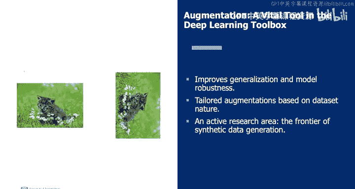

数据增强是工具箱中的重要工具，它能有效提升模型的泛化能力和鲁棒性。增强策略需要根据数据集和任务性质量身定制。这是一个活跃的研究领域，特别是合成数据生成方面。

---

## 噪声鲁棒性与噪声注入 🔊

接下来，我们探讨另一种提升模型鲁棒性的正则化技术：噪声注入。

噪声是指数据中不期望的扰动。现实世界中的数据大多天然带有噪声。噪声可能来自内部或外部，它会降低模型准确性，增加输出的不可预测性。

有趣的是，在训练过程中主动注入噪声，反而可以增强模型的鲁棒性。我们可以对输入、权重或激活函数注入噪声。这迫使模型学习更根本、更稳健的特征和模式，而不是记忆训练数据中的细微噪声。

常见的噪声类型包括高斯噪声、均匀噪声和椒盐噪声。作为正则化器，噪声注入能有效减少过拟合。从贝叶斯角度看，这也可以被视为一种模型平均。

噪声鲁棒性对于模型在实际应用中的部署至关重要。巧妙地注入噪声可以增强泛化能力。同时，我们也需要警惕对抗性威胁——即专门设计来欺骗模型的微小扰动。这是一个重要的研究领域。

---

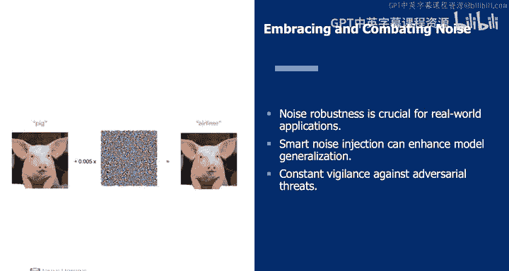

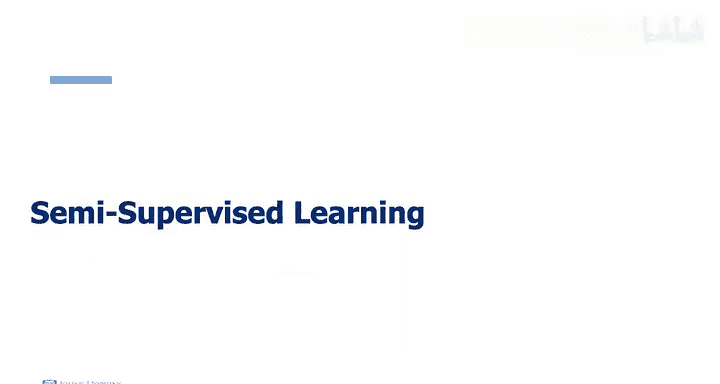

## 半监督学习 🏷️➡️🏷️❓

半监督学习也可以作为一种正则化技术。

它同时利用有标签数据和无标签数据进行训练。这扩展了模型的知识和上下文，因为可以加入更多数据，从而在不进行大量人工标注的情况下提升模型性能。

半监督学习具有成本效益，并且由于使用了更大的数据集，通常能带来更好的泛化能力。在某些情况下，其性能可能超过纯监督学习方法。

然而，它也面临挑战。无标签数据的质量至关重要，使用低质量数据可能强化数据中已有的偏见和错误。此外，量化无标签数据对模型的具体贡献也很复杂。

实践中，半监督学习常与自训练方法、协同训练或迁移学习结合使用。随着对高效、可持续学习方法的追求，半监督学习仍然是一个不断发展和演进的活跃研究领域。

---

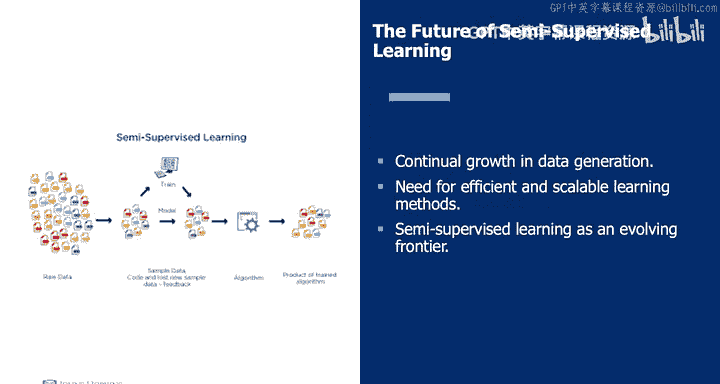

## 多任务学习 🎯🎯

最后，我们介绍多任务学习，这是另一种有效的正则化范式。

在多任务学习中，一个单一模型同时处理多个相关任务。这迫使模型在不同任务之间共享表征学习，从而同时优化多个目标。

这样做的好处包括提高效率、改善泛化能力，并促进任务间的知识迁移。例如，在目标检测中，一个模型同时完成“识别物体类别”和“定位物体位置”两个任务，这两个任务的知识可以相互促进，使模型对图像有更全面的理解。

实现多任务学习通常涉及设计联合损失函数，并确保任务间的协调性。关键挑战在于确定任务间的相关性、平衡不同任务的重要性，以及避免“负迁移”（即一个任务的学习干扰另一个任务的表现）。

多任务学习广泛应用于自然语言处理（如句法分析和情感分析）、计算机视觉（如检测、分割和识别）以及医疗健康（跨症状诊断）等领域。

多任务学习是迈向更通用、更全面人工智能的一步，它试图融合知识的广度与深度，利用多样化任务之间的协同效应来提升整体模型性能。

---

## 总结 📚

本节课我们一起学习了深度学习中多种重要的正则化技术。

我们从**参数范数惩罚（L1/L2）** 及其**约束优化视角**开始，理解了它们如何通过限制模型复杂度来防止过拟合。接着，我们探讨了**数据增强**和**噪声注入**，这两种方法通过增加训练数据的多样性和鲁棒性来提升泛化能力。然后，我们介绍了**半监督学习**，它利用无标签数据来扩展模型的知识。最后，我们了解了**多任务学习**，它通过让模型同时学习多个相关任务来共享和迁移知识，从而获得更强大的表征。

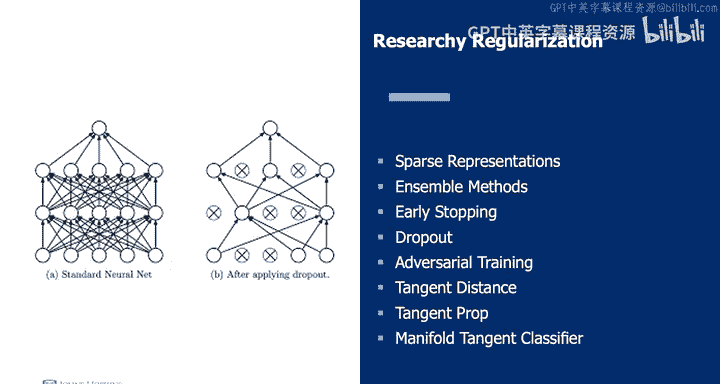

正则化是构建高效、鲁棒深度学习模型的基石。每种技术都有其适用场景和权衡，在实践中常常需要组合使用。除了本节课介绍的方法，还有如 Dropout 等更多研究活跃的正则化技术值得探索。掌握这些工具将帮助你设计出泛化能力更强、更可靠的神经网络模型。