#  007：卷积神经网络 (CNNs) 🧠

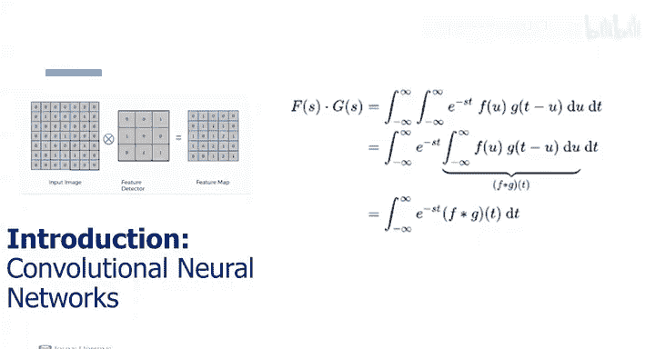

在本节课中，我们将学习卷积神经网络（CNNs）的基础知识。这是一种在深度学习中具有变革性意义的网络架构，尤其擅长处理图像和视频数据。我们将探讨其核心概念、工作原理、优势以及一些高级变体。

---

## 卷积神经网络概述 🚀

卷积神经网络代表了深度学习中最具变革性的创新之一。它们主要针对图像和视频数据设计，通过利用空间层次和模式来提取特征，这与传统的全连接前馈网络有显著区别。

CNNs的核心是卷积操作。这是一种融合两个函数以产生第三个函数的数学运算。在CNNs中，它使用一系列可学习的滤波器（或称为核），逐层地从数据中提取信息。

与标准神经网络不同，CNNs具有更稀疏的连接架构。并非每个输入节点都连接到每个输出节点。这种方式降低了网络的复杂性，使其能够提取局部和全局特征，同时减少过拟合并降低计算需求。

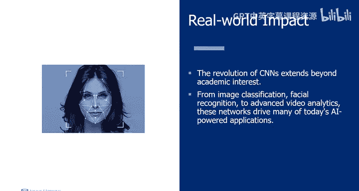

CNNs的应用已超越学术兴趣，驱动着当今许多人工智能应用，如图像分类、面部识别和视频分析。

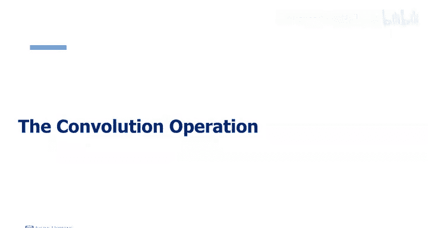

---

## 卷积操作：核心概念 🔍

上一节我们介绍了CNNs的概况，本节中我们来看看驱动其功能的核心概念——卷积操作。

卷积操作是一种数学运算，它将两个函数融合以产生第三个函数。在CNNs的背景下，它用于从输入数据中提取基本特征。

对于函数 **F** 和 **G**，卷积操作符记为 **F * G**，其定义如下（连续形式）：
`(F * G)(t) = ∫ F(τ) G(t - τ) dτ`
在离散形式下，积分变为求和。

在CNNs中，卷积操作涉及一个滤波器（或核）。该滤波器在输入数据（通常是图像）上滑动，并生成一个特征图。这个特征图会突出显示滤波器认为重要的特征。

例如，一个4x4的输入与一个3x3的滤波器进行卷积，通过滑动操作，可以产生一个输出。

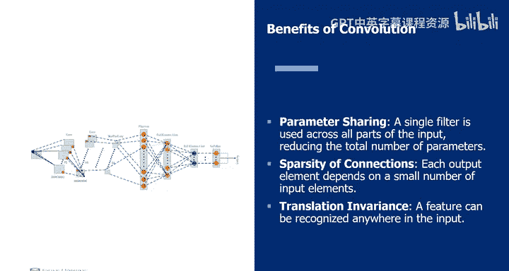

CNNs中的滤波器是**可训练参数**的矩阵。当与输入特征进行卷积时，它们可以突出显示特定的特征，如边缘、纹理和颜色。

有时我们需要控制输出特征图的大小。以下是两种常用方法：
*   **步长 (Stride)**：控制滤波器每次滑过输入的步幅。
*   **填充 (Padding)**：通过在输入值周围添加零来控制空间尺寸。

卷积操作具有几个重要特性：
*   **参数共享**：同一个滤波器用于输入的所有部分，减少了参数总数。
*   **连接稀疏性**：每个输出元素仅依赖于一小部分输入元素。
*   **平移不变性**：无论特征出现在输入的哪个位置，都能被识别。

---

## 设计动机：为何需要CNNs？💡

了解了卷积操作后，我们来看看CNNs为何应运而生。

随着深度学习任务变得复杂，传统的全连接网络面临挑战：
*   全连接层参数过多。
*   缺乏空间层次和平移不变性。
*   处理大图像时计算成本高昂。

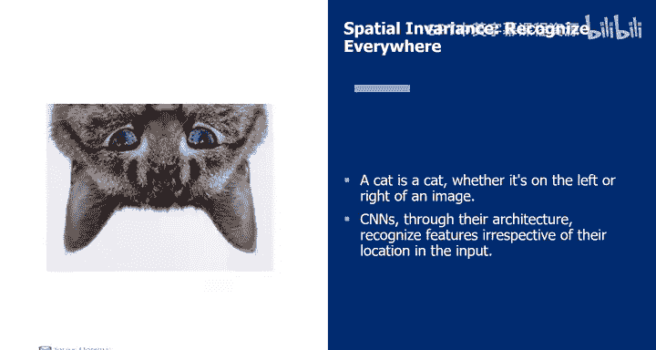

CNNs的设计灵感来源于人类的视觉皮层。视觉皮层中的神经元只对视觉场中有限区域的刺激做出反应。为了模仿这一点，CNNs引入了卷积的概念，首先关注局部特征，然后逐步构建全局特征。

想象一下识别一个物体：你会先识别边缘，然后将边缘组合成形状，再将形状组合成模式，最后根据模式识别物体。CNN正是以这种分层方式复现这一过程。

CNNs通过在整个输入的不同部分**重用相同的滤波器**，极大地减少了参数数量，有助于防止过拟合。同时，其架构使其能够识别特征，而不管这些特征在输入中的位置如何，这就是平移不变性。

由于这些基本动机和设计选择，CNNs极大地提高了图像识别任务的性能，并已成为计算机视觉领域事实上的标准。

---

## 池化层：下采样与特征保留 📉

上一节我们介绍了卷积层，本节中我们来看看CNNs中另一个常见的层——池化层。

池化是一种下采样形式，用于减少特征图的空间尺寸，同时保留基本信息并使CNN对小的平移变化更具鲁棒性。

我们使用池化层的原因如下：
*   **维度缩减**：减少计算量和参数，防止过拟合。
*   **平移不变性**：最小化对输入中轻微移位和失真的敏感性。
*   **捕获主导特征**：强调区域内最显著的特征。

以下是几种常见的池化类型：
*   **最大池化 (Max Pooling)**：取特征图中一组值的最大值。
*   **平均池化 (Average Pooling)**：取特征图中一组值的平均值。
*   **最小池化 (Min Pooling)**：取特征图中一组值的最小值。

与卷积类似，池化也涉及核大小和步长。但不同之处在于，池化操作（如取最大值、平均值）**没有可学习的参数**。

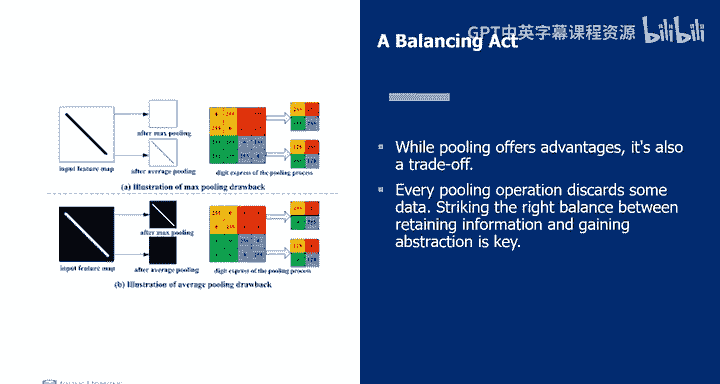

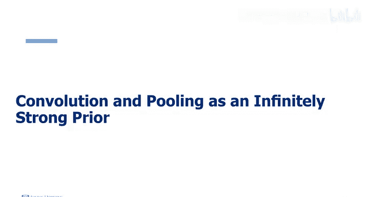

最大池化能有效捕获区域内的主导特征。例如，在人脸图像中，如果池化区域包含眼睛的一部分，最大池化能确保该特征被保留到下一层。

平均池化则提供区域更平滑的表示，它不那么激进，保留了更一般的信息。

关于池化的有效性存在讨论。一些先进的架构（如残差网络、密集连接网络）通常使用步长卷积来代替池化以降低空间维度。

池化虽有优势，但也有权衡。每个池化操作都会丢弃一些数据。在保留信息和获得抽象之间取得平衡是关键。

---

## 卷积与池化：作为强先验的视角 🧮

现在让我们更深入地探讨卷积和池化，从数学角度将其视为一种“无限强的先验”。

在贝叶斯统计中，先验提供了关于未知参数的假设或信念。在深度学习中，某些架构选择可以对模型能够表示的函数类型施加强先验。

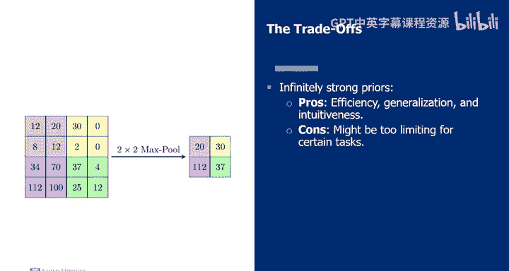

CNN中的卷积操作做出了两个强有力的假设：
1.  **平稳性 (Stationarity)**：相同的特征在输入的不同部分都有用。
2.  **局部性 (Locality)**：附近的输入是相关的，可以一起处理。

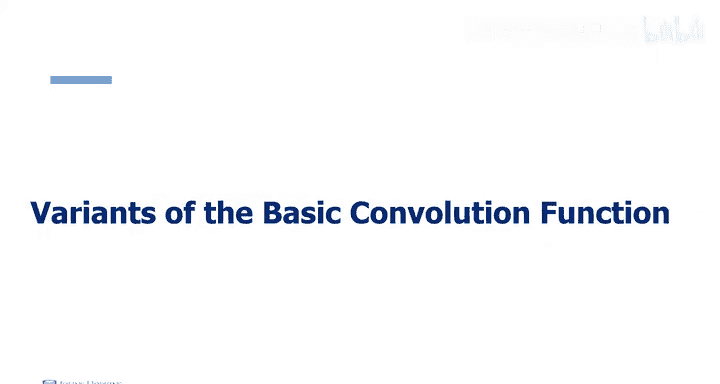

卷积之所以是“无限强的先验”，是因为它将函数空间限制在空间不变函数上，从而极大地限制了搜索范围。池化则对图像中的层次结构做出了更强的假设：网络的更高层通过组合较低层的特征来捕获更抽象的表示。

我们这样做是因为：
*   **计算高效**：它缩小了假设空间。
*   **泛化能力强**：大大降低了过拟合的机会。
*   **直观合理**：图像本身就具有空间层次和模式。

然而，这种先验并非总是有利的。对于非图像数据（如时间序列或表格数据），这种假设可能过于严格。一些先进技术会放松这些先验以捕获更复杂的模式。因此，理解数据特性以做出正确选择至关重要。

权衡如下：
*   **优点**：效率高，泛化能力强。
*   **缺点**：可能对某些任务限制过大。

---

## 卷积的变体：适应不同任务 🛠️

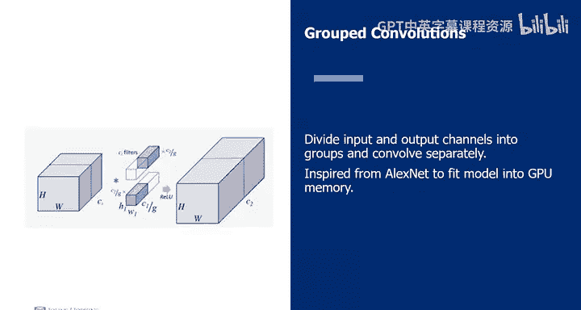

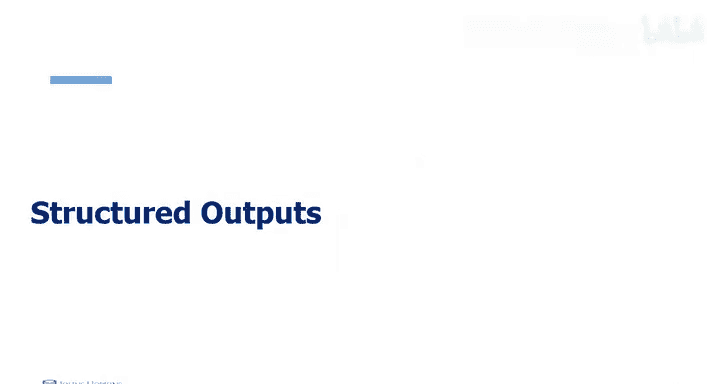

卷积是CNN的基础操作，但像所有基础概念一样，它也随着针对特定任务的优化而演变。

以下是几种卷积变体：
*   **步长卷积 (Strided Convolutions)**：定义滤波器的步长大小（如2，3）。它能减少空间维度，从而控制计算成本。
*   **空洞卷积 (Dilated Convolutions)**：在滤波器值之间引入间隙，以在不增加滤波器大小或计算成本的情况下捕获更广泛的上下文。
*   **转置卷积 (Transposed Convolutions / Deconvolutions)**：用于上采样空间维度，常见于自编码器或生成对抗网络的解码器部分。
*   **深度可分离卷积 (Depthwise & Separable Convolutions)**：优化计算效率。深度卷积对每个输入通道应用单个滤波器；可分离卷积结合了深度卷积和逐点卷积。
*   **分组卷积 (Grouped Convolutions)**：将输入和输出通道分成组并分别进行卷积，灵感来源于AlexNet，旨在更好地适配GPU。

---

## 结构化输出：超越图像分类 🖼️➡️🗺️

卷积神经网络不仅用于图像分类，还能产生如图像和序列标签等结构化输出。

结构化输出是其元素间具有相互依赖关系的多维输出。例如，图像中每个像素都被分类（如人、狗、树、背景）。

这类任务包括：
*   **像素级任务**：如图像分割、图像生成、视觉输入的问题预测。

面临的挑战包括保持空间层次、平衡全局与局部上下文以及计算复杂性。

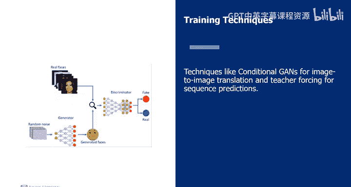

**用于分割的CNNs**：为每个像素分配一个标签，通常使用U-Net或全卷积网络结构。
**图像到图像翻译**：在保持结构的同时转换图像内容，例如将卫星图像转换为地图。
**用于序列预测的CNNs**：从图像中产生序列，例如读取图像中的文本。

结构化输出的损失函数用于衡量预测输出与真实结构化输出之间的差异，例如分割任务中使用的Dice损失。

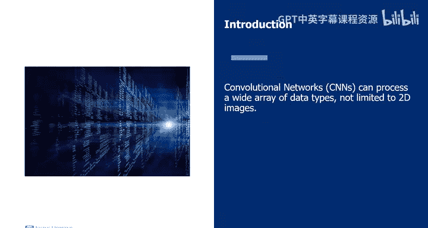

训练技术也多种多样，例如用于图像到图像翻译的条件GAN，它通过对抗性方式帮助训练网络。

实际应用包括医学成像（如肿瘤分割）、自动驾驶和光学字符识别。

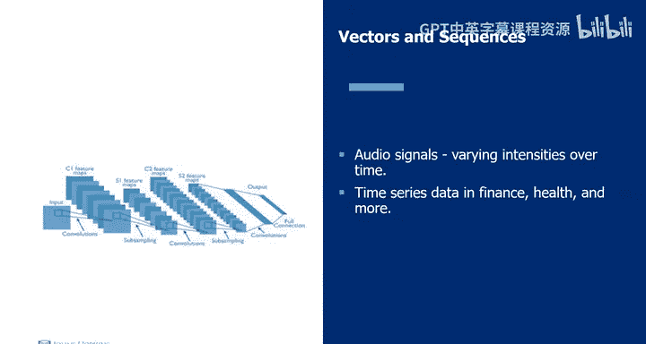

---

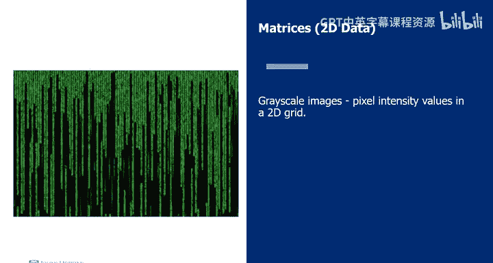

## 处理多种数据类型 📊

卷积神经网络可以处理多种数据类型，而不仅仅是二维图像。

基本数据类型包括标量、向量、矩阵和张量。
*   **向量（1D）**：如音频信号、时间序列数据（金融、健康）。一维卷积操作在此类数据上表现良好。
*   **矩阵（2D）**：如灰度图像，是像素强度的二维网格。
*   **张量（3D+）**：如RGB彩色图像（三个通道的矩阵），或更高维数据如CT扫描、MRI（3D），以及作为3D帧序列的视频（4D）。

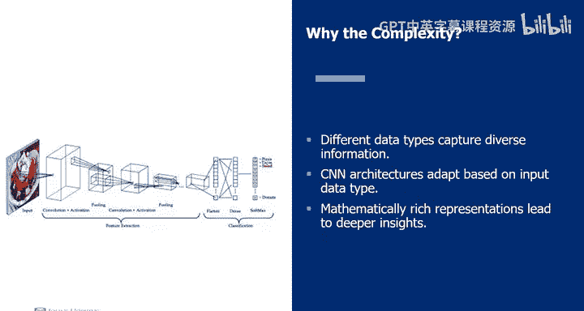

以这种复杂方式思考数据的原因是，不同的数据类型捕获不同的信息。CNN架构需要根据输入数据类型进行调整。数学上丰富的表示使其能够从数据中挖掘出深刻的见解。

处理这些数据也面临挑战，需要考虑调整卷积操作、管理计算资源，并在图像分辨率与网络深度/宽度之间进行权衡。

---

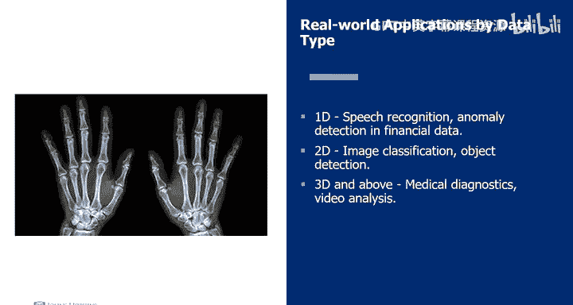

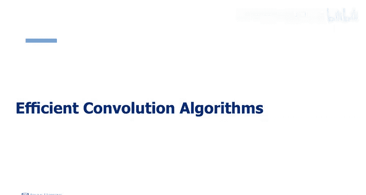

## 计算效率优化 ⚡

卷积层本身计算量很大。我们的目标是在不影响性能的前提下使其更快。

回顾一下，卷积是将滤波器（核）应用于输入矩阵以产生特征图的过程。

**暴力卷积**：直接计算特征图输出中的每个值，复杂度至少为 `O(n²)`（对于n x n输入和滤波器）。

为了提高效率，有以下几种方法：
*   **基于FFT的卷积**：使用快速傅里叶变换将空间数据转换到频域，在频域进行逐元素乘法，然后通过逆FFT转换回空间域。复杂度降至 `O(n² log n)`，且可并行化。
*   **Im2col方法**：将输入图像的部分重塑为列，将卷积转换为矩阵乘法。主流深度学习框架常用此方法。
*   **Winograd算法**：针对特定滤波器（如3x3）的最小滤波算法，以减少乘法运算为代价增加加法运算。
*   **步长卷积**：如前所述，通过跳跃滑动减少操作次数。

这是一个非常活跃的研究领域，包括特定硬件优化、稀疏卷积、量化和剪枝等技术都在不断发展。

---

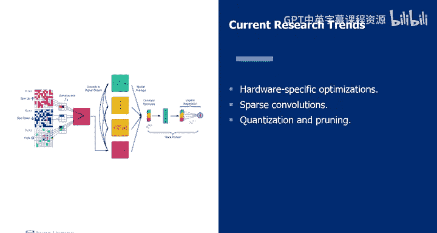

## 总结 📚

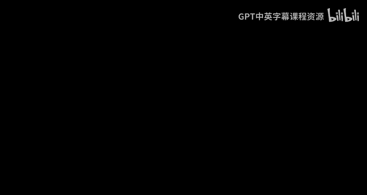

本节课我们一起学习了卷积神经网络。我们从CNN的概述和核心的卷积操作开始，探讨了其设计动机和优势。接着，我们了解了用于下采样的池化层，并从强先验的角度理解了这些操作。我们还介绍了多种卷积变体以适应不同任务，并探讨了CNN在产生结构化输出和处理多种数据类型方面的能力。最后，我们简要介绍了提升卷积计算效率的几种方法。希望本教程能帮助你建立起对卷积神经网络的基本理解。