#  008：循环神经网络 🧠

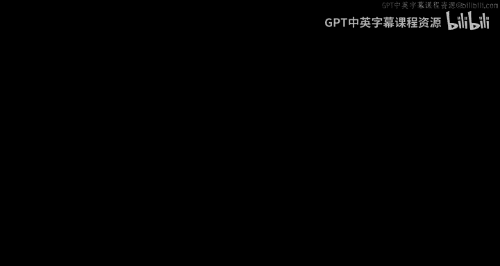

在本节课中，我们将学习循环神经网络。这是一种特殊的神经网络，因为它能够处理具有时间维度的数据。我们将探讨其基本概念、工作原理、不同类型以及如何优化它们以处理长期依赖关系。

---

## 序列建模简介

上一节我们介绍了课程主题，本节中我们来看看什么是序列建模。

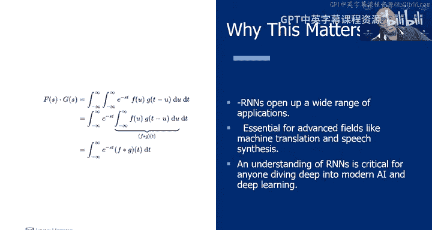

序列建模旨在捕捉时间数据中的模式，其中顺序和时间至关重要。例如时间序列预测、语音识别和自然语言处理。

我们之所以需要序列建模，是因为现实世界的数据通常以序列形式出现，而传统的神经网络缺乏捕捉这种时间关系的设计。因此，循环神经网络应运而生。

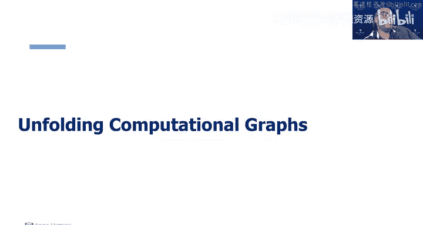

循环神经网络是一种旨在识别跨时间模式的神经网络。其关键特性是具有**循环连接**，这赋予了RNN一种记忆形式。

理解循环神经网络对于深入研究现代人工智能和深度学习至关重要。

---

## 展开计算图

上一节我们了解了序列建模和RNN的基本概念，本节中我们来看看一个核心概念：展开计算图。

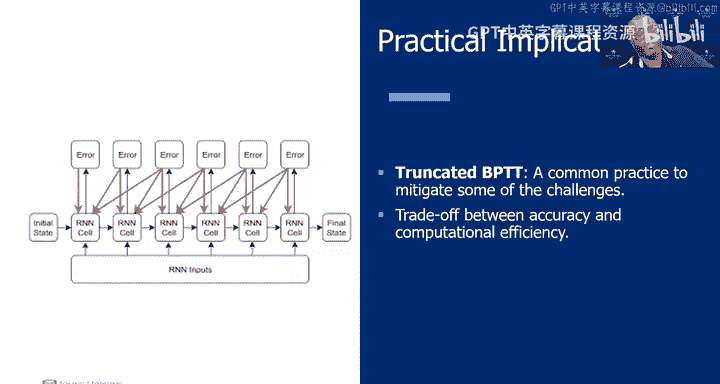

展开计算图指的是将循环计算的每一步都明确写出来的过程。

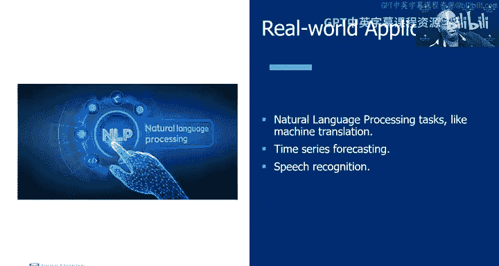

其目的是将RNN转换为具有前馈拓扑的网络，从而能够应用我们熟知的反向传播和优化技术。这样做可以更好地理解计算结构，并应用反向传播来优化网络。

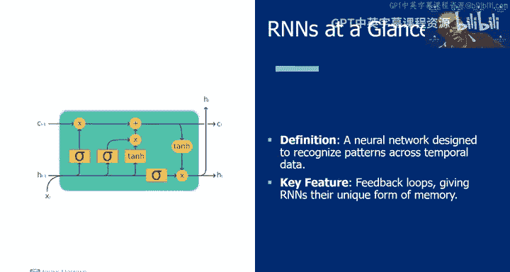

以下是展开计算图的一些优点：
*   **清晰度和表示**：它允许应用随时间反向传播算法。
*   **简化并行计算**：在硬件上简化了并行计算。

然而，RNN也面临一些挑战，例如在收敛方面存在梯度爆炸和梯度消失的问题。此外，处理较长序列时，计算复杂度和内存管理也可能成为挑战。

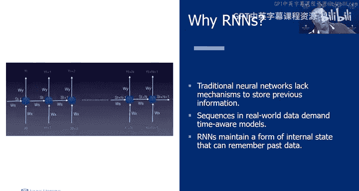

在实践中，截断的BPTT是缓解这些挑战的常用方法，但需要在准确性和计算效率之间进行权衡。

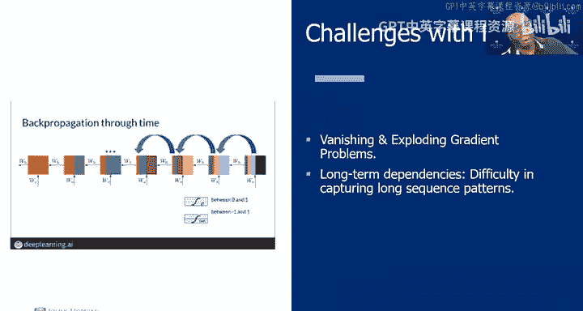

---

## 循环神经网络概述

上一节我们讨论了计算图的展开，本节中我们更详细地看看循环神经网络本身。

循环神经网络是专门为识别时间数据中的模式而设计的神经网络。其关键特征是**循环连接**，这赋予了RNN独特的记忆形式。

我们使用RNN是因为传统的神经网络无法存储先前的信息。现实世界中的序列数据要求一种时间序列的处理方式，而RNN通过维护内部状态来“记住”过去的数据。

然而，传统RNN的一个主要问题是处理**长期依赖关系**的能力有限，例如理解一个很长的句子。

---

## 双向循环神经网络

上一节我们看到了传统RNN的局限性，本节中我们来看看一种变体：双向循环神经网络。

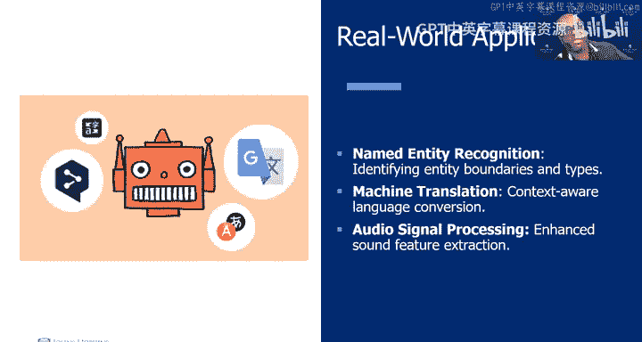

传统RNN按顺序（从左到右）处理序列。但有些任务需要未来的上下文信息来理解当前上下文。

因此，双向循环神经网络旨在同时利用过去和未来的信息。

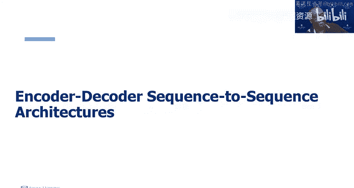

它的工作原理是：在每个时间步维护两个隐藏层，分别用于前向和后向处理序列。这样，它就能同时理解过去和未来的内容。

双向RNN的好处包括：
*   **全面理解序列上下文**。
*   提高语音识别、词性标注等任务的准确性。
*   提供更丰富的数据表示。

其挑战在于：
*   需要访问整个序列，因此不适用于在线或实时任务。
*   计算复杂度增加，因为需要进行前向和后向两次处理。
*   可能存储两倍的数据，并有潜在的过拟合风险。

双向RNN的实际应用包括命名实体识别、机器翻译和音频信号处理。

---

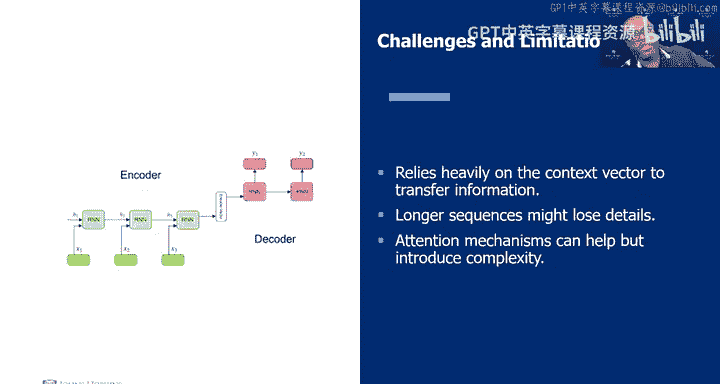

## 编码器-解码器架构

现在让我们谈谈编码器-解码器序列到序列架构。这与自编码器类似，但应用于RNN领域。

**编码器**将输入序列压缩成一个固定大小的上下文向量。
**解码器**将上下文向量扩展成所需的输出序列。

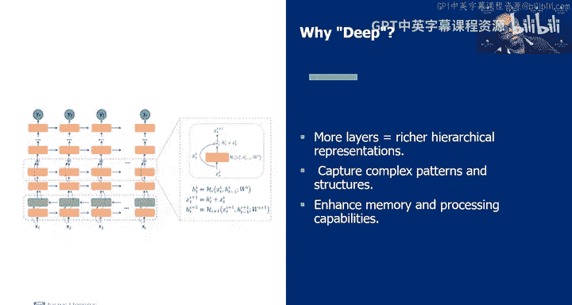

编码器的作用是处理输入序列，创建一个全面的表示，并将其最终隐藏状态作为上下文传递给解码器。

解码器内部则使用编码器的上下文来开始其操作，并逐步生成输出序列。它还可以使用**注意力机制**来聚焦于输入序列的不同部分。

这种架构的优点包括：
*   灵活处理可变长度的输入和输出序列。
*   在翻译、摘要和问答等任务中非常强大。
*   编码器和解码器可以根据任务独立定制。

其挑战在于：
*   严重依赖上下文向量来传递信息。
*   序列越长，可能丢失的细节越多。注意力机制可以缓解这个问题，但会引入额外的复杂性。

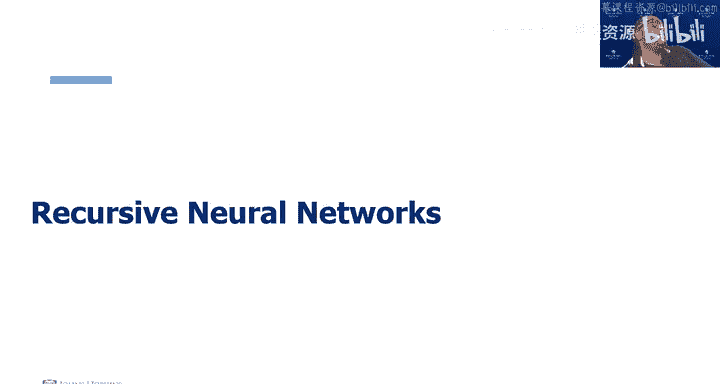

---

## 深度循环神经网络

与所有神经网络一样，我们倾向于在可能的情况下构建更深的网络，RNN也不例外。本节我们讨论深度RNN。

基本的RNN通过循环连接处理序列，但存在一些缺点，例如难以处理长期依赖关系。

解决方案是增加更多层，构建更深的神经网络。

这样做是因为更多层意味着更丰富的层次化表示，能够捕捉序列中更复杂的模式和结构，并通过更多参数增强记忆和处理能力。

深度RNN的解剖结构如下：
*   在输入和输出之间有多个隐藏层。
*   每一层接收来自前一层的隐藏状态。
*   某一层的输出是下一层的输入。

其优势在于层次化特性，能实现更好的特征提取，增强处理复杂序列的能力，并在语言建模和语音识别等任务上有所改进。

挑战包括：
*   梯度消失和爆炸的风险增加。
*   训练计算密集。
*   需要仔细的初始化和先进的优化策略，这对所有深度神经网络都适用，但对RNN尤其重要。

---

## 递归神经网络

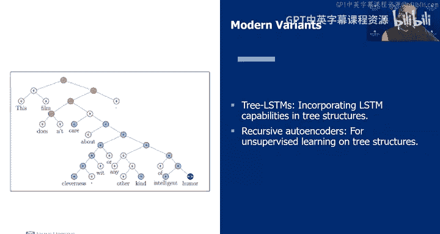

我们讨论了循环神经网络，现在来看看另一种结构：递归神经网络。

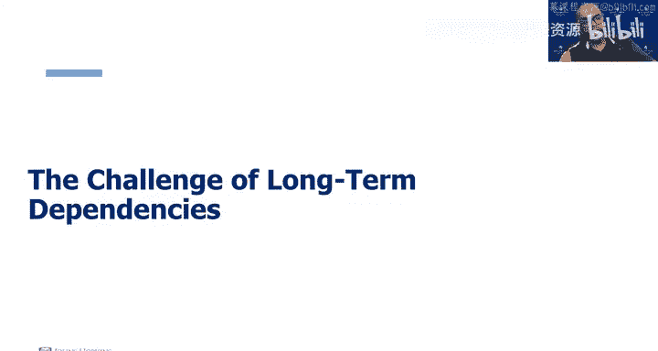

基本RNN适用于序列数据，而递归神经网络适用于具有层次化或树状结构的数据，例如自然语言、计算机程序或抽象语法树。

其核心思想是：数据并不总是线性的，很多时候是层次化的。树中的节点组合形成更高层级的节点，每个节点由一个向量表示。

通过组合子节点来形成父节点，使用权重矩阵来合并节点，并通过激活函数传递。递归传播一直进行，直到形成根节点。

其数学表示可以是：`P = F(W * [C1, C2] + b)`，其中P是父节点，C1和C2是子节点，W是权重矩阵，F是激活函数（如tanh）。

递归神经网络与循环神经网络的主要区别在于：
*   RNN用于序列，顺序很重要。
*   递归神经网络用于层次结构，结构很重要。

递归神经网络的应用包括为句子构建语法树、理解基于结构的句子含义（语义组合性），以及分析计算机程序的抽象语法树。

其优势在于能捕捉层次化模式。局限性在于比标准RNN更复杂，并且由于处理树状结构，计算需求更大。

递归神经网络的变体包括树状LSTM（将LSTM机制融入树结构）和用于无监督学习的递归自编码器。

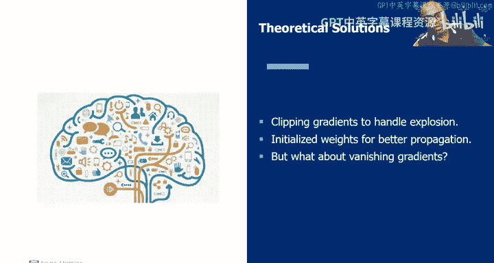

---

## 长期依赖关系与挑战

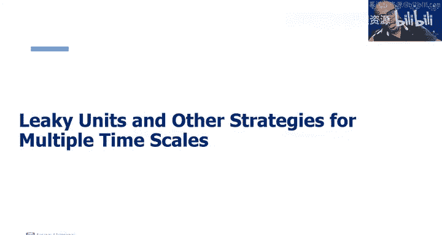

我们一直在说RNN的一个难点是处理长期依赖关系。本节我们具体看看这个问题以及如何应对。

RNN被设计用来记住过去的信息，但能有效记住多远呢？这里的挑战在于将遥远的过去与现在联系起来。

当当前输出依赖于很久以前的输入时，这种情况就会发生。RNN理论上应该能够捕捉这些依赖关系，例如理解一个长句的主语。

然而，在反向传播过程中，梯度往往会变小，导致权重得不到显著调整，从而使网络“遗忘”。这使得RNN变得“短视”，只关注最近的输入，难以学习被长时间间隔分隔的模式，从而限制了其潜力。

理论上的解决方案包括：
*   梯度裁剪以处理梯度爆炸。
*   更好的权重初始化以促进梯度传播。
*   对于梯度消失问题，则需要引入新的架构。

---

## 处理多时间尺度的策略

RNN难以处理长期依赖，传统单元面临梯度消失和爆炸问题。我们需要策略来处理多个时间尺度。

**泄漏单元** 的思想是保留一些过去数据的记忆。它整合过去的信息，参数α决定了记住多少。它模仿了大脑中的泄漏整合神经元。

*   小的α意味着快速更新，适应近期事件，但遗忘更快。
*   大的α意味着缓慢适应，能捕捉更长期的依赖。

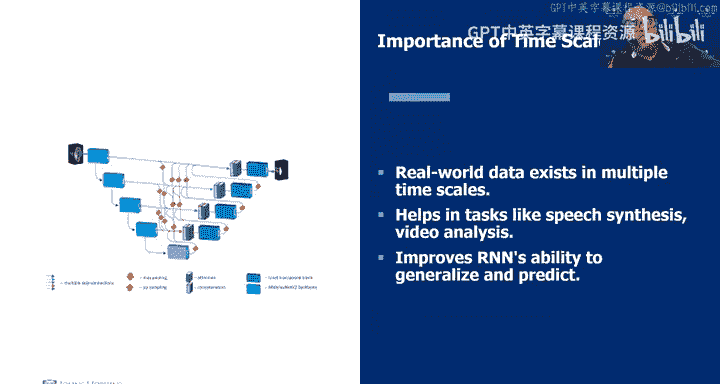

这为RNN提供了一系列时间尺度和敏感性。在网络中，可以变化这些α值。

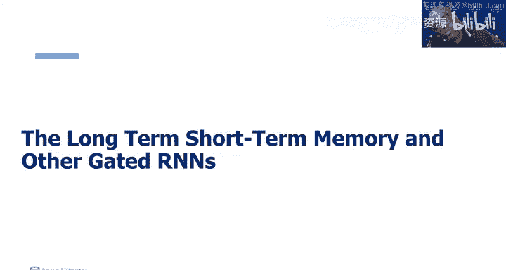

其他策略包括：
*   **跳跃连接**：直接连接非相邻的时间步，缓解梯度消失问题，加速跨时间尺度的信息流动。
*   **扩张循环网络**：受扩张卷积启发，RNN层以不同的时间尺度运行，在不增加参数的情况下扩展感受野。
*   **层次化RNN**：将多个RNN堆叠成层次结构，更高层以更粗的时间尺度运行，从而高效捕捉多尺度时间结构。

时间尺度的重要性在于，现实世界的数据存在于多个时间尺度上（如股票市场的日价格和年总量）。处理多时间尺度有助于语音合成、视频分析，并提高RNN的泛化和预测能力。

---

## 门控循环单元：LSTM及其他

传统RNN存在梯度消失和爆炸问题，难以学习长期依赖。门控RNN是解决这一挑战的方案。

著名的**长短期记忆网络**由Hochreiter和Schmidhuber于1997年提出，它使用门来控制信息流，旨在长时间记住信息。

LSTM包含几个关键元素：
*   **遗忘门**：决定从细胞状态中丢弃哪些信息。使用sigmoid函数输出0（完全遗忘）到1（完全保留）之间的值。公式示例：`f_t = σ(W_f * [h_{t-1}, x_t] + b_f)`
*   **输入门**：决定哪些新信息存储在细胞状态中。它结合了一个sigmoid层和一个tanh层。
*   **细胞状态更新**：结合遗忘门的决定和输入门的新值来更新细胞状态。这是LSTM学习长期依赖的关键机制。
*   **输出门**：决定下一个隐藏状态是什么。它使用当前细胞状态并通过一个tanh函数。

除了LSTM，还有其他门控RNN：
*   **门控循环单元**：一种简化的LSTM变体，于2014年提出，它合并了遗忘门和输入门，参数比LSTM少，且通常同样有效。
*   **高速网络**：在前馈网络中使用门控机制。

这些门控单元是语音识别、机器翻译等任务的关键组件，展示了学习复杂模式和依赖关系的能力。

---

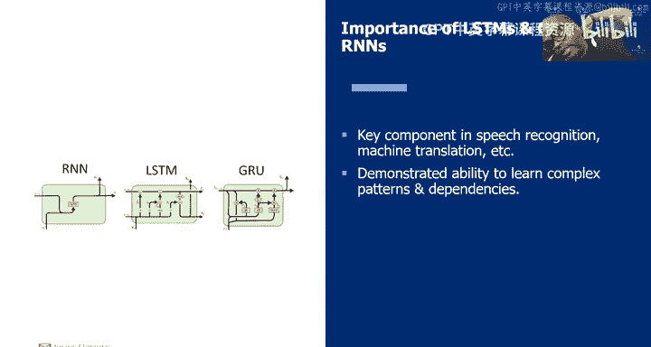

## 优化长期依赖关系

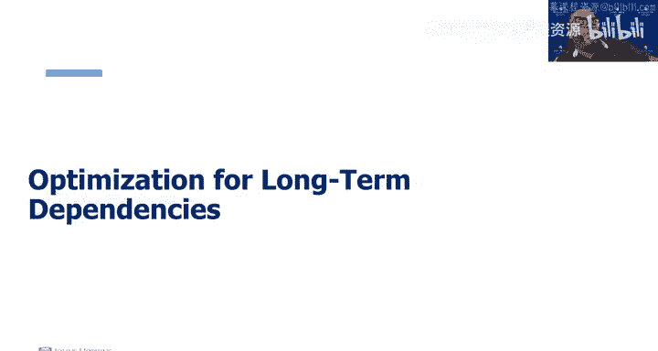

我们如何优化RNN以更好地捕捉长期和短期依赖呢？

长期依赖是指需要长时间维持的信息。传统RNN在这方面有限制，主要是因为梯度消失和爆炸问题。

应对梯度爆炸的方法包括**梯度裁剪**，即当梯度超过某个阈值时，将其缩放。

应对梯度消失的方法包括：
*   引入新架构，如LSTM。
*   更改激活函数，例如从tanh改为ReLU。
*   使用动态学习率，如RMSprop等自适应学习率算法，它们能加速收敛并带来更好性能。
*   进行权重初始化，例如正交初始化，这能显著影响训练动态，确保训练开始时梯度的多样性。

---

## 总结

本节课中，我们一起学习了循环神经网络的核心知识。我们从序列建模和RNN的基本概念出发，探讨了其计算图的展开方式。我们了解了不同类型的RNN，包括双向RNN、编码器-解码器架构、深度RNN以及用于层次化数据的递归神经网络。

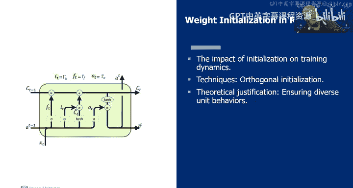

我们重点分析了RNN处理长期依赖关系时面临的挑战，特别是梯度消失和爆炸问题。为此，我们介绍了多种策略，如泄漏单元、跳跃连接、扩张网络和层次化结构。最后，我们深入研究了解决这些问题的关键方案——门控循环单元，特别是LSTM和GRU，并讨论了优化RNN训练的各种技术。

理解这些概念是掌握现代序列建模和深度学习应用的重要基础。