#  009：自动编码器 🧠

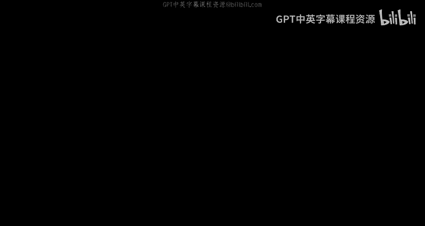

在本节课中，我们将学习自动编码器。这是一种无监督的机器学习方法，旨在通过神经网络高效地编码和重构输入数据。我们将探讨其结构、不同类型、工作原理以及实际应用。

---

## 什么是自动编码器？🤔

自动编码器是一种设计用于重构其输入数据的神经网络。其目的是高效地编码数据，并保留其关键表示。你可以将其理解为某种形式的数据压缩。

自动编码器的结构如下：它包含一个**编码器**，用于将输入压缩为隐藏表示；包含**隐藏层**，即输入数据的压缩版本；还包含一个**解码器**，用于将隐藏表示扩展并重构为输出。

我们为何要这样做？原因包括数据压缩、去噪、降维以及生成模型。数据压缩能更高效地存储和传输数据。去噪可以移除数据中的噪声。降维有助于理解数据的核心特征。生成模型则可以生成与输入类似的新数据。

自动编码器有多种类型，例如欠完备、稀疏、去噪和变分自动编码器。其中一个关键概念是**损失函数**，它用于衡量原始输入与重构输出之间的差异。目标是最小化这种差异，使重构结果尽可能接近原始输入。

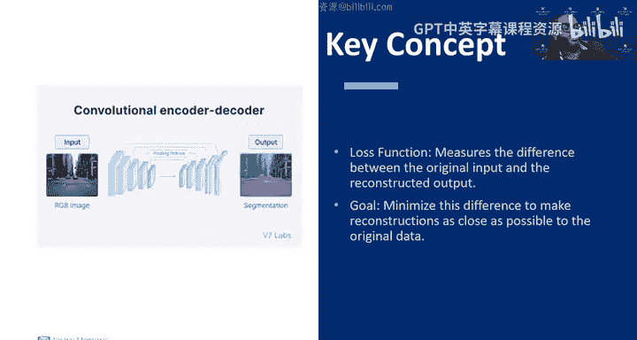

---

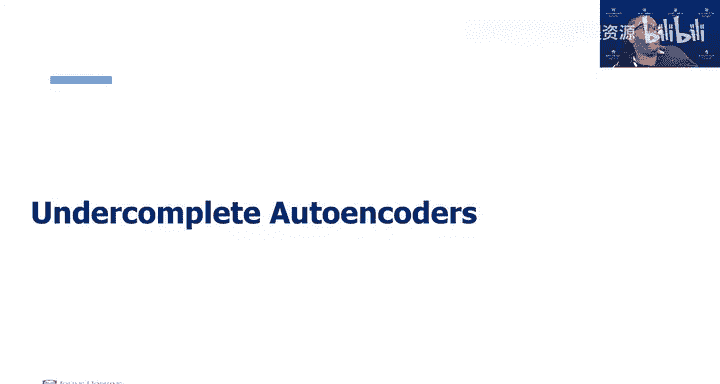

## 欠完备自动编码器 📉

上一节我们介绍了自动编码器的基本概念，本节中我们来看看欠完备自动编码器。

欠完备自动编码器的隐藏层单元数少于输入层。这种设计迫使自动编码器捕捉数据中更显著的特征，因为它必须找到数据中最重要的方面才能成功重构。

降维的目的是减少所考虑的随机变量的数量。其应用包括数据压缩、噪声消除和特征学习。

训练欠完备自动编码器时，目标是**最小化重构误差**。损失函数通常是输入与输出之间的均方误差。有时我们会使用正则化来避免平凡解。

那么，为什么我们要使用这种降维方法，而不是直接使用主成分分析（PCA）呢？因为PCA是一种线性技术，而我们有时需要非线性技术。欠完备自动编码器可以捕捉非线性关系。与PCA相比，自动编码器在降维可视化上通常能展现更复杂的结构。

以下是欠完备自动编码器的一些应用：
*   数据压缩
*   特征学习
*   降维可视化

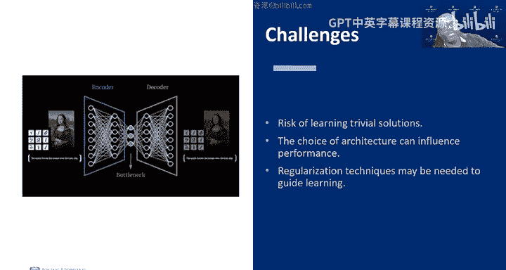

其挑战在于可能学习到平凡的解决方案（例如恒等映射）。架构的选择会影响性能，可能需要正则化技术来指导学习。

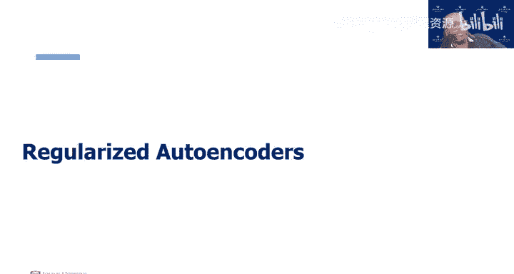

---

## 正则化自动编码器 🛡️

上一节我们讨论了欠完备自动编码器，本节我们将探讨正则化自动编码器。

正则化是一种对模型复杂度添加惩罚项的技术，其目的是防止过拟合，并迫使模型学习更有用的特征。

以下是几种正则化自动编码器：
*   **稀疏自动编码器**：目标是限制隐藏层中活跃神经元的数量。通常通过在内部层激活上添加L1稀疏性惩罚来实现，这有助于学习更鲁棒和有意义的特征。
*   **去噪自动编码器**：其思想是在训练时向输入引入噪声，并尝试恢复原始的无噪声数据。这鼓励网络学习数据模式并忽略噪声。
*   **对比自动编码器**：它们使编码器函数对输入空间中的微小变化具有抵抗力，这是通过基于编码器激活的雅可比矩阵添加惩罚项来实现的，从而创建平滑的数据编码。
*   **变分自动编码器**：它结合了深度学习和贝叶斯推断的思想。它不将输入编码为单个点，而是编码为一个分布，因此它是一种可以生成新样本的生成模型。

正则化自动编码器的优势包括：对未见数据具有更好的泛化能力，能学习更有意义和可解释的特征，并且对噪声和变化更鲁棒。

其挑战在于：正则化方法的选择会极大地影响结果；需要仔细调整正则化强度；并非所有正则化都适用于所有类型的数据。

---

## 随机编码器与解码器 🎲

现在我们来讨论随机编码器和解码器。

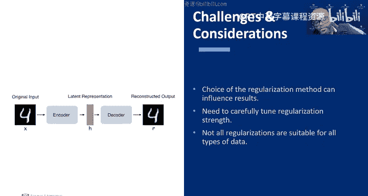

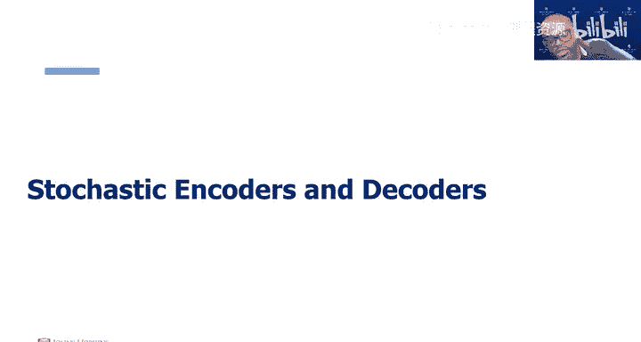

随机自动编码器是指编码和/或解码过程涉及随机性的自动编码器。这与确定性自动编码器形成对比，后者每个输入都产生固定的输出。

引入随机性的原因包括：增强鲁棒性，使模型对噪声不那么敏感；鼓励模型捕捉最重要的特征；它本身也是一种正则化形式。

在编码过程中引入随机性的一种方法是**变分自动编码器**，其编码器输出一个分布的均值和方差，而不是一个固定点。

在解码过程中引入随机性则不太常见，但在某些上下文中也很有用。

变分自动编码器是随机自动编码器的一种流行形式。它对输入数据的分布做出假设，其损失函数包含一个重构损失项和一个正则化项（KL散度）。

其好处在于：可以生成新样本（生成模型）；由于模型的随机性，对过拟合更鲁棒；非常灵活，可以与其他架构结合。

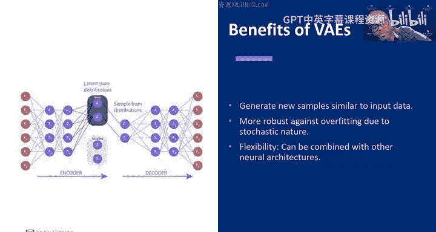

挑战包括：正则化方法的选择；需要仔细调整正则化项；并非所有正则化都适用于这些方法。

在实践中，实现随机性的一些方法包括：使用**Dropout**；向潜在空间注入噪声；使用蒙特卡洛采样等技术。

---

## 去噪自动编码器 🔊➡️🔇

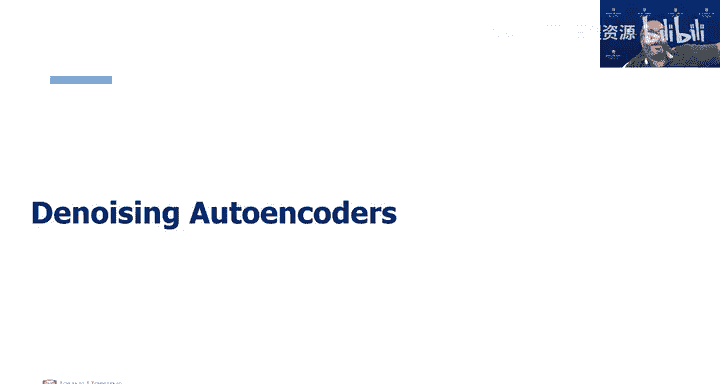

接下来，我们深入了解去噪自动编码器。

去噪自动编码器的基本概念是：训练一个自动编码器，使其能够从带噪声的输入版本中重构出原始干净输入。其核心思想是捕捉数据的底层结构，同时忽略噪声。

其工作流程是：首先**有意破坏输入数据**（例如添加高斯噪声、掩码噪声或椒盐噪声）。然后，处理带噪声的输入，经过编码和解码，最后将输出与原始干净数据进行比较。目标是**最小化重构输出与无噪声干净数据之间的差异**。

我们这样做的原因包括：作为一种正则化手段，通过从噪声数据中重构，模型能更关注本质特征，减少过拟合；具有实际效用，能够处理现实世界中普遍存在的噪声数据；以及通过**权重绑定**（编码器和解码器共享权重）来减少过拟合和参数量。

此外，还有**堆叠去噪自动编码器**，即堆叠多个去噪自动编码器层，每层单独训练，这增强了特征提取能力。

去噪自动编码器面临的挑战包括：确定最佳噪声水平（解决方案：交叉验证、自适应噪声引入）；确保模型不会学习到噪声本身（解决方案：监控训练过程、避免过于复杂的架构）。

---

## 流形与自动编码器 🗺️

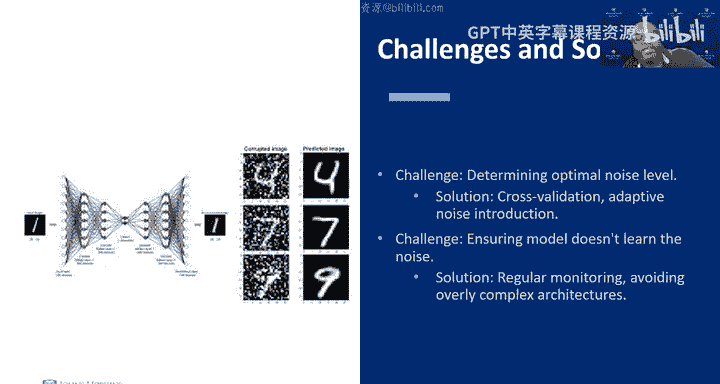

现在，我们从流形的角度来思考自动编码器。

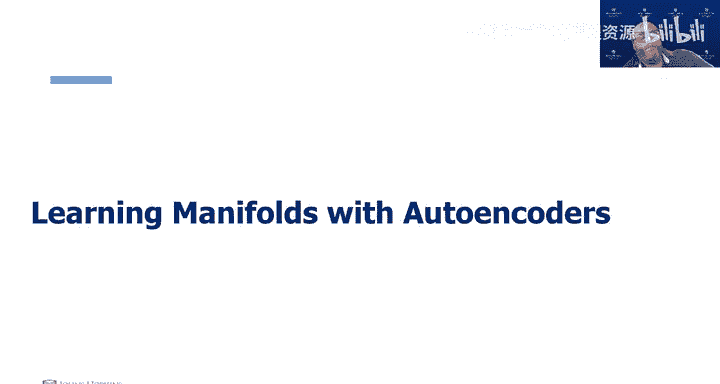

**流形**是高维空间中的一个连续、非自交的表面。在数据术语中，它是大部分概率质量所在的地方。

我们使用流形概念的原因是：高维数据通常位于或接近一个低维流形。理解这个结构可以带来更好的数据表示。压缩、去噪和许多其他任务都可以在这个更小的流形维度中找到。

**流形假设**指出，自然数据在其嵌入空间中形成低维流形。这意味着理解流形就等于理解数据。

自动编码器可以近似生成数据流形的函数，这是通过在潜在空间中学习一个压缩表示来实现的。编码器将数据点推向流形，从而捕捉数据的内在结构。解码器则学习从流形上或附近的点重构数据，充当从流形映射回原始数据空间的角色。

其好处包括：改进数据压缩；更好的噪声消除能力；增强泛化能力。

挑战在于：确定流形的正确维度；确保流形捕捉的是有意义的结构，而不仅仅是噪声。

关于切平面与自动编码器：在流形上的每个点都存在一个切平面，自动编码器可以很好地近似这些切平面。**对比自动编码器**（应为**收缩自动编码器**）则使自动编码器对沿着流形方向的变化更敏感，而对跨越流形的变化不那么敏感，从而产生一个在流形周围收缩的自动编码器。

---

## 深入探讨：收缩自动编码器 📐

让我们深入探讨收缩自动编码器。

“收缩”意味着关注点周围的局部稳定性，其目标是使自动编码器对输入的小变化不敏感。动机在于解决自动编码器可能存在的过度敏感问题，从而增强潜在表示的鲁棒性。

实现方法是在损失函数中添加一个**正则项**，该惩罚项惩罚编码器输出相对于其输入的大导数。大的导数意味着对输入变化过于敏感，惩罚这些可以使编码器更稳定。

**雅可比矩阵**捕捉了编码器输出相对于输入的变化率，是计算收缩惩罚的核心。

收缩自动编码器的损失函数结合了传统的重构损失和收缩惩罚项。

其优势包括：改进泛化能力；对噪声和小输入扰动更鲁棒；潜在空间中的特征更稳定。

在实现时需要考虑：惩罚系数的选择；雅可比矩阵计算的计算成本；对特定问题领域的适用性。

应用场景包括：去噪任务；以及那些输入的小变化不应 drastically 改变输出表示的领域。

挑战和局限性包括：参数调优（在重构和收缩性之间权衡）；可能降低模型表达能力；找到收缩性的最佳平衡点。

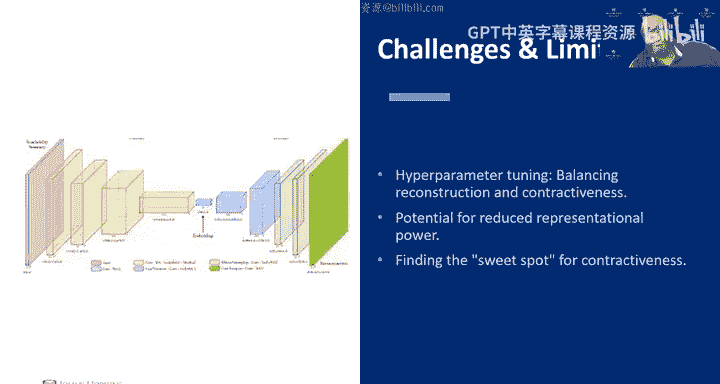

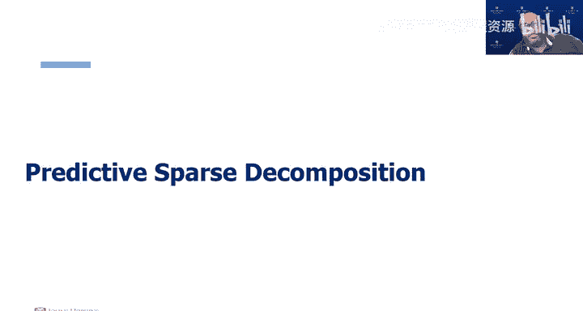

---

## 预测稀疏分解 🔮

现在，让我们谈谈预测稀疏分解。

稀疏编码使用少量非零系数来表示数据。其挑战在于优化过程的复杂性和缓慢性。因此，我们需要一种快速而准确的替代方案。

预测稀疏分解结合了预测建模和稀疏编码，它利用前馈神经网络来实现。

其工作分为两个阶段：
1.  **预测阶段**：使用神经网络预测稀疏编码。
2.  **精炼阶段**：使用传统稀疏编码技术调整预测的稀疏编码。

在预测阶段，使用参数化函数（如神经网络）来预测稀疏编码，并训练它以最小化预测值与传统稀疏编码输出之间的差异。在精炼阶段，确保最终表示是真正稀疏的。

其损失函数结合了预测误差和稀疏性约束项。

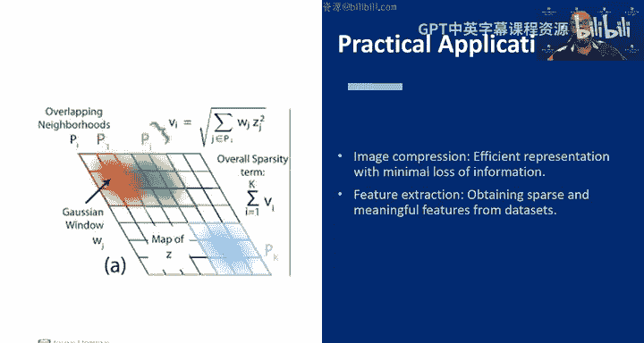

这种方法的优势包括：由于神经网络的预测，速度比传统稀疏编码快；灵活，可根据特定需求进行微调；有效性，能以更少的时间获得与传统方法相当的结果。

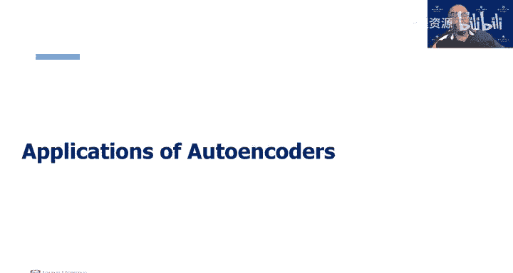

它通常使用单层前馈神经网络，激活函数（如软阈值）能促进稀疏性。

实际应用包括图像压缩和特征提取。

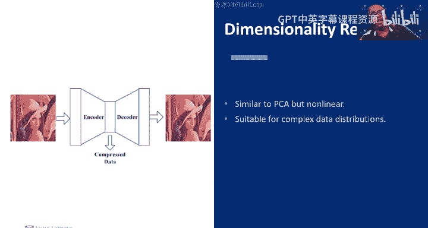

挑战包括：超参数选择；可扩展性；实现真正的稀疏性；在速度与精炼精度之间进行权衡。

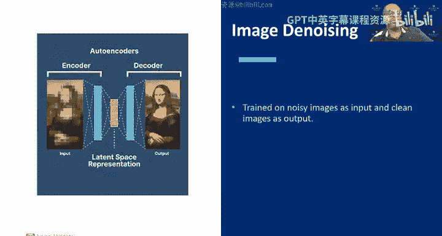

---

## 自动编码器的应用 💡

最后，我们来看看自动编码器的一些实际应用。

*   **降维**：类似于PCA，但是非线性的，更适用于复杂的数据分布。
*   **异常检测**：自动编码器学习重构正常数据，高重构误差则指示异常。可用于欺诈检测、系统健康监控等。
*   **图像去噪**：输入噪声图像，输出清晰图像。
*   **图像生成**：特别是变分自动编码器，作为生成模型可以创建新数据。
*   **特征学习**：可用于无监督特征学习，从编码器中提取压缩表示。
*   **序列到序列学习**：适用于自然语言处理任务，如翻译、聊天机器人、摘要。
*   **信息检索**：语义哈希，基于语义相似性进行快速文档检索。
*   **协同过滤**：推荐系统（如电影、音乐），自动编码器在此类任务中表现出色。
*   **深度神经网络的预训练**：以无监督方式训练自动编码器，然后使用其编码器部分作为深度网络的初始层，这有助于解决梯度消失等问题。

---

## 总结 📚

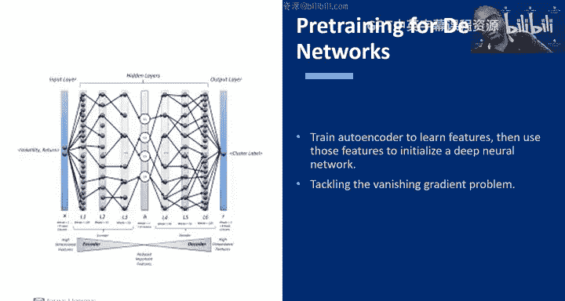

在本节课中，我们一起学习了自动编码器。我们从基本概念和结构入手，探讨了欠完备、正则化、随机、去噪等多种类型的自动编码器。我们还从流形的角度理解了其工作原理，并介绍了预测稀疏分解这一特定技术。最后，我们回顾了自动编码器在降维、去噪、生成模型、特征学习等多个领域的广泛应用。自动编码器是连接无监督学习与深度特征表示的重要桥梁。