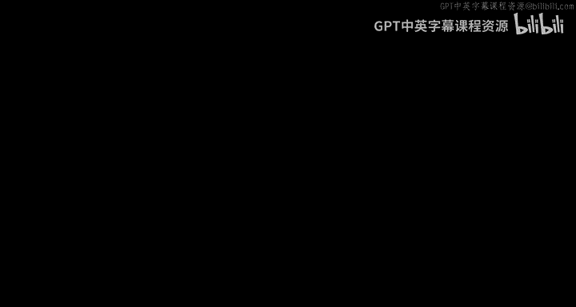
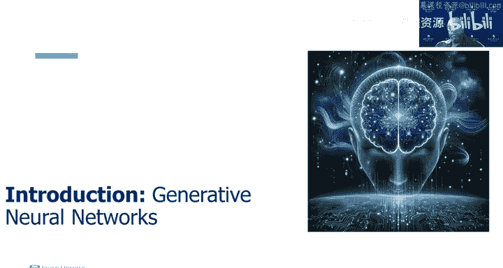
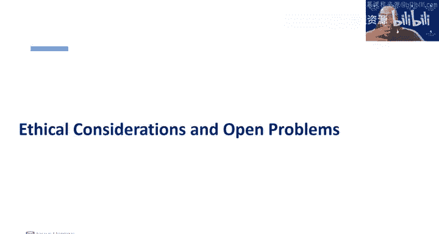

#  010：生成式深度学习 🧠

在本节课中，我们将要学习生成式深度学习的基础知识。我们将探讨生成式模型的核心概念、两种主流的模型架构（生成对抗网络和变分自编码器），并了解它们的应用与挑战。

---

## 概述

生成式模型是一类专注于创造新数据的模型。与传统的分类或预测模型不同，生成式模型学习数据的底层分布，从而能够生成全新的数据样本。这类模型在音乐、图像、文本生成等领域有广泛应用，并且通常利用无监督学习，这在该领域非常重要。

上一节我们介绍了神经网络的基础，本节中我们来看看生成式模型如何工作。

---

## 生成式模型的特点

生成式模型具有以下几个核心特点：

*   **创造新数据**：能够生成全新的数据，如音乐、图像或文本。
*   **学习数据分布**：通过学习数据的底层分布来理解和解释数据。
*   **利用无监督学习**：能够从未标记的数据中学习，减少对标注数据的依赖。

---

## 生成式人工智能的应用

以下是生成式人工智能的一些主要应用场景：

*   **数据增强**：当原始数据量小或不平衡时，生成额外的训练数据。
*   **异常检测**：通过学习数据的正常分布，识别显著偏离该分布的异常值。
*   **创造逼真数据**：生成逼真的图像、音乐、文本等，扩展了艺术、设计和娱乐领域的创作能力。
*   **数据解释**：通过建模数据生成过程，帮助我们理解复杂的数据分布并提取有意义的模式。
*   **半监督学习**：结合有限的标记数据和大量未标记数据，提升模型性能。
*   **隐私保护**：生成合成数据集以模拟真实数据，从而在保护隐私（如医疗数据）的前提下训练模型。

---

## 主流生成式模型

我们将重点介绍两种流行的生成式模型：**生成对抗网络** 和 **变分自编码器**。

*   **生成对抗网络** 学习生成与真实数据难以区分的新数据。
*   **变分自编码器** 专注于将数据编码到潜在空间，并尝试从中重建数据。

接下来，让我们深入探讨生成对抗网络。

---

## 生成对抗网络详解 🤼

生成对抗网络由伊恩·古德费洛等人于2014年提出，它包含两个通过对抗过程同时训练的主要组件：**生成器** 和 **判别器**。这两个组件之间的交互使得GANs独特而强大。

### 生成器的角色

生成器的目标是产生尽可能逼真的人工数据，以“欺骗”网络，使其认为这些人工数据是真实的。

*   **输入**：通常是从高斯分布或均匀分布中采样的随机噪声向量。
*   **输出**：类似于真实数据的数据（例如，如果GAN在图像数据集上训练，则输出图像）。
*   **架构**：通常是深度神经网络，对于图像数据常使用反卷积神经网络。
*   **目标**：愚弄判别器，使其将生成的数据分类为“真实”。

### 判别器的角色

判别器充当“评论家”，其工作是避免被愚弄。本质上，它是一个二元分类器，判断输入是“真实”还是“虚假”。

*   **输入**：来自真实数据集的数据实例，或由生成器生成的虚假数据。
*   **输出**：一个概率分数，表示输入是真实数据的可能性。
*   **架构**：对于图像数据，通常是卷积神经网络。
*   **目标**：准确区分真实数据和虚假数据。

### 训练过程

训练过程涉及生成器和判别器之间的优化博弈。

1.  **训练判别器**：在每个训练步骤中，首先训练判别器。向其展示一批真实数据和一批生成器生成的虚假数据。目标是最大化其区分真假数据的能力。
2.  **训练生成器**：随后训练生成器。将生成器的输出馈送给判别器。生成器的目标是最大化判别器的错误率，即让判别器将其生成的虚假数据误分类为真实数据。

这是一种对抗性训练过程，生成器和判别器在不断竞争。生成器试图产生越来越逼真的数据，而判别器则试图更好地识别虚假数据。

### 损失函数与纳什均衡

GANs使用一种称为**最小最大损失**的目标函数来反映这种对抗关系。其公式基于博弈论：

`min_G max_D V(D, G) = E_{x~p_data(x)}[log D(x)] + E_{z~p_z(z)}[log(1 - D(G(z)))]`

*   第一项是判别器将真实数据正确分类为真实的期望对数概率，判别器试图最大化此项。
*   第二项是判别器将虚假数据正确分类为虚假的期望对数概率，生成器试图最小此项。

简单来说，判别器试图最大化区分真假数据的能力，而生成器试图最小化被检测为虚假的可能性。

**纳什均衡**是博弈论中的一个概念，指在游戏中，当其他参与者策略不变时，任何参与者都无法通过单方面改变策略而获益的状态。在GANs中，当生成器产生的数据如此逼真，以至于判别器无法区分真假（即分类准确率为50%，相当于随机猜测）时，就达到了均衡。此时，任何一方的策略改变都不会改善其性能。

然而，在实践中，完美的纳什均衡很少实现。训练过程通常旨在找到一个满意的点，使生成器能产生足够逼真的输出。

### 模式崩溃问题

模式崩溃是GAN训练中的一个常见问题。它发生在生成器发现数据分布中的一个特定子集（模式），并不断利用它来成功欺骗判别器时。

*   **后果**：生成器不再学习完整的数据分布，只产生该特定模式的变体，导致生成的数据缺乏多样性。
*   **影响**：破坏了对抗训练的平衡，判别器无法看到多样化的生成数据，学习过程变得低效。

为了解决模式崩溃，可以采用以下技术：

*   **经验回放**：保存历史生成的虚假数据并展示给判别器，防止其遗忘。
*   **改进架构**：使用如Wasserstein GAN等不同架构，其损失函数有助于缓解模式崩溃。
*   **小批量判别**：确保判别器同时查看多个数据点，使生成器难以持续产生相同输出。
*   **展开GAN训练**：基于判别器多步训练的结果向生成器提供反馈，使其对判别器策略有更全面的认识。

### GANs的应用

GANs在多个领域有广泛应用：

*   **图像与视频合成**：生成逼真的图像和视频，用于创建虚拟训练环境以增强计算机视觉模型。
*   **风格迁移**：将一幅图像的风格应用到另一幅图像的内容上，用于艺术创作。
*   **超分辨率**：提升图像分辨率，为低分辨率图像添加细节。
*   **数据增强**：在数据稀缺时，为机器学习模型生成额外的训练数据。
*   **药物发现**：生成可能成为新药的分子结构，加速药物研发过程。
*   **异常检测**：通过学习数据的正常分布，检测安全或医疗诊断等领域中的异常。
*   **深度伪造与克隆**：（需注意伦理问题）用于创建高度逼真的人物视频或声音克隆。

---

## 变分自编码器详解 🔄

变分自编码器是另一种生成式模型，它学习将数据编码到一个潜在空间，然后再解码回原始数据。VAE由两个主要部分组成：**编码器** 和 **解码器**。

### 编码器

编码器的目的是将输入数据压缩成一个低维的表示（潜在变量）。

*   **输入**：原始数据。
*   **输出**：定义潜在变量分布的参数（例如，如果是高斯分布，则输出均值和方差）。
*   **架构**：通常是神经网络（对于简单数据是全连接网络，对于图像是卷积网络）。

### 潜在空间

潜在空间是数据以压缩形式表示的地方。在VAE中，这个空间是概率定义的。编码器不是将输入编码为单个点，而是输出定义潜在空间中可能值分布的参数。为了生成新的潜在变量，模型从该分布中采样。这个随机步骤对VAE的生成能力至关重要。

### 解码器

解码器的目的是获取潜在表示，并尽可能接近地重建原始输入数据。

*   **输入**：潜在空间表示。
*   **输出**：原始数据的重建。
*   **架构**：通常是神经网络，其结构通常与编码器镜像（例如，对于图像，使用反卷积神经网络进行上采样）。

### 训练与损失函数

VAE的训练基于**变分推断**（一种贝叶斯统计方法），目标是最大化数据的证据下界。

损失函数由两部分组成：

`L(θ, φ; x) = -E_{z~q_φ(z|x)}[log p_θ(x|z)] + KL(q_φ(z|x) || p(z))`

1.  **重建损失**：鼓励解码后的样本匹配原始输入。
2.  **KL散度**：一个正则化项，衡量学习到的潜在变量分布与先验分布（通常是标准高斯分布）的差异。它确保潜在空间具有良好的属性，便于生成新数据。

KL散度在信息论中用于量化一个概率分布与另一个概率分布的差异。在VAE中，它惩罚与先验分布差异过大的变分分布，从而鼓励编码器以符合先验假设的方式映射输入，得到一个更有结构、更可解释的潜在空间。

### 重参数化技巧

由于从分布中采样的操作是不可微的，这阻碍了基于梯度的优化。**重参数化技巧**通过将随机性分离出来解决了这个问题。

原始采样：`z ~ N(μ, σ²)`
重参数化后：`z = μ + σ ⊙ ε`，其中 `ε ~ N(0, 1)`

这里，μ和σ由编码器输出，ε是从简单分布采样的辅助随机变量。这样，z就成为μ、σ和ε的确定性函数，梯度可以相对于μ和σ进行计算，因为ε现在与模型参数无关。

### VAEs的应用

VAEs也有广泛的应用：

*   **降维**：作为非线性降维工具。
*   **文本生成**：生成连贯且多样的文本段落，应用于自然语言处理和机器翻译。
*   **推荐系统**：建模用户偏好并预测用户可能喜欢的项目。
*   **语音合成**：生成类人语音，用于文本转语音系统。
*   **药物发现**：与GANs类似，用于生成新的药物分子结构。
*   **可解释AI**：VAE的潜在空间可以被检查和操作，以理解数据中的变化因素，有助于创建可解释的AI系统。

---

## 伦理考量 ⚖️

在结束之前，我们必须思考生成式人工智能带来的伦理挑战。我们已经看到了生成式AI的优秀用例，但也目睹了其被滥用的案例。作为从业者，我们应始终将伦理问题放在心上，不断自问：我们为何要使用它？其潜在影响是什么？

---

## 总结

本节课中我们一起学习了生成式深度学习的核心内容。我们介绍了生成式模型的特点和应用，并深入探讨了两种主流模型：生成对抗网络和变分自编码器。我们了解了GANs中生成器与判别器的对抗训练过程、最小最大损失、纳什均衡以及模式崩溃等挑战。我们也学习了VAEs的编码器-解码器结构、变分下界损失函数、KL散度的作用以及重参数化技巧。最后，我们强调了在发展和应用这些强大技术时必须考虑的伦理问题。