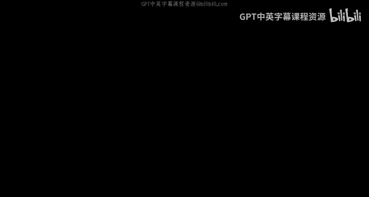
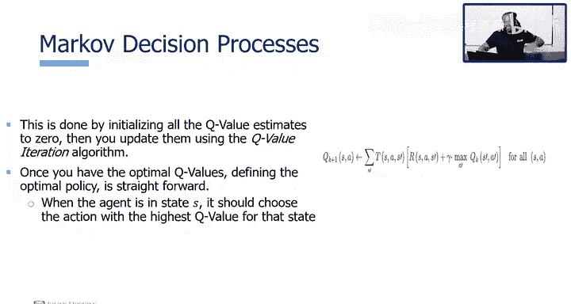

#  012：4_马尔可夫决策过程 🧠

在本节课中，我们将学习强化学习中的一个核心假设——马尔可夫过程。我们将了解什么是马尔可夫链，并重点介绍贝尔曼方程及其在求解最优状态值和最优策略中的应用。

---

## 马尔可夫过程与马尔可夫链

在强化学习问题中，一个重要的假设通常是该问题是一个马尔可夫过程。

那么，什么是马尔可夫过程呢？在20世纪早期，安德烈·马尔可夫研究了无记忆的随机过程，我们称之为马尔可夫链。这些过程具有固定数量的状态，并且在每一步中，它会随机地从一种状态演变到另一种状态。

从状态 `S` 演变到状态 `S'` 的概率是固定的，并且它只取决于状态对 `(S, S')`，而不依赖于过去的状态。因此，它是无记忆的，不关心两步之前或之后发生了什么，只关心当前正在发生什么。

---

## 贝尔曼方程与最优状态值

上一节我们介绍了马尔可夫过程的基本概念，本节中我们来看看贝尔曼如何估计任何状态 `S` 的最优状态值。

贝尔曼找到了一种方法来估计任何状态 `S` 的最优状态值 `V*(S)`。`V*(S)` 是智能体在到达状态 `S` 后，假设其采取最优行动，平均可以预期的所有未来折扣奖励的总和。

他证明了如果智能体采取最优行动，那么被称为贝尔曼方程的公式成立，即你在右侧看到的这个公式。

这个递归方程表明，如果智能体采取最优行动，那么当前状态的最优值等于它采取一个最优行动后平均获得的奖励，加上该行动可能导致的所有可能下一个状态的预期最优值。

用公式表示如下：
`V*(S) = max_a Σ_{S'} T(S, a, S') * [R(S, a, S') + γ * V*(S')]`

其中：
*   `T(S, a, S')` 是给定智能体选择行动 `a` 时，从状态 `S` 转移到状态 `S'` 的转移概率。
*   `R(S, a, S')` 是智能体从状态 `S` 出发，选择行动 `a` 后到达状态 `S'` 所获得的奖励。
*   `γ` 是一个折扣因子。

---

## 值迭代算法

这个方程引出了一个算法，可以精确估计每个可能状态的最优状态值。

以下是值迭代算法的步骤：
1.  首先将所有状态值的估计初始化为零。
2.  然后使用值迭代算法迭代更新它们。

这个算法的一个非常棒的结果是，给定足够的时间，这些估计保证会收敛到对应于最优策略的最优状态值。

在这个方程中，`V_k(S)` 表示算法在第 `k` 次迭代时对状态 `S` 的估计值。

---

## 从状态值到Q值

了解最优状态值实际上非常有用，它可以用于评估策略，但它并没有直接给出智能体的最优策略。

贝尔曼实际上发现了一个非常相似的算法来估计最优的状态-行动值，这通常被称为Q值（质量值）。

状态-行动对 `(S, a)` 的最优Q值 `Q*(S, a)`，是智能体在到达状态 `S` 并选择行动 `a` 之后（但在看到该行动的结果之前），假设在此之后采取最优行动，平均可以预期的未来折扣奖励的总和。

---

## Q值迭代与最优策略

计算最优Q值的方法与之前类似。

以下是Q值迭代的步骤：
1.  再次将所有Q值初始化为零。
2.  然后使用迭代算法更新它们。

一旦你拥有了最优Q值，定义最优策略就变得直接了当。当智能体处于状态 `S` 时，你只需选择对该状态具有最高Q值的行动。

用公式表示最优策略 `π*(S)` 为：
`π*(S) = argmax_a Q*(S, a)`

---

## 总结

本节课中我们一起学习了马尔可夫决策过程的核心内容。我们首先了解了马尔可夫链作为无记忆随机过程的特性。接着，我们深入探讨了贝尔曼方程，它通过递归关系定义了状态的最优价值。我们学习了值迭代算法，该算法通过迭代更新可以收敛到最优状态值。最后，我们引入了Q值的概念，并展示了如何通过Q值迭代找到最优策略，即在每个状态下选择具有最高Q值的行动。这些概念构成了许多现代强化学习算法的基础。