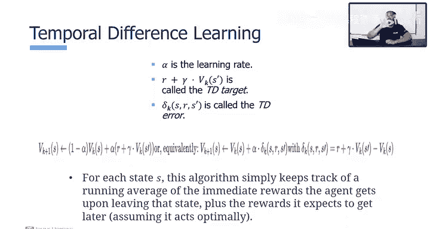

#  013：深度强化学习网络 🧠🤖

在本节课中，我们将学习如何构建一个用于强化学习的神经网络策略。我们将探讨如何将神经网络与马尔可夫决策过程结合，以解决智能体在环境中学习最优行为的问题。课程将涵盖策略表示、探索与利用的权衡、信用分配问题以及策略梯度算法等核心概念。

---

## 构建神经网络策略

上一节我们介绍了马尔可夫决策过程的基本概念，本节中我们来看看如何用神经网络来表示策略。

策略网络接收一个**观察**作为输入，并输出要执行的**动作**。更准确地说，它会为每个可能的动作估计一个概率，然后根据这个估计的概率分布**随机选择**一个动作执行。

一个显而易见的问题是：为什么我们要根据神经网络给出的概率随机选择动作，而不是直接选择得分最高的动作？这样做是为了让智能体在**探索**新动作和**利用**已知动作之间找到正确的平衡。

以下是一个类比：
*   假设你第一次去一家餐厅，所有菜品看起来都不错。
*   你会随机选择一道菜。
*   如果这道菜味道很好，你下次点它的概率就会增加。
*   但这个增加的概率不应该是100%，因为如果你每次都点同一道菜，就永远无法尝试其他可能更好的菜品。

这里的情况是类似的。

---

## 训练策略网络与信用分配问题

现在我们有了一个接收观察并输出动作概率的神经网络策略。问题在于：我们如何训练它？

如果我们知道每一步的**最佳动作**是什么，我们就可以像往常一样训练这个神经网络，将其视为一个**监督学习**问题。我们可以最小化估计概率分布与目标概率分布之间的交叉熵损失。

但在强化学习中，智能体获得的唯一指导是**奖励**本身——那个标量值。奖励通常是**稀疏**且**延迟**的。

这就引出了**信用分配问题**：当智能体获得一个奖励时，它很难知道这个奖励应该归功于（或归咎于）之前的哪个动作。

另一个类比是：想象你训练你的狗“坐下”。狗坐下了，但你30分钟后才奖励它。狗并不知道你奖励它是因为“坐下”这个动作。

为了应对这个问题，一个常见的策略是根据一个动作之后获得的**所有奖励之和**来评估该动作。计算时通常还会应用一个**折扣因子**。这种奖励之和被称为该动作的**回报**。

当然，一个好的动作之后可能跟着几个坏动作。因此，我们想估计一个动作与其他可能动作相比，平均而言是好是坏。这被称为**动作优势值**。为此，你必须运行许多回合（episodes），并通过减去均值、除以标准差来标准化所有这些动作的回报。

之后，你可以合理地假设具有**负优势值**的动作是坏的，而具有**正优势值**的动作是好的。

---

## 策略梯度算法

策略梯度算法通过朝着更高奖励的方向调整梯度，来优化策略的参数。

一类流行的PG算法叫做**REINFORCE算法**，由Ronald Williams提出。其大致流程如下：

以下是REINFORCE算法的关键步骤：
1.  让神经网络策略玩游戏多次。
2.  在每一步，计算一个梯度，该梯度会使**已选择的动作**在未来更可能出现，但先不要应用这些梯度。
3.  运行多个回合后，计算每个动作的**优势值**。
4.  如果一个动作的优势值为**正**，说明该动作可能很好，你希望应用之前计算的梯度，使该动作在未来更可能被选择。
5.  如果一个动作的优势值为**负**，说明该动作可能不好，你希望应用**相反的梯度**，使其在未来更不可能被选择。

解决方案很简单：将每个梯度向量乘以对应的动作**优势值**。最后，计算所有结果梯度向量的**均值**，并用它来执行梯度下降步骤。

---

## 时序差分学习

具有离散动作的强化学习问题通常可以建模为马尔可夫决策过程。但智能体在开始时并不知道转移概率是什么，它是一个完全“无知”的智能体，对环境一无所知，也不知道会得到什么奖励。

它必须至少体验一次每个状态和每次状态转移，才能了解奖励；并且必须多次体验，才能对转移概率有合理的估计。观看强化学习智能体随着时间学习的视频非常有趣，因为在开始时，它确实在做最愚蠢的事情，比如随机乱跑，它必须先体验一切。

**时序差分学习算法**与价值迭代非常相似，但进行了调整，以考虑到智能体对MDP只有部分了解这一事实。

通常，我们假设智能体最初只知道可能的状态和动作，对其他一无所知。智能体使用**探索策略**（例如，完全随机行动）来探索MDP。随着探索的进行，TD学习算法根据实际观察到的转移和奖励来更新对**状态价值**的估计。

其核心更新公式如下：
`V(S) ← V(S) + α [R + γ * V(S') - V(S)]`
其中：
*   `α` 是学习率。
*   `R + γ * V(S')` 被称为 **TD目标**。
*   `[R + γ * V(S') - V(S)]` 被称为 **TD误差**。

对于每个状态`S`，该算法只是持续跟踪一个运行平均值，这个平均值包括：智能体到达该状态时获得的即时奖励，加上它预期在未来（假设以某种最优方式行动）能获得的奖励。

---

## 总结

本节课中，我们一起学习了深度强化学习网络的核心思想。我们了解了如何用神经网络表示策略，以及通过随机采样动作来平衡探索与利用。我们探讨了奖励稀疏和延迟带来的信用分配问题，并介绍了通过计算动作回报和优势值来解决此问题的方法。最后，我们学习了REINFORCE策略梯度算法的基本步骤，以及用于在未知环境中在线学习的时序差分算法。这些概念为理解智能体如何通过试错与环境交互并学习最优行为奠定了坚实基础。