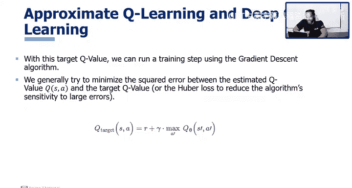

#  014：Q学习与深度Q学习 🧠

在本节课中，我们将学习强化学习中的两种重要算法：Q学习和深度Q学习。我们将了解它们如何帮助智能体在未知环境中通过试错来学习最优策略。

---

## Q学习算法概述

Q学习算法是Q值迭代的一种适应形式，适用于转移概率和奖励最初未知的情况。Q学习通过观察智能体随机行动，逐步改进其对Q值的估计。一旦获得足够准确的Q值估计，最优策略就是选择具有最高Q值的动作，这本质上是一种贪婪策略。

对于每个状态-动作对，该算法会跟踪一个运行平均值，该平均值包括智能体在状态S采取动作A后获得的即时奖励，加上其预期获得的未来折扣奖励总和。

为了估计这个总和，我们取下一状态S‘的所有可能动作的Q值估计中的最大值，因为我们假设目标策略从那时起将采取最优行动。

## 策略类型：离策略与同策略

Q学习算法被称为**离策略**算法，因为被训练的策略不一定是要执行的策略。有时，执行的策略（例如探索策略）是完全随机的，而被训练的策略总是选择具有最高Q值的动作。

相反，策略梯度算法是**同策略**算法，因为它探索世界时使用的策略正是被训练的策略。

令人惊讶的是，Q学习能够仅通过观察（尤其是观察随机行动）来学习最优策略。一个关键问题是：我们能做得更好吗？

## 探索策略的改进

Q学习只有在探索策略足够彻底地探索所有状态和转移时才能工作。虽然纯随机策略最终会访问每个状态和每次转移，但这可能需要很长时间。

一个更好的选择是使用**ε-贪婪策略**。在每个步骤中，它以概率ε随机行动，或以概率（1-ε）选择具有最高Q值的动作。

与完全随机相比，ε-贪婪策略的优势在于，随着Q值估计越来越好，你将花更多时间探索有趣且正确的部分，同时仍会花一些时间探索未知区域，这提供了发现新可能性的机会。

通常，开始时设置较高的ε值（例如1），然后逐渐将其降低到0.05左右。

另一种探索方法是鼓励策略尝试之前尝试较少的动作。这可以通过在Q值估计中添加一个探索奖励来实现。

以下是实现探索奖励的公式示例：
`Q(S, A) = 估计的Q值 + f(N(S, A))`
其中，`N(S, A)` 是在状态S下选择动作A的次数，`f` 是一个探索函数，例如 `f(n) = k / sqrt(n)`，`k` 是一个好奇心超参数，决定了智能体对未知事物的吸引力程度。

## Q学习的扩展性问题

Q学习的主要问题是它不能很好地扩展到具有大量状态和动作对的大型甚至中型MDP问题。

例如，假设你想用Q学习训练一个智能体玩《吃豆人小姐》游戏。游戏中有大约150个豆子，每个豆子可能存在也可能不存在，因此可能的状态数大于2的150次方。如果再考虑幽灵和吃豆人小姐的所有可能位置组合，状态数将超过地球上的原子数量。因此，不可能为每个Q值都跟踪一个估计值。

## 解决方案：近似Q学习

解决方案是找到一个函数 `Q_θ`，它使用一组可管理的参数θ来近似任何状态-动作对的Q值。这被称为**近似Q学习**。

多年来，推荐的方法是使用从状态中手工提取的特征组合来估计Q值，例如最近幽灵的距离、方向等。

但在2013年，DeepMind表明，使用深度神经网络可以更好地解决复杂问题，并且完全不需要特征工程。用于估计Q值的深度神经网络被称为**深度Q网络**，使用DQN进行近似Q学习被称为**深度Q学习**。

## 如何训练深度Q网络

考虑DQN为给定状态-动作对计算的近似Q值。我们希望这个近似Q值接近在状态S执行动作A后实际观察到的奖励r，加上从那时起最优地玩游戏所获得的未来折扣奖励总和。

为了估计这个未来折扣奖励总和，我们可以将DNN应用于下一个状态S‘，并计算所有可能动作A’的近似未来Q值。我们选择最高的一个，因为我们假设要最优地玩游戏，然后将其进行折扣。

通过将即时奖励与这个未来折扣价值估计相加，我们得到了状态-动作对的目标Q值 `y`。

有了这个目标Q值 `y`，我们就可以使用梯度下降算法运行训练步骤。我们通常尝试优化估计Q值与目标Q值之间的平方误差。也可以使用其他损失函数，如Huber损失，以减少算法对较大误差的敏感性。

## 总结

本节课我们一起学习了Q学习和深度Q学习。我们了解到Q学习是一种离策略算法，通过观察和试错来学习最优动作价值。为了解决大规模状态空间的问题，我们引入了近似Q学习，并最终借助深度神经网络的力量，发展出了深度Q学习。深度Q学习使用DQN来近似Q值函数，通过梯度下降来最小化预测值与目标值之间的误差，从而能够在复杂环境中（如视频游戏）学习有效的策略。