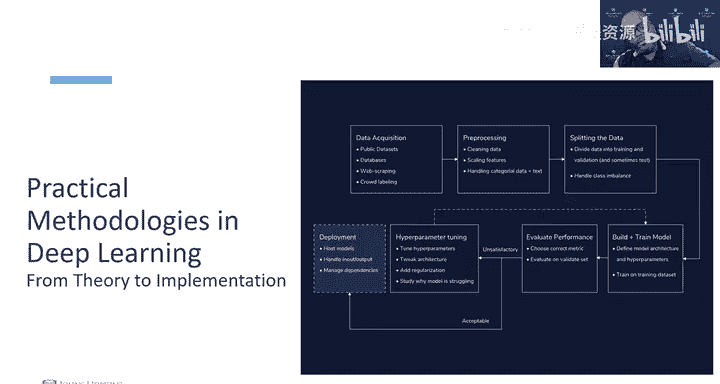
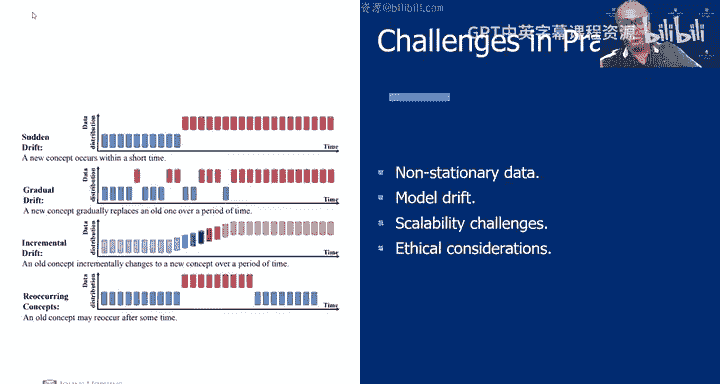

#  015：神经网络实践方法论 🛠️

在本节课中，我们将从理论转向实践，探讨训练神经网络模型时的一系列核心方法论。我们将学习如何评估模型、选择基准、调整超参数、防止过拟合与欠拟合，以及如何调试和确保结果的可复现性。

---

## 概述

我们已经花费了大量时间学习神经网络的理论知识，这是本课程的预期内容。现在，我们需要暂停一下，开始思考实践方法，即如何训练模型以及相关的一切工作。这里的核心思想是从理论转向实践。

你始终需要考虑性能指标，例如准确率、精确率、召回率和F1分数。这些是评估模型并判断其表现好坏的方法。为你的问题选择合适的指标至关重要。

那么，在哪些情况下这些指标不适用呢？在这种情况下，你会改用哪些指标？这在很大程度上取决于你正在处理的具体问题集。你永远无法绕过该领域的专业知识。

---

## 确定基准模型

在构建这类模型时，你需要确定一个基准。建立一个简单的模型进行比较非常重要。你不应该从最复杂的模型开始并试图与之比较，而应该考虑一个线性模型，并以此作为起点进行比较，以明确你的改进方向。这对于建立基准至关重要。

以下是一些基准模型的例子：
*   **线性回归**：适用于回归问题。
*   **逻辑回归**：适用于分类问题。

这些模型能提供一个良好的基准。

---

## 改进策略

你的目标是从基准模型开始改进。以下是一些改进策略：
*   **添加更多数据**。
*   **采用更好的模型架构**。
*   **使用更好的优化算法**。

你需要了解每种情况的例子并进行比较。

---

## 超参数调优

超参数调优是一项艰巨的任务。以下是一些需要调优的超参数示例：
*   **学习率**。
*   **正则化策略**。
*   **网络层数**。
*   **层的宽度**，等等。

调优这些参数对于模型改进非常重要。常见的调优方法包括网格搜索和随机搜索。

---

## 正则化技术

接下来是正则化技术，主要用于处理过拟合和欠拟合问题。

你既不想过拟合，也不想欠拟合。以下是一些常用的正则化技术：
*   **L1正则化**。
*   **L2正则化**。
*   **Dropout**。

你需要使用这些常规技术来应对这些问题。那么，过拟合和欠拟合通常发生在哪些例子中？你能快速分辨它们吗？

---

## 优化策略

思考你的优化策略也很重要。很多时候，你不会直接使用标准的梯度下降法，大多数时候你会使用它的变体，例如带动量的梯度下降、RMSProp或Adam等。

那么，为什么这些添加的项（如动量）在这个决策中起作用？它们如何帮助你优化策略？

---

## 调试策略

我从未在完成一个非常大的机器学习项目后，不回头调试一些错误。在机器学习工作流中，拥有一个调试策略非常重要。

典型的问题包括：
*   **梯度消失**。
*   **梯度爆炸**。
*   **权重初始化不佳**。

相应的解决方案可以是：
*   **梯度裁剪**。
*   **更好的权重初始化方法**。

你能给我一个机器学习工作流程中出现的错误例子，并给出解决方案吗？

---

## 可视化与监控工具

拥有可视化与监控工具非常有益。像TensorBoard这类工具非常棒，它们能让你在训练过程中监控系统。

这些工具对于跟踪训练进度和调试至关重要。我们可以使用哪些工具来可视化训练过程？我提到了TensorBoard，它是TensorFlow的一个实现，还有哪些类似的工具？

---

## 确保可复现性

确保可复现性这一点我怎么强调都不为过。我对许多机器学习论文的一个不满之处在于，它们声称的很多结果无法被复现。

我们可以通过以下方式来实现可复现性：
*   **设置随机种子**。
*   **对数据和代码进行版本控制**。

这对于发表研究等工作非常重要，因为你希望能够复现自己的结果。

---

## 迁移学习

只要有可能，你都应该利用预训练模型。它有助于你的模型收敛等。具体做法是，从那个模型开始，使用在该模型上训练好的权重，然后针对你的特定任务进行微调。

那么，你预计迁移学习在何时会表现良好？我给你一个通用的答案：当你的任务相似时，迁移学习效果会好。例如，如果我有关于猫狗的RGB图像，我可能会使用ImageNet作为预训练模型，因为它包含很多猫狗图像。或者，如果我要使用黑白图像，ImageNet的初始层具有良好的边缘检测器等功能，当我的数据与训练数据相似时，这些都是迁移学习可能成功的场景。

---

## 模型评估策略

你需要有完善的模型评估策略。只要可能，你都应该拥有训练集、验证集和测试集。

如果无法做到这一点，你需要进行部分评估。回顾一下，问问自己这些数据集之间有何不同，并确定它们，告诉我你的想法。

---

## 总结

本节课内容虽然简短，但当你开始为期末项目实现模型时，我希望你能暂停一下，了解这些实用的方法。以上就是本节课的全部内容。如果你有任何问题，可以通过邮件联系我。