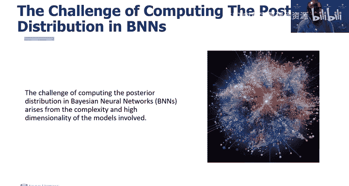
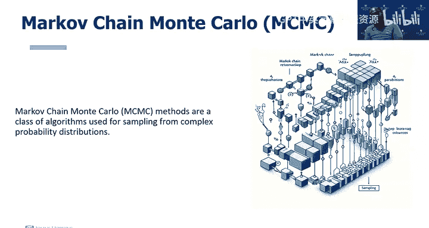
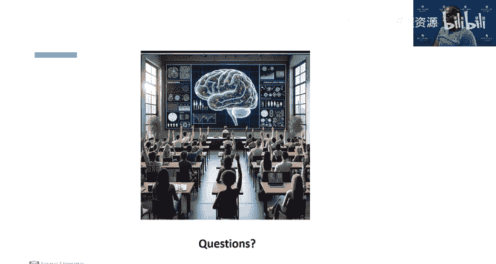

#  017：深度学习中的结构化概率建模 🧠

在本节课中，我们将学习如何将神经网络应用于实际场景，并探讨如何通过结构化概率模型来系统性地处理预测中的不确定性。我们将介绍概率模型的基本概念、核心方法及其在深度学习中的集成应用。

---

## 概述

现实世界的数据和预测充满了不确定性。结构化概率模型为我们提供了一个数学框架，用于表示和推理具有不确定性的系统。通过将概率理论与神经网络结合，我们可以量化不同结果的可能性，并在新信息到来时更新我们的认知。

---

## 什么是结构化概率模型？

上一节我们介绍了课程的目标，本节中我们来看看结构化概率模型的核心定义。

结构化概率模型本质上是基于概率理论的数学框架。它们用于表示和推理那些表现出不确定性的系统。神经网络所做的每一个预测都带有某种不确定性，我们需要找到处理这种不确定性的方法。

我们通过编码世界所有可能状态的知识以及每个状态发生的可能性来实现这一点。这些模型提供了一种结构化的方式来管理不确定性。推理过程使我们能够量化各种结果的概率，并对所有不确定性进行推理。

其核心在于，概率模型建立在概率论的基础上，这使我们能够以严谨的方式表示不确定性。我们利用**概率分布**来描述系统中变量的不确定性，并使用这些分布进行预测、做出推断，并在新信息到来时更新信念。

---

## 概率模型的作用与重要性

理解了基本概念后，我们来看看为什么这些模型如此重要。

概率模型在捕捉现实世界现象固有的不确定性方面起着至关重要的作用。它们的重要性源于能够正式地量化和管理不确定性。在处理真实、非学术性的、不“干净”的数据时，我们必须能够处理无处不在的不确定性。

以下是概率模型的主要作用：
*   **量化不确定性**：对预测中的不确定性进行度量。
*   **整合先验知识**：将已有的领域知识纳入模型。
*   **更新信念**：随着新信息的到来，更新模型的认知。
*   **在不确定性下做出决策**：为关键决策提供依据。
*   **进行预测**：构建预测模型。
*   **理解复杂系统**：分析系统内部的风险和不确定性。
*   **优化资源分配**：基于概率评估进行更高效的资源配置。

---

## 与深度学习的关键集成技术

了解了模型的作用，接下来我们看看如何将概率模型与深度学习相结合。

以下是三种关键的集成技术：
1.  **贝叶斯神经网络**：通过引入权重的先验分布来量化模型本身的不确定性。
2.  **变分自编码器**：将神经网络与概率图模型结合，用于生成任务。
3.  **深度高斯过程**：使用深度神经网络学习特征表示，作为高斯过程的输入。

---

## 贝叶斯神经网络详解

上一节我们列出了几种集成技术，本节中我们深入探讨第一种：贝叶斯神经网络。

贝叶斯神经网络通过应用贝叶斯统计学来估计网络权重的不确定性，从而扩展了传统的神经网络。在标准神经网络中，权重从数据中学习并固定下来，这暗示了对预测模型有某种程度的置信度。

相比之下，贝叶斯神经网络将权重视为**随机变量**，并赋予其概率分布。这意味着权重不是固定的。这种方法允许贝叶斯网络表达模型预测中的不确定性，并提供了一个强大的框架，在决策制定至关重要的应用中尤其有用，例如医疗结果预测。

其核心思想是整合关于权重的先验知识，并根据新的观察结果更新这些知识。贝叶斯神经网络学习的是权重的**分布**，该分布反映了在看到数据之前对权重的先验信念，以及在给定权重下观察到数据的可能性。

其数学公式基于贝叶斯定理：
`P(W|D) = [P(D|W) * P(W)] / P(D)`
其中，`P(W|D)` 是给定数据 `D` 后权重 `W` 的后验分布，`P(D|W)` 是似然函数，`P(W)` 是先验分布，`P(D)` 是证据（或边缘似然）。

**优势**：
*   提供预测的**不确定性估计**，对医疗、自动驾驶、金融等领域至关重要。
*   对**过拟合更加鲁棒**，尤其是在小数据集上。
*   能够**整合先验知识**。

**挑战**：
*   **计算成本高昂**：计算权重上的后验分布非常耗时。
*   **后验分布难以精确计算**：由于神经网络参数空间维度极高，精确计算后验分布通常是不可行的。

---

## 处理计算挑战的近似方法

由于精确计算后验分布非常困难，我们需要使用近似方法。以下是几种常见的近似技术：

1.  **变分推断**：用一个更简单的分布来近似真实的后验分布，通过最小化两个分布之间的散度来实现。它将问题转化为一个优化问题，计算上更可行。
2.  **马尔可夫链蒙特卡洛方法**：直接从后验分布中采样，而无需显式计算它。虽然强大，但其本身计算量也可能很大。
3.  **拉普拉斯近似**：用一个以最大后验估计为中心的高斯分布来近似后验。计算更简单，但在高维空间中可能无法很好地捕捉后验的真实形状。
4.  **Dropout 近似**：在测试时使用Dropout，已被提出作为一种实用的贝叶斯推断近似方法，能以计算高效的方式估计不确定性。

---

## 量化不确定性：偶然 vs 认知

贝叶斯神经网络的一个关键优势是能够量化两种不同类型的不确定性。

**偶然不确定性**（也称为统计不确定性）源于数据固有的随机性。这种不确定性无法通过收集更多数据来减少。它通常与数据中的噪声相关。在模型中，可以通过为输出层假设一个噪声分布（如高斯分布）来直接建模。其数学表示可以为：`P(y|x, W) = N(f(x; W), σ²(x; W))`，其中 `f(x; W)` 是均值预测，`σ²(x; W)` 是噪声方差。

**认知不确定性**（也称为模型不确定性）源于对底层系统缺乏完整了解。它代表了关于模型本身（如结构、参数）的不确定性。与偶然不确定性不同，认知不确定性可以通过收集更多数据来减少。贝叶斯神经网络通过将权重视为随机变量（具有后验分布 `P(W|D)`）来量化这种不确定性。计算或近似这个分布可以评估我们的信念如何随数据变化。

通过整合所有可能的权重，贝叶斯神经网络可以计算新输入的预测分布，该分布同时包含了偶然和认知不确定性。

---

## 马尔可夫链蒙特卡洛方法

另一种重要的近似方法是MCMC。MCMC是一类用于从复杂概率分布中采样的算法。

它们通过构建一个马尔可夫链来生成样本，该链以目标概率分布作为其平稳分布。其思想是从一个任意点开始，迭代地在样本空间中移动到新点，设计的转移概率使得链最终收敛到目标分布。

**Metropolis-Hastings算法**是其中的关键，它通过基于接受概率来接受或拒绝提议的移动，从而实现从目标分布中采样。

**Gibbs采样**是MH算法的一个特例，其中移动总是被接受。它通过顺序地采样每个变量（以其他变量的当前值为条件）来工作，在高维但结构化的空间中很实用。

**在深度学习中的应用**：
*   **贝叶斯深度学习**：用于近似神经网络权重的后验分布。
*   **不确定性估计**：通过从后验分布中采样，估计深度学习模型中的预测不确定性，这对自动驾驶、医疗诊断等应用至关重要。

**挑战**：直接应用于深度学习模型面临高维参数空间和计算成本的挑战。变体如哈密顿蒙特卡洛和随机梯度MCMC已被开发出来以提高效率。

---

## 真实世界案例研究

最后，我们通过一些案例来看看结构化概率模型的实际影响力。

结构化概率模型通过整合对不确定性的细致理解，显著增强了深度学习在许多领域的应用。

以下是几个值得注意的案例：
*   **图像生成与VAEs**：变分自编码器利用结构化概率模型学习数据的潜在表示，在图像生成领域极具影响力。例如，VAE被用于从CelebA等数据集中生成高质量、多样化的人脸图像，捕捉了细微的面部特征和变化。
*   **自然语言处理与LDA**：潜在狄利克雷分配是一种用于发现文档主题结构的概率模型。与神经网络结合后，LDA可以增强主题发现和文本生成过程。例如，用LDA增强的深度学习模型在文本分类和生成任务中表现出色，产生了更连贯的主题和文本。
*   **语音识别与DMMs**：深度马尔可夫模型结合了深度学习和隐马尔可夫模型，能更有效地建模序列数据。它们被用于增强语音识别系统，为处理音频中的时间变化和噪声提供了更鲁棒的框架。
*   **自动驾驶与贝叶斯网络**：贝叶斯神经网络被用于自动驾驶中，预测其他车辆和行人的行为并关联不确定性，从而增强了在不确定环境中的决策过程。
*   **药物发现与图神经网络**：图卷积神经网络与概率模型结合，已被用于预测分子性质和相互作用，加速了药物发现过程。

---

## 总结

在本节课中，我们一起学习了结构化概率建模在深度学习中的核心作用。我们首先了解了概率模型如何为处理不确定性提供框架，然后探讨了贝叶斯神经网络如何通过将权重视为随机变量来量化偶然和认知不确定性。我们还介绍了应对计算挑战的近似方法，如变分推断和MCMC。最后，通过多个领域的实际案例，我们看到了这些技术如何解决复杂的现实世界问题，从图像生成、自然语言处理到自动驾驶和药物发现。掌握这些概念，将帮助你构建更稳健、可解释且能妥善处理不确定性的智能系统。