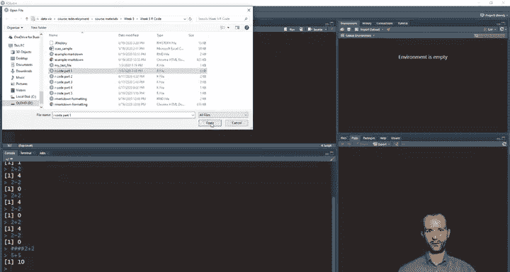
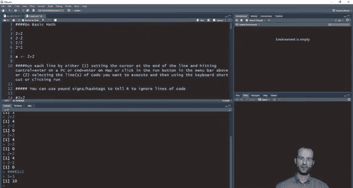
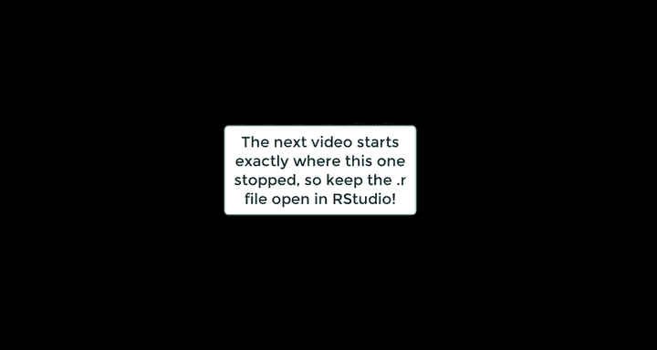

# 003：R语言基础入门 🚀

在本课程中，我们将学习R语言的基本使用方法，包括如何运行命令、创建脚本文件以及使用注释。这些是开始使用R进行数据分析和可视化的第一步。

## 概述

R语言是一种功能强大的编程语言，特别适用于数据分析和可视化。本节课程将引导你了解R的基本操作，为后续更复杂的数据处理任务打下基础。

## 1. 运行R命令

在RStudio中，你可以通过在控制台（Console）中输入命令并按下回车键来执行操作。R本质上可以作为一个计算器使用，支持加法、减法、乘法和除法等基本数学运算。

例如，在控制台中输入：
```r
2 + 3
5 * 4
10 / 2
```

## 2. 创建和使用R脚本文件

随着命令变得复杂，直接在控制台中逐行运行会变得低效。因此，我们通常将代码保存在R脚本文件中。R脚本文件以 `.R` 为扩展名，允许你编写、保存和重复使用多行代码。

在RStudio中创建脚本文件后，你可以通过以下方式运行代码：
*   将光标置于代码行末尾，按 `Ctrl + Enter`（Windows）或 `Cmd + Enter`（Mac）。
*   点击菜单栏中的“Run”按钮。
*   选中多行代码，然后使用上述快捷键或点击“Run”。

## 3. 使用代码注释

在R脚本中，以井号 `#` 开头的行是注释行。R会忽略注释行，不执行其中的代码。注释对于记录代码意图、步骤说明至关重要，能帮助你或他人在日后回顾时理解代码逻辑。

例如：
```r
# 这是一行注释，下面的代码用于计算圆的面积
radius <- 5
area <- pi * radius^2
area
```

## 4. 打开课程示例文件

为了便于跟随本课程学习，你可以打开提供的示例R脚本文件。

以下是操作步骤：
1.  点击菜单栏的“File”（文件）。
2.  选择“Open File...”（打开文件）。
3.  导航至你之前下载并保存的课程 `.R` 文件所在位置。
4.  选择并打开该文件。

打开文件后，你就可以跟随文件中的代码示例继续学习了。



你现在可以打开该文件，并从我们中断的地方继续学习。






## 总结


在本课程中，我们一起学习了R语言的基础操作：如何在控制台中运行命令、为何以及如何创建和使用 `.R` 脚本文件来高效地编写和保存代码，以及如何使用 `#` 符号添加注释来提升代码的可读性和可维护性。掌握这些基础是开启R语言数据科学之旅的关键第一步。