# 004：基础R语言（第二部分）📊

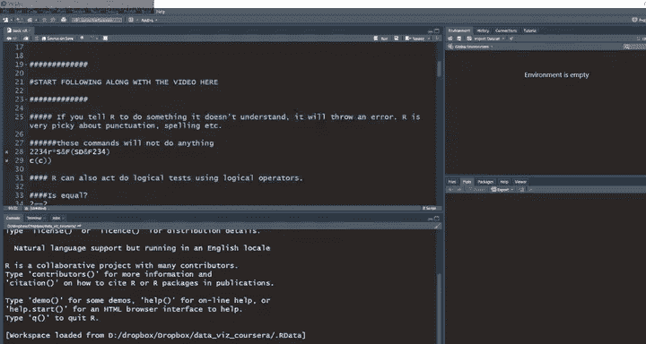

在本节课中，我们将学习R语言的基础知识，包括如何处理错误、进行逻辑测试、操作字符字符串、创建和操作对象与向量，以及理解数据类型和类。这些是掌握R语言进行数据可视化和仪表盘开发的重要基础。

## 错误处理与逻辑测试 ⚠️

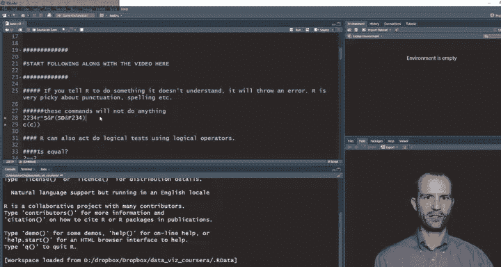

上一节我们介绍了R的基本运算，本节中我们来看看当R遇到不理解的操作时会如何反应。

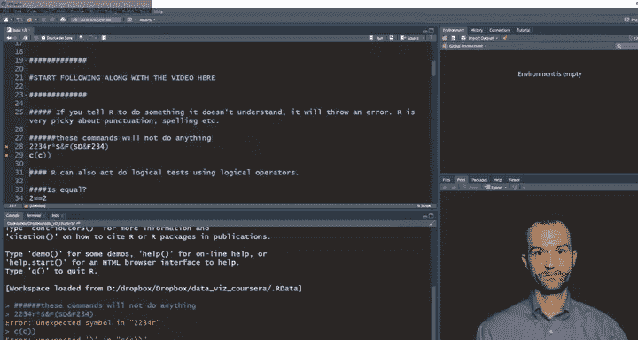

如果要求R执行它不理解的操作，它会在控制台中抛出错误。R对语法、拼写等非常严格，因此如果存在语法错误，R会告知它不理解你的意图，并显示错误信息。

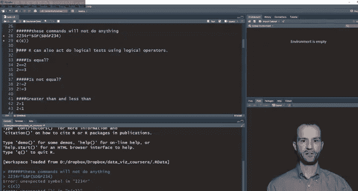

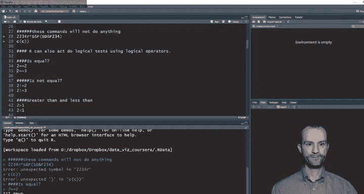

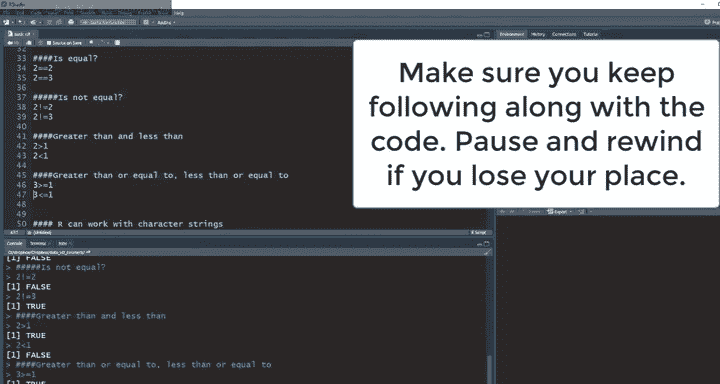

这些错误信息起初可能难以解读，但随着编码经验的积累，你会逐渐理解它们的含义。

---

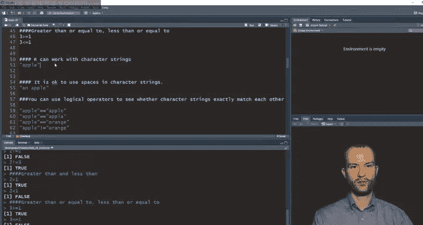

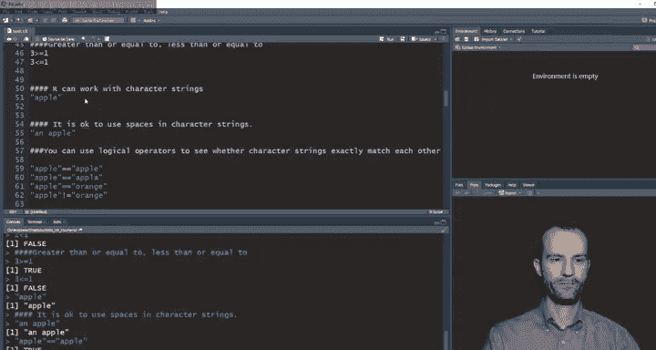

R可以进行简单的逻辑测试，例如判断两个值是否相等，或对不等式返回真（TRUE）或假（FALSE）。

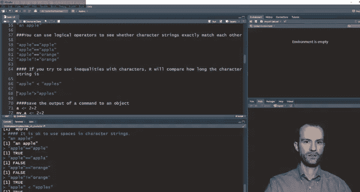

以下是常见的逻辑运算符：
*   `==`：等于
*   `!=`：不等于
*   `>`：大于
*   `<`：小于
*   `>=`：大于等于
*   `<=`：小于等于

## 字符字符串操作 🔤

R也可以处理字符字符串。在R中书写字符字符串时，需要用引号将其括起来。

你可以使用逻辑运算符来检查两个字符串是否完全匹配。

如果尝试对字符字符串使用不等式运算符，R会比较字符串的长度。

## 创建与使用对象 📦

你可以将执行的R命令的输出结果保存到一个对象中，这个对象会存储在R环境中。R环境是你当前代码会话中所有数据的列表。

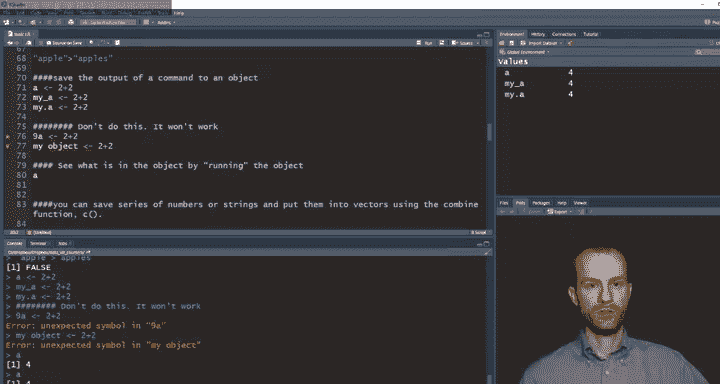

创建对象的方法是：以对象名称开始一行代码，然后使用赋值运算符 `<-` 为其赋值。

以下是创建对象时的命名规则：
*   可以使用字母、数字以及下划线或句点等特殊字符。
*   对象名称不能以数字开头。
*   名称中不能包含空格。

将值赋给对象后，该对象会出现在R环境中，你可以在环境面板中看到它。通过在控制台或R脚本中运行该对象名称，可以查看其存储的值。

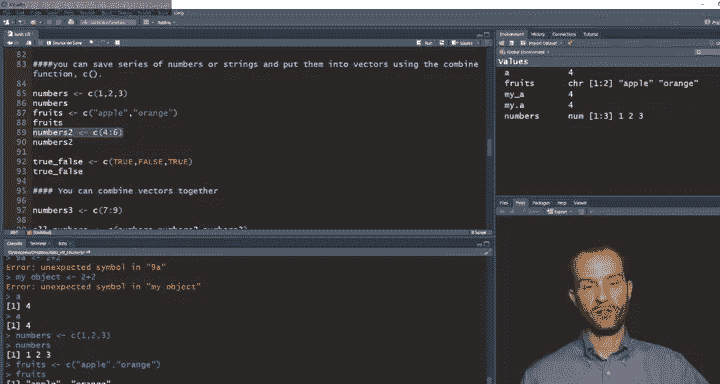

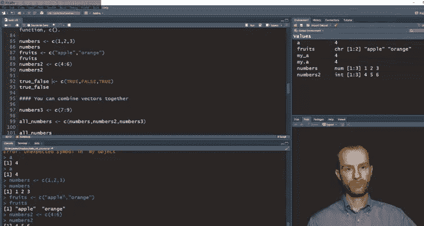

## 向量操作 📈

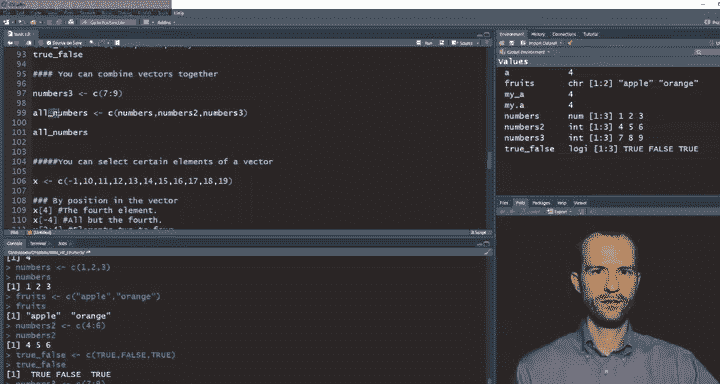

如果你想保存一系列值，可以将它们组合成向量。使用 `c()` 函数，并用逗号分隔向量中的每个元素。

以下是创建向量的几种方法：
*   使用 `c()` 函数：`c(1, 2, 3, 4, 5)`
*   使用冒号创建整数序列：`1:5`
*   创建逻辑值向量：`c(TRUE, FALSE, TRUE)`

拥有多个向量后，可以再次使用 `c()` 函数，用逗号分隔不同的向量，将它们组合在一起。

有多种方法可以选择向量的不同元素。具体做法是：输入向量对象的名称，然后在方括号中使用特定的向量符号来指定要选择的元素。

请仔细研究以下示例，并参考本视频附带的R速查表，以理解其工作原理：
*   `my_vector[1]`：选择第一个元素。
*   `my_vector[c(1,3)]`：选择第一和第三个元素。
*   `my_vector[-2]`：选择除第二个元素外的所有元素。

## 数据类型与类 🔄

在R中将不同类型的数据保存到对象中时，数据会被赋予一个“类”，用于描述向量中包含的数据类型。

一些常见的类包括：
*   **逻辑向量**：包含TRUE和FALSE值。
*   **数值向量**：包含数字。
*   **字符向量**：包含文本。
*   **因子**：一种特殊的字符向量，具有某种顺序值（称为“水平”），某些统计模型需要用到。

可以使用 `class()` 函数查看对象的类。

如果将数字和字符组合到一个向量中，数字会被转换为字符。因此，在进行数据可视化时，通常建议将数字和字符保存在不同的向量中，不要混合。我们将在讨论数据管理时进一步探讨这一点。

有时确实需要更改向量的类，因为某些R函数可能只接受字符向量或只接受数值向量。当遇到这种情况时，我们会详细讨论。目前，你只需要知道可以使用 `as.logical()`、`as.numeric()`、`as.character()` 和 `as.factor()` 等函数将向量强制转换为不同的类，并根据需要在不同类之间转换信息。

---

本节课中我们一起学习了R语言的基础核心概念，包括错误信息的解读、逻辑与字符串运算、对象的创建与赋值、向量的构建与索引，以及数据类型的识别与转换。理解这些内容是后续进行有效数据操作和可视化的关键。