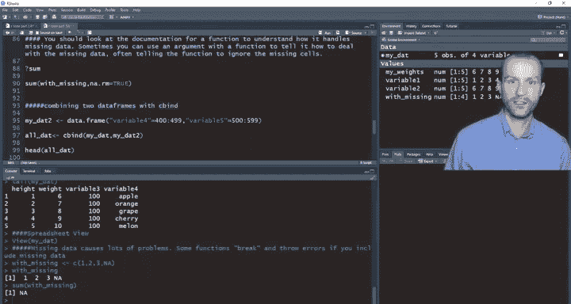

# 006：R语言中的数据框 📊

在本节课中，我们将更深入地探讨R语言如何管理数据。我们将重点学习**数据框**——一种在创建数据可视化时最常用的数据结构。我们将了解如何创建数据框、如何操作其行与列、如何处理缺失数据，以及如何合并不同的数据框。

---


## 数据框简介

到目前为止，你已经看到R可以对单个数字或字符串进行操作，也可以将多个数字或字符连接起来创建**向量**。除此之外，R中还可以创建矩阵。但从数据可视化的角度来看，更常用的是**数据框**。


数据框本质上就像一个表格或电子表格，可以作为一个对象保存在R的环境中。数据框可以有列标题。你可以执行不同的操作来为数据框添加列或行，这将是本视频讨论的主要内容。


---

## 创建数据框

在R中，通过组合向量来创建数据框。例如，如果我们创建两个向量并将它们保存为R中的对象：

```r
vector1 <- c(1, 2, 3)
vector2 <- c("a", "b", "c")
```

然后，使用`data.frame()`函数，我们可以将这些变量（对象）组合成一个数据框，并将其保存为我们命名的第三个对象。

```r
my_dataframe <- data.frame(numbers = vector1, letters = vector2)
```

如果你想为列指定名称，并且希望这些名称与你组合的对象名称不同，可以在`data.frame()`函数中通过将列标签放在引号中并使其等于向量名称来指定。解释起来可能有点难理解，但你可以直接看这段代码是如何工作的，它相当直观。

---

## 访问与选择数据

大多数时候，当你创建可视化时，你会使用数据框，或者稍后我们将看到的、一种非常相似的对象——**Tibble**。当数据以这些格式存在时，你可以使用美元符号`$`来调用其中的单个列。

```r
my_dataframe$numbers
```

这样做时，你基本上就是在调用一个向量。你可以将这些数据列输入到函数中，或者，如果你愿意，甚至可以将它们保存到R环境中的不同对象中。

如果你想选择数据框的某些行、列或单元格，可以使用类似于选择向量元素的语法。你可以使用这种表示法来选择整行、整列或特定单元格等。

```r
# 选择第一行
my_dataframe[1, ]
# 选择“numbers”列
my_dataframe[, "numbers"]
# 选择第一行第一列的单元格
my_dataframe[1, 1]
```

---

## 添加列与获取信息

创建数据框后，你可以通过使用美元符号`$`将值分配给数据框中的新列来添加列。

```r
my_dataframe$new_column <- c("x", "y", "z")
```

当你这样做时，你必须添加一个将在新列的每一行中重复的**单个值**，或者添加一个与数据框行数**长度相同**的向量。它们必须匹配，以免你尝试添加的内容与原始数据框之间出现不匹配。

如果你想获取数据框大小的信息，可以使用以下函数：
*   `dim()`：告诉你行数和列数。
*   `str()`：提供更详细的数据结构信息。
*   `nrow()` 和 `ncol()`：分别返回行数和列数。

如果你想了解数据框的列名，可以使用`names()`函数。如果你有一个非常大的数据框，可以使用`head()`查看前几行，或使用`tail()`查看最后几行。如果你想看到一个可以滚动的电子表格视图，可以使用`View()`函数。

---

## 处理缺失数据

现在是一个讨论缺失数据的好时机。你会发现，有时当你下载别人收集的数据时，该数据集经常会有缺失数据——可能整行、整列缺失，或者在整个数据集的单个单元格中缺失。

**非常重要的一点是，要记住这些单元格不等于零，它们只是空白，里面什么都没有。** R通过为数据框中的这些单元格分配值`NA`来处理这些空白单元格。

缺失数据在你分析数据时会造成很多问题，它可能导致函数无法工作，也可能使你的数据变得不准确，因此你需要非常、非常小心地处理这个问题。

这里给你一个简单的例子，假设我们创建一个包含一个缺失元素的向量，然后尝试对该向量使用`sum()`函数，你会发现它不起作用。

```r
vector_with_na <- c(1, 2, NA, 4)
sum(vector_with_na) # 返回 NA
```

对于这个问题有一种变通方法。如果你想了解这一点，你可以在函数名（本例中是`sum`）前加上一个问号`?`，这将调出该函数的文档或帮助文件。




在该文档中，它会描述函数的功能，并告诉你可以传递给函数的输入或参数类型。这些就像你可以给函数的更多指令，告诉你如何处理输入的数据，或者函数将运行何种计算。

在本例中，对于`sum()`函数，你会看到有一个额外的参数可以使用：`na.rm`参数，它代表移除缺失数据。这允许你在运行函数时向其中输入一个`TRUE`或`FALSE`的逻辑值，这将决定在计算总和时是否移除缺失数据。

```r
sum(vector_with_na, na.rm = TRUE) # 返回 7 (1+2+4)
```

因此，当你添加该参数时，函数将返回这些值的总和，并且会完全忽略缺失数据。再次强调，你需要非常小心这一点，理想情况下，你希望拥有没有缺失值的干净数据，但有时在现实世界中会出现缺失数据，你需要知道如何处理它。

---

## 合并数据框

现在，跳回到操作数据框，你将遇到的另一个非常常见的任务是合并不同的数据框。你可以使用`cbind()`函数来实现这一点。

```r
new_dataframe <- cbind(dataframe1, dataframe2)
```

你只需要确保，如果你使用列绑定函数`cbind()`并尝试将向量或数据框组合在一起，你必须确保它们都具有相同的行数，以免再次出现这种不匹配的问题。

`cbind()`（列绑定）的互补函数是`rbind()`（行绑定）。在这里，你必须确保要添加到数据框的行具有与数据框列数相同的元素数量，因此它们必须在垂直方向上相互匹配。

```r
new_row <- c(5, "e")
my_dataframe <- rbind(my_dataframe, new_row)
```

如果你要合并两个不同的数据框，你必须确保这些列的顺序相同并且标题相同，以避免任何不匹配的问题。

---

## 总结

在本节课中，我们一起学习了R语言中**数据框**的核心概念和操作。我们了解到数据框是类似表格的结构，是数据分析与可视化的基石。我们掌握了如何**创建**数据框、如何**访问和选择**其中的数据、如何**添加新列**以及如何获取其基本信息。我们还探讨了处理**缺失数据**（`NA`）的重要性和方法，最后学习了如何使用`cbind()`和`rbind()`来**合并**数据框。熟练掌握数据框的操作，将为后续更复杂的数据处理和图形创建打下坚实的基础。