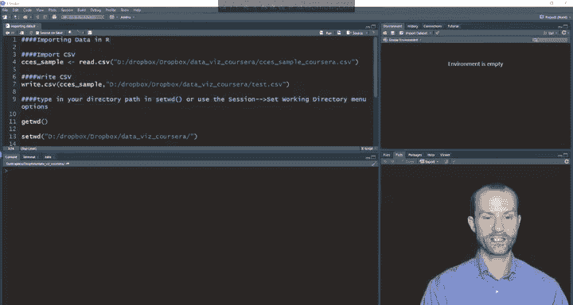
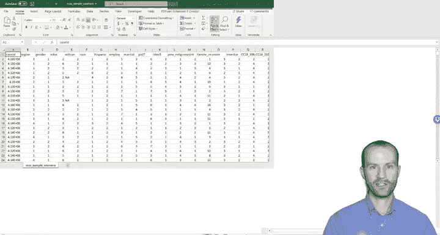
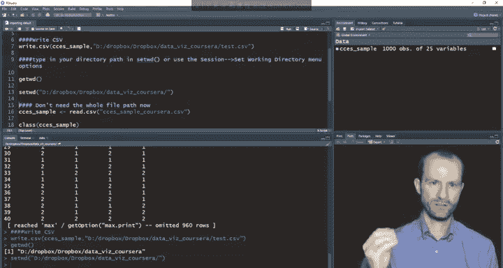
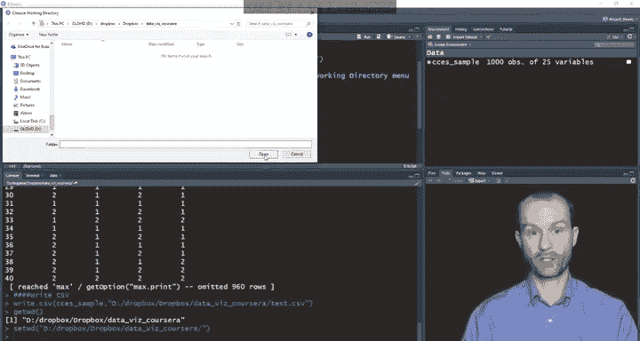
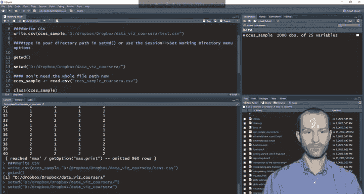

# 007：将数据导入R的基础知识

在本节课中，我们将学习如何将外部数据导入R，这是进行数据可视化的关键第一步。我们将重点介绍矩形数据，特别是CSV文件的读取和写入方法，并讲解工作目录的设置。

---

## 矩形数据与CSV文件

到目前为止，我们一直在R中手动创建向量和数据框进行练习。但在现实中，进行数据可视化时，你很可能需要使用某种外部数据，通常是从互联网下载的数据。

最容易用于制作可视化的数据类型被称为**矩形数据**，它类似于我们一直在处理的数据，具有行和列的结构。

R可以导入多种不同类型的数据，但一种非常常见的矩形数据集类型是**逗号分隔值文件**，即`.CSV`文件。

在本视频的配套材料中，我提供了一个示例CSV文件。你应该下载它，并将其放在计算机上的某个位置，以便你清楚它在计算机文件夹或目录系统中的确切路径。

如果你还没有这样做，请暂停视频，下载文件，将其放在计算机上，然后返回。


现在，你可能想用电子表格软件（如Microsoft Excel）打开CSV文件，查看一下它的内容。






目前这些值并不重要，因为我们只是练习导入数据。这只是向你展示这是一个矩形数据集。


---

## 使用 `read.csv()` 导入数据

R中用于导入`.CSV`文件的基础函数是 `read.csv()`。

要使用此函数，你需要向 `read.csv()` 函数提供从你的计算机到文件在文件夹或目录结构中位置的**确切文件路径**。

你需要将文件路径放在引号内，并使用**正斜杠**来分隔目录。

你可以将 `read.csv()` 函数的输出分配给R环境中的一个对象，这样就将数据导入到R中，你可以像使用任何其他数据框一样使用它。

以下是导入CSV文件的基本代码格式：

```r
my_data <- read.csv("C:/Users/YourName/Documents/data_file.csv")
```

---

## 使用 `write.csv()` 导出数据

与读取`.CSV`文件相反的操作是写入`.CSV`文件。你可以将在R中创建的数据框写入到CSV文件中。

同样，需要使用你想要写入文件的确切路径。

以下是导出数据框到CSV文件的基本代码格式：

```r
write.csv(my_data, "C:/Users/YourName/Documents/new_data_file.csv")
```

---

## 设置工作目录

另一种将数据读入R的方法不需要你设置确切的文件名，那就是从你的**工作目录**导入。

工作目录是计算机上的一个目录，R在其中查找输入文件并写入输出文件。如果你没有在 `write.csv` 命令中指定文件路径，文件就会写入这里。

你可以使用 `getwd()` 命令找出当前的工作目录是什么。



你也可以使用 `setwd()` 命令设置工作目录，同样需要指定计算机上的确切文件路径。



RStudio还提供了一个方便的选项，允许你通过顶部菜单栏设置工作目录。如果你转到 **Session > Set Working Directory > Choose Directory**，你可以浏览到你的`.CSV`文件所在的文件夹，或者你想要设置工作目录的位置。


当你这样做时，R会自动将相应的 `setwd()` 代码放入你的控制台。

或者，你也可以使用此菜单快捷方式将工作目录设置为你的`.R`文件所在的位置。

你还可以使用右下方面板中的 **Files** 选项卡导航到文件夹，并以这种方式设置工作目录。

你选择哪种方法并不重要，它们都是实现同一目标的方式。但关键是要记住，你一次只能有一个工作目录。

如果你设置了工作目录，那么你只需要在 `read.csv` 或 `write.csv` 命令中使用文件名，而不需要使用完整的目录路径。




---

## 使用RStudio界面导入数据

导入数据的最后一个选项是使用RStudio窗口右上角的 **Import Dataset** 按钮。

无论你选择哪种方式，一旦将数据导入R，这些数据就和我们手动创建的数据框一样，有列、值和单元格，有时也会有缺失数据。你可以像之前一样应用各种函数。

---

## RStudio环境管理与故障排除

在这里，最好再补充一个关于在RStudio中导航的快速细节。

当你在R中进行大量工作时，可能会在R环境中积累许多变量。有时你想重新开始，并确保你的代码可以从头开始复制。

当这种情况发生时，你只需要点击RStudio窗口右上角的**小扫帚图标**，这将清除环境中的所有对象，你必须再次运行代码才能重新加载它们。

此外，R偶尔会遇到一些奇怪的、持续性的错误，如果你尝试处理大量数据，它甚至可能冻结。当这种情况发生时，你可以通过选择 **Session** 菜单中的 **Restart R** 来重启R会话。

这有点像重启计算机，如果你遇到某种技术问题，这是首先要尝试的方法。

---

## 总结

本节课中，我们一起学习了将外部数据导入R的基础知识。我们了解了矩形数据和CSV文件，掌握了使用 `read.csv()` 和 `write.csv()` 函数读写数据的方法，并学会了如何设置和使用工作目录来简化文件路径。最后，我们还介绍了RStudio中管理环境和进行基本故障排除的技巧。这些是开始使用真实数据进行可视化分析的重要步骤。