# 010：Tidyverse中的数据导入与结构 📊

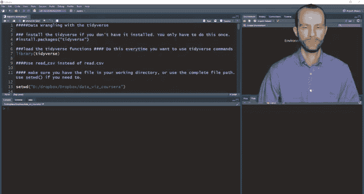

在本节课中，我们将学习如何使用Tidyverse包导入数据并查看其结构。我们将从安装和加载必要的R包开始，然后导入一个示例数据集，并了解Tidyverse中特有的数据结构——Tibble。


---

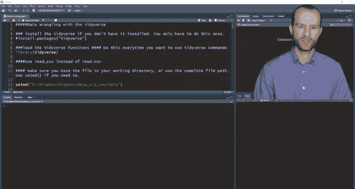

## 安装与加载Tidyverse包

首先，我们需要安装并加载所需的R包。

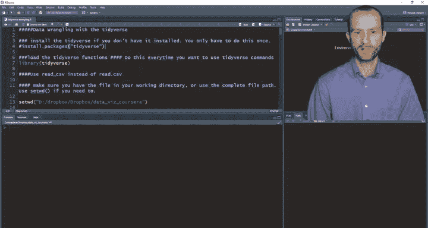

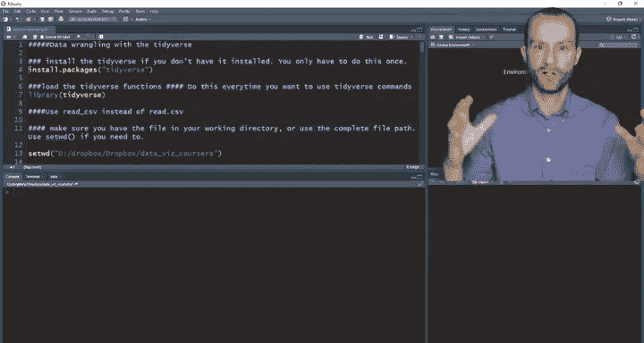

全球的软件开发者为R编写了数百个有用的包，这些包是可以通过R下载的函数集合。


这些包包含了数千个不同的函数，可用于数据整理和可视化。

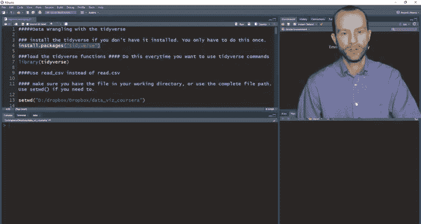

其中最常用和有用的包之一是Tidyverse。因此，我们首先使用`install.packages`函数来安装它。

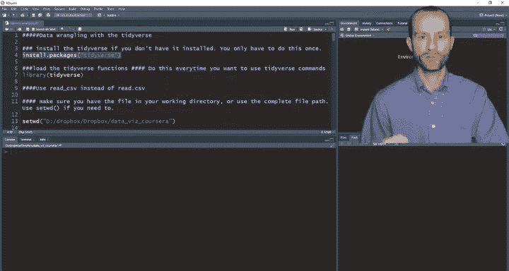

```r
install.packages("tidyverse")
```

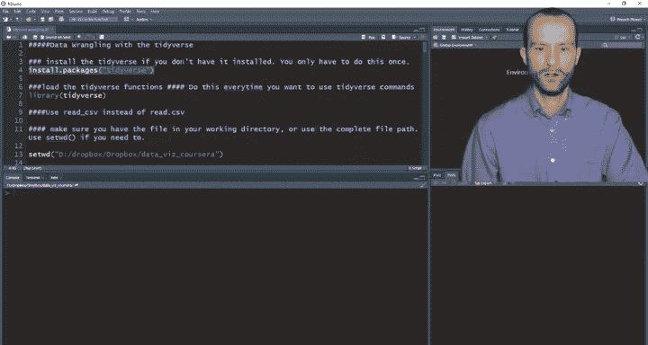

安装好这个包后，你可以使用`library(tidyverse)`来加载它。

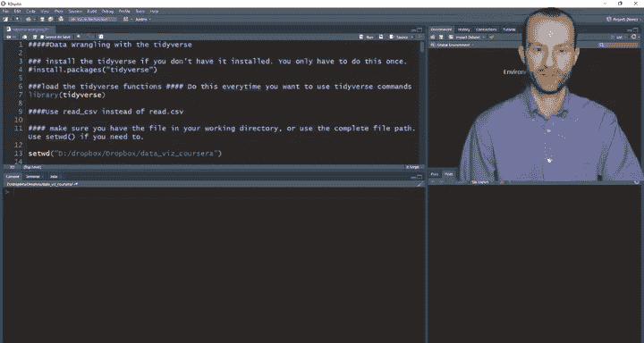

你不需要每次打开RStudio时都重新安装这个包，只需在第一次使用它时，或者在你电脑上重新安装或更新R时进行安装。

---

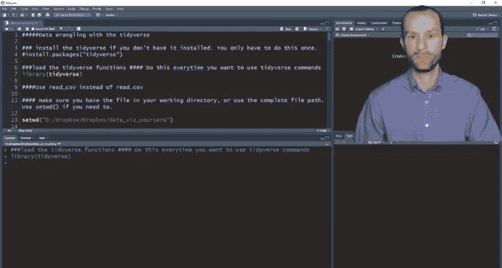

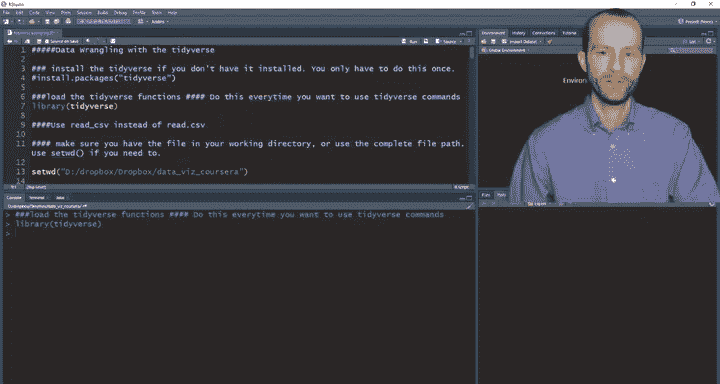

## 准备示例数据集

为了演示数据整理，我将使用一个示例数据集。我从“合作国会选举调查”中抽取了100份回复样本，这是由美国一些政治学家进行的一项主要学术调查。

我从中选取了调查中的几个问题。

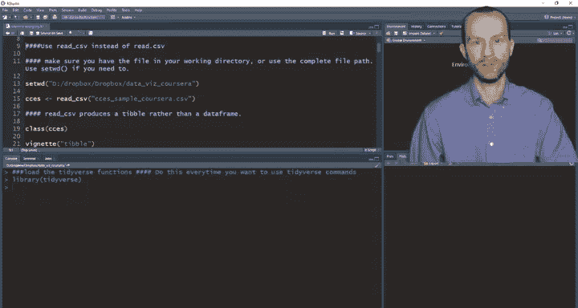

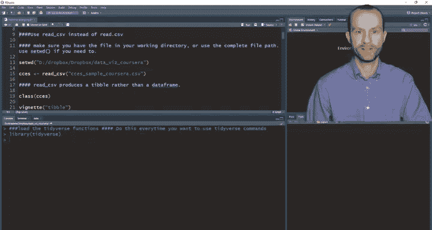

为了进一步说明你在许多情况下可能用于数据整理的过程，我提供了一个代码簿，解释了调查问题中不同回复的含义。


这确实是查找数据的理想情况：它是一个矩形的电子表格，并附有解释所有不同数据含义的代码簿。

你现在应该花几分钟时间，在Microsoft Excel或其他电子表格软件中打开这个文件。

同时打开代码簿，熟悉调查的问题及其对不同回复的编码方式。

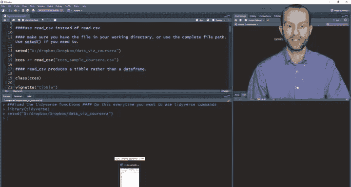

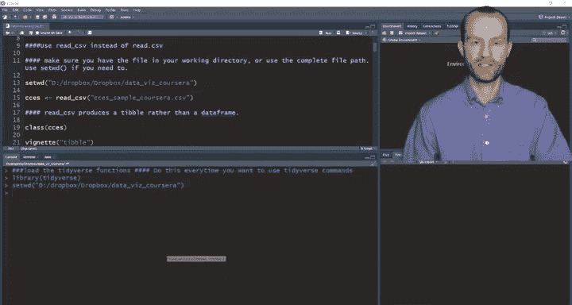

理解数据的文档和代码簿对于正确组织和使用数据至关重要。

假设你已经花时间熟悉了数据，现在让我们继续使用Tidyverse方法来加载数据。

---

## 设置工作目录并导入数据

我们将把工作目录设置为数据文件所在的路径。

```r
setwd("/path/to/your/data")
```


现在，从一开始，我们就开始与标准的Base R方法分道扬镳，转而使用Tidyverse工具。

Tidyverse包含一个名为`read_csv`的命令，它是`read.csv`函数的替代品。

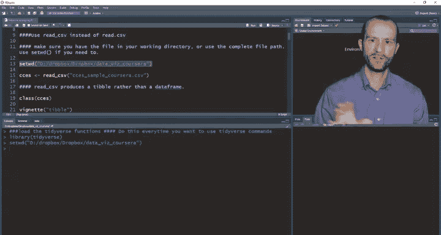

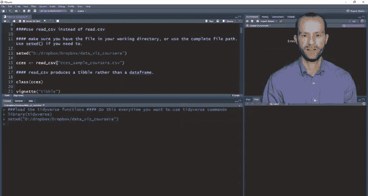

`read_csv`读取CSV文件的方式与`read.csv`非常相似，但输出略有不同。

`read_csv`产生的是一个称为**Tibble**的东西，而不是数据框。


---

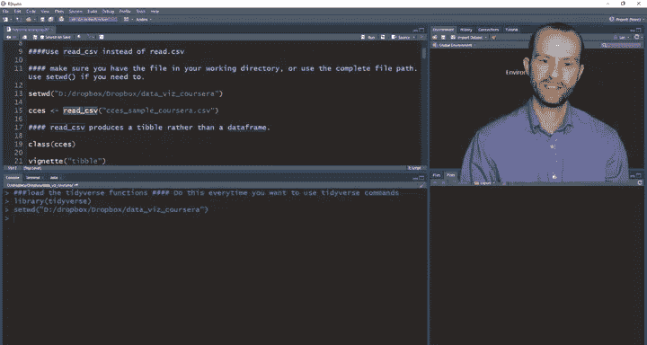

## 理解Tibble

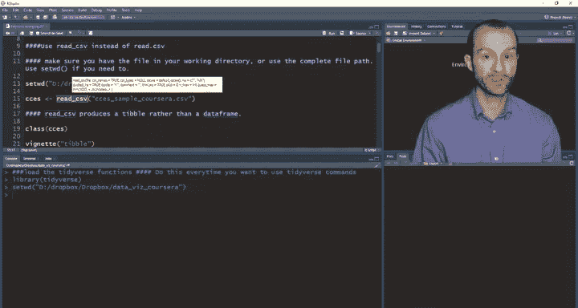

Tibble有点像数据框的一个专门版本，它与Tidyverse配合得很好，并具有几个理想的特性。

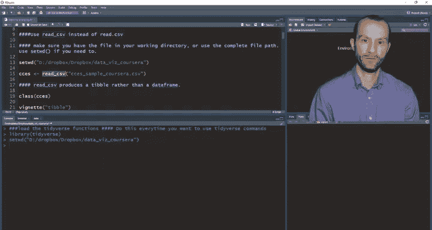

在最表面的层面上，当你在R控制台中显示一个Tibble时，它只会显示前10行，而不是在你尝试打开它时显示所有列。因此，你不需要使用`head`命令。

在更深层次上，Tibble在处理数据的方式上也有一些优势，可以帮助你在处理数据时避免犯错。

如果你想了解更多，可以在控制台中输入`vignette("tibble")`。

如果出于某种原因，你需要将数据框转换为Tibble，或将Tibble转换为数据框，你可以使用`as_tibble()`或`as.data.frame()`命令进行转换，可以来回切换。

---

## 处理缺失数据

在开始整理数据时，你需要决定如何处理数据中的任何空白单元格。

根据数据质量的不同，这可能是一个非常大的问题，因此在做出这个决定时必须极其小心。

理想情况下，你希望收集更多数据来填补这些空白，或者确定某种系统性的方法来填补缺失数据。

如果做不到这一点，最简单的做法是直接删除任何单元格中存在缺失数据的行，这样做的好处是让你的编码生活更轻松。

你可以使用`drop_na()`函数来实现这一点。

出于演示目的，这里我将删除任何有缺失数据的行，但再次强调，请注意危险警告：这不是你想轻易做的事情，因为它确实会损害你的数据质量以及你使用数据做出的推断质量。

数据科学家对如何处理缺失数据可能非常挑剔，因此要特别注意这一点，尤其是考虑到你的受众。

---

## 总结

本节课中，我们一起学习了如何使用Tidyverse导入数据。我们安装了`tidyverse`包，了解了Tibble这种与Tidyverse配合良好的数据结构，并讨论了处理缺失数据时需要谨慎考虑的问题。记住，理解数据的结构和背景是进行有效数据分析的第一步。