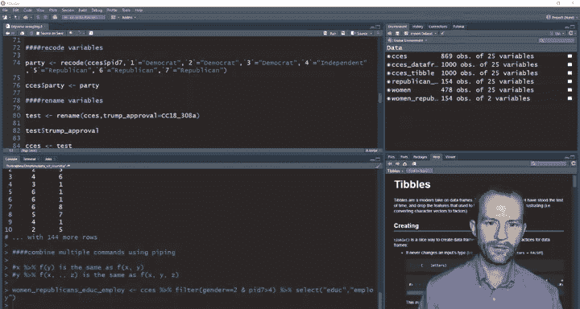
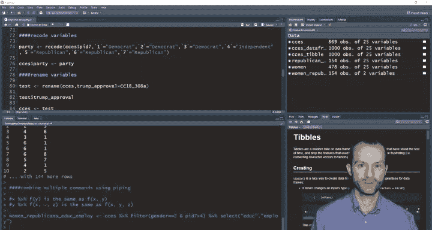
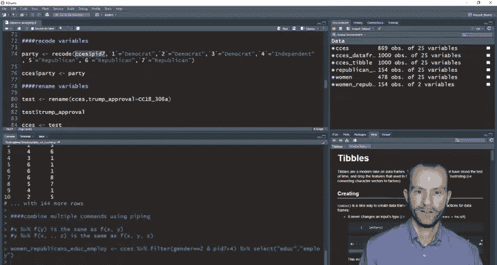
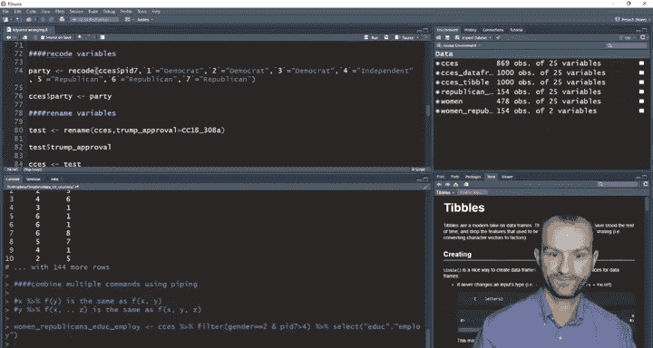
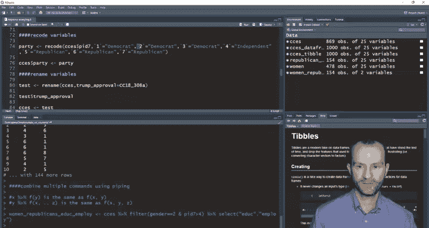
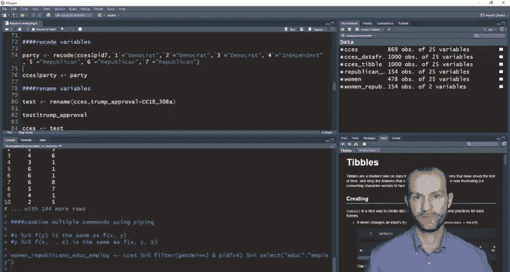
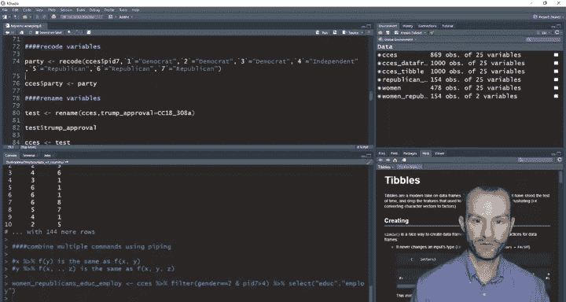
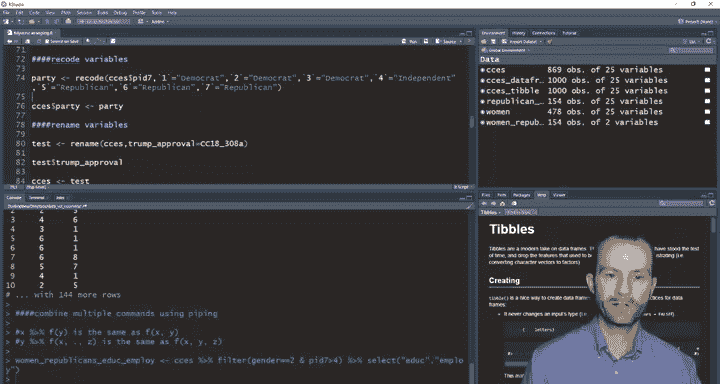
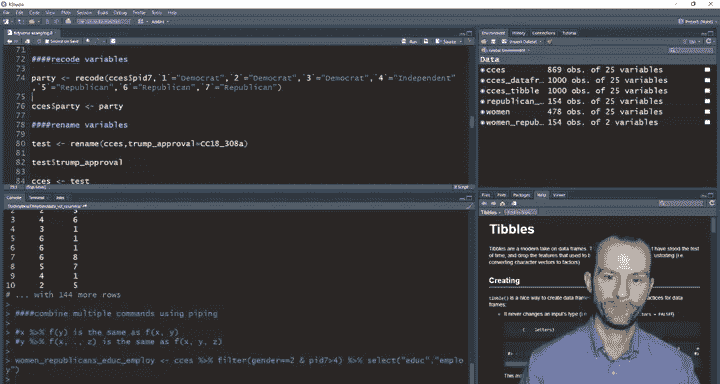
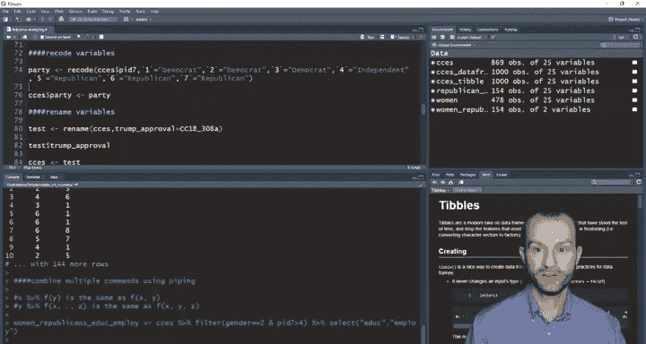

# 012：数据重塑基础 - 重新编码、重命名与计算列 📊

在本节课中，我们将学习数据重塑（Data Wrangling）中的三个核心操作：使用 `recode()` 函数重新编码变量值、使用 `rename()` 函数重命名数据框列，以及使用 `mutate()` 函数基于现有列计算并创建新列。这些是使用 `tidyverse` 进行数据整理的基础技能。

上一节我们介绍了如何筛选和选择数据，本节中我们来看看如何修改数据本身的结构与内容。

## 重新编码变量值 🔄


有时，获得数据后，你可能需要修改数据表中变量的编码方式。这可以通过 `recode()` 函数实现。例如，你可能希望将数字转换为字符，或将字符转换为数字，以及其他类型的操作。




要使用 `recode()`，首先需要将你想要重新编码的数据列放入函数中，然后为该列中的每一个离散值指定新的编码。




以下是使用 `recode()` 函数的基本步骤：


1.  指定需要重新编码的数据列。
2.  使用一系列等式来定义原始值到新值的映射关系。



例如，如果我想将 `PID7` 变量（一个1到7的尺度）重新编码为描述共和党人、民主党人和独立人士的三个类别，我会首先包含数据列的名称，然后是一系列等式，这些等式会告诉R如何重新编码每一个不同的值。


等式左边是原始值，右边是重新编码后的新值。




这里需要特别注意，如果在 `recode` 命令中遗漏了任何原始值，即没有为某些原始值明确定义重新编码规则，那么这些值将被记录为缺失数据。因此，你必须确保为所有值提供了完整的重新编码指示。



**核心概念：`recode()` 函数语法**
```r
新列 <- recode(原数据列,
               `原始值1` = "新值1",
               `原始值2` = "新值2",
               ...)
```

标点符号在使用 `recode()` 时非常重要。在这些等式的左侧，你包含原始值，并用反引号（`）将数字值括起来（这个键盘键通常也是波浪号~）。而字符字符串则用双引号括起来。





在等式的右侧，你放置数字时不需要任何标点，而字符字符串仍需使用双引号。


如果你在使用 `recode()` 时遇到问题，请仔细检查你的标点符号并进行实验，这可能就是问题所在。


通常，良好的做法是先将重新编码的结果保存到一个新变量中并检查，以确保其按预期工作。一旦你对此感到满意，就可以将其添加回原始数据中。


## 重命名数据列 🏷️




除了重新编码变量，有时你可能还想重命名数据集中的列。这可以使用 `rename()` 函数轻松完成。





`rename()` 函数的第一个参数是数据集的名称，然后在随后的参数（用逗号分隔）中，你为新列名赋值，等号右边是旧列的名称。



在我们的示例数据中，变量 `CC18_308A` 是一个非常奇怪的列名，它实际上只是一个关于总统工作支持率的问题。因此，你会将这个变量重命名为更合理的名称。


然后，这个函数的输出是整个原始数据集，但包含了新的列名。同样，我发现通常好的做法是保存输出，检查它，然后再替换你的原始数据。

**核心概念：`rename()` 函数语法**
```r
新数据集 <- rename(原数据集,
                   新列名1 = 旧列名1,
                   新列名2 = 旧列名2)
```

## 计算并创建新列 ➕

有时，你可能希望将不同列的值相加，或对列数据执行其他类型的数学运算，并将输出结果放入一个新列中。例如，你可能希望将一行中各单元格的值相加，并基于某种数学计算创建某种汇总值。

在我提供的示例数据中，有两个问题询问调查受访者是否听说过他们居住州的参议员。请记住，在美国，每个州有两名参议员。

假设我们想创建一个非常简单的量表：如果受访者听说过两位参议员，则得2分；如果听说过其中一位，则得1分；如果两位都没听说过，则得0分。我们将运用在此学到的所有技能来完成这个任务。

首先，我们需要在代码簿中查找这些参议员认知变量的名称，它们是 `CC18_310B`（用于第一位参议员的认知）和 `CC18_310C`（用于第二位参议员的认知）。

现在，我们想创建这些列的新版本，对回答进行重新编码，使得0表示受访者从未听说过该人或不确定是否听说过，而任何其他回答则表示该人声称认识该参议员并知道其党派身份，这些受访者得1分。这样，我们就把变量变成了一个二分变量（0或1）。

我们可以使用 `recode()` 命令来完成这一步，然后将结果保存到两个新变量中。这会创建两个重新编码后的值向量。

接着，我们可以使用 `mutate()` 函数将这两列的值相加，创建一个包含这个简单量表的新数据列。

**核心概念：`mutate()` 函数语法**
```r
新数据集 <- mutate(原数据集,
                   新列名 = 基于现有列的数学或逻辑运算)
```

这显然是一个非常简单的例子，但你可以想象在不同列之间进行更复杂的数学运算，并使用不同类型的数据。

## 总结 📝

本节课中我们一起学习了数据重塑的三个基本操作。我们掌握了如何使用 `recode()` 函数改变变量值的含义，使用 `rename()` 函数使列名更清晰易懂，以及使用 `mutate()` 函数基于现有数据计算并生成新的数据列。这些是构建更复杂数据分析和可视化流程的基石。记住，这只是基础，一旦掌握了这些函数的基本用法和工作原理，最终需要由你自己去探索 `tidyverse` 中其他的数据整理命令。同时请记住，对于许多不同类型的数据操作，有很多不同的方法可以实现；如果你愿意，实际上可以用基础R完成相当一部分 `tidyverse` 中的操作，只是可能会更繁琐、更困难一些。请务必查阅我提供的参考资料，以帮助你更好地熟悉这个过程，并在遇到问题时进行排查。