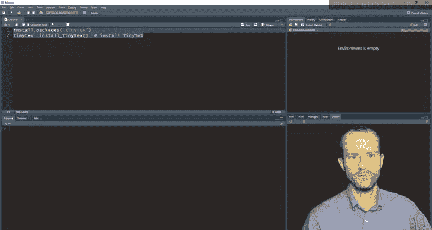
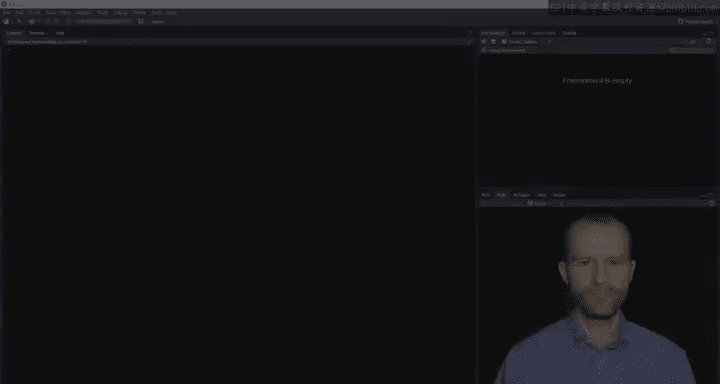
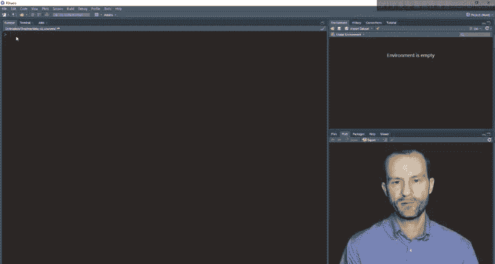
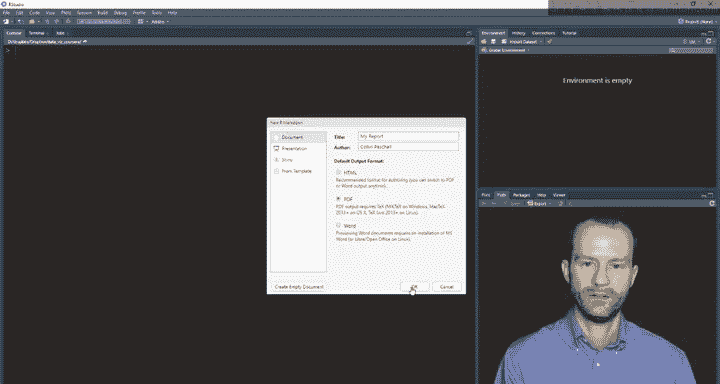
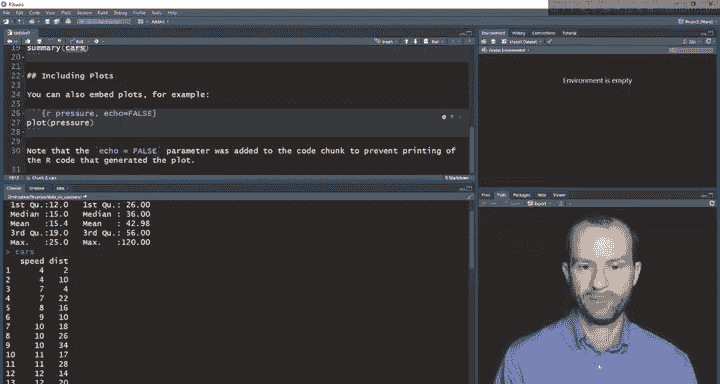
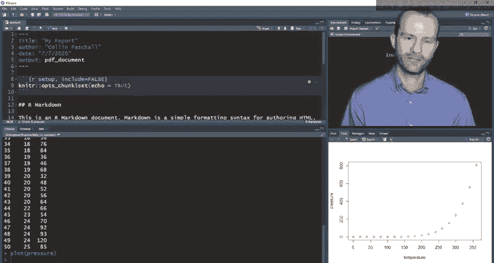
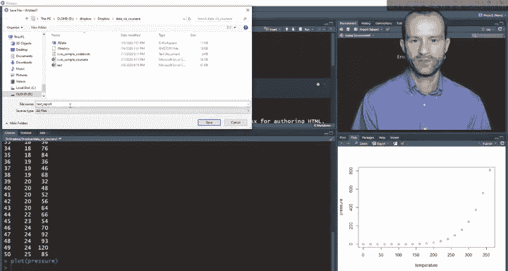
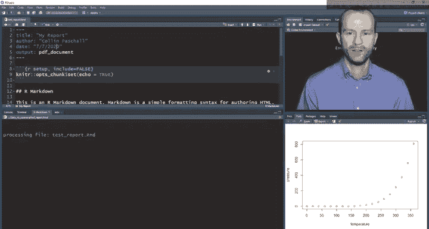
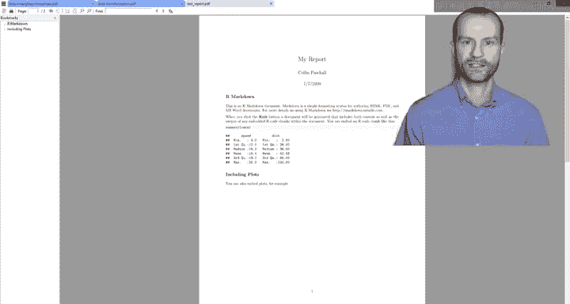

# 014：使用R Markdown创建报告

在本节课中，我们将学习如何使用R Markdown创建一份结合了文本、代码和可视化结果的报告。R Markdown是实现可重复数据科学的强大工具，它允许你将分析过程完整地记录下来并分享给他人，让他人能够完全复现你的工作。

---

## 🛠️ 软件准备：安装LaTeX

在开始制作报告之前，我们需要先完成一个快速的软件安装。



你需要安装LaTeX到你的电脑上。这将使你能够将R Markdown报告编译成PDF文件。



如果你已经安装了LaTeX，那很好。如果不确定是否已安装，只需在RStudio中运行以下两行R代码，正确的文件将会被下载并安装。整个过程将在RStudio内完成。

```r
install.packages("tinytex")
tinytex::install_tinytex()
```

请注意，此过程可能需要几分钟，请耐心等待，因为有许多文件需要下载。安装完成后，我们就可以开始制作R Markdown报告了。

---

## 📝 认识R Markdown文档

上一节我们准备好了环境，本节中我们来看看R Markdown文档究竟是什么。

R Markdown文档是一个文件，它既包含类似文字处理软件中的文本，也整合了R代码和可视化结果。因此，它是进行可重复数据科学的绝佳方式，因为你可以将R Markdown文件交给他人，他们可以从头开始复现你所做的任何分析或可视化。

`.Rmd`文件与仅包含可执行R命令的`.R`文件不同。解释起来可能有些抽象，不如直接动手创建一个文档，这样会更具体。

---



## 🚀 创建你的第一个R Markdown文档

以下是创建R Markdown文档的步骤。



1.  **新建文档**：在RStudio中，点击菜单栏最左侧的图标，你会看到一系列可以用R创建的不同类型文件。我们选择“R Markdown”。
2.  **选择格式**：在弹出的“New R Markdown”窗口中，选择“Document”和“PDF”格式。你也可以选择HTML文件或Microsoft Word文件。
3.  **编辑文档**：点击“OK”后，RStudio窗口会发生变化，控制台上方会出现一个编辑窗口。这不是一个`.R`文件，而是一个`.Rmd`文件。

---

## 🔍 剖析R Markdown文档结构

现在我们已经创建了一个文档，让我们来仔细看看它的结构。

文档的第一部分包含报告的标题信息和要创建的输出类型。常见的格式有HTML文档、Word文档或PDF文档。

接下来的几行是文档的一些设置命令，目前可以暂时忽略，它们只是一些文件设置信息。

在这之后，你会看到纯文本。当我们稍后编译报告时，这些文本会呈现出类似文字处理软件的输出效果。

两个井号`##`在R Markdown中不是注释，而是指示如何格式化后续文本的指令。两个井号表示后面的文本将是一个加粗的标题。星号`*`则表示段落中的文本将加粗显示。

接下来，你会看到一个R代码块。代码块由以三个反引号开始和结束的行分隔开。在第一部分的花括号`{}`内，包含了字母`R`和一个代码块的标题。这个标题不会出现在最终文档中，但可以作为你编码时的参考。

在这个代码块内，有一个R命令，它是对R内置数据集`cars`的`summary`命令，用于生成该对象的摘要信息。

你可以在RStudio中直接运行这段R代码，看看编译文档后会生成什么样的输出。只需双击选中`cars`文本，然后像以前一样运行该行即可。`cars`数据集是一个包含两列（`speed`和`dist`）的简单表格。

在这个代码块之后，有更多看起来像文字处理输出的文本。然后，我们还有更多的R代码，它告诉R绘制`pressure`对象。`pressure`是R内置的一个小数据集，用于生成示例图。

请注意，在代码块标题的逗号后面有一段文本`echo=FALSE`。这里的`echo=FALSE`是告诉RStudio在最终文档中隐藏原始代码。因此，你实际上不会看到被执行的代码，只会看到它的输出结果。

---

## 🧶 编译并查看报告



既然我们已经理解了R Markdown文件的结构，现在让我们来编译它，看看最终形式是什么样子。

首先，你需要将R Markdown文件保存到电脑上的某个位置。

保存后，点击“Knit”按钮。



电脑可能会自动打开这个新生成的文件。如果没有，你可以导航到保存R Markdown文件的文件夹，然后在电脑上手动打开它。



这份在RStudio中创建的R Markdown报告包含了嵌入的R代码和命令。它具有类似文字处理器的输出效果，以及我们的代码和输出结果（这些结果通常出现在控制台或绘图预览窗口中）。



正如你所见，这非常酷，因为你可以广泛分发这些文件。任何拥有R和正确数据文件的人都可以运行它们，并确切地看到你所做的工作。这对于透明、可重复的数据科学至关重要。

---

## 📚 课程总结

本节课中，我们一起学习了R Markdown的核心概念和创建报告的全过程。

我们首先安装了必要的LaTeX软件以支持PDF输出。然后，我们创建了一个新的R Markdown文档，并详细剖析了其结构，包括YAML头部、文本格式（如`##`表示标题）以及包含可执行R代码的代码块（用三个反引号定义）。我们特别了解了代码块选项如`echo=FALSE`的作用。最后，我们通过点击“Knit”按钮将`.Rmd`文件编译成了最终的PDF报告。



通过R Markdown，你可以轻松创建结合了分析过程、结果和解释的完整报告，这是实现可重复和透明化数据分析的关键一步。