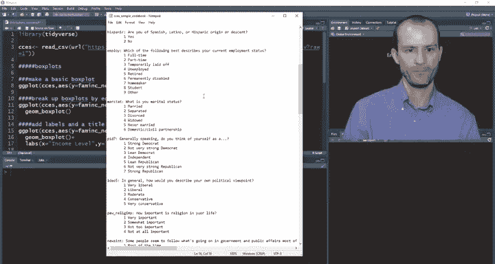

# 020：R语言数据可视化和仪表盘｜Data Visualization & Dashboarding with R
## 课程编号：P20 - 3_分布


在本节课中，我们将要学习如何使用R语言的`ggplot2`包来创建用于展示单变量数据分布的图表。我们将重点介绍箱线图、直方图和密度图这三种经典的可视化方法。

上一节我们介绍了如何使用散点图来观察两个变量之间的关系。本节中，我们来看看如何通过可视化来展示单个变量的数据分布或数据摘要。

箱线图是一种经典的可视化方法，它能快速总结一列数值型数据。箱线图是数据的视觉摘要。在`ggplot2`中，标准箱线图包含中位数、箱体（代表第一和第三四分位数）以及须线。须线延伸至最高和最低值，但最多不超过箱体四分位距的1.5倍。超过1.5倍四分位距的点会被绘制为离群值。

创建箱线图非常简单，它遵循与创建散点图相同的基本方法。为了演示，这里我将使用合作国会选举调查的数据，而不是国会数据。这是一项专注于美国政治的大型学术调查，面向通过电话回复的普通公众成员。出于教学目的，我对数据做了一些微调。如果你想在课程之外进行原始数据分析，需要前往CCES的官方网站并自行下载最新数据。教学用的调查代码本和我们将使用的CSV文件包含在本视频的配套材料中。

浏览代码本，你会发现其中一个问题对应数据集中的`FamInc_new`列，它报告了调查受访者的近似家庭收入，分为从低到高的16个类别，编码为数字1到16。让我们以这个数据为例制作一个箱线图。同样，相关的R代码附在本视频的配套材料中，你应该跟着操作。除了加载`tidyverse`，代码还会从网络导入名为`CCES`的数据，当然你也可以选择本地下载文件并自行导入。





以下是创建箱线图的基本步骤：
1.  使用`ggplot()`函数设置数据集。
2.  在美学映射中，将感兴趣的变量映射到`y`轴（因为我们这里只处理单变量分布）。
3.  使用`geom_boxplot()`函数添加箱线图图层。


```r
ggplot(data = CCES, aes(y = FamInc_new)) +
  geom_boxplot()
```

运行这段代码，我们得到了预期的箱线图。现在，如果我们想修改这个箱线图，可以像之前处理其他`ggplot2`图形一样操作。例如，假设我们想比较不同教育水平个体的家庭收入。我们的调查中也有这个问题，受访者会指出他们取得的最高教育水平。

我们可以通过将教育水平变量添加到美学映射中，并将其分配给`group`参数，来按教育水平拆分箱线图。你还可以进一步用标签和标题修改图形。

```r
ggplot(data = CCES, aes(y = FamInc_new, group = educ)) +
  geom_boxplot() +
  labs(title = "Income by Education Level", x = "Education Level", y = "Household Income")
```

运行后，我们看到X轴上现在按教育水平显示了收入分布。这是因为我们按组进行了拆分。你可能想做的另一个调整是将教育水平变量的数字编码转换为分类定性变量。我们可以再次使用`recode`函数来实现。这里，我将数值变量分成了一个二分类变量，一个类别是没有四年制大学学位的个体，另一个类别是至少完成了四年制大学学位的个体。

当你这样做时，需要注意一点，你必须更改美学映射，使你创建的分类变量映射到`x`而不是`group`。这将有助于确保X轴正确显示。有时美学映射可能有点挑剔，所以你可能需要稍作实验，以确定哪种映射能达到你想要的效果。

```r
CCES <- CCES %>%
  mutate(educ_cat = recode(educ, `1` = "No College Degree", `2` = "College Degree or More"))

ggplot(data = CCES, aes(x = educ_cat, y = FamInc_new)) +
  geom_boxplot()
```

除了箱线图，另外两种常用于展示单变量数据分布的常见可视化是直方图和密度图。直方图本质上是频率条形图的特殊名称，它显示数值向量中离散值的计数。密度图，用非常不正式的术语来说，就是一个经过平滑和重新缩放的直方图。

创建这两种可视化，我们几乎遵循与创建箱线图相同的步骤。我们调用`ggplot()`，指定数据，并将我们想要的变量映射到坐标轴。这里我们再次使用受访者的收入水平。一旦写好`ggplot()`函数，你就可以添加适当的几何对象，即`geom_histogram()`或`geom_density()`。

以下是创建直方图和密度图的示例代码：

```r
# 创建直方图
ggplot(data = CCES, aes(x = FamInc_new)) +
  geom_histogram(binwidth = 1, fill = "blue", color = "black") +
  labs(title = "Histogram of Household Income", x = "Income Category", y = "Count")

# 创建密度图
ggplot(data = CCES, aes(x = FamInc_new)) +
  geom_density(fill = "red", alpha = 0.5) +
  labs(title = "Density Plot of Household Income", x = "Income Category", y = "Density")
```

当然，如果你想，也可以对颜色、坐标轴、轴标签等进行与之前其他图形相同的修改。整个过程是一样的：你从一个`ggplot()`函数开始，添加你想要的几何对象，然后稍后可以调整额外的视觉元素，使其符合你的喜好。

本节课中我们一起学习了如何使用`ggplot2`创建箱线图、直方图和密度图来可视化单变量的数据分布。我们了解了每种图表的特点和适用场景，并掌握了通过修改美学映射和图形参数来定制图表外观的方法。记住，探索性数据分析的核心是尝试不同的可视化，以发现数据中隐藏的模式和见解。