# 028：注释（第一部分） 📝

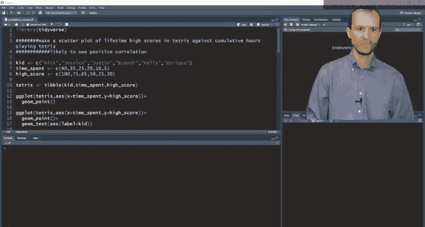

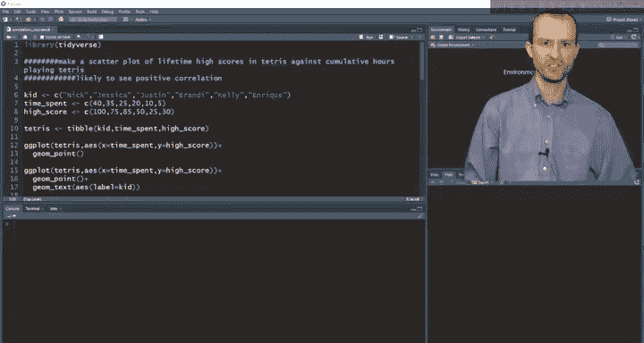

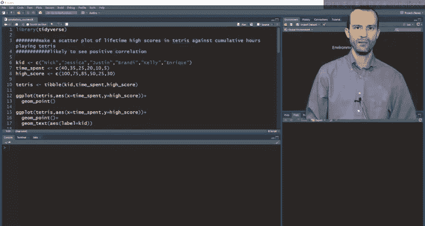

在本节课中，我们将学习如何在ggplot2绘图中直接添加文本注释。这是提升图表信息传达能力的重要技巧。

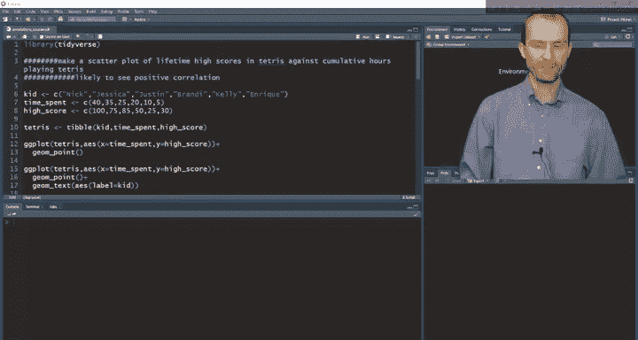

上一节我们介绍了使用颜色、更改坐标轴标签等方式对图形进行基础调整。本节中，我们来看看如何通过`geom_text()`函数在图形上直接绘制文本。


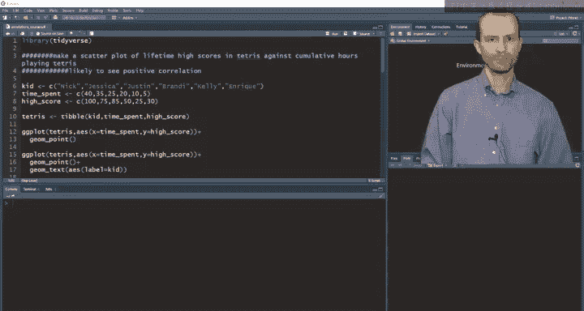

## 核心概念：`geom_text()`函数

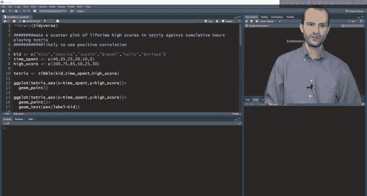


`geom_text()`函数与之前创建散点图时使用的`geom_point()`函数非常相似。本质上，它是将散点图中每个数据点替换为对应的文本标签。


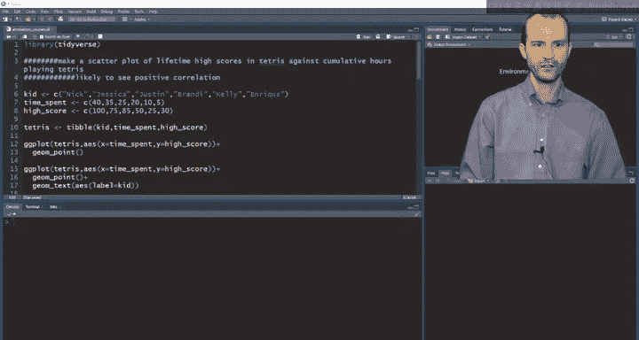

其基本语法结构如下：
```r
ggplot(data, aes(x = x_var, y = y_var)) +
  geom_point() +
  geom_text(aes(label = text_var))
```


## 实践演练：创建带标签的散点图


让我们通过一个虚构的数据集来演示其用法。假设我们想绘制一个关于玩《俄罗斯方块》游戏时长与个人最高得分关系的散点图。

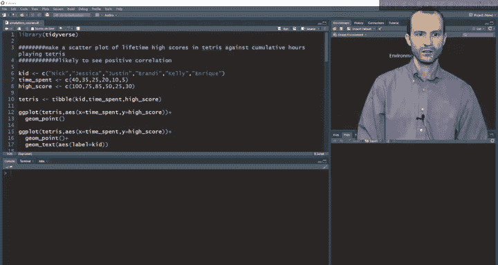


以下是创建数据框和基础图形的步骤：


```r
# 创建示例数据
library(tidyverse)

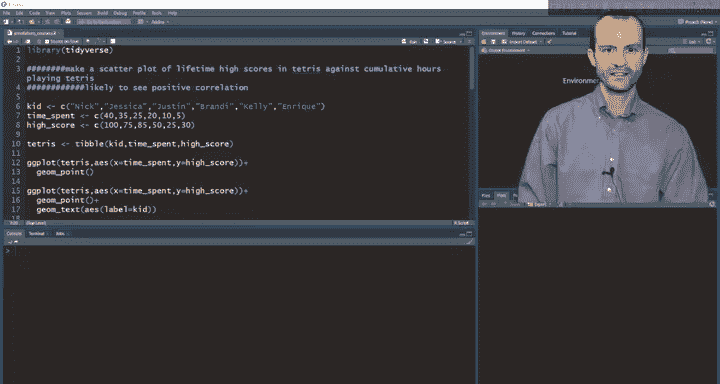

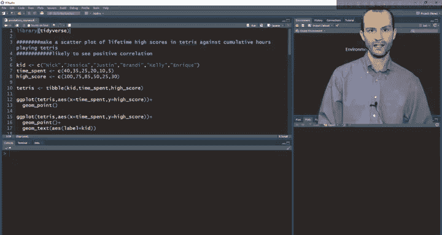

kids_data <- tibble(
  kid = c("Nick", "Jessica", "Justin", "Brandy", "Kelly", "Enrique"),
  hours_played = c(40, 35, 25, 20, 10, 5),
  high_score = c(175, 85, 50, 25, 30, 10)
)

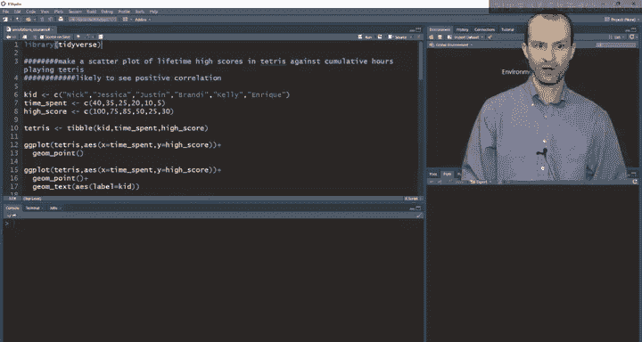

# 创建基础散点图
ggplot(kids_data, aes(x = hours_played, y = high_score)) +
  geom_point()
```


## 添加文本标签

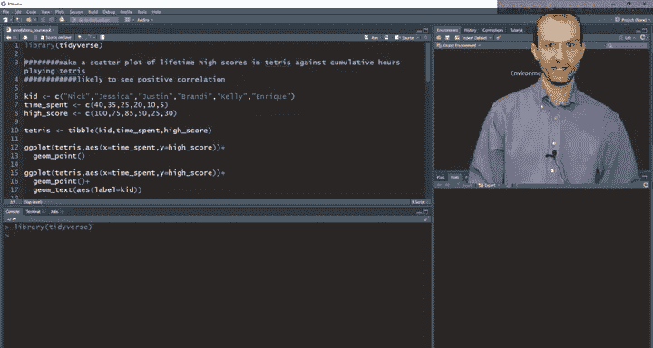


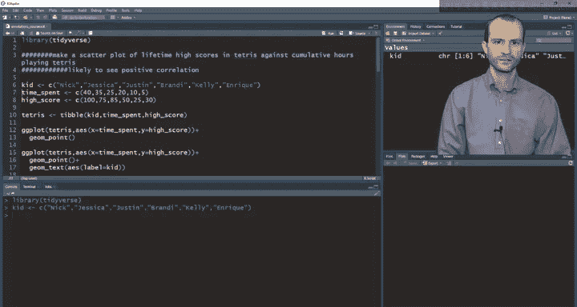

现在，我们希望在数据点上添加玩家的名字作为标签。

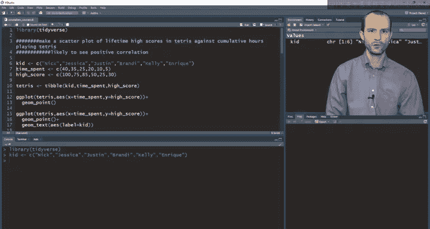


以下是添加`geom_text()`的方法：
```r
ggplot(kids_data, aes(x = hours_played, y = high_score)) +
  geom_point() +
  geom_text(aes(label = kid))
```

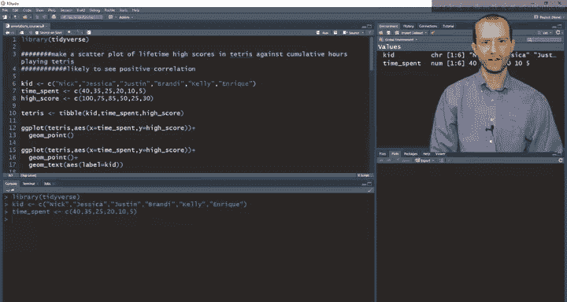

运行上述代码后，你会发现文本标签与数据点完全重叠，导致图表难以阅读。

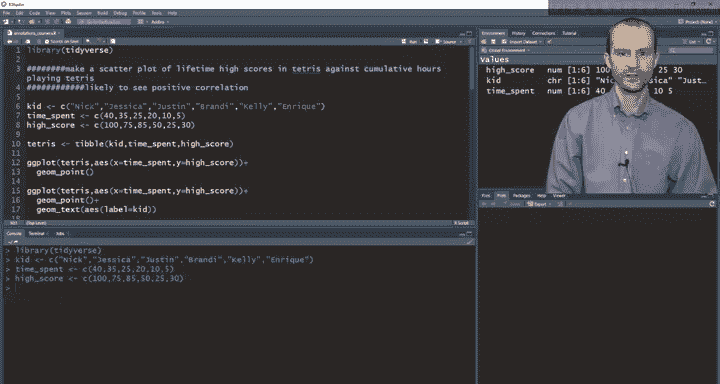

## 解决标签重叠问题

为了解决重叠问题，我们有两个主要选择。

第一种选择是移除数据点，只保留文本标签：
```r
ggplot(kids_data, aes(x = hours_played, y = high_score)) +
  geom_text(aes(label = kid))
```

第二种选择是同时保留点和标签，但通过微调文本位置来避免重叠。这需要使用`geom_text()`函数中的`nudge_x`或`nudge_y`参数。

以下是使用`nudge_y`将文本向上微调的示例：
```r
ggplot(kids_data, aes(x = hours_played, y = high_score)) +
  geom_point() +
  geom_text(aes(label = kid), nudge_y = 5)
```
`nudge_y = 5`将每个文本标签在Y轴方向上移动了5个单位，从而与数据点分离开来。

> **提示**：如果你对某个函数的参数不确定，请务必使用`?geom_text`或`help(geom_text)`命令查看R的帮助文档，其中详细列出了所有可用选项。

## 总结

本节课中我们一起学习了ggplot2中`geom_text()`函数的基础用法。我们了解到：
1.  `geom_text()`可用于在图形上直接添加文本注释。
2.  通过`aes(label = ...)`映射指定用作标签的变量。
3.  文本标签可能与图形元素（如点）重叠，影响可读性。
4.  可以通过移除重叠元素或使用`nudge_x`/`nudge_y`参数微调文本位置来解决重叠问题。

在下一个视频中，我们将继续学习更复杂的注释技巧，请保持你的R代码文件打开，我们将在此基础上继续深入。