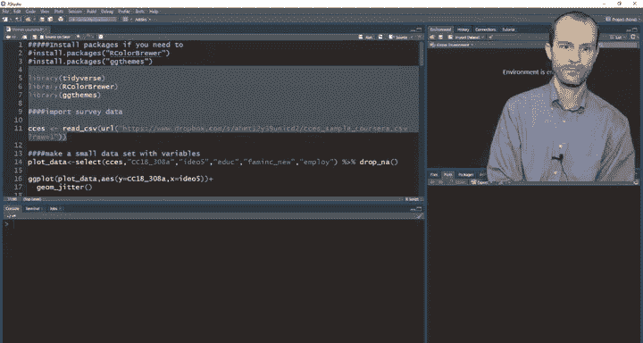

# 030：🎨 颜色、图例和主题（第1部分）

在本节课中，我们将深入学习如何通过调整颜色、图例和主题来精细化你的R语言数据可视化图表。我们将从基础图表出发，逐步应用更高级的修饰技巧，使图表在传达信息的同时更具美观性和专业性。

---

## 概述

到目前为止，我们已经掌握了基础的可视化方法。我们偶尔会对图表进行一些微调，例如更改坐标轴标签、移除图例或调整某些颜色。本节课，我们将集中精力深入探讨这些修饰技巧。我们将通过对一个可视化图表进行一系列修改，向你展示可用的不同选项和一些更高级的技术。

请跟随本视频附带的R代码进行操作。确保你已经安装了代码中提到的所有包，并在代码的前几行加载它们。我们还将再次导入我们一直在使用的合作国会选举调查数据。

## 数据准备与基础图表

你可能还记得，这项调查包含了关于个人收入和教育水平的问题。此外，还有一些我们尚未使用的关于受访者政治意识形态（即他们是自由派还是保守派）以及对总统支持度（即是否赞同总统的表现）的问题。

如果需要重新熟悉这些问题，你可以查看本视频附带的CSV文件和代码手册。

我们将使用一些简单的数据整理命令，创建一个用于制作可视化图表的小型数据集。首先，我们使用这些数据创建一个简单的散点图。为了避免点过度重叠，我们使用 `geom_jitter`。在这个图表中，Y轴代表对总统的支持度问题，X轴代表受访者的意识形态。

这个散点图告诉我们，越自由的受访者越倾向于不赞同总统的表现。

## 添加颜色与大小维度

和之前一样，我们可以通过为点添加颜色来对这个图形进行简单的修改。我们还可以根据数据中另一列的值来改变点的大小。

在这里，我根据每个点对应的 `fam_inc_new` 列的值来改变点的大小。请记住，每个点对应调查电子表格中的一行，即一个受访者。因此，除了根据每个受访者的值在X轴和Y轴上的位置外，我们现在还根据这些列的值来改变点的颜色和大小。

通过操纵这些不同的视觉元素，我们确实在可视化中注入了更多的数据信息。

显然，这并非有史以来最引人注目的可视化图表，但这仅用于演示目的，向你展示如何更改图形的这些不同元素，并让你练习如何将这些技术应用到真实世界的数据中。

## 自定义连续颜色标度

为了继续优化，需要注意的一点是，R自动为颜色（即教育水平值）选择了一个蓝色渐变。过去，我们曾使用 `scale_color_manual` 命令手动操作颜色标度，以覆盖R的默认设置，为列中的离散值使用特定颜色。

就教育水平而言，确实没有一组颜色能自然地与教育水平的提高相对应。但如果我们只是不想使用蓝色渐变，我们可以使用其他方案。例如，我们可以通过添加 `scale_color_gradient` 命令来修改这串 `ggplot` 命令。

我们可以将高值和低值设置为不同的颜色，以指示颜色如何随值增加而变化。这里，我将其切换为从灰色到紫色的渐变作为示例，但你可以根据自己可视化图表的需要选择许多不同的颜色。

渐变最适合用于连续的数值变量，例如从0到10或0到16等，在连续尺度上具有可定义的高值和低值。教育水平对此适用，因为你可以将教育水平从较低水平排序到较高水平。

## 处理分类变量颜色

但其他变量并不真正映射到这样的尺度上，它们可能更具分类性质。例如，一个人的就业状况并不真正这样运作，你可能是在职、退休、失业、兼职、残疾、学生，或者属于其他类别，这些类别之间并没有天然的高低之分。

当你有一个这样的分类变量时，你可以用稍微不同的方式在R中控制颜色。为了练习这一点，让我们创建另一个图表。

参考代码手册，我在这里重新编码了之前从调查中获取的就业问题，并将这些数值转换为定性的分类变量，正如我刚才描述的那样。

现在，我将再次制作一个散点图，但这次图形的颜色将映射到重新编码后的就业类别变量，而不是之前应用的连续教育变量。

## 使用预定义调色板

要在这里设置颜色，与其手动为每个不同的类别分配颜色，我将使用 `RColorBrewer` 包中的一个命令，我们在代码文件的开头已经调用了这个包。与 `ggthemes` 包类似，`RColorBrewer` 是R的一个包，它本身不在 `tidyverse` 中，但与 `ggplot2` 配合得很好。`RColorBrewer` 的优点是它内置了这些美观的调色板，你可以直接获取并应用到你的图形中。

这避免了在为离散值分配多种颜色时，你必须做出关于哪些颜色搭配好看的所有选择。

因此，在我们添加到 `ggplot` 代码串的这一新行中，我们使用了 `scale_color_brewer`，并告诉 `ggplot2` 将 `RColorBrewer` 中的“Set2”调色板应用到我的图形上。这些颜色将映射到我创建并映射到颜色的 `employ_cat` 值上。

当我们运行这段代码时，我们看到这个新的调色板已自动应用到我们的图形上。

## 学习资源与实验

你可能已经发现，如果在图表中开始使用许多不同的颜色，处理颜色会变得相当复杂。在这种情况下，你必须开始自己进行一些实验。

幸运的是，有一些很好的资源可以仔细介绍你拥有的所有不同选项。`tidyverse.org` 上 `ggplot2` 参考页面的“Scales”部分非常全面，并提供了很好的代码片段，如果你想掌握使用不同的配色方案，可以查阅。`R Graph Gallery` 有一个非常方便的参考页面，可以向你展示不同的 `RColorBrewer` 调色板是什么样子。

因此，当你继续尝试颜色时，你会想要回顾这些资源。

这里使用的基本方法是相同的，你将在你的 `ggplot` 函数串中添加某种 `scale_color` 命令，但对于一些细节，你需要确保仔细阅读文档。

## 总结

本节课中，我们一起学习了如何精细化R语言数据可视化的视觉元素。我们从基础散点图开始，逐步添加了颜色和大小维度以编码更多数据信息。我们探讨了如何为连续变量自定义颜色渐变，以及如何使用 `RColorBrewer` 包中的预定义调色板来美观地处理分类变量。掌握这些颜色、图例的调整技巧，是提升图表专业性和表现力的关键一步。

现在，请深呼吸，如果需要可以回顾一下这段代码。当你准备好后，请保持R代码打开，进入下一个视频，我们将继续学习如何优化图表的视觉元素。