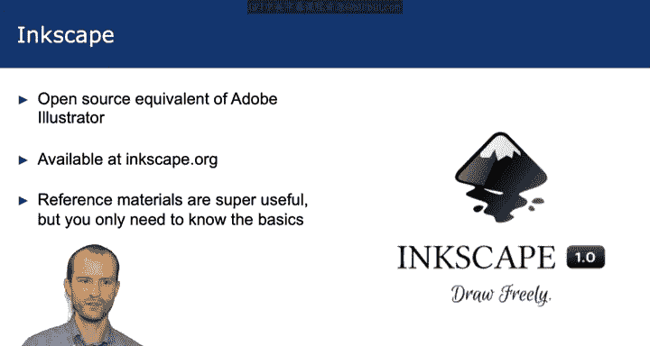
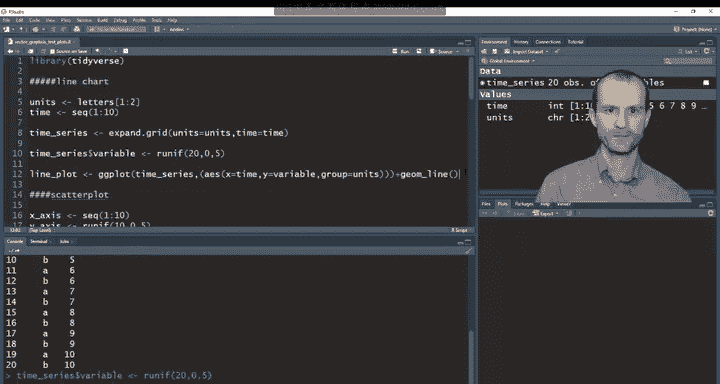

# 032：使用Inkscape调整ggplot图形 - 第1部分 🎨

在本节课中，我们将学习如何使用Inkscape——一款免费的矢量图形编辑软件——来微调在R语言中使用ggplot2创建的图形。我们将从创建示例图形开始，然后将其导出为SVG格式，为下一部分在Inkscape中进行编辑做好准备。

---

## 什么是Inkscape？ 🖌️

Inkscape是一个矢量图形编辑程序，本质上是Adobe Illustrator的开源替代品。你可以免费从 inkscape.org 下载Inkscape，其1.0版本已于2020年春季发布。

Inkscape是一款功能非常强大的程序，为平面设计师提供了大量功能。然而，对于调整ggplot图形的目的而言，你无需理解该程序的所有细节。尽管有可用的参考资料，你当然可以深入学习。相反，我们真正需要做的是能够打开在R中使用ggplot2创建的文件，并使用一些基本工具来调整这些图形。

接下来，让我们一步步了解如何操作。

---

## 创建示例图形 📊

首先，我们将创建一些示例可视化图形。这也是一个很好的练习机会，所以我们会快速完成这部分。



上一节我们介绍了Inkscape的基本概念，本节中我们来看看如何创建用于编辑的图形。

### 创建折线图

以下是创建折线图的步骤：

1.  设置两个不同的单元或案例以及10个时间点。
2.  使用 `expand.grid()` 创建一个包含这两个单元所有可能组合的数据框。
3.  例如，使用 `rnorm()` 创建一个包含20个介于0和5之间的随机值的向量，并将其附加到变量列。
4.  快速绘制折线图，并将图形分配给 `line_plot` 对象。

```r
# 创建折线图数据
units <- c("A", "B")
time_points <- 1:10
df_line <- expand.grid(Unit = units, Time = time_points)
df_line$Value <- rnorm(20, mean = 2.5, sd = 1)

# 创建折线图
line_plot <- ggplot(df_line, aes(x = Time, y = Value, color = Unit)) +
  geom_line() +
  geom_point() +
  theme_minimal()
```

此时，这些内容对你来说应该主要是复习，但如果你需要回顾，可以暂停视频，再次查看代码以确保理解。

### 创建散点图



为了创建散点图，我们生成X和Y值，将它们绑定到一个数据框中，然后创建散点图。同样，这应该是复习内容。

以下是创建散点图的代码：

```r
# 创建散点图数据
set.seed(123) # 确保可重复性
x_vals <- rnorm(50)
y_vals <- x_vals + rnorm(50, sd = 0.5)
df_scatter <- data.frame(X = x_vals, Y = y_vals)

# 创建散点图
scatter_plot <- ggplot(df_scatter, aes(x = X, y = Y)) +
  geom_point(alpha = 0.6) +
  geom_smooth(method = "lm", se = FALSE, color = "red") +
  theme_minimal()
```

### 创建条形图

最后，我们将创建一个条形图。我们设置五个案例以及三个额外的列，你可以将其视为五个案例中每个案例针对不同变量的不同值。我们将所有这些绑定在一起。

请注意，这里我们以“宽”格式而非“长”格式创建数据，因此我们将使用 `pivot_longer()` 将数据转换为ggplot2喜欢的长格式。

以下是具体步骤：

1.  将三个Y列（y1, y2, y3）的标题展开为两行不同的值。
2.  将这些列中的值放入名为“value”的列中。
3.  现在我们有了用于条形图的长格式数据，并快速绘制条形图。

```r
# 创建条形图数据（宽格式）
cases <- c("Case1", "Case2", "Case3", "Case4", "Case5")
df_wide <- data.frame(
  Case = cases,
  y1 = runif(5, 1, 10),
  y2 = runif(5, 1, 10),
  y3 = runif(5, 1, 10)
)

# 转换为长格式
df_long <- df_wide %>%
  pivot_longer(cols = c(y1, y2, y3),
               names_to = "Variable",
               values_to = "Value")

# 创建条形图
bar_plot <- ggplot(df_long, aes(x = Case, y = Value, fill = Variable)) +
  geom_bar(stat = "identity", position = "dodge") +
  theme_minimal()
```

---

## 导出图形 💾

现在我们已经创建了这些示例图形，我们将使用RStudio导出它们。

你可以在RStudio的绘图窗口中调出图形并从那里导出，也可以使用 `ggsave()` 命令。如果使用 `ggsave()`，你首先需要提供文件名和文件扩展名，然后提供要导出为图像的ggplot对象。文件将被保存到R的工作目录中。

你可以将文件保存为常见的图像格式，如 `.png` 或 `.jpg`。但是，如果你想在Inkscape中调整图像，最简单的方法之一是将其保存为 `.svg` 文件。

为了做到这一点，安装一个允许你执行此操作的附加包会很有帮助，我们在下面的代码中完成了这个操作。

以下是导出图形的代码：

```r
# 安装并加载用于保存SVG的包（如果需要）
# install.packages("svglite")
library(svglite)

# 导出图形为SVG文件
ggsave("line_plot.svg", plot = line_plot, device = "svg")
ggsave("scatter_plot.svg", plot = scatter_plot, device = "svg")
ggsave("bar_plot.svg", plot = bar_plot, device = "svg")
```

现在，让我们将这三个图形保存为 `.svg` 文件。我将在下一个视频中与你会面，届时我们将开始在Inkscape中操作这些文件。

---

## 总结 📝

本节课中我们一起学习了如何为Inkscape编辑准备ggplot2图形。我们回顾了创建三种基本图形（折线图、散点图和条形图）的步骤，并重点介绍了如何将图形导出为SVG格式，这是进行矢量编辑的理想格式。在下一部分，我们将打开这些SVG文件，探索Inkscape的基本工具来微调和美化我们的可视化成果。