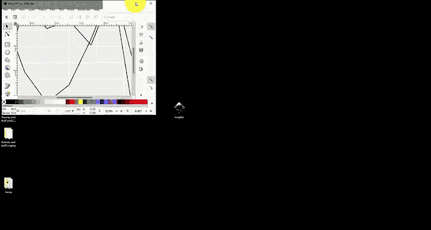
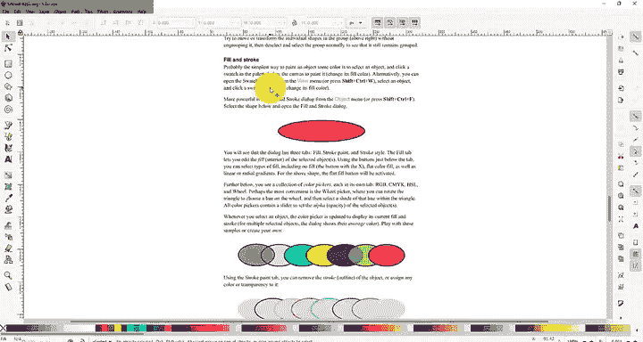
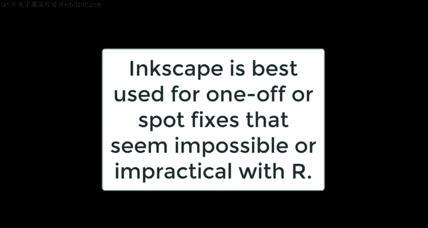

# 033：Inkscape基础教程（第二部分）🎨

在本节课中，我们将学习如何使用Inkscape软件对从Ggplot生成的图表进行基础修改。我们的目标是展示这个过程并不复杂，即使你只有类似Microsoft Paint或PowerPoint这类图形编辑软件的使用经验，也能快速上手。虽然Inkscape的高级功能可能很复杂，但为了完成本课程所需的基础修饰工作，你并不需要掌握全部。

---

## 打开与查看SVG文件

上一节我们介绍了Inkscape的用途，本节中我们来看看如何开始操作。

首先，找到你通过`ggsave()`保存到电脑上的`.svg`文件。通常双击该文件即可在Inkscape中打开。

如果无法直接打开，你可以通过菜单栏的 **文件（File）** -> **打开（Open）** 来导入文件。

文件打开后，图表会显示在一个带有边框的画布上。你可以通过按住 **Ctrl** 键并滚动鼠标滚轮来放大或缩小视图，也可以使用界面上的缩放按钮。

---

## 调整图像与理解对象

为了获得更多操作空间，我们可以先缩小图像。图表中的每个元素（如线条、背景、文字、刻度）都是独立的对象。

以下是调整图像大小的步骤：
1.  按 **Ctrl + A** 选中所有对象。
2.  按住 **Ctrl** 键，同时用鼠标拖动图像角落的控制点。这样可以等比例缩放图像。

这个操作能让你在修改图像时有更多空间。这是一个使用标准主题导出的Ggplot图表，因此没有太多额外修饰。你可以看到灰色背景、白色的网格线以及可点击的绘图线条。

点击不同对象时，选择框会发生变化，这有助于你识别当前选中的元素。文字和刻度标记也都是可以单独点击和编辑的独立对象。

---

## 修改颜色与删除元素

现在，我们来学习如何修改对象的颜色。

要改变一个对象的颜色，只需点击选中它。在软件底部的调色板中，你可以看到丰富的颜色选项。

以下是修改线条颜色的具体方法：
*   对于线条这类对象，需要按住 **Shift** 键，再点击你想要的颜色。例如，我们可以将一条线改为蓝色，另一条改为红色。

关于图表标签，最简单的方法是直接删除旧标签并创建新的。
1.  点击选中旧的坐标轴标签，按 **Delete** 键删除。
2.  点击左侧工具栏的 **文本工具（Text tool）**。
3.  在画布上拖拽出一个文本框，输入新标签，例如“My X Axis”。
4.  选中文本后，可以在顶部工具栏调整字体和大小。
5.  使用 **选择工具（Select tool）** 将文本移动到理想位置。

---

## 创建垂直文本与添加形状

有时我们需要创建垂直的文本标签，比如Y轴标签。

以下是创建垂直文本的步骤：
1.  复制一个现有的文本框并粘贴。
2.  使用 **文本工具** 将内容改为“Y”。
3.  切换回 **选择工具**，将文本框移动到Y轴附近。
4.  **双击**该文本框，控制点会从缩放模式变为旋转模式。
5.  拖动角落的控制点，即可将文本旋转为垂直方向。

你同样可以使用文本工具为图表添加标题，并用选择工具移动和调整它。文本的颜色也可以通过点击调色板来更改。

此外，Inkscape还提供了丰富的形状工具。你可以使用它们为图表添加标记或注释。
1.  从左侧工具栏选择一个形状工具（如矩形）。
2.  在画布上拖拽绘制形状。
3.  右键点击形状，选择 **填充与描边（Fill and Stroke）**。
4.  在弹出的面板中，你可以调整填充色的RGB值和透明度（Alpha），也可以修改描边（边框）的颜色。

---

## 寻求帮助与使用场景

如果你在操作中遇到困难，Inkscape内置的教程是非常有用的资源。

以下是访问教程的方法：
1.  点击顶部菜单栏的 **帮助（Help）**。
2.  选择 **教程（Tutorials）**，例如“基础教程”。
3.  Inkscape会打开一个包含说明和练习的SVG文件，帮助你快速熟悉软件。

Inkscape最适合用于对Ggplot图表进行“点对点”的修正。大多数时候，直接在R语言中调整图表会显得更专业、更高效。然而，当你遇到一些无法用R代码实现的效果时，Inkscape就是一个很好的备用工具。

---

## 总结

本节课中，我们一起学习了Inkscape的基础操作：包括如何打开和缩放SVG文件、理解并选中独立对象、修改图形颜色与文本、创建垂直标签、添加自定义形状以及如何利用内置教程。记住，Inkscape是一个强大的辅助工具，能帮助你对R生成的图表进行最终的美化与微调。