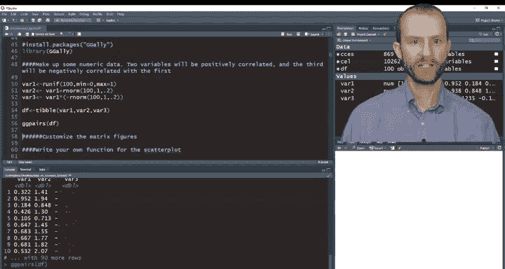
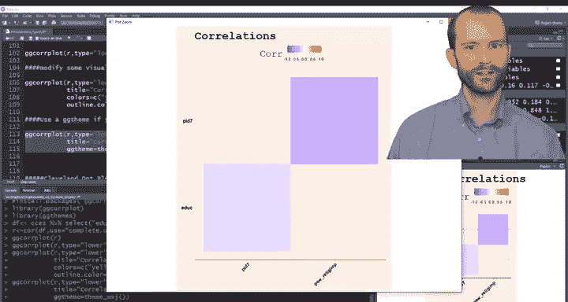

# 034：散点图的变体

在本节课中，我们将学习几种不同类型的图形，通过大量练习来熟悉 `ggplot2` 及其相关库。这些视频的目标是让你练习制作多种多样的图形。因此，在本课程中，我们将不过多强调数据处理，而是专注于制作大量图形以获得实践经验。


---

## 🎯 添加趋势线

上一节我们介绍了课程目标，本节中我们来看看如何为散点图添加趋势线。许多人可能有一些基础的统计学知识，或者至少熟悉在散点图中添加趋势线的概念。这能让你更好地理解两个变量之间的关系，而不仅仅是观察一堆点。

例如，我将使用之前课程中用过的“合作国会选举调查”数据。在这份调查数据中，包含了美国受访者的教育水平和政治意识形态问题。如果你关注美国政治或世界其他地区的政治，可能会知道教育水平的提高通常与政治自由主义程度的增加相关。

在调查数据中，变量 `ideo5` 代表政治意识形态，5 表示最保守，1 表示最自由。变量 `educ` 代表教育水平，16 表示最高，1 表示最低。因此，我们应当看到这两个变量之间存在负相关关系。

仅从散点图很难评估这种关系的真实面貌，但绘制一条最佳拟合线可以让你更好地理解它。我们使用 `geom_smooth()` 为散点图添加最佳拟合线。

绘制最佳拟合线有多种方法，`geom_smooth()` 默认使用的是 **LOESS 曲线**。如果你有统计学背景，可以选择几种不同的方法来绘制这条线，例如线性模型或广义线性模型。你还可以更改围绕该线绘制的置信区间。

但如果你不熟悉统计学，请务必小心，因为用这种方法进行统计推断是相当冒险的。不过，用于探索性分析是可以的。如果你想通过散点图绘制一些最佳拟合线来了解数据、获得直觉，这是可以的。

---

## 🔗 散点图矩阵

除了最佳拟合线，另一种用于探索性可视化的方法是使用**散点图矩阵**，它可以同时显示数据中几个不同变量之间的二元关系。

`GGally` 库有一个方便的工具可以创建散点图矩阵。在以下代码行中，我创建了一些简单的模拟数据：变量1和变量2高度相关，第三个变量与变量1负相关。

```r
# 示例代码：创建散点图矩阵
library(GGally)
# ... 创建数据框 data ...
ggpairs(data)
```

当我们把这些数据放入一个数据框，并将其输入 `ggpairs()` 函数时，它会为我们生成一个散点图矩阵，显示变量的分布、二元散点图以及每对变量之间的相关系数。



如果你想修改散点图矩阵中散点图或密度图的外观，可以为绘图函数编写自定义函数，然后使用 `lower` 和 `diag` 参数将它们包含在 `ggpairs()` 函数中。这是一种控制颜色、填充和可视化其他方面的方法。

---

## 📈 相关矩阵图

一种与绘制相关性图相关的方法是**带阴影的相关矩阵图**。在 `ggcorrplot` 包中，`ggcorrplot()` 函数可以为我们生成这些图。

```r
# 示例代码：创建相关矩阵图
library(ggcorrplot)
# ... 从调查数据中选择变量并计算相关系数矩阵 cor_matrix ...
ggcorrplot(cor_matrix)
```

这里我从调查数据中选择了几个变量，计算了它们的相关系数，并使用 `ggcorrplot()` 生成了相关图。`ggcorrplot()` 内部有许多不同的选项，用于修改图形的颜色和其他视觉特征，你可以查看帮助文件来了解。如果你愿意，也可以应用 `ggplot2` 主题。



---

## ⚫ 克利夫兰点图与棒棒糖图

除了总结二元关系，你还可以修改用 `geom_point()` 制作的图形，以比较不同观测单位的值，有点像条形图。事实上，许多专业的数据可视化者更喜欢这类图形，因为它们视觉上更简洁。

我们在这里讨论的一种图形叫做**克利夫兰点图**。为了举例说明，我将使用之前课程中用过的关于美国国会立法的数据。这里我选择了第114届国会的一些议员样本。我想做的是比较他们的立法效率，这在数据中由变量 `les` 来概括。同样，`les` 值越高，意味着议员的立法生产力越高。

```r
# 示例代码：创建克利夫兰点图
ggplot(data, aes(x = les, y = reorder(member_name, les))) +
  geom_point() +
  theme_minimal() +
  # ... 其他主题和标签调整 ...
```

在我的 `ggplot()` 函数中，我设置了数据并进行了美学映射，因此 x 轴是我感兴趣的结果，y 轴是比较的单位。当我添加 `geom_point()` 时，我得到一个类似于条形图顶部的点。在接下来的几行中，我通过 `theme()` 函数进行修改，去掉了一些白色的垂直线，并添加了一些虚线水平线。我还更改了点的大小、标签，并按照结果变量值的降序重新排列了 y 轴上的单位。经过这些修改，我们得到了一个用于比较的精炼、极简的图形。

最后，与这种点图密切相关的一个变体叫做**棒棒糖图**。要制作棒棒糖图，我在美学映射中翻转了 y 轴和 x 轴，并使用 `geom_point()`，但我没有去掉网格线，而是使用 `geom_segment()` 来绘制连接线，从 y 值为 0 的 x 轴（即底部）连接到每个类别对应的感兴趣变量的 y 值（向上延伸）。这本质上也是一种制作条形图的非常精炼、简单的方法。

---

## 📝 总结

本节课中我们一起学习了散点图的多种变体。我们从添加趋势线开始，以更好地理解变量间的关系。接着，我们探索了散点图矩阵和相关矩阵图，用于同时可视化多个变量间的关联。最后，我们介绍了克利夫兰点图和棒棒糖图，这些是比传统条形图更简洁的用于跨单位比较的可视化方法。通过这些练习，你掌握了使用 `ggplot2` 及其扩展库创建多样化、信息丰富的图形的实用技能。