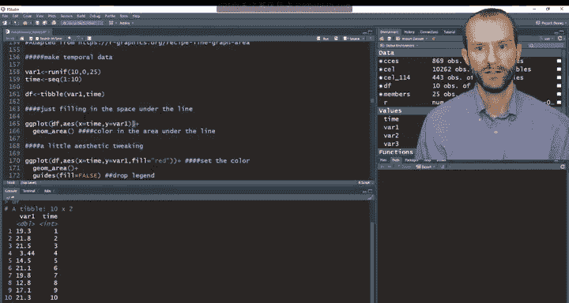

# 035：R语言数据可视化和仪表盘｜Data Visualization & Dashboarding with R
## 课程编号：P35 - 折线图的变体 📈


在本节课中，我们将要学习几种用于展示数据随时间变化的折线图变体。我们将探讨如何填充折线下的区域、创建堆叠面积图以及构建哑铃图，以更丰富地呈现时间序列数据。

---

之前，我们制作了一些简单的折线图，它们对于探索时间序列数据很有用。

现在，我们将进一步学习几种可视化方法，它们能有效地展示数据随时间的变化。

我们将从上一视频结束处的R代码继续，请在附带的R代码文件中找到这些代码行。

---

### 填充折线下方的区域 🎨

折线图中一个非常常见的视觉效果是填充折线下方的区域。

制作这种效果非常简单。这里我创建了一些模拟数据，其中`time`是一个变量，每个时间点还有一个关联值。你可以将其想象为任何数据，例如分数、温度、体重、身高等。

要绘制填充折线下方的图形，你可能会想到使用`fill`美学和`geom_line`。但实际上，最好的方法是使用一个完全不同的几何对象：`geom_area`。

默认情况下，使用`geom_area`时，曲线下的填充颜色是黑色的，但你也可以手动设置填充颜色。

```r
# 示例：使用geom_area填充折线下区域
ggplot(data, aes(x = time, y = value)) +
  geom_area(fill = "steelblue")
```




---

### 堆叠面积图 📊

用单一颜色填充曲线下方的区域为可视化增添了一定的美感，但在信息价值方面并没有增加太多，它所表达的内容与折线图相同。然而，如果你制作一个堆叠折线图，就可以利用那个空间来传达额外的信息。

假设我有三个人（Bob、Sue和Lisa）的时间序列数据。我在五个时间点记录了每个人的某个值，比如他们口袋里有多少零钱。

下面的代码行创建了一个长格式的模拟数据集，记录了每个人在每个时间点口袋里的钱数。

```r
# 创建模拟数据
library(tidyr)
library(dplyr)

set.seed(123)
time_points <- 1:5
people <- c("Bob", "Sue", "Lisa")

data_long <- expand.grid(time = time_points, person = people) %>%
  mutate(money = round(runif(n(), 5, 25), 2))
```

现在，如果我们使用`geom_area`并将填充美学设置为每个人的标识符，图表将显示每个人在每个时间点口袋里的钱数是如何堆叠在一起的。因此，折线的总高度将是三个人在每个时间点拥有的钱数的累计总和。

你可以通过计算每个人在每个时间点口袋零钱的累计总和来验证这一点，我可以用这几行数据整理代码来完成。

```r
# 计算累计总和
data_cumulative <- data_long %>%
  group_by(time) %>%
  summarise(total_money = sum(money))
```

`geom_area`的好处在于它会自动为你处理所有这些计算，因此你现在实际上是在利用折线下方的区域来传达额外的信息。

```r
# 绘制堆叠面积图
ggplot(data_long, aes(x = time, y = money, fill = person)) +
  geom_area()
```


---

### 构建哑铃图 🏋️‍♂️

上一节我们介绍了如何用堆叠面积图展示多个序列的累计变化。本节中我们来看看如何比较两个不同时间点的数据。

如果你想展示观测单位在不同时间点的数值变化，并希望比较两个不同的时间点，例如，我们想比较这三个人在时间点一和时间点五各自拥有的零钱数量，哑铃图是一个很好的选择。


我们将在这里构建一个哑铃图，向你展示我的意思以及它的样子。

我们使用`ggalt`包来制作哑铃图，所以先加载它。

```r
# 加载ggalt包
library(ggalt)
```

然后，我们将整理关于Bob、Sue和Lisa的数据，只保留他们在时间点一和时间点五的值。

接着，我们将数据转换为宽格式。制作哑铃图是少数几个你实际上希望数据是宽格式而非长格式以便于绘图和`ggplot2`处理的情况之一，因此我们使用`pivot_wider`函数来完成这个转换。

```r
# 整理数据为宽格式
data_wide <- data_long %>%
  filter(time %in% c(1, 5)) %>%
  pivot_wider(names_from = time, values_from = money, names_prefix = "time")
```

要制作图表本身，我们调用`ggplot`函数。我们将Y轴设置为观测单位，在本例中是不同的人（Bob、Sue和Lisa）。对于X轴，我们将其设置为要比较的第一个时间点，即`time1`。然后，对于`xend`（即我们要绘制的线段的终点），将其设置为最后一个时间点。

一旦所有这些都设置好，`geom_dumbbell`就会处理其余部分。像任何其他`ggplot2`图形一样，我们可以进行优化，使其看起来更吸引人。

```r
# 绘制哑铃图
ggplot(data_wide, aes(y = person, x = time1, xend = time5)) +
  geom_dumbbell(size = 1.2, color = "grey", colour_x = "blue", colour_xend = "red") +
  labs(x = "Amount of Money", y = "Person", title = "Change in Pocket Money from Time 1 to Time 5") +
  theme_minimal()
```


---

本节课中我们一起学习了三种折线图的变体：填充面积图、堆叠面积图和哑铃图。填充面积图主要增强视觉美感；堆叠面积图能有效展示多个类别的累计变化；而哑铃图则擅长突出显示两个特定时间点之间个体或类别的数值差异。掌握这些变体将帮助你更灵活、更有效地呈现时间序列数据。