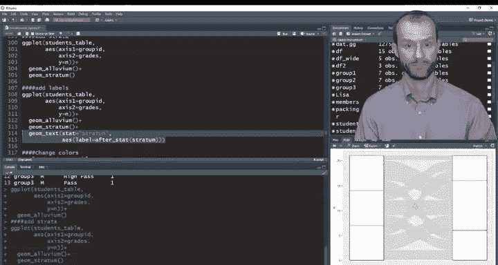

# 036：流图与圆图 📊


在本节课中，我们将学习两种用于展示数据构成和类别间关系的特殊图表：**桑基图** 和 **打包圆图**。这两种图表能直观地展示“部分与整体”的关系以及不同类别间的流动与比较。

---

## 桑基图：展示流动与构成

到目前为止，我们已经使用 `ggplot2` 创建了多种图表。相信你已经体会到这个工具包在数据可视化方面的强大能力。

本节视频中，我将向你展示几种其他类型的图表。在课程接下来的部分，我们将覆盖空间数据。

桑基图是一种常见的可视化类型，它擅长展示整体中各部分的构成，或者不同数据类别之间的连接关系。这种图表需要亲手制作才能真正理解，让我们开始吧。

我将创建一些关于学生课堂表现的模拟数据。这里有21名学生，分为三组。学生有男有女，成绩分为优秀、及格或不及格。生成这些数据需要一些数据处理步骤，如果你需要理解细节，可以暂停视频逐步查看代码。

关键在于得到最终的表格，其中每一行告诉你每组中取得每种成绩的男女生人数。桑基图将展示这些类别如何相互关联，以及它们如何共同构成整体。这同样是一种需要实践才能掌握的可视化方法。

`ggalluvial` 包是另一个为 `ggplot2` 提供专用工具的辅助包。我们首先使用 `ggplot()` 函数和数据开始绘图。

这里的图形属性设置有些特殊，因为它是一个专用包。我们必须将 `aes` 中的 `axis1` 设置为组别 ID，`axis2` 设置为成绩，`y` 设置为 `n`（即计算出的每组中取得各成绩的男女生人数）。

我知道这有点难以跟上，但请继续，待看到最终成果后，你可以回头复习，将各个部分串联起来。

设置完成后，你可以添加 `geom_alluvium()` 图层，开始看到这些类别之间的流动和连接。显然，目前图表对类别的区分还不够清晰，因此我们需要添加 `geom_stratum()` 图层使其更清楚。



为了进一步优化，我们可以使用 `geom_text()` 命令在图表上添加文本，将 `stat` 设置为 `"stratum"`，并在图形属性中设置 `label`。


和任何其他 `ggplot` 图表一样，我们也可以添加颜色。我刚才非常快速地演示了一遍，这确实是 `ggplot2` 工具的一种特殊用法，单靠自己可能难以琢磨透彻。

你必须查阅 `ggalluvial` 包的文档，才能真正理解这幅图各个部分组合的内部逻辑。仔细阅读文档、亲自动手实践、并尝试逐步理解是无可替代的。

然而，如果你遵循文档中的示例，特别是当你的数据格式与文档中的模型一致时，你应该能够拼凑出这幅图。再次回到我们自课程开始就一直在谈论的“元学习”概念：你需要做的是找到一个示例，仔细研究并理解其内部逻辑，然后审视自己的数据，找出如何将其映射到你正在使用的示例上。

---

## 打包圆图：另一种比较方式

让我再展示一种复杂的图表——打包圆图，以防你还没被绕晕。打包圆图有点像条形图的另一种替代方案，因为它允许你跨单元比较数值，并看到整体的部分构成。

`packcircles` 库提供了制作圆图所需的函数。这里我将比较第114届国会中25位议员的立法效能或生产力。立法效能大致衡量了议员在制定法律方面的效率，我们将比较这些议员在第114届国会中的相对生产力。

这和我们几节课前在“棒棒糖图”中做的事情完全一样，只是以不同的方式展示信息。我们将绘制一系列不同大小的圆，圆的半径表示每位议员在第114届国会中的立法效能分数大小。因此，效率高的议员对应大圆，效率较低的议员对应小圆。


首先，我们使用包中的一个函数，根据数据的立法效能列（`les` 列）计算圆的大小。其输出提供了每个圆的中心点 X、Y 坐标以及半径。有了这些数据，你就可以想象在图形上的某个点钉上图钉，并围绕它画圆。


获取这些信息后，我们使用 `add_column()` 函数将其添加回数据中。接着，使用 `circleLayoutVertices()` 函数生成更多的几何信息，`ggplot2` 将使用这些信息来绘制圆形多边形的边缘（因为圆本质上是一个有无限条边的多边形）。

从这里开始，我们调用 `ggplot()` 并添加 `geom_polygon()` 函数来绘制我们的圆。将数据设置为我们创建的圆信息，并将 X 和 Y 值设置为这些圆的中心点（这来自前几行代码生成的对象）。我们必须将 `group` 图形属性设置为 `id`，并将 `fill` 设置为因子化的 `id`。出于美观考虑，我们使用 `alpha` 设置透明度。

然后，我们添加 `geom_text()` 来提供标签，并进行一些额外的视觉调整。这样就创建了一个非常酷的图表，具有一定的视觉冲击力。但再次强调，它展示的信息与条形图或棒棒糖图相同，只是格式不同。

我并不指望你完全理解这里的所有细节，但如果你想在自己的工作中使用这种图表，同样可以查阅文档，并运用你已掌握的技能，逐步理解图表的各个组成部分，使其适用于你的数据。

---

## 关于饼图的说明

现在，我们为这一系列可视化内容画上一个略显平淡的句号。你可能想知道：饼图在哪里？实际上，饼图在许多数据可视化专家中并不受青睐，因此我在课程中没有重点介绍。问题在于，人类并不擅长即时比较角度，因此饼图可能导致错误的推断。

但如果你必须制作饼图，只需使用基础 R 的 `pie()` 函数，如下所示：

```r
pie(c(30, 20, 50), labels = c("A", "B", "C"))
```

与我们刚刚完成的所有工作相比，这非常简单。但你现在已经掌握了如此多的技能，没有必要退而求其次。

---

## 总结

本节课我们一起学习了两种特殊的图表：**桑基图** 和 **打包圆图**。桑基图擅长展示类别间的流动与整体构成，而打包圆图则以一种视觉上吸引人的方式比较不同单元的大小。我们还简单讨论了为何饼图在专业可视化中较少使用。掌握这些工具能让你在面对不同数据关系和展示需求时，拥有更丰富的选择。