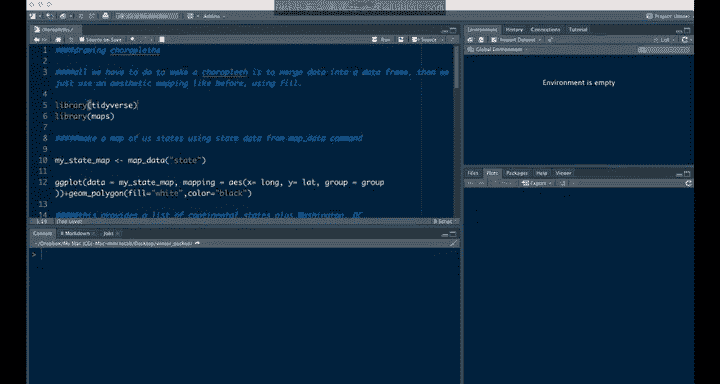

# 038：R语言数据可视化和仪表盘｜Data Visualization & Dashboarding with R
## 课程编号：P38 - 4_等值线图 🗺️



在本节课中，我们将学习如何在地图上添加数据，从而创建等值线图。我们将从制作一个基础的美国州地图开始，然后逐步学习如何将定性和定量数据合并到地图数据中，并使用`ggplot2`进行可视化。


---


上一节我们介绍了如何使用R绘制基础地图。本节中，我们来看看如何向这些地图添加数据，以创建等值线图。

首先，我们需要加载必要的库并创建一个美国各州的空白地图。

```r
# 加载所需库
library(ggplot2)
library(maps)

# 创建美国各州的空白地图数据
states_map <- map_data("state")
```

让我们检查一下这个美国州地图对象。它和我们之前使用的数据结构一样，是一个数据框。

`region`列包含了美国大陆各州以及哥伦比亚特区的列表。现在，为了将数据“绘制”到这张地图上，我们需要向这个数据框添加一些数据。为此，我们需要将一些数据合并到地图数据框中。

以下是合并数据的具体步骤：

1.  **创建示例数据**：为了演示，我们将创建一些与`region`列中每个州对应的假数据。
2.  **合并数据**：使用`left_join`命令将原始地图数据框与我们创建的值合并。
3.  **创建地图**：使用`ggplot`函数，通过设置`fill`美学映射来创建等值线图。

首先，我们创建示例数据。我们将创建一个包含三列的数据框：`region`、`qual_value`（定性值）和`quant_value`（定量值）。

```r
# 创建示例数据
example_data <- data.frame(
  region = unique(states_map$region), # 获取州名列表
  qual_value = sample(letters, size = length(unique(states_map$region)), replace = TRUE), # 定性数据（字母）
  quant_value = runif(length(unique(states_map$region)), min = 0, max = 100) # 定量数据（数字）
)
```

请注意，为了演示目的，我们只使用了美国大陆的49个州（包括哥伦比亚特区），暂时排除了阿拉斯加和夏威夷。你可以将这些字母视为某种类型的定性数据，将数字视为定量数据。

现在，我们可以将原始地图数据框与我们创建的值合并。我们使用`left_join`命令来完成这个操作。

```r
# 合并地图数据与示例数据
merged_map_data <- left_join(states_map, example_data, by = "region")
```

`region`在这里是一个连接列，因此对应的定性和定量值会被附加到匹配相应州的每一行上，并赋值给一个新对象。这里需要指出，在进行此类数据合并时应非常小心，拼写、大小写或空格错误都可能导致合并失败，因此最好手动检查以确保操作正确。

现在，使用我们新补充的地图数据，我们可以调用`ggplot`函数。

这次，我们设置美学映射`aes`中的`fill`参数，并在`geom_polygon`中应用它。

```r
# 使用定性数据创建等值线图
ggplot(data = merged_map_data, aes(x = long, y = lat, group = group, fill = qual_value)) +
  geom_polygon(color = "white") +
  coord_fixed(1.3)
```

这样我们就得到了一个等值线图，用颜色填充了州边界，不同的颜色对应不同的字母值。

因为这只是一个普通的`ggplot`函数，我们可以进行所有过去学过的格式调整，比如更改调色板、添加标题、移除元素、使用主题等等。

```r
# 美化图表
ggplot(data = merged_map_data, aes(x = long, y = lat, group = group, fill = qual_value)) +
  geom_polygon(color = "white") +
  coord_fixed(1.3) +
  scale_fill_brewer(palette = "Set3") + # 更改颜色方案
  labs(title = "美国各州定性数据分布图", fill = "类别") + # 添加标题和图例标题
  theme_minimal() + # 使用简洁主题
  theme(axis.text = element_blank(), # 移除坐标轴文本
        axis.title = element_blank(), # 移除坐标轴标题
        axis.ticks = element_blank()) # 移除坐标轴刻度线
```

我们也可以使用完全相同的方法，将连续的定量数据添加到地图上，并用它来制作等值线图。

```r
# 使用定量数据创建等值线图
ggplot(data = merged_map_data, aes(x = long, y = lat, group = group, fill = quant_value)) +
  geom_polygon(color = "white") +
  coord_fixed(1.3) +
  scale_fill_gradient(low = "blue", high = "red") + # 使用连续颜色梯度
  labs(title = "美国各州定量数据分布图", fill = "数值")
```

同样，你可以进行我们之前见过的所有类型的优化和美化。

---

本节课中我们一起学习了如何创建等值线图。我们从加载库和基础地图数据开始，然后创建了示例数据集并将其与地图数据合并。最后，我们使用`ggplot2`分别用定性和定量数据填充地图，生成了直观的可视化图表，并演示了如何对图表进行进一步的美化和定制。掌握这些步骤是进行空间数据可视化的关键基础。