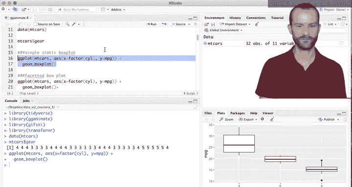

# 041：使用 gganimate 创建动态图表（第一部分）

在本节课中，我们将学习如何将静态的 `ggplot2` 图表转化为生动的动画。动画能够展示数据随单一参数变化的过程，让数据故事更加引人入胜。

---

## 概述：从静态到动态

上一节我们学习了制作多种静态可视化图表。本节中，我们将为工具箱添加一个新技巧：让这些图表动起来。常言道，一图胜千言，而动态图能传达的信息则更多。

一些开发者开发了将 `ggplot2` 可视化转变为动态图像的方法，这基于一个名为 **gganimate** 的包。本质上，`gganimate` 会获取一个 `ggplot` 图形，并通过改变数据中的一个参数，为动画的每一帧创建该图形的多个不同版本。

抽象理解不如实践来得容易，因此我们将快速进入实际操作。

---

## 学习资源与准备工作

学习使用 `gganimate` 制作动画有两个很好的资源：官方文档（网址为 gganimate.com）以及 R Graph Gallery 中关于交互式可视化的部分。本视频的材料正是改编自这些网站的内容。

正如 `gganimate` 文档所示，构建动画可能相当复杂。因此，在本视频中，我将通过讲解文档中的一个示例来引导大家。在后续视频中，我们会更详细地探讨每个步骤。

请跟随本视频相关的 R 代码进行操作，你需要安装几个 R 包。

---

## 实践：创建一个简单的动画

让我们从 `gganimate` 文档中的一个示例开始，制作一个简单的动画。这个动画将为不同气缸数和变速箱档位数的汽车创建燃油效率的箱线图。

首先，我们制作这个图的静态版本，这对我们来说是简单的复习。

我们调用 `ggplot2`，加载 `mtcars` 数据，并设置我们的 X 和 Y 美学映射。在这份数据中，`cyl`（气缸数）是一个数值变量，但我们希望将其视为分类变量，因此我们将其包裹在 `factor()` 函数中。然后，对于 Y 轴美学，我们使用每加仑英里数（`mpg`）来表示燃油效率。通过添加一个箱线图几何对象，我们现在可以看到四缸、六缸和八缸汽车每加仑英里数的分布情况。

正如我们所料，气缸数更多、发动机更大的汽车燃油效率更低。

`mtcars` 数据中还有一个变量是 `gear`（档位数），其值为 3、4 或 5，这表示变速箱中的档位数量。假设我们想知道每加仑英里数如何随发动机气缸数变化，并且要按车辆拥有的变速箱档位数（3、4 或 5档）进行细分。

我们可以使用 `facet_wrap()` 函数来展示这一点，告诉 R 根据汽车的档位数制作单独的图形。同样，这对你来说都是复习。这个静态视图非常有用且完全没问题。

---

## 引入动画：替换分面功能

但假设我们想操作这个图表，使其成为一个会变化的单一图形。我们所做的是用来自 `gganimate` 包的 `transition_states()` 函数替换掉我们的 `facet_wrap()` 函数。我们稍后会讨论更多细节，但使用 `transition_states()`，你可以指定数据中你希望随着动画变化的变量。

我们在这里指定它，并将这个图形保存到一个对象中。如果我们运行这个对象，R 将渲染动画的不同帧。当你运行它时，你会看到动画将在我们在此指定的不同状态之间移动。这提供了与分面图形相同的信息，但只是增加了一点视觉上的趣味。

---

## 下节预告

接下来，我将更详细地讨论控制使用 `gganimate` 制作动画的不同方法以及其他一些细节。请保持你的 R 代码处于打开状态，当你准备好后，请继续观看下一个视频。

---

## 总结

本节课中，我们一起学习了 `gganimate` 包的基本概念，它能够将静态的 `ggplot2` 图形转化为动画。我们通过一个具体的示例，实践了如何使用 `transition_states()` 函数替代 `facet_wrap()` 来创建展示数据状态变化的动态图表，为数据呈现增添了动态维度。