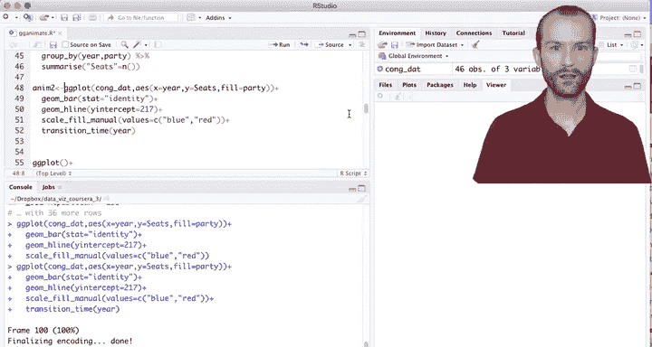

# 042：R语言数据可视化和仪表盘｜Data Visualization & Dashboarding with R
## 课程编号：P42 - `gganimate` 动画过渡详解 🎬

在本节课中，我们将要学习 `gganimate` 包中不同类型的过渡函数，了解如何控制动画在帧与帧之间的切换方式，从而创建更符合数据特性和展示需求的动态图表。

---

### 过渡函数的选择

使用 `gganimate` 制作动画时，核心决策之一是如何在不同动画帧之间进行过渡。不同的过渡函数适用于不同类型的数据和场景。

上一节我们介绍了 `transition_states`，本节中我们来看看其他几种重要的过渡函数。

---

### `transition_states` 回顾

`transition_states` 主要用于**分类变量**。当你的动画需要在不同的分类值之间切换时，这个函数非常有用。

它的一个重要特性是，它会在变量的每个不同值之间**暂停**，从而产生一系列固定的图像。你可以通过函数中的 `transition_length`（过渡时长）和 `state_length`（状态停留时长）参数来控制每个过渡的持续时间以及每个状态停留的时间。

**公式/代码示例**：
```r
animate(plot + transition_states(category_var, 
                                 transition_length = 2,
                                 state_length = 1))
```
修改这些参数值，动画在不同图像间切换的速度和停留时间就会相应改变。

---

### 使用 `transition_time` 处理时间数据

另一个重要的过渡函数是 `transition_time`。这个函数专为**时间序列数据**设计，例如小时、天、月、年等。

使用 `transition_time` 时，你只需指定时间变量，函数会自动为你处理过渡的时序。

以下是 `transition_time` 的一个应用示例。我们使用国会成员的数据，来追踪不同年份民主党与共和党席位的数量变化。

首先，我们准备数据。假设数据中有一个名为 `D` 的列，值为1代表民主党，0代表共和党。为了方便，我们使用 `recode` 创建一个新的分类变量 `party`。

**代码示例**：
```r
# 创建党派分类变量
data <- data %>%
  mutate(party = recode(D, `1` = "Democrat", `0` = "Republican"))

# 按年和党派汇总席位数量
congress_summary <- data %>%
  group_by(year, party) %>%
  summarise(seats = n(), .groups = 'drop')
```

接着，我们创建一个堆叠条形图来展示每年各党派的席位数量，并添加一条代表众议院多数席位门槛（217席）的水平线。

**代码示例**：
```r
library(ggplot2)
library(gganimate)

static_plot <- ggplot(congress_summary, aes(x = year, y = seats, fill = party)) +
  geom_col() +
  geom_hline(yintercept = 217, linetype = "dashed") +
  labs(title = "Party Seats in Congress by Year",
       x = "Year",
       y = "Number of Seats")



# 使用 transition_time 创建动画
animated_plot <- static_plot +
  transition_time(year) +
  labs(subtitle = "Year: {frame_time}")

animate(animated_plot)
```
运行此代码，R会渲染出展示历年席位变化的动画。细心的学习者可能会注意到国会成员总数有轻微波动，这是由于数据中存在议员在任期中途更替的记录所致。

---

### 使用 `transition_layers` 逐层构建图表

`transition_layers` 允许你**逐层构建**一个图表，这里的“层”指的是你添加到 `ggplot` 命令序列中的不同图形函数。

为了说明这一点，我们再次使用国会数据。这次，我们绘制每个议员资历（在国会任职时间）与其在第115届国会期间通过法案数量的散点图。

通常，在其他条件相同的情况下，资历更深的议员生产力可能更高，因此我们预期看到一个正相关关系。

最终的静态图表是一个抖动散点图，共和党议员用红色表示，民主党议员用蓝色表示。同时，我们使用 `geom_smooth` 函数为两党分别绘制了一条最佳拟合线。

**代码示例**：
```r
# 假设数据中包含 `seniority` 和 `bills_passed` 列
scatter_plot <- ggplot() +
  geom_jitter(data = filter(data, party == "Republican"), 
              aes(x = seniority, y = bills_passed), 
              color = "red", alpha = 0.5) +
  geom_jitter(data = filter(data, party == "Democrat"), 
              aes(x = seniority, y = bills_passed), 
              color = "blue", alpha = 0.5) +
  geom_smooth(data = filter(data, party == "Republican"), 
              aes(x = seniority, y = bills_passed), 
              method = "lm", se = FALSE, color = "darkred") +
  geom_smooth(data = filter(data, party == "Democrat"), 
              aes(x = seniority, y = bills_passed), 
              method = "lm", se = FALSE, color = "darkblue") +
  labs(title = "Seniority vs. Productivity in the 115th Congress",
       x = "Seniority (Years in Congress)",
       y = "Number of Bills Passed")

# 使用 transition_layers 创建动画
animated_layers <- scatter_plot +
  transition_layers()

animate(animated_layers)
```
图表显示，在第115届国会中，共和党议员的资历与生产力正相关较强，而民主党议员则不明显。这可能是因为当时共和党是多数党，拥有更强的立法主导权。

在这个例子中，我们没有在初始 `ggplot()` 函数中统一指定美学映射和数据，而是在每一层分别指定。这是因为我们需要为图表中的每一层精确指定所使用的数据。

设置好图表后，使用 `transition_layers` 就很简单了。只需在 `ggplot` 代码序列中加入 `transition_layers()` 函数，渲染时图表就会按照你命令的序列逐层构建起来。该函数的文档中提供了控制每层停留时间和层间过渡时间的选项。

---

### 总结

本节课中我们一起学习了 `gganimate` 包中三种核心的过渡函数：
1.  **`transition_states`**：适用于在**分类变量**的不同状态间切换动画。
2.  **`transition_time`**：专为**时间序列数据**设计，自动处理时间过渡。
3.  **`transition_layers`**：用于**逐层构建**复杂的图表，展示图表的生成过程。

理解这些过渡函数的工作原理，能帮助你根据数据特性选择最合适的动画效果。你可以通过查阅 `gganimate` 官方文档来探索更多可能性。

在下一个视频中，我们将继续探讨对 `gganimate` 动画的更多调整技巧。请保持你的R代码编辑器打开，我们下节课再见。